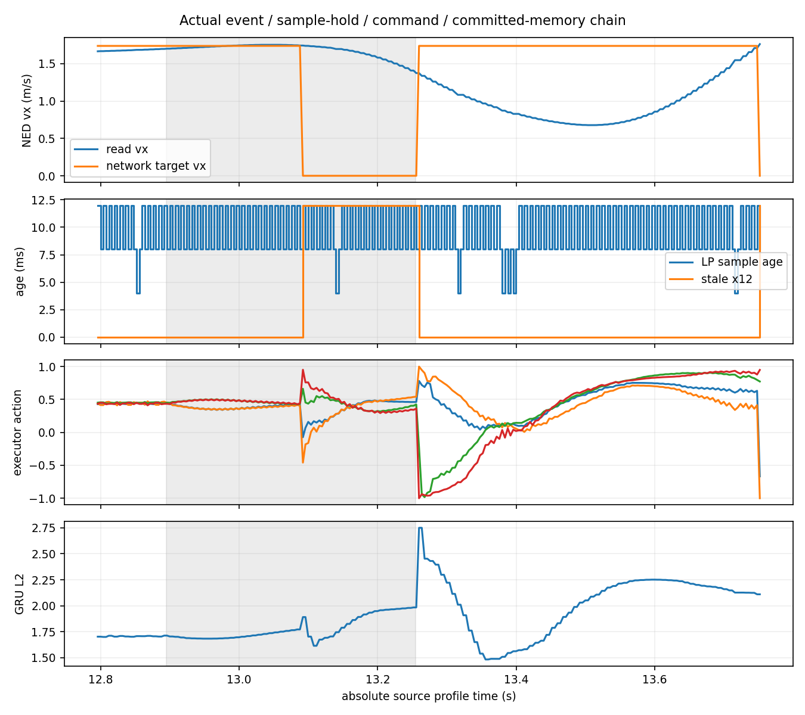
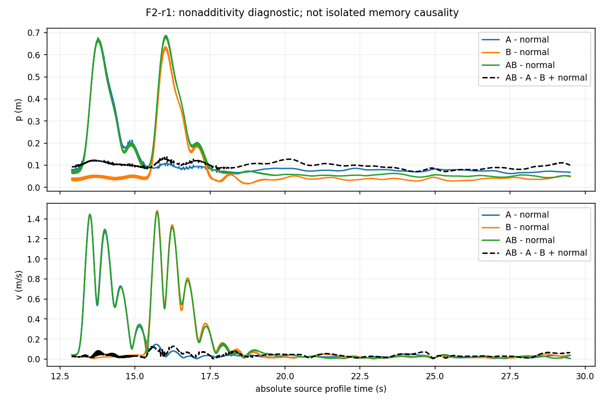
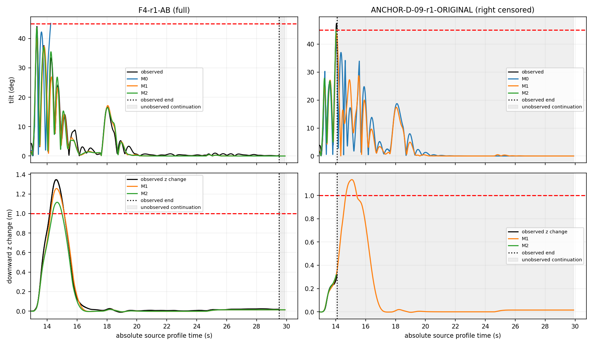
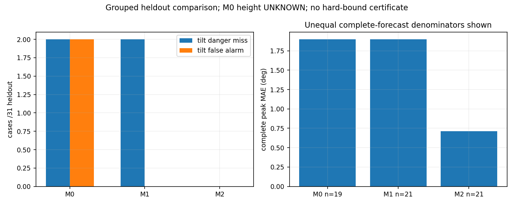

# P11：接入事件、采样保持与神经记忆机制辨识

1. **目前误差的主要来源**：控制器实际读取的多速率保持、事件目标及记忆更新时间必须显式建模。相同固定速度的一步位置诊断中，按4ms推进的平均RMS为3.526mm，使用实际LP更新时间后为0.379mm，约下降89.2%；这不是“A4总误差的89.2%已归因”。实际网络输入重建和连续网络重放达到约1e-6量级，说明这些实现关系可被准确复现。剩余机体/估计器/执行状态与初始化误差仍重要：给定实际命令的开放式动力学重放在2秒及整段明显漂移，不能用闭环反馈预测较好来掩盖。
2. **事件如何作用**：停止发送先造成旧目标保持；严格大于200ms的读取年龄触发捕获，重写位置、速度及yaw目标，保留GRU、previous action和均值历史。网络在4ms调用中产生输出，8ms才提交GRU，中间调用仍更新previous action与后续历史。命令经最新值选择、执行动态与机体运动，再反馈到下次读取和捕获。必须保留世界高度；相对内部捕获目标恢复不代表没有累计损高。
3. **组合与相位**：可控组合证据很有限：只有F2-r1同时满足A/B/AB前状态匹配且AB实际到达第二事件。存在可测非加性，但本轮没有通过全部冻结前状态门限的“单事件任务成功、组合任务失败”证据。F4两次A+B均倾角小于45°而损高超过1m，单事件成功，但完整簇前状态不一致，不能解释成纯组合因果贡献。0/2/6ms发送意图的实际native相位分布重叠，判为不可辨识。原D03三事件、D09四事件失败锚点全部保留，不能由删减后的两事件成功替代。
4. **哪个模型能自主闭环预测**：M0/M1/M2均只从初值、源码任务表、预定事件及封存参数出发，未来日志在文件系统/网络/PID层隔离。M2在31条有效整组留出中，整程失败标签没有观察到倾角或任务危险漏判/误报；21条完整任务峰值误差均值0.714°、最大2.189°。M0、M1各漏判两条D09原四事件的倾角危险，M0另有两次倾角误报且不预测高度。M1虽漏判倾角，却预测了高度任务失败，不能把其任务标签正确解释成失效模式预测正确。但0.5s事件窗内的逐时刻诊断有两条在实际首次越界时仍预测安全（约44.91°/44.80°），预测越界晚约2.0/5.9ms；冻结窗口最大值分类一致不能掩盖这些局部漏判。这些时差还须结合时钟区间，不能宣称精确因果延迟。上述是部分留出的点预测结果，不是未来硬界或准入证书。
5. **哪些结构能支持理论**：源码可核验采样/保持、严格超时守卫、捕获/历史跳变、GRU与限幅、速度捕获的运动学一致性，以及隐藏状态/动作的条件不变域。剩余动态误差接口、有限域内有用增量增益、混合储能和域不变性尚未证明。第70条真实记录出现native hrt平台，拒绝了“所有时钟都严格每步4ms前进”的假设。
6. **下一核心定理与障碍**：应建立覆盖观测缓存/时钟与排队、目标捕获、GRU/动作历史、执行动态及机体/世界高度的混合增量储能定理，沿源码允许的事件模式词组合流动与跳变增益，再用名义绝对安全余量恢复倾角、高度和跟踪约束。关键障碍是包含所有真实记录、具有因果可实现性的动态误差接口及调度/守卫不确定性；当前不能把经验残差变成独立逐步硬球，也不能把本研究降为回放评分或启发式筛选。

**执行结论：正式批次在第70次启动后按冻结新错误规则停止，P11为部分完成，理论边界未建立。** 69条正式结果有效，1条观测验收无效，2条未启动。没有新版续飞、补跑、P12或P10 B/C/D。测试与工程门通过不等于全批合规PASS，更不等于理论通过。

## 版本、预算与冻结

起点本地/远端main均为`1bf072c01c3fd57e939e367bc2407b17b916cd80`。完整阅读了P9最终报告、P10-A3/A4报告、A4证明与机器结论。P6–P10结果、失败、冻结、模型和A4 NOT_PASSED保留。独立观测和72行计划正常提交/推送于`296951b21eabdce5eb43377cd7e930dd06af05b7`，正式之前回读远端并校验273个提交对象字节；见`data/p11-20261025-freeze/{manifest,receipt}.json`。冻结输入未在正式过程中编辑或提交。

| 项目 | 上限/计划 | 实际 |
|---|---:|---:|
| 观测开发SITL启动 | 12 | 11 |
| 正式SITL启动 | 72 | 70 |
| 总启动 | 84 | 81 |
| 正式有效结果 | 72计划 | 69 |
| 正式观测无效 | — | 1：F5-r2-NORMAL，第70次 |
| 未启动 | — | 第71 F6-r2-REPAIR；第72 F4-r2-B |
| 正式原冻结飞行失败/保护截断 | — | 16/16 |
| 正式任务失败 | — | 18，含两条完整损高失败 |

所有失败、中止、无效均计入预算，剩余开发名额未挪用。正式块按固定种子随机化为19/19/17/17，完成前三块及末块14次启动；末块只有13条有效结果。正式模型开发组G15/G20为38条，留出G45/G50/G75/G80为34条计划、32次实际启动、31条有效结果。这里“留出”是新的整组P11飞行；历史场景结果已用于事先设计，不称为历史从未见过的条件。

模型算法/结构、参数域、选择和评价在正式前冻结。38条开发组全部结果（包括失败前缀）拟合后，数值模型在任何留出START之前封存：模型hash`03fb69bbedb5c1896c00b1ab2507718b2ded10547ba3334103c415f6828a262b`，seal hash`f8f775fe6fd7a04df35ca53deff424bae4f303bfd8bd5e2bbe2b0d7d7e7a49f6`。组均衡冻结规则选M2作经验比较，三模型全保留；没有留出后拟合、阈值修改或案例替换。

完整计划见[THOR_P11_PLAN.md](THOR_P11_PLAN.md)，字段、坐标、单位、源码顺序、可选真值限制及Mermaid时序图见[THOR_P11_INTERFACE.md](THOR_P11_INTERFACE.md)。72行身份、hash、种子、分支/配对/状态见`data/p11-20261026-analysis/branch-pair-table.{json,csv}`；81次启动见`startup-ledger.csv`及原始`data/p11-20261025-preparation/attempts.jsonl`。

## 观测门及开发版本

11次开发保留独立目录、candidate、配置与全部失败：dev01旧原生基准；dev02新观测默认关闭；dev03首次sidecar序列化失败，保留截断与修复版本；dev04修复后原三事件完整观测；dev05长T0正常包线保护中止；dev06速度捕获；dev07已有RREC2观测核验（正式未使用RREC修复）；dev08无事件；dev09最终事件mask/相位/hardlink协议；dev10/11末版完整hook关/开对照。

dev03的NumPy float32 JSON异常没有重写为成功。dev05峰值47.20°，原generic result中的`accepted:false/flight_failure:false`是旧wrapper字段，不能据此称无失败；独立measurement明确原判据失败、任务失败和右截断，解释文件与原字段同时保留。正式也使用独立P11字段作为科学结果口径，generic wrapper只作原始工程记录。

开发观测门见`observation-acceptance.json`：8739个完整active控制调用，单步hidden/action容差1e-5，连续递推1e-4，实际最大误差约8.48e-7/1.02e-6；连续递推hidden、previous action及action均值历史，只初始化一次，未逐步注入真实隐藏状态。目标模块T0、RTGT2及RREC2对实际读取输入的离线重建均逐点一致。覆盖完整神经active区间；不包含classic起降，不是仅固定小窗口采样。

末版完整hook关/开周期p99分别48.19/44.77us，覆盖setup至新uORB发布结束，另记录前后复制、发布和runner publish+sidecar成本。单对对照不支持“观测加速”或全称无开销。1164个有效读取全部唯一匹配发送，最大发送至读取延迟区间上端7.924ms；native查询、读取及每次Linux monotonic配对保留区间，不把单个profile起点当成全程严格同步。

容量门按末三次开发最大物理占用85,975,040B，冻结未来每次117,468,800B及2GB保留量，每次正式启动前重检。仅在所有owned进程停止后为新ULog创建硬链接，同时保留原rootfs路径和flight.ulg；没有删除历史或降采样。原保护、网络权重、物理步长均未静默改变。用户会话可修改的进程/线程置于0–3核；三个受保护系统进程未强行修改，记录保留。无ToDesk_Session或并行SITL进入批次。

## 第70条停批：实现问题与时钟机制分别说明

`F5-r2-NORMAL`飞行子进程正常结束，generic wrapper为PASS，原始ULog和完整sidecar保留；但P11观测门没有产生有效报告，因此**不纳入69条有效正式结果，也不参与留出评分或配对**。

| 顺序 | sample_us | native hrt_us | Run host monotonic_ns |
|---|---:|---:|---:|
| 前一行 | 80,336,000 | 80,336,000 | 924530268038562 |
| 随后一行 | 80,340,000 | 80,344,000 | 924530275924301 |
| 再下一行 | 80,344,000 | 80,344,000 | 924530276128948 |
| 后一行 | 80,348,000 | 80,348,000 | 924530279995212 |

真实机制是延迟后追赶：host先约7.886ms，随后约0.205ms，两条采样仍相隔4ms，但native hrt先跳8ms后停滞。接入超时守卫使用native当前时间，网络更新/提交使用采样及native-step标识，这些时钟不能压成一个严格4ms时钟。未来时序模型必须允许排队、平台和守卫年龄的不确定演化；第70条虽未通过正式观测门，仍是真实记录，下一理论不能为方便而把它视为物理不可能。

独立诊断发现8745个active采样无缺失、无非4ms边，连续hidden/action重放仍约7.43e-7/1.03e-6。这说明已知输入和实际更新标识下的网络递推仍可复现，不证明未来目标守卫、相位或闭环调度的名义4ms假设。诊断器实现缺陷是对`Δhost/Δnative`直接除零，产生inf后严格JSON拒绝写出；原traceback、临时输出、STOP、未完成report全保留。没有仅把inf改成null便宣布此条有效，也没有修改冻结工具、删除STOP或用新版继续。

停批后确认所有owned进程已退出，冻结272个输入与模型seal不变。两个pending没有启动。精确阻碍为：正式观测工具`tools/p11/observe.py`在第70条报告序列化失败，冻结新错误停止规则阻止第71/72条自动继续；这是确定的已执行/未执行状态，不是权限拒绝或不确定启动结果。见`stopped-observation-forensics.json`、`formal/diagnosis.json`和checkpoint-09/10。

16条安全截断均为原runner包线异常，原约100ms监测节拍未改变；从首次控制器读取倾角越45°至runner abort约24.5–97.3ms。峰值可能越过45°后才中止，不能把45°当物理不可越过硬墙；未见保护代码异常、身份混淆或native崩溃。该事实也不使全批成为PASS。

## 配对、组合、修复与机制

本平台没有覆盖仿真/EKF/GRU/previous action/接入模块/时钟的完整快照分叉；所有配对均是相同任务/种子/暖机与预事件状态核查。冻结前0.5s最大差门限：p0.10m、v0.15m/s、SO(3)测地角2.5°、action最大分量0.1、hidden L2 0.5。阈值未放宽，未用欧拉角直接相减。

9个完整五臂簇仅3个全部匹配；这些完整簇的36个正常对照中25个匹配。把可用不完整簇逐对也列出后，42个正常对照中30个匹配；11个修复—AB对照中8个匹配。它们共享分支、重复与条件族，不能作为38个独立同分布样本。第70条使F5-r2缺正常基准；末两条使F6-r2缺修复、F4-r2缺B，三个簇不完整，不拼接成完整簇。

F1-r1-A事件前位置差0.127m，已超限；第一个留出块三个完整簇均有分支超限。`mechanisms.json`逐项保留p/v/SO3/action/hidden/previous差异，不能用同种子代替状态一致。`analysis.json`及图中明确列`AB-A-B+NORMAL`和有序相对旋转残差；F2-r1为可用完整匹配示例。其非加性不等于隐藏状态的因果贡献。

两条F4-AB完整任务的倾角44.080°/43.998°，损高1.347/1.304m；原飞行判据成功、任务失败并列。它们的完整五臂前状态门未全通过，所以不能声称已得到严格的单事件安全—组合不安全因果结论。未通过门限的结果仍可作为有初始不确定性的观测。原D09四事件的两次倾角失败被M0/M1漏判，M2识别，显示执行历史候选状态有实际预测作用，但尚非必要状态或普遍因果贡献的证明。

修复仅为已有RTGT2、RTDEC2m/s²、RREC0，且在首次激活也生效。全部11条已执行修复臂任务成功；其中8对满足AB—修复前状态门，4对观察到任务失败变成功。完整F4-r2对照从43.998°/1.304m降至16.344°/0.042m。F3/F5原AB为截断，不能把其短前缀损高/积分成本与修复完整任务直接比较成“修复增加/减少整程代价”；原分项、共同窗口、跟踪计划误差、action总变差及恢复在`mechanisms.json`逐项给出。

在22次已观测正式修复中断捕获中，水平`v_read-v_target`为0；对应T0捕获常约1.8m/s，部分历史下达到3.23m/s。源码写入关系与实际记录一致。RTGT2位置/速度满足同一分段减速轨迹的运动学积分与连续性；resume仍可跳回原绝对计划目标，垂向速度目标仍为0，GRU/动作历史保留，因此修复不是无历史、无高度代价的万能操作。此处的零速度输入误差是局部源码保证，后续安全不是。

离线zero-hidden、zero-history及组合干预改变了相同实际外生输入下的网络输出；报告完整峰值/分位数。它们不是飞行总响应的因果贡献：StateBridge能写h/previous，独立executor均值历史reset没有相同公开操作；反事实的可实现范围逐项标注。




## 预测、已知输入重放和计算成本

M0保留P9增益/A4轻量p/v/q及22槽88ms代理，在4ms上重采样；没有高度/网络记忆模型，不能称为原20ms模型严格等价。M1明确实际Dense/GRU16、previous/均值历史、LP8ms保持、姿态传输、目标状态、p/v/四元数/角速度和命令传输；M2再加4个源码上升12.5ms/下降25ms的期望转速滤波状态。M2状态不是真实测量RPM，初始化假定末命令稳态。两者10个有效动力学系数只用开发组有界最小二乘拟合，网络权重未训练。状态数已明显超过旧6维，尚未证明最小充分状态。

预测入口只接受stream前一次初值与当时记忆/时钟、预先生成的源码任务表、事件计划和封存模型。bubblewrap隐藏data/export、网络及父进程/proc；future实际目标、观测、hidden、触发和终止只在评分端使用。预测名义4/8/20ms时钟，源stream+poststream外加事先声明0.5s终止时序余量；超出实测终点的预测延续在图中灰色标识，不拿未观测尾段判成功。模型不预测classic起降。第70条对恒步长native守卫假设的反例另列，不能因69条经验较好忽略。

| 留出有效31条 | M0 | M1 | M2 |
|---|---:|---:|---:|
| 完整峰值误差可用n | 19 | 21 | 21 |
| 完整峰值MAE/最大，° | 1.897 / 3.567 | 1.898 / 4.672 | 0.714 / 2.189 |
| 位置RMS逐案例均值，m | 0.0872（水平） | 0.0539（3D） | 0.0532（3D） |
| 速度RMS逐案例均值，m/s | 0.1498（水平） | 0.0853（3D） | 0.0835（3D） |
| 倾角危险漏判 / 误报 | 2 / 2 | 2 / 0 | 0 / 0 |
| 任务危险漏判 / 误报 | 高度未知31条 | 0 / 0 | 0 / 0 |
| 预测CPU计算总秒 | 14.49 | 28.65 | 28.46 |

M0的两条误报提前停止预测，所以完整峰值分母19，不能与另两者21直接当成相同样本平均比较。共同19条完整子集的峰值MAE分别为M0 1.897°、M1 1.652°、M2 0.737°。整程倾角UNKNOWN均为0；任务UNKNOWN为M0 31条、M1/M2 0条，不能混成一个unknown计数。全部原分项、事件0.5/2s窗、完整/公共前缀及危险标签见每条`score.json`。16条保护中止的观测峰值是下界，完整峰值误差为null，没有补未观察尾段。M1对D09预测高度失败但漏掉真实倾角危险，失效机制必须分项报告。

冻结留出0.5s窗口最大值标签：M0漏判8/误报2，M1漏判2/误报0，M2漏判0/误报0；2s窗口分别为4/4、4/0、0/0。每种长度47个计划窗口，其中8个NOT_REACHED，不把它们算成功；相关事件窗互相重叠，不是独立样本。另以实际首次倾角越45°时刻作事后逐时刻审计，M2在F5-r1-B和D09-r1第二事件仍预测44.908°/44.805°，对应实际45.132°/45.365°，预测首次采样越界晚2.008/5.901ms。原冻结峰值窗口评分未修改，新增诊断不用于重新选模型；它直接限制任何“无危险漏判”的泛化或时序准入说法。

隔离检查和69次成功预测只验证当前打包器/入口实现的文件可见性与数值流程，不是任意程序绝对不可泄漏的证明。

已知实际输入评价与上述自主演化分开。69条网络/目标工程重放通过冻结容差。位置保持诊断给出3.526mm→0.379mm，但剩余误差非零。估计器与held Gazebo真值是不同采样年龄，不能把两者差直接叫瞬时估计误差；姿态几何代理q与held净水平加速度差的逐案例RMS均值约1.925m/s²，也包含时序差异，不能等同推力因果贡献。真值角速度topic为欧拉角差分，不冒充body omega；真实RPM未取得。

另做固定实际命令、单次初始化/固定短窗初始化的动力学重放：M1/M2在0.5s窗口的平均速度RMS约0.102/0.060m/s、SO3约4.35/2.41°；2s窗口位置RMS约0.94/1.14m，SO3约22.0/28.4°；长开放式重放明显漂移并可离开有效域，不能验收为整段准确动力学模型。这包含初始物理状态由延迟读样近似、命令/估计器相位和简化动力学的不确定性，不能仅归因为某个遗漏项。原输出与脚本保留，没有为了使长重放好看而重新注入真实状态。闭环反馈可以抑制这些误差，恰说明下一理论须论证闭环耦合储能，而非把小一步残差直接累加成通用球。




## 可检查的下一理论接口

| 对象 | 当前判断 | 下一步必须核验 |
|---|---|---|
| 采样/保持与事件模式 | 源码及日志核验；单一hrt恒4ms已被70反例拒绝 | 排队/平台/读取年龄区间形成的允许模式词，未来调度硬界 |
| 捕获、hidden、previous/均值历史更新 | 源码映射及完整已知输入重放核验 | 同模式及异步守卫下的成对跳变增益与初始不确定性 |
| 权重局部增量关系 | GRU凸更新的hidden立方域、限幅动作/均值域可数学核验 | 有用加权增益与闭环域不变性；不能用样本替代全域 |
| 剩余动态误差 | 执行滤波、估计器/角动态为候选，仅数据支持 | 因果有状态误差接口、扰动来源与限定域硬界，容纳真实70记录 |
| 增量储能状态 | 当前需要物理/绝对高度、缓存/时钟、目标/捕获、h/动作历史及执行动态 | 状态削减是否保持可实现历史及事件组合关系 |
| 从增量恢复绝对安全 | SO3三角关系、世界高度/跟踪输出映射可数学写出 | 名义安全余量及全前缀鲁棒误差证书 |

对hidden在[-1,1]^16的条件域，权重导出的保守∞增量上界约12.900；128个开发点有限差分Jh谱范数约1.188–1.438。前者不是有用收缩证书，后者也不证明全域；它们不排除另一个加权的完整闭环储能。不能把相关性或拟合矩阵直接升格为确定性全称约束。

源码有真实可用的局部约束：只有读取年龄严格>200ms才进入stale捕获；读取先于守卫，恢复消息可改变可达模式词；捕获目标和机体状态相关，h/历史不自动清空；RTGT2立即清除水平速度输入误差并沿连续减速参考演化。给定调度/读取不确定区间可据此枚举允许事件词，而不是任意独立目标跳变。但本轮没有证明一般调度硬界或整程安全间隔，所以这些不能冒称修复准入。

建议核心定理使用扩展状态z上的分模式储能：流动满足`V(k+1)≤a(mode,phase)V(k)+动态误差状态项`，事件满足相关捕获映射的`V+≤J(event,phase,state-domain)V-+事件项`；误差本身按因果动态状态演化，不任意独立选择每步全状态球。沿允许的事件词/不确定间隔组合这些量，并在每个前缀以名义倾角+SO3距离、名义世界高度±Δz、名义跟踪误差+Δp/Δr恢复绝对约束，才能产生真实事件序列限制或修复准入。

本轮**没有证明A4具体球反例被新接口排除**，也没有证明候选误差接口包含未来全部真实记录；因此A4 NOT_PASSED原样保留。后续若排除某个反例，必须展示该轨迹违反哪条源码/可实现动态约束，同时保留所有真实记录，包括第70条时钟追赶，不能用选择性域排除掩盖。

## 数据、历史保留、测试与复现

原始大日志均留在既有本地存储，未入Git。`raw-data-manifest.json`登记81次运行、727个原始文件路径/大小/设备inode/硬链接/hash，所有flight.ulg与metadata hash一致。Git提交小证据、同步NPZ、模型、预测及分项；同步/预测是派生数据，原始ULog、Gazebo motor trace、telemetry/resources、完整发送sidecar保持本地。`history-final-audit.json`原始审计与`history-raw-locality-resolution.json`同时保留：24份P8 portable元数据本来不含ULog，经原LOCAL_RAW_DATA.md定位外部目录后全部匹配；不能把首次路径假设错误写成历史数据被删。

历史61,491个登记文件未缺失，唯一声明修改为ResearchTiming.msg观测字段追加；本次允许更改的运行/注入工具另在代码diff中。P6–P10的1,345个已登记原ULog hash逐一复核一致，旧结果、异常、冻结及模型未回写。未跟踪AGENTS.md与旧P9 attempts.lock保留且未纳入提交。

交付前针对P11及P0–P9相关回归121项通过；全套收集209项时206通过，3项历史P10冻结源码检查拒绝新P11源码（A3 source snapshot、A4 source dependency、P10 review SOURCE_CHANGED_REQUIRES_NEW_REVIEW）。未削弱这些检查，也不称全套通过。原生构建和最终源码注入两次幂等检查通过，新增hook/P7 recovery片段各只出现一次。日志见`tests-delivery.log`、`tests-final-freeze.log`、`idempotence-before-freeze.log`和构建日志。

三个代表案例（完整训练、完整高度失败留出、截断四事件留出）独立隔离重算，9个模型trace数组含NaN逐元素完全一致，复现PASS仅指这些数值轨迹，不是理论或全批PASS。评分运行时间字段允许变化。复现目录`data/p11-20261026-reproduction`，原模型seal不变。

```bash
# 仅离线；这些命令不启动SITL，输出必须使用新的目录
uav_lab/.local/venv/bin/python tools/p11/observe.py \
  data/p11-20261025-formal/F4-r1-AB/run --output /tmp/p11-new-observe
uav_lab/.local/venv/bin/python tools/p11/state.py \
  /tmp/p11-new-observe/synchronized.npz \
  --config data/p11-20261025-formal/F4-r1-AB/run/config.json --output /tmp/p11-new-target
uav_lab/.local/venv/bin/python tools/p11/isolated.py \
  --packed data/p11-20261025-formal/F4-r1-AB/packed \
  --models data/p11-20261025-formal/models --output /tmp/p11-new-prediction
uav_lab/.local/venv/bin/python tools/p11/score.py \
  --predictions /tmp/p11-new-prediction \
  --packed data/p11-20261025-formal/F4-r1-AB/packed \
  --measurement data/p11-20261025-formal/F4-r1-AB/measured/measurement.json \
  --output /tmp/p11-new-score
```

全69条重评分/缺失预测可用`tools/p11/analyze.py --predict-missing --output <全新目录>`，不会生成缺失飞行。机制、固定命令重放、图、原始hash、历史审计和复现脚本均保留在`data/p11-20261025-preparation/`，对应输出在`data/p11-20261026-analysis/`。机器结论见`conclusion.json`，区分观测开发门、正式STOP/缺失、经验预测和理论未建立。

冻结提交已正常推送并核对远端；交付另正常commit/push，最终SHA在交付回执与对话中回读。GitHub连接器对冻结提交返回status/workflow空记录，CLI未登录，仓库无workflow定义；这是“未观察到CI记录”，不是CI通过。最终提交也按实际查询结果记录，不把本地121项测试当CI。
