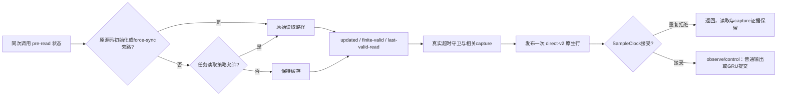

# P12b 初始化、双时钟与执行求解接口

本接口对应准备阶段实际运行版本direct-v2，正式未放行。原P12、P12b v1失败均保留；不能用本版本字段回填旧记录。

## 真实读取契约

实现见`tools/apply_p12b.py`、`research/state/ResearchP12b.msg`、`research/state/P12bTrace.hpp`，审计见`tools/p12b/{contract,audit,read_trace}.py`。同一次mc_raptor调用在读取决策前记录：executor timing initialized、force-sync initialized/value、实际index和时序标记、gate applicable/permit/pending、activation、sample修复门及native/sample/wall时间；读取后记录实际updated与源码相同finite表达式的valid结果。审计使用同sample且pre-read wall落在该调用Run/read区间内的唯一行，不使用last-GRU或后状态来猜初始化。

初始化旁路合法性来自pre-read initialized/force-sync条件，不是“忽略首行”。inactive shadow已带时间标记不等于本次executor已初始化；force-sync标记和值也分别核查。正常任务期严格检查PH1/PH2读取关系，实际capture相位是机制结果。两种读取策略的处理效应包含缓存与交付影响，不能改称纯capture相位移动。

`sample`为控制样本us；`native hrt`保留其平台、跳进和追赶；executor时间标记保留原ns单位；host monotonic ns记录调用及消息区间。任务epoch由真实运行事件绑定。状态包含p/v、姿态/角速度、绝对高度、LP/姿态缓存及年龄、外部保持目标/捕获/减速参考、hidden、previous action、mean/count、滤波状态、待消费/已消费命令以及提交index/队列。捕获与机体状态相关；输出调用与GRU提交不同，不能统一成恒定4ms映射。mean/count、previous与hidden的前后顺序保持原源码，既有连续重放逐项核查。

## 原生流与ULog必须分开

v1准备2的ULog出现59组重复/缺失关联，触发STOP_CRITICAL/NOT_PASSED。后续取证发现一次遗留被动发布块没有随finite检查更新移除，实际源码每次调用有**两次ULog publish**；这不是已证明的logger丢包问题。

direct-v2每次调用恰写一次packed原生行，magic/version/sequence/prior_write_failures和全部声明标量字段受审计；O_EXCL新文件，写失败与缺行不可静默忽略。五条开启记录通过逐调用关联、完整性及普通阶段读取审计。准备3为8745条active同次调用，其中1条真实初始化旁路、8744条正常调用。冗余ULog仍是NONCANONICAL/NOT_PASSED_UNIQUENESS；direct PASS不升级ULog，也不升级v1准备2。

剥离两个**完整**观测块后控制cpp与旧源码SHA均为`75f5ffbfc24e9a27d19586da77f2ffc03ed37d8ed3f7abee1ed8d0e042e89cea`。初次不完整剥离的FAIL和所有中间文件保留。当前被测cpp为`112453b892b444e5d5c58699308e719edcdead85cfdf30bf1c00e29f4f17a0b8`。这证明声明观测插入之外的源码一致，不证明运行时延/缓存及整程行为相同。

`preparation-v2/cleanup-candidate-NOT_VALIDATED/`仅有未应用、未编译、未飞的单发布清理候选，不进入已测试构建。预算耗尽后未通过删除发布块、重建或新增启动来绕过验收。

旧第27项仅有后状态和旧时间标记，缺真实pre-read字段，最多支持“initialized=false或force-sync=0的原旁路可能性”，不能从中选择一个原因。任务期1198次有效读取满足原中间调用策略，不撤销旧冻结FAIL。详见`preparation/legacy-contract-review.json`。

## 执行连接及数值状态

真实自动派发是DART **JointConstraint SERVO**，此前阅读ServoMotorConstraint不足以证明实际派发。JointConstraint先处理位置/速度限制，再处理servo及force界。观察库仅在本任务Gazebo进程LD_PRELOAD，原函数原参数调用一次，不改求解/物理状态。记录World物理步和pre/post时间、约束类型/次序/维数、free/post速度、命令/desired、dt/CFM、force/velocity/position limits、求解前原始完整A/b/lo/hi/findex和求解后lambda。保留接触/其他耦合行，不能只截四个rotor对角元。原矩阵在求解器排列修改前复制，n=1特例及dPAD stride经真实World单元核查。

观测量与重建量：

| 量 | 身份及范围 |
|---|---|
| command、free/post速度、模式/限幅、dt/CFM、A/b/lambda | 直接hook安装库接口，保留World步编号、约束次序和方向 |
| eta=A_original lambda−b_original | 独立矩阵残差，不使用e_j反算 |
| D=A_ii/(1+c) | 按已核验源码CFM对角关系重建 |
| e_j(next) | 直接post速度乘slowdown并按转向归一后减filter命令 |
| 机体未来加速度、积分缺陷、EKF/缓存传播域 | 未认证，不能由小观测残差替代 |

在声明servo模式及行方向下：

`e_j(next)=slowdown·[eta−c D lambda+(desired−command)]`。

原简式只在desired=command的域内成立。饱和模式eta含LCP slack，不能全叫浮点误差；其他约束模式需对应行关系，不自动沿用servo式。全系统Aλ−b混合平动/转动单位，不能当统一rad/s范数。飞行servo行force/velocity limits为无穷，position约±1e16，无command clipping；因此无穷force limit不产生有限未来lambda上界。

五条canonical direct-v2开启飞行共118941个World系统、475744个servo核查行，独立速度等式最大残差约7.53e−15 rad/s。准备2另有95524行诊断，不能并入五条有效读取契约飞行分母。真实World单元包含2个interior/20个饱和行，数值连接通过，off/on物理输出逐位一致；这不足以证明完整PX4/EKF闭环运行无影响。

因果host顺序连接：最近已完成motor end早于getInfo；下一motor消费晚于World post。GZ motor sim_us=World pre_us+4000，是接口阶段偏移。准备3和7的filter-after→joint-command、World-post→下一PreUpdate joint、实际有符号速度→thrust连接误差为零。free velocity与PreUpdate已读joint在所查两条记录中可差约.00945 rad/s，不能混为同一时刻状态。命令/滤波设定/实际关节速度分别命名，不混称真实RPM。

## 真实运行版本

普通文件副本清单位于`preparation/runtime-snapshot.json`及`preparation-v2/runtime-snapshot.json`，实际大文件在git-ignored `data/p12b-20261026-runtime-local/`。包含PX4、research motor plugin、DART/GZ物理插件、solver库、观察库、policy及构建配置。

- v2 PX4：`cc314acb408cfa7ab92e8910f9ce6cba873cdad378c73d169009172ed587ec60`
- solver observer：`184ca45286d315d3da1a3650e23e461319ada5d4d1c567cee9731bd5d84f6b7e`
- 原权重tar：`5327c83dc57f094ca1977a2533ebce318645be010e16b9354c96c337cd5c278b`

Ubuntu 6.13.2 headers与OSRF 6.13.2运行库版本分别记录；未声称由该源码重建认证发行二进制。v1早期工具源码归档及实际Lab diff/untracked的独立重建hash对应被测candidate，不能以清理后的源码替代。旧CLI符号链接不是历史二进制快照。
