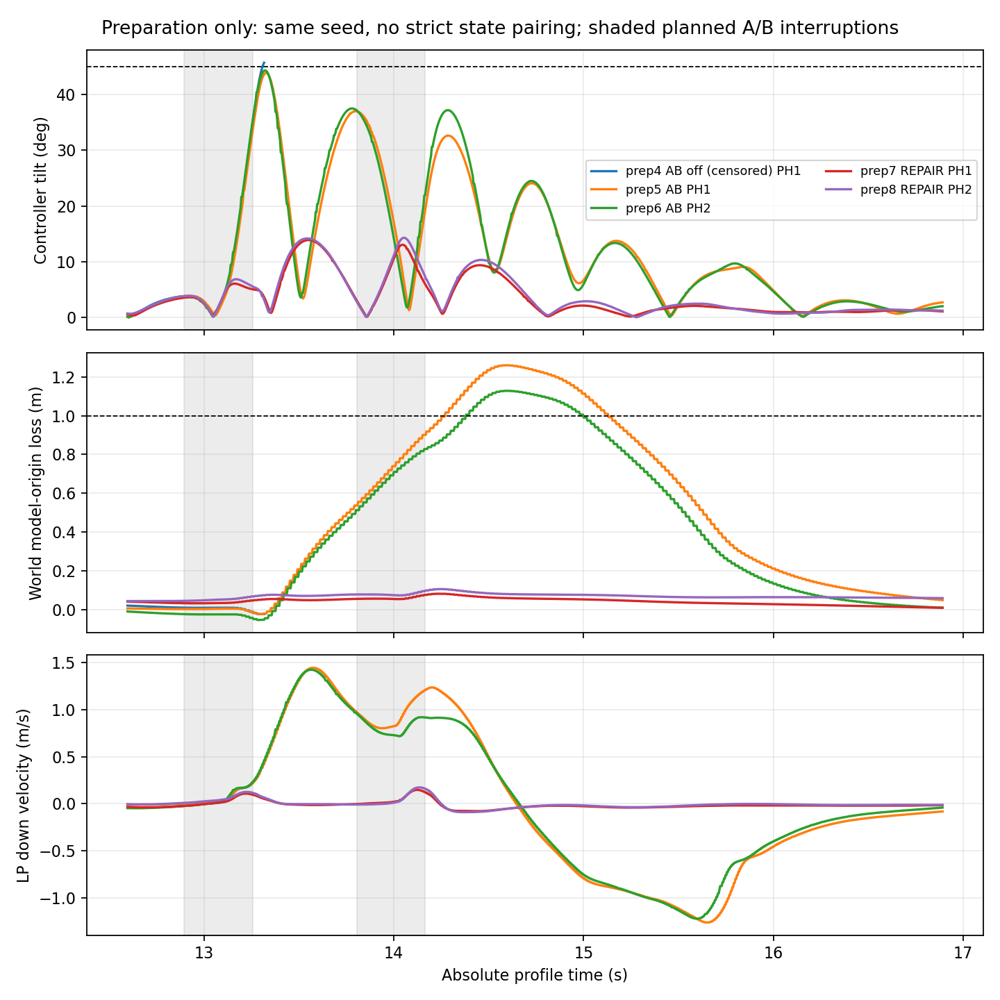

# P12b：部分完成交付，正式未放行

**本轮准备8/8，正式0/45；旧P12累计48保持，合计56次。工程验收NOT_PASSED，未冻结正式批次。** 全部45项保留NOT_STARTED，未替换旧断连或第27项。理论未闭合不是本次停正式的理由。

1. **F4组合失败没有取得新的跨块正式复现。** 两条开启观测的AB准备运行均完成且高度失败，另一条关闭观测的AB在A后安全中止、B未到达。新两个随机块未启动；准备没有新A/B单独臂，不能据此证明“单事件稳定安全、组合失败”。旧F4块的证据和单A仅约.019m余量仍保留，不能称稳健安全。
2. **B前未恢复量已取证。** 两条新AB准备记录B前世界损高.537/.513m、向下速度.937/.986m/s，伴随神经/动作/filter偏离及约.735/.762m水平跟踪误差。世界当前余量约.463/.487m，历史损高没有在capture/resume重置。旧块AB对B单独的独立离线表也保留了初态/cache差异，不能直接解释成纯因果贡献。
3. **修复在两读取策略的准备记录中均改善，但不是跨块正式验证。** 倾角约16.06/16.87°，LP主判据损高.0435/.0625m；整个实际capture保持段无水平位置/速度裁剪。B前世界损高.056/.079m、向下速度.022/.016m/s。主要区别出现在相关速度捕获、保持段及A后残余状态；接回、后段和共同窗口代价均保留，未只比较瞬间输入。四条为同种子、顺序准备运行，无严格同初态或随机块因果结论。
4. **执行连接从缺失接口推进到真实数值核查。** 真实派发为JointConstraint SERVO；直接取得完整LCP A/b、lambda、free/post速度、模式/limits/CFM，独立重建eta而不从e_j反算。五条有效direct-v2记录475744个servo行的连接最大残差约7.53e−15 rad/s。有限数值残差不构成未来硬界，无穷force limit仍不能给有限未来冲量界。
5. **形成了可计算的完整片段条件约束。** 组合保留L、历史最大D、向下速度和历史状态，覆盖保持、接回与恢复；给出B前余量条件、从执行/推力/姿态域到高度的充分式及不重置高度的精确有理数反例。示例全段filter下界916.901rad/s代数上低于1000上限，但未来闭环域未认证，不能当实际安全证书或已证明修复参数范围。
6. **最具体理论缺口仍是未来求解/机体/cache连接域。** 需要在真实约束耦合与切换下建立可达lambda/eta及积分/EKF/cache误差界，才能把条件事件映射闭合。工程上还需消除重复ULog发布并取得足够的同版本开关非干扰证据；本轮准备预算已尽，没有自动追加启动。A4维持NOT_PROVEN_EXCLUDED。

## 为什么没有正式开跑

原`preparation-v2/acceptance.json`保留**FAIL**：同版本F4 off/on整程LP损高差1.285145m超过事前.2m效应尺度。但off在A后因倾角安全中止，on完成全任务，两个完整峰值不具相同覆盖范围。独立`acceptance-scope-review.json`及`delivery/reviewed/common-prefix-review-v2.json`修正比较适用范围为**UNKNOWN_CENSORED_VS_COMPLETE**，没有放宽门槛、改主标签或升级放行。

严格截至实际安全中止的共同窗[12.895,13.316969]s，两侧各106条controller-cache记录，倾角峰值45.665/43.581°，LP损高.04361/.04007m。这些数与整段ULog姿态主峰值、上一个含停止后控制尾部的共同窗数分开；原表与原FAIL不覆盖。共同前缀接近不能单独消除一方安全早停的关键行为差异。

同版本PX4/插件一致；剥离**全部两个**声明观测块后控制源码与旧版本逐字一致，真实World单元off/on输出逐位一致，开启后cycle p99约49–55μs低于2500μs，sample/host速率接近1。然而这些不构成完整机体/EKF/cache/调度快照，也不能充分排除观测时序对边界行为的影响。off/on事件前已有p/v/h/动作/filter和缓存阶段差异：最大位置L2 .0346m、速度L2 .0395m/s、SO3 .378°、hidden L2 .0911、filter L2 12.14rad/s；125点中LP样本offset不同59点、姿态120点，count/commit均0差异。原始差异未删、未只平移计数后宣布一致。

本轮观察实现还留下冗余ULog双发布，v1准备2已据此停止；direct-v2虽然逐调用唯一，冗余ULog仍非canonical。清理源码候选未应用/未飞，不能用它替代已测版本。**工程放行NOT_PASSED，正式冻结NOT_CREATED；停止执行原定45次，不再消耗或转移预算。** 精确状态、输入hash和全部未启动身份见`data/p12b-20261026-preparation-v2/formal-stop.json`及`freeze-status.json`。没有权限拒绝或终态不确定项。

## 实际启动账本与观察范围

| 次数 | 条件/读取/分支 | 原飞行结果 | 任务结果 | 覆盖与审计 |
|---|---|---|---|---|
| 1 | F2 PH2 NORMAL off | SUCCESS | SUCCESS | 原始基线，新增pre-read关闭 |
| 2 | F2 PH2 NORMAL on v1 | SUCCESS | SUCCESS | 读取观测STOP_CRITICAL/NOT_PASSED，不升级 |
| 3 | F2 PH2 NORMAL on direct-v2 | SUCCESS | SUCCESS | canonical审计PASS |
| 4 | F4 PH1 AB off direct-v2 | FAILURE | FAILURE | A后安全中止，B/任务终点NOT_REACHED |
| 5 | F4 PH1 AB on direct-v2 | SUCCESS | FAILURE | 完整；43.841°、LP损高1.33296m |
| 6 | F4 PH2 AB on direct-v2 | SUCCESS | FAILURE | 完整；44.284°、LP损高1.24177m |
| 7 | F4 PH1 REPAIR on direct-v2 | SUCCESS | SUCCESS | 完整；16.062°、LP损高.04350m |
| 8 | F4 PH2 REPAIR on direct-v2 | SUCCESS | SUCCESS | 完整；16.875°、LP损高.06254m |

失败、中止和v1审计无效均计预算。两套账本聚合8次，没有重置；五条canonical开启记录不是整个工程通过。v1两条与v2六条分版，不拼作一个整体验收。旧P12的25有效/1断连无效/1审计拒绝/21未启动及原九开发、十二准备全保留。P11第70条及两pending不补跑/回写。

所有准备实际种子1334270311。Gazebo真实Rand::Seed setter已由被动hook核对；新块5/6种子1334275356/1334276365仅做实际RNG setter单元对照，**没有飞行**。PH1/PH2不是独立随机块。原21来源与新24分别保留、旧协议不拼接。事前45草案的顺序/配置及分块分析规范仍在，未生成成功冻结回执。

## 历史偏离、高度及修复

图中灰区为计划停流窗，不是事后按实际capture筛组。高度为truth命名model origin的H=−z，速度另标LP；世界位置callback有限差分速度不是直接物理twist。LP冻结主任务判据与世界高度诊断并列，原阈值/参照点不变。

| 准备记录 | B前世界损高m | 历史最大损高m | B前向下速度m/s | 水平跟踪误差m |
|---|---:|---:|---:|---:|
| AB PH1 | .53722 | .53722 | .93700 | .73536 |
| AB PH2 | .51323 | .51323 | .98562 | .76182 |
| REPAIR PH1 | .05623 | .05623 | .02190 | .18560 |
| REPAIR PH2 | .07898 | .07898 | .01570 | .16194 |

AB保持段速度输入裁剪在全部40/42行发生，A最大约1.39m/s、B约2.5–2.58m/s；REPAIR两次A/B全保持段水平速度最大约.121/.096及.036/.033m/s，无裁剪。实际capture至resume约.156–.180s，不能把某个.16s例子当全部覆盖。接回时机体/目标差、hidden/previous/mean/count、filter/joint/消费命令、缓存年龄/真实pre-read/GRU阶段均在每条事件表，缺pre-read的旧/关闭流明确null，不补造。

完整任务及共同[A开始,29.395]s分别计算；两组AB/R均完整，才可比较完整积分。共同窗实际joint平方积分PH1为39.574/39.127百万rad²/s，PH2为39.606/39.134百万；绝对推力冲量约338.30/334.48及338.57/334.54 N·s。共同窗命令总变化修复较低，但task0起完整窗口的总变化修复反而更大（约67.8/70.8千rad/s对59.7/63.5千）；不能笼统说所有执行代价都下降。这些只是机械代理量，不是电能。

旧块2 AB与B单独的B前世界损高差PH1 .60783m、PH2 .56620m；向下速度差约1.17955/1.01405m/s，hidden L2差PH1约1.793。单独B当时接近原高度，而AB已经消耗余量。初态与缓存不严格匹配保留，完整四条事件表与协变量在`delivery/historical-B-before/`，这是已见历史关联，不是本轮正式新复现。旧F2不普遍放大结论保持，本轮仅有F2 NORMAL准备，不能重新声称验证了F2组合差异。

## 初始化、求解与工程状态

详见[接口与源码连接](THOR_P12B_INTERFACE.md)。真实pre-read契约、直接有限值读取、activation/任务门、SampleClock之前capture/拒绝顺序已实现；初次activation、inactive shadow、force-sync、首有效/无效/重复消息、重复sample/捕获、平台/追赶均有真实源码或直接提取的测试。没有把每种离线模式都说成已在新飞行中诱发。旧第27项缺字段的推断限制与原FAIL均保留。

执行接口实际取得完整约束系统，直接求解后速度与独立Aλ−b对应；5条canonical开启飞行共118941个系统、475744个servo行。接触/其他耦合行也保存。没有通过eta由e_j反算而循环自证。单位、约束次序、原始未排列矩阵、stride、符号、command clipping、饱和及World步编号在独立solver审计中核查。真实飞行未发生有限force饱和，不代表该模式未来不存在；单元覆盖有限限幅和饱和。

实际机体、target/read/timeout/executor/保护源码在剥离完整声明观测后相同；原网络和保护未改。观测开关有真实开销/缓存不确定性，不能由上述源码一致推断整程不干扰。容量本轮始终足够，末次普通用户可用约104.2GB；无删除或降采样。

## 预测、漏判与UNKNOWN

保持M3/M4及既有M2/消融，不新增候选或调参；实际filter初态来自已完成物理步。预测使用事前计划与初始数据，未来真实轨迹只在评分/受控诊断端使用。五条canonical开启准备飞行各七个输出，**不是35个独立飞行样本，也不是正式留出**。

评分v2规则保持：有效前缀见证可FAIL，完整且无失败才SUCCESS，其余UNKNOWN；倾角、高度、任务OR单列，窗口与整程各有分母。五条准备中M3/M4三个标签各5/5一致，但M4全时刻倾角最大误差可达9.758°，不能从分类或峰值误差.155–.908°泛化危险边界可靠性。single_clock在本五条分类同样一致，不证明时钟不重要。no_history/no_filter/uncorrelated_capture各漏两条高度失败，M2有两条高度误报；均为离线模型变化，不是飞行因果干预。

例如PH1 AB实际controller LP高度首越界区间[14.180056,14.184027]s，M4预测[14.334010,14.338010]s；PH2约[14.224053,14.228027]对[14.297996,14.301996]。倾角在这两条完整准备记录未跨45°。逐前缀误差数组、整程与.5/2s事件窗分类、各自分母及UNKNOWN均在`delivery/prefix-and-costs/`和`delivery/reviewed/prediction-*.json`，分类吻合不能掩盖越界时刻偏差。

旧F4 PH1 AB倾角漏判保持：M4 44.22524°，实际完整topic 46.06506°，高度/taskOR一致不能掩盖倾角DANGER_MISS。控制缓存首跨区间[13.303996,13.308018]s，早于B。A capture预测/实测同sample，B相差−8ms，所以B时序偏差不能解释最早漏判。

`delivery/old-miss-diagnostic-v2/`用相同物理PreUpdate阶段filter-before与实际joint对照；先前draft混用filter-after与旧joint的相位错误及结果原样归档、加erratum。修正后该两种执行流在共同有效前缀内的受控plant倾角差约3.1e−10°；已知输入神经/target/filter重放通过。但自由经验plant在2.672s、A之前就出原经验域，巨大后尾仅为诊断失效、不能当物理预测。单步实际状态重置p95倾角误差.0165°、最大1.166°也含缓存/采样误差，不能宣称定位为纯求解或纯EKF原因。受控重放没有混入自主成绩。

## 理论、复现和测试

[理论推导](THOR_P12B_THEORY.md)给出有条件可组合的全片段高度/历史映射、执行到推力的符号和几何前提、B前约束与精确反例。物理g=9.8、原预测g=9.80665分别记录；truth model-origin至COM有.241869m偏移，几何预算不能漏。最早未闭合执行边是未来eta/lambda/模式域，其后机体积分/EKF/cache域也缺。没有用经验最大值封定理，没有排除A4，没有得到覆盖实际记录的完整安全证书或修复参数区间。

[复现说明](THOR_P12B_REPRODUCE.md)列离线命令、真实版本hash、原始目录与测试。旧13项报告/冻结/账本SHA全部一致；v1/v2真实运行文件普通副本hash复验通过。旧CLI symlink不是二进制快照。原始ULog/solver/direct/bin、telemetry及完整预测NPZ保留本地且按既定规则不入Git；原始与派生hash、硬链接inode/去重容量在`delivery/reviewed/raw-and-derived-local-manifest.json`，新增前缀数组另由交付总清单覆盖。所有失败/不完整剥离/旧诊断均保留。

独立新目录复现一条完整准备记录的七个模型数组逐项一致，评分v2除计算耗时完全一致，新增SITL=0。本地全项目测试**248通过、7失败**：四项旧P10原生oracle stub未包含后续P12成员，三项旧冻结source hash拒绝新runner；未修改旧断言以制造通过。首次根目录pytest误收集历史data测试的import失败、一次指定不存在测试文件的命令错误也保留；正确测试目录结果与最终针对P12/P12c/P12b/评分的49/49通过（含新增高度前缀/不可撤销失败、组合残余速度和禁止误放行回归）分开。工程放行仍NOT_PASSED，与测试PASS不是同一状态。

最终发布正常commit/push并回读远端，发布SHA/CI查询结果见交付后本地publication回执与最终答复；空CI列表不能称CI通过。本轮未启动正式、未启动P13或额外批次。剩余动作不是等待一般性批准，而是在新授权预算中先验证观测清理和非干扰；本交付不自动执行它们。
