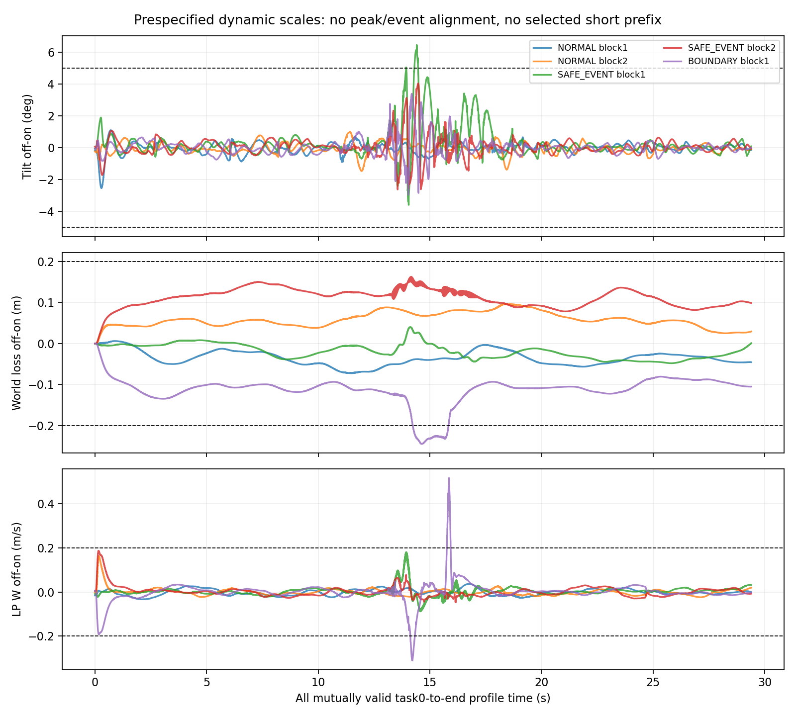
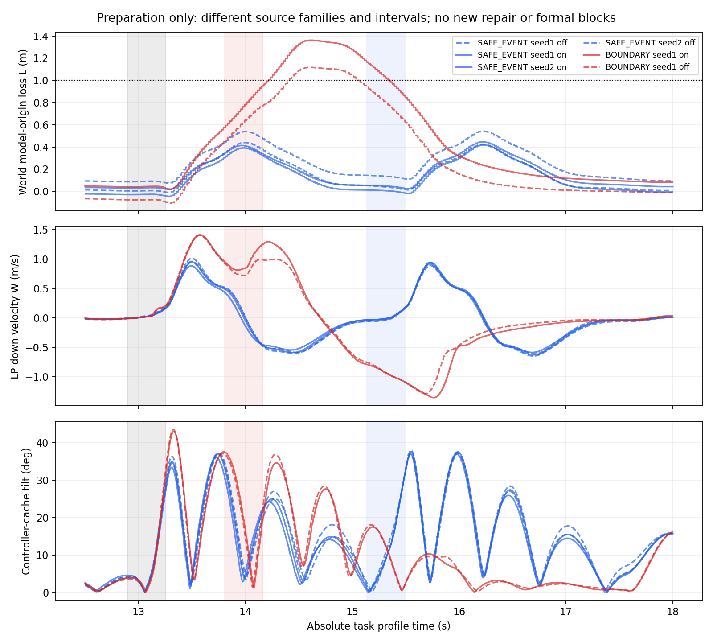

# P12c 部分交付：平台已清理，工程未放行正式

**准备10次启动、10次完整完成；正式0/24、有效正式0。旧P12/P12b共56次保持，P12系列累计66次。** 剩余2次准备和24次正式均未启动，未转预算、未替换，旧45项仍未启动。完整理论尚缺不是停正式的原因。

1. **观测平台没有通过声明范围的整体验收。** 一次direct/零重复ULog、重型关闭、源码/构建/幂等及适用字段重放已通过；但SAFE_EVENT块1全有效前缀倾角差6.469902°超过事前5°，BOUNDARY块1损高/垂速差也超过.2尺度。另有一组初态SO3略超事前域。不能把分类相同、源码一致、低p99或不显著当等价，也不能直接断言这些差异由观测造成。
2. **正式没有启动。** 10条准备运行证据完整，其中5条light-on有实际pre-read canonical，5条off仅共同基础记录、ready新增字段UNOBSERVED；它们不构成整体工程PASS。10条原飞行判据均SUCCESS；固定任务判据8成功、2条F4高度失败，无截断/丢失/无效SITL。服务最后的锁拒绝发生在下一START之前，不计作新飞行。
3. **B前残余下降的条件差异有新准备证据，未获得新F4跨块正式复核。** F2在A接回至B约1.875s，B前W已为负、当前世界损高约.012–.144m，历史D仍.391–.538m；F4同一准备seed两臂在约.541–.545s间隔后仍向下约.940–.949m/s，世界损高.446–.574m。任务方向/事件间隔共同不同，不能纯归因于间隔或神经记忆。新块7/8未飞，没有本轮单A/B比较。
4. **本轮没有新修复飞行，不能声称新跨块修复改善。** 旧P12b已见证据仍支持速度相关capture、全hold裁剪减少及较小B前残余，但完整任务命令总变差可能增加；旧结果/代价不回写。新24项REPAIR均未启动。本轮完整保留接回、后段与所有机械代理，未称电能。
5. **取得了有用途的有限执行/高度关系。** 源惯量推导四SERVO实数矩阵及显式逆，得全子域增量小增益和条件冲量界；不是采样Jacobian或经验最大值。另给全前缀L/D/W组合、B前余量、恢复时间/停止损高条件、含hold/resume的修复前提。条件实数关系不等于实际未来全域证明。
6. **最具体缺口仍有明确接口。** 真正COM初始W和测量延迟不能由当前native回调戳/差分vz给硬区间；执行算子还缺未来ΔA/η浮点预算，随后是机体/估计器/cache域不变性。全部目标记录逐前缀检查后，真实有限域成员资格从起点起仍UNKNOWN。A4未证明排除。

## 实际实施与预算停止

基线远端为`7e54974e1129ae0c8ebca99a75950aef66cf9f62`，开工无遗留仿真进程。离线先归档旧实际cpp/hpp及工具，清理两个ULog发布和冗余publisher，只留一次pre-read原生写入。反向置回后控制源码逐字相同，编译/两次注入幂等通过；实际PX4/插件/权重/配置保存普通文件副本。没有在准备过程中加新重型日志或重建仿真器。

首飞前固定`noninterference-spec.json`、12项顺序/seed、原5°/.2m尺度、初态域、异常/停止规则及516项seal。正常、较安全真实捕获/接回任务、F4边界各计划两seed块off/on随机顺序。正式只计划新F4块7/8共24，不执行旧45。M3/M4及既有基线/消融零拟合、零新候选。

在完成前两类后，固定动态门已出现不可恢复的超限；识别时第10项已开始，因此保留其正常终态，通过既有attempts.lock在案例之间阻止第11项。最终10 START/10 FINISH/零STOP_CRITICAL，2准备未启动。源码/运行文件在10次期间无漂移，没有中断、补跑或结果替换。

服务报`BlockingIOError`是主动在下一项claim前占用串行锁的结果，证据见`queue-stop-receipt.json`。所有所属PX4/Agent/Gazebo随后核验已结束。原seal保持；停止后仅为driver增加防误续跑guard，实际用过的driver普通副本、新旧SHA和补丁独立留存，二进制/观测/预测未变，不混入已运行版本。

`formal-stop.json`列全部2+24未启动身份/配置hash；`freeze-status.json`为NOT_CREATED_ENGINEERING_NOT_RELEASED，没有伪造成功冻结回执。未创建P13、未补P11/P12/P12b，旧冻结/失败/剩余45状态不变。

## 三门分别判定

| 门 | 结果 | 主要证据 |
|---|---|---|
| 硬性语义 | 已完成记录的声明范围PASS | 同候选；on唯一pre-read/实际源分支；零research_p12b ULog/零solver重型文件；原控制/history/target/filter重放、sample完整、消费/保护门通过；off不声称ready可观测 |
| 动态影响 | NOT_EQUIVALENT_WITHIN_FIXED_SCALES | SAFE_EVENT块1倾角6.470°>5°；BOUNDARY块1世界L差.244987m、LP L差.223158m、W差.515613m/s超过.2尺度 |
| 证据充分性 | INSUFFICIENT | SAFE_EVENT块2预事件SO3=1.001894°略超1°；未舍入/放宽；边界块2与正式未启动；有限重复不支持总体等价 |
| 理论 | CONDITIONAL / NOT_PROVEN | 单列，未作为实验停止门 |

全部共同前缀是task0至双方完整29.395s，不挑短窗、不对齐峰值/capture、不按实际相位或存活筛样本。所有10条都完整，因此本次没有截断/完整混比；旧P12b的混比FAIL及独立范围修订照原样保留。

SAFE_EVENT块1最大倾角差发生在14.411993s，A接回恢复后、B之前：off/on约17.348/10.878°；对应att cache年龄8/0ms、LP年龄12/4ms。held Gazebo姿态同刻差约5.514°，全前缀最大5.811°，所以不是只看峰值标签的现象，但这些truth也异步且初态/cache不同，不能唯一定位开关因果。两臂整程峰值仅37.385/37.058°且都成功，峰值接近不足以证明时程等价。

自然重复分别报告，不用来扩容差：SAFE_EVENT off/off最大倾角差4.030°、on/on 3.411°；正常任务off/off垂速差也约.2016m/s。小样本、不同seed及未完全恢复状态限制辨识能力，没有事后回归或时移救放行。

原sealed accept工具可能空timing列表误过。独立v2/v3从既定规范补齐：完整事件必须同时有capture及实际fresh-valid resume，缺见证失败，NOT_REACHED/截断另记。6条事件运行共12事件全部见证齐全、原.024s时序尺度通过；正常任务0计划事件不冒充缺失。旧工具/原seal/结果保留，没有制造额外启动。

## L、D、W与事件后过程

| 条件与臂 | B前世界L m | 历史D m | callback向下W m/s | LP向下W m/s |
|---|---:|---:|---:|---:|
| F2 seed1 off | .05283 | .43917 | −.03823 | −.06083 |
| F2 seed1 on | .05417 | .41290 | −.02118 | −.03466 |
| F2 seed2 on | .01226 | .39081 | −.01635 | −.03272 |
| F2 seed2 off | .14424 | .53791 | −.02659 | −.05292 |
| F4 seed1 on | .57368 | .57368 | .94928 | .97002 |
| F4 seed1 off | .44562 | .44562 | .93958 | .94866 |

F2在A接回后的首个非向下LP采样约13.964–14.008s，B计划15.135s；这只是速度符号见证，不是全状态/历史的持续恢复。F4在B计划13.805s前没有该见证。恢复高度不会清掉历史D；所有事件表从同一task起点累计，不在capture/resume重置。

每条交付A前/capture/resume、B前/capture/resume、后段恢复/终点，包含p/v/R/omega/跟踪、h/previous/mean/count、filter/joint、已消费与最新桥命令、年龄/读取/提交阶段。world H=−z、LP及COM分开。callback差分W不称物理twist，附回调时间区间/裁剪分母及UNKNOWN原始物理pose时刻；保留COM高度**和速度**几何项。完整transport/正在消费快照不足的地方明确未知。

完整任务与共同事件窗口均报告命令TV、joint平方积分、推力冲量、任务/active-reference跟踪及原最终capture恢复。它们是机械代理，不是电能。SAFE_EVENT seed1完整任务TV off/on约80.889/70.302千rad/s，seed2约71.134/70.642千；F4约77.061/61.300千。没有把这些非随机因果对照说成修复节能；本轮无新修复飞行。原最终静止capture的SETTLED不等于A至B移动过程已全恢复。

## 预测时间过程与旧漏判

10条准备×7模型是70组相关模型输出，独立飞行分母10，正式留出0。M3/M4整程倾角/高度/task标签各10/10一致；但本轮真实倾角均<45°，**没有验证危险倾角漏判率**。M4逐时倾角最大误差可达14.370°，而峰值误差约.298–1.407°，分类/峰值不能掩盖时程偏差。逐前缀完整数组、B前L/W/h/action误差、首跨区间、.5/2s事件窗及各自UNKNOWN/完整性分母保留，不把模型或重叠窗口当独立飞行。

F4 on的controller-cache LP首跨区间[14.192357,14.196400]s，M4预测[14.241990,14.245990]s；off约[14.248090,14.252059]对[14.242051,14.246051]。原完整topic/原baseline的源时间首跨另列，避免与控制缓存混用；都只是离散采样区间，非连续精确越界时刻。

旧F4 PH1 AB仍为M4倾角44.225°对实际46.065°的DANGER_MISS，task OR一致不能掩盖它。旧未来实际执行输入驱动的自由plant在2.672063s、A之前就到45.219°并越出停止包络；不是已证明精度域退出。新M4数值完整且不触发同包络仍有14°时程误差，包络内也不代表精度覆盖。

新的受控高度余额诊断把物理步推力对齐至目标IMU/sample时刻，分别替换实际未来姿态、初始callback/LP W及近似link阻力。旧F4同一实际未来推力/姿态下，加入源阻力重建项后，全后段最大高度差约1.081m降至.0453m；A前约.131m降至.00434m。重建仍使用未来callback速度和cached gyro、原始pose物理时刻未知、积分/阻力近似未认证；它定位垂向耦合遗漏，**不是自主预测改进、新模型或飞行因果干预**。原host阶段近似版本及离线错误/修正版全部保留。

## 理论适用性与交付状态

[理论](THOR_P12C_THEORY.md)给出源质量结构的全子域矩阵逆/增量、有限冲量条件界、推力/阻力增量、全片段L/D/W组合、恢复储备与全hold/resume条件。74,689旧servo子集矩阵吻合只验证连接，不能宣称整个失败轨迹已覆盖。

`domain-membership-v2/all-records.json`逐前缀检查16条实际完整目标记录和全部未启动项：观测投影未见候选界越出，但真实物理COM速度、连续H/R/约束、未来ΔA/η及域不变性不足，**每条真实域成员资格从起点起UNKNOWN**。不是仅检查有利servo步，也没有删除不利失败来凑域。

[接口](THOR_P12C_INTERFACE.md)与[复现说明](THOR_P12C_REPRODUCE.md)列canonical、三层开关、运行快照、原始hash和命令。旧历史SHA、原始日志、失败/旧候选保留。原始ULog/bin/NPZ与实际二进制按既有规则留Thor，不盲目入Git、不删/不降采样。

本地：初始专项41通过、继承契约12通过；全项目255通过/8失败（旧P10 stub4、冻结runner hash3、旧P12b要求已移除ULog publish的断言1，均保留）；最终专项/离线补充27通过。独立新目录七模型数组及scorev2（除compute_s）完全复现。首次嵌套sandbox bwrap NETLINK失败在预测前，失败目录保留，宿主只读重试保持未来日志隔离且无SITL。

正常commit/push与远端回读的最终SHA/CI见发布本地回执和最终答复；空CI结果不是通过。停止是工程规范决定，无权限拒绝、无实验终态不确定。未创建正式冻结、未自动追加预算或P13。
