# P12准备续轮：执行链与单事件闭环接口

本续轮保留旧P12的滤波/捕获子定理；不把记录残差当未来界。运行版本的真实二进制、研究插件、物理插件、DART插件和权重副本在本机 `data/p12-cont-20261026-runtime-local/`，小型manifest在preparation。旧CLI链接不是历史二进制快照。上游源码归档与实际安装版本号相符，尚未将发行版二进制从该源码重建，因此源码推导与二进制验证有明确边界。

```mermaid
flowchart LR
 C[桥接latest命令] -->|mutex取最新/保持; min上限| U[本物理步已消费u]
 U -->|源码精确分段滤波| F[f_after]
 F -->|direction/slowdown| J[JointVelocityCmd]
 J -->|Physics UpdatePhysics| S[DART SERVO command]
 S -->|动力学/约束LCP; 条件关系| V[求解后joint velocity]
 V -->|UpdateSim回写; 下一PreUpdate读取| W[scaled joint w]
 W -->|源码代数关系| T[推力及drag/rolling力矩]
 T -->|整机约束/惯量/姿态| B[真实机体]
 B -->|传感/估计/缓存与保持| O[控制器读取]
 O -->|相关捕获/网络/history| C
```

源码核验：研究motor plugin的PreUpdate先选择命令、读取JointVelocity，使用 `w=slowdown*joint` 计算 `T=d sign(w) k w²`，施加旋翼局部轴推力、空气阻力及parent显式反扭矩/rolling moment；随后更新filter，写 `JointVelocityCmd=d*f_after/slowdown`。显式parent torque不含全部臂长×推力，不是总机体力矩。命令运输是latest-value，多个控制输出可以只有最后一个被物理步消费。

[gz-sim8.14 Physics](https://github.com/gazebosim/gz-sim/blob/gz-sim8_8.14.0/src/systems/physics/Physics.cc) 的Update顺序为UpdatePhysics→Step→UpdateSim；JointVelocityCmd在UpdatePhysics传给SetVelocityCommand，求解后UpdateSim以GetVelocity回写JointVelocity。因motor是PreUpdate而physics是Update，同一物理步filter-after不能代替该步推力使用的filter-before/actual joint。

[gz-physics7.8 DART接口](https://github.com/gazebosim/gz-physics/blob/gz-physics7_7.8.0/dartsim/src/JointFeatures.cc)对有限速度命令设置SERVO并setCommand，**不是直接setVelocity赋值**。[DART6.13.2 World::step](https://github.com/dartsim/dart/blob/v6.13.2/dart/simulation/World.cpp)先前向动力学/积分自由速度，再解约束、施加冲量并积分位置。因此实际关节误差具有求解器/约束来源，不能把约9e-8观测差当成测量噪声后抹掉。

## 可计算的求解器条件关系

[DART ServoMotorConstraint](https://github.com/dartsim/dart/blob/v6.13.2/dart/constraint/ServoMotorConstraint.cpp)的等式右端是command−free velocity，冲量上下界为关节force-limit×dt；对角项按CFM `c=1e-9` 乘以1+c。设完整约束系统物理速度响应矩阵为A，D为servo行对应的对角，lambda为包含其他耦合约束的冲量。若servo行激活、未饱和且求解等式残差eta满足

`(A+cD)lambda = b+eta`,

则同一行求解后速度−命令为 `eta-c D lambda`。乘slowdown s后，下步残差

`e_j(next)=s*(eta-c D lambda)`。

成对（同s,c）关系为

`E_delta_ej <= s*(E_delta_eta + c*E_delta(D lambda))`，
`E_w(next) <= E_f(after)+E_delta_ej`。

这是给定约束模式/冲量域/求解残差域的代数条件界，非本轮已验证的全称DART误差证书。若有 `|eta|<=eta_max, |D lambda|<=L`，可用 `E_delta_ej<=2s(eta_max+cL)`；再接 `E_T<=2k Omega E_w`。force/velocity限幅、接触及其他约束切换必须另分模式。当前日志未直接给lambda、自由速度和等式残差，也未证明未来域上L/eta_max，故该边仍为**条件关系已推导、实际未来覆盖缺失**，没有用观察最大值封口。

## 完整单事件片段及最早缺口

从共同启动不确定集到首次停流：缓存/GRU/history/执行初值均保留实际差异。停流后目标保持、native严格age>200ms触发；相关capture的delta(p-r)=0，水平delta(v-s)=(1-alpha)delta v，h/previous/mean不跳变。alpha1只在预定实验捕获启用，首次激活T0。连续减速参考全段满足 `E_r(t)<=E_p_capture+t E_v_capture`、`E_s<=E_v_capture`。接回时保持绝对任务时间，目标跳回原任务轨迹，神经及执行状态继续；绝对高度损失不在capture或resume清零。末段含减速到静止、停止发送的终端捕获及5秒poststream恢复。

滤波分支切换界可逐步与网络/history关系组合，但首次向真实机体传播时仍缺上述未来求解残差/冲量域，随后还缺整机/估计缓存闭环误差域；保守网络绝对矩阵在4调用达到动作差2是界过宽，不是实际反例，也不是实验停止条件。完整反馈储能、A4误差球排除仍NOT_PROVEN。

针对性正式实验将保持全部处理分支、真实初始协变量和完整接回后段：单事件对正常检验停流—捕获—接回的响应；AB与A/B检验历史组合；capture-only修复检验输入跳变消除能否改善完整任务；两种分配的真实读取门检验阶段/缓存关系。它们可缩小测试边界及确定需要证明的执行/估计域，不能从有限残差最大值升级为未来硬界。

续轮异常保留：第7次修复在任务前sample47740000已发生mode2，旧`nonactivation&&external_seen`协议存在实际反例。末版新增sample门：先0禁用，实际提交epoch+固定首事件时间决定未来门限；之后仍走原strict timeout/capture。M4只增加该逻辑，不重拟合机体系数。第10次执行环境断连后runner消失、已登记子进程继续，恢复时已核实归属并结束，所有约14GiB原始记录保留，不计作有效飞行或补跑。
