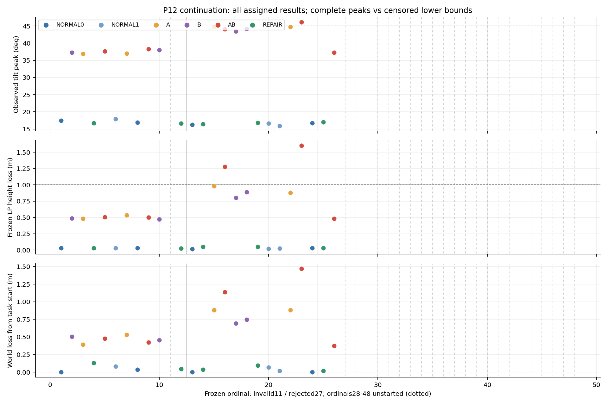
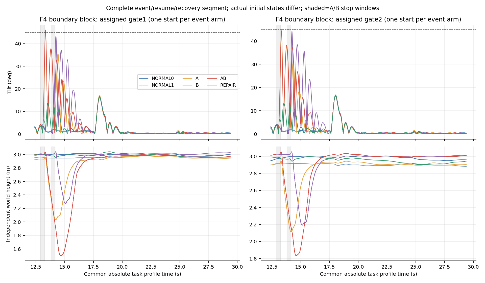

# P12准备续轮与正式部分完成报告

本报告对应2026-10-26的独立续轮。正式实验冻结并推送于 **68dfb73b26695a630f9fdb2c4534af3797a284a3**；模型参数、随机顺序、阈值和运行代码此后未变。最终状态为 **STOPPED_AT_NEW_FROZEN_AUDIT_ERROR_NO_BYPASS**。原P12九次开发、原停止结论及评分修订、P11第70条无效与两条pending全部保持。没有启动P13、原P10 B/C/D或替换案例。

## 六个直接回答

1. **准备解决了什么？** 拆开实验可比性与理论适用性；完成同分支重复性、固定共同任务坐标/native提交epoch、真实读取门、直接执行状态和评分v2验收。没有完整快照，采用事前分块随机设计并保留缓存/初态差异。第7次准备发现非首次activation仍可能在任务前启用修复，原结果保留；新增sample时间门抑制所有臂的预事件修复，实际修复只在计划捕获后生效。另保存真实二进制、插件、权重及配置的普通文件副本。
2. **正式是否启动、完成多少？** 新准备12/12次；正式27/48次启动，其中25次有效完成、1次基础设施中断无效、1次冻结审计拒绝。剩余21项未启动且停批。加原9次，P12累计48/69次；此次39/60次。失败/无效均计数，无转用或重跑。
3. **组合、相位和修复证据？** 在一个F4边界块的两个分配读取门下，A和B各自任务成功，AB均损高失败，修复均任务成功；这提供带实际初始差异的受控机制证据。F2没有普遍组合峰值放大。真实读取/捕获类别分离，但不是严格同初态证明，也没有完成跨种子重复。五个可用的预定AB—修复对照均改善峰值、损高和共同窗跟踪；它们来自三个块，不是五个独立重复块。
4. **哪些闭环增量关系成立？** 同源捕获跳变、完整减速参考段非扩张界、异步捕获界、允许分支切换的执行滤波界，以及附条件的整个保持段修复参数区间。SERVO求解器连接有条件等式，尚无完整后段反馈储能。不是风险评分器，也不把这些子系统关系升级为整飞行证书。
5. **最具体理论缺口？** `w=d f+e_j`中的未来成对关节残差界；条件SERVO式还缺允许未来域上的求解残差与冲量界，随后需闭合机体/EKF/cache/队列。约9e-8观测残差不是未来硬界。A4仍 **NOT_PROVEN_EXCLUDED**。
6. **对测试和修复有何用？** 已能检查实际事件顺序、发现修复前状态混杂、定位高度累积失败、从给定加速度/cache域反推保持时长和减速度约束，并量化模型缺项。现有预测有倾角危险漏判，不能作为安全准入；完整后段及跨平台推广仍未证明。

## 账本、冻结和停止原因

[冻结计划](THOR_P12_CONT_PLAN.md)、[准备报告](THOR_P12_CONT_PREPARATION.md)、[准备验收](../data/p12-cont-20261026-preparation/acceptance.json)、[冻结回执](../data/p12-cont-20261026-freeze/receipt.json)记录放行依据。冻结manifest SHA256为`c843a053a1bc0af39ab324431eeafb8e4ea7ef3cf89afc39956a94bea4f35a68`，模型seal为`744a09e9c464f22c937d27e83041e60e4a1fa53346a26e0f4d52f558d33dc59f`。先提交、推送、回读远端，再启动正式。

| 阶段 | 启动 | 终态与范围 |
|---|---:|---|
| 原P12开发 | 9 | 全保留，原正式0的结论不回写 |
| 新准备 | 12 | 11条飞行闭合（10完整、1安全截断）+1基础设施无效；旧修复协议结果独立保留 |
| 正式块1 | 12 | 11有效+第11项基础设施无效 |
| 正式块2 | 12 | 12有效，包含科学失败结果 |
| 正式块3 | 3 | REPAIR、AB有效；第27项审计拒绝后停批 |
| 正式剩余 | 0/21 | NOT_STARTED，不记成飞后NOT_REACHED，不补跑 |

完整逐项身份、hash和终态见[启动/排除账本](../data/p12-cont-20261026-delivery-v2/startup-exclusion-ledger.json)及原始`preparation/attempts.jsonl`。准备10和正式11均为断连后runner结束、其子进程遗留；恢复时逐一核实PID/创建时间/命令，只结束所属进程，确认身份不变后继续未启动项。两个已启动身份都未重试。持久user-service仅保护既定冻结队列，没有变更任务或随机顺序。

第27项`b3-ph2-NORMAL1`的普通飞行wrapper退出0，通用检查、执行/目标诊断通过；冻结native审计中仅`read_phase`失败。唯一例外在active第0行：sample/native=48348000us，index0→1，gate permit=1且actual_commit=1；inactive shadow的last-GRU已为48340000us。**不能把last-GRU非零当作executor时序已初始化。** 任务期1198次有效读取中提交读取为0，符合PH2。

源码交付门明确保留未初始化/force-sync未就绪时的原读取路径，冻结审计却检查所有active读取、未编码初始化豁免；pre-read readiness又未直接记录。见[取证](../data/p12-cont-20261026-poststop-diagnostic/native-audit-forensics.json)及[初始化契约单元](../data/p12-cont-20261026-poststop-diagnostic/phase-startup-test-result.json)。这是新的关键工具/接口契约缺口，故原FAIL和拒绝状态保持，**没有删首行、修审计后续飞或另版混批**。剩余21项停止原因已明确，非权限拒绝、非终态不确定，也非理论证书未完成。最终无遗留SITL进程。

## 共同启动、可比性与识别范围

共同NED[0,0,-3]、yaw96°及真实native提交回执定义任务epoch；等待上限2s、回执年龄30ms，在准备验证前固定。不重置hidden/history，不把同种子当同状态。完整Gazebo/EKF/执行/队列/时钟快照不可得。

原dev08与新同分支repeat01/02在事件前.5s内p差≤.0403m、v≤.0754m/s、SO(3)≤.781°；count/commit/stale相同，LP/姿态缓存阶段不同。F4准备03/04相同分支峰值44.882/45.160°、损高1.499/1.485m。第二条短暂越45°未被原约100ms监控采样捕获，离线主结果按实际记录判FAIL；保护代码未改，不能称45°硬障壁。正式三个完整NORMAL重复对的倾角差.417–.782°、损高差.00158–.00574m。

离散一致性、连续诊断容差和最小有意义效果分开冻结。连续诊断p .1m、v .15m/s、姿态2.5°、h L2 .5、previous/mean分量.1、filter分量30rad/s不用于挑掉正式结果。最小效果倾角5°、损高.2m、跟踪.2m来源于历史安全/任务尺度，见`effect-scale-provenance.json`，早于新准备及留出；不按本轮修复结果反推。

四块内按固定随机表分配两种读取门×六臂（含重复NORMAL）。估计对象是**分配读取策略的总效应，包含预事件缓存/交付影响**，不是只移动capture一瞬间。实际相位、存活到B和结果没有用于事后挑配对。初态/缓存差异完整列于`initial-covariates.json`、`prestate-diagnostics.json`和`final-supplement.json`；严格配对0，理论集合成员资格未证明。

实际只得到三个完整六臂组：F2块1/PH1、F4块2/PH1及PH2。F2/PH2缺NORMAL1、块3仅修复/AB可用；不补NORMAL、不把不完整块拼成完整组。原计划F2三块重复未完成，不报告n=3的t区间，不汇总两个家族为一个总体推断。

## 组合、非加性、高度与修复

以下为完整任务测量；单元为倾角°/冻结LP损高m。

| 条件/分配门 | NORMAL0/1 | A | B | AB | AB+REPAIR |
|---|---|---|---|---|---|
| F2 块1 PH1 | 17.412/.0315；17.897/.0298 | 37.000/.5331 | 37.244/.4861 | 37.610/.5071 | 16.666/.0258 |
| F4 块2 PH1 | 16.704/.0284；15.923/.0268 | 44.811/.9809 | 43.446/.8033 | **46.065/1.6044** | 16.465/.0481 |
| F4 块2 PH2 | 16.243/.0171；16.660/.0229 | 44.707/.8786 | 44.165/.8916 | **44.068/1.2796** | 16.786/.0512 |

25条有效正式记录：原主判据24成功/1失败；任务判据23成功/2失败；安全截断0。F4 PH1的A距离1m任务边界仅.0191m，新准备A也有失败，因此“单事件成功、AB失败”限于本块，不宣称稳定单事件安全域。所有有效记录所计划的事件均达到并确认接回；删除事件为NOT_PLANNED。末段保持与持续恢复观察未删除。

独立世界高度按GZBridge的NED真值 **H=−z** 计算，任务起点高度不在capture重置。F4 AB两门的世界损高分别1.4710/1.1396m，修复.0356/.0942m；高度失败并非只由LP口径产生。LP与世界值不能混用；原点/估计偏差及采样年龄另记，真值速度也是回调差分而非直接twist。

五个可用预定REPAIR−AB对照：倾角改善20.30–29.60°，LP损高改善.450–1.556m，超过事前5°/.2m效果尺度；并非严格同初态或五块独立重复。F4两门共同绝对窗（首A至原任务终点）的跟踪平方积分从3.6536/2.4360降至.1042/.0966 m²s。完整任务0至终点的跟踪平方积分，F4两门分别从3.7256/2.4905降至.1661/.1413 m²s；另列`final-supplement.json`，不与事件窗混分母。恢复SETTLED的时间指**满足连续2s条件区间的起点**，不能把单点或相位意图称达成。

非加性在共同绝对时间用有序SO(3)关系及AB−A−B+N位置计算。F2完整组位置残差峰值.0932m、姿态8.34–9.13°；F4两门位置.4773/.4433m、姿态约31.9/34.9°。但标量峰值交互项为负，不能称峰值超加性：F2 AB不比单事件显著更险，F4主要是高度累积/恢复不足。存在真实初态和缓存差异，残差不是已剔除初值影响的确定性因果量。详见`randomized-groups.json`与`available-predeclared-contrasts.json`。



## 真实相位、双时钟与完整片段

[状态机/时序图](THOR_P12_CONT_INTERFACE.md)将输出调用、GRU提交、观测更新/保持、strict timeout、capture/resume、重复sample拒绝、命令选择/消费和初始化分别建模，不统一成恒4ms映射。native读取门与intermediate读取门可识别；通常capture分别在上次提交后4ms中间调用/8ms提交调用。捕获的同源p/v关系、history更新顺序和物理消费host括号保留，不把括号重叠猜作确定先后。

28次计划事件捕获均达到；五条修复共10次计划捕获均实际mode2、水平速度输入误差0，预事件门检查通过。新增门解决修复起始混杂，未给出整段机体安全证明。NORMAL末段停流等非计划捕获也完整保存。

本轮25条有效正式记录未出现native平台，sample/native偏移为0；single-clock消融数值相同，不说明时钟无关。P11第70条与旧P12平台记录仍在模型/离线诊断范围内：原70实际guard差异为0；另构造合法时钟词可提前一个调用，二者明确区分。受控追赶装置未验收而取消，48名额原已分配给核心设计；未执行/未回答追赶强度因果问题，不能继承读取门PASS。

## 执行链及理论适用性

[执行源码连接图](THOR_P12_CONT_EXECUTION.md)、[理论推导](THOR_P12_CONT_THEORY.md)、[独立适用性规范](THOR_P12_CONT_APPLICABILITY.md)给出逐边状态。真实路径是latest已消费命令→直接filter状态→joint command→DART SERVO/求解器→下一次实际JointVelocity→旋翼力/显式parent力矩→机体→估计/cache。力在filter更新前由当前joint读取计算；joint command不是直接setVelocity。parent显式力矩不是整机总wrench。

25条有效正式记录共2,382,480个电机物理步，直接初始filter/joint均0。单步与连续filter重放、状态连接及推力公式逐项通过；连续filter重放最大误差4.55e-13 rad/s、带转向符号关节残差最大8.9e-08 rad/s（仅经验量）；`scaled_joint−d*filter_before`逐项另列`final-supplement.json`。已读发行版源码与实际插件版本相符，但不称发行二进制已由该源码重新构建认证。实际运行副本/源码核查是两种证据。

已成立关系（各自前提见理论文档）：

- 同源捕获：位置相对误差跳变为0；水平速度差为(1−alpha)倍同源速度差；h/history/filter保持，不能独立重选捕获初值。
- 连续减速参考：`E_r≤E_p+T E_v`、`E_s≤E_v`；两条均已capture且未resume时，异步扩为`E_s≤E_v+a E_c`、`E_r≤E_p+T E_v+L E_c`。
- 切换filter：逐步增量界取up/down两支的最大值；同命令初始记忆按`exp(−T/.025)`衰减。该定理没有被实际关节误差反驳。
- 若已认证真实水平加速度A、cache误差eps和保持时长T，整个保持段水平输入不裁剪的充分约束是`0<a≤min((1−eps_v)/T−A, 2(.5−eps_p−T eps_v0)/T²−A)`。示例域T=.16、A=3、eps_v=.02、eps_v0=.01、eps_p=.02给a≤3.125，a=2时界.82m/s及.0856m。**这些示例域未被证明覆盖实际允许未来，不是拟合参数、正式准入或整段安全认证。**
- SERVO未饱和条件下`e_j(next)=slowdown*(eta−c D lambda)`；`E_w≤E_f+E_delta e_j`还缺未来求解残差/冲量域。保持后的resume回原绝对任务，h/history/filter继续、垂向未匹配，需闭合完整后段反馈，不能只检查捕获瞬间。

孤立网络界四调用退化到动作差2是保守构造，不是物理反例，也未拿来阻止实验。没有用局部采样Jacobian替代全域证明；A4未排除，完整世界高度/反馈储能仍NOT_PROVEN。

## 模型、评分与消融

M2、M3基线按版本保留；唯一M4候选增加sample修复门，其余数值参数沿用封存模型，正式数据未拟合。M3与M4在全部25条上数值预测相同：新增逻辑修复了真实启动协议，不能声称获得新的预测精度提升。正式为已见条件下新启动的前瞻检验，不是未见平台/家族泛化。

预测隔离未来日志/网络，仅用初始信息、事前任务及名义调度；真实未来目标、h、观测、capture/终止只在评分端使用。已知输入单步/连续重放与自主预测分开。固定评分v2三值：有效前缀已见失败可FAIL，完整且无失败才SUCCESS，其余UNKNOWN。有效数值前缀统一裁切；不同模型不是独立飞行。

| 模型 | 完整倾角峰值分母 | 峰值MAE° | 倾角危险漏判 | 任务危险漏判/误警 |
|---|---:|---:|---:|---|
| M2 | 25 | 5.324 | 1 | 0/2 |
| M3、M4（各自） | 25 | .738 | **1** | 0/0 |
| single_clock | 25 | .738 | 1 | 0/0 |
| no_history | 25 | 6.087 | 详见JSON | 2/0 |
| no_filter | 25 | 2.048 | 详见JSON | 1/0 |
| uncorrelated_capture | 17 | 12.931 | 1 | 2/8 |

M4最大峰值误差2.211°；F4 PH1 AB实际46.065°而倾角预测未越45°。任务25/25一致是因为该条高度失败已预测到，**不能用OR任务标签掩盖倾角漏判**。uncorrelated_capture的8条完整峰值缺失不入完整峰值分母，其高度8UNKNOWN、任务8误警来自有效前缀见证和各自语义，不把截断安全前缀算成功。分类共25×7=175个模型—记录对，完整峰值167个；仅25条独立飞行。逐时刻/前缀误差、采样越界区间、共同窗和事件窗口另见`extra/prefix-errors-witnesses.json`，不称已证明覆盖的区间传播。

历史/A4/70及理论时序初值界保留；自主点预测使用名义未来词，对允许时序和物理初值集合的整段覆盖未证明。四消融只改变离线模型，不能替代实际完整飞行中清零h或去掉执行滤波的因果干预。M2还缺本轮capture-only修复语义，其精度差不能全归因某一状态。



## 独立修订、测试、复现及保存

冻结后未改`tools/`、`research/`或正式配置。未使用过的冻结汇总器误把truth的NEDz当ENU高度，并混合9维真值单位；独立`analysis-v2-source/`修正H=−z和分开位置/速度单位，原源码字节、原始数据、LP判据、scorev2、随机分配及第27项FAIL不变。首个extra草案路径错误及部分输出保留，修正版另目录；没有新增SITL。见`coordinate-analysis-erratum.json`。

本地检验：完整Python集237通过、7失败；其中4项旧P10源码oracle桩未覆盖新增P12接口，3项旧冻结源码身份断言拒绝新源码，原失败全部保存，不称全套通过。续轮重点49项通过；世界高度4个合成检查通过；初始化契约ASan/UBSan通过（无状态头文件，泄漏检查关闭）；构建、两次注入幂等通过。失败边界案例的独立新目录数值复现，七个预测NPZ逐数组完全相等、score除计算耗时完全相等，未来日志隔离检查通过，新增飞行0。最终离线账本/冻结hash/分母/真实修复捕获审核13项通过；源码和报告空白检查通过，53个原样日志文件的空白警告保留、不清洗证据。CI与本地检验分别记录，空工作流/状态不能称CI成功。

离线复现（输出目录必须全新，约数分钟，不会启动SITL）：

```bash
uav_lab/.local/venv/bin/python data/p12-cont-20261026-analysis-v2-source/reproduce.py \
  --run data/p12-cont-20261026-formal/b2-ph1-AB/run \
  --output data/p12-cont-reproduction-NEW \
  --compare data/p12-cont-20261026-formal/b2-ph1-AB/analysis
```

汇总可用`analysis-v2-source/analyze.py --help`所列新输出目录，然后运行`extra.py --analysis <新目录>`；`available_contrasts.py`、`final_supplement.py`为本次固定交付路径的保留脚本，拒绝覆盖既有补充输出。科学图由Matplotlib生成。

原始数据、失败/中断根目录全部本机保留，未删除、迁移或降采样。完整NPZ统一本机保存；Git保留小证据/hash/脚本/图，例外为小型冻结policy数组。全量raw/derived manifest记录1485路径、1448独立inode；后完成两个诊断NPZ在补充manifest记hash。81条旧P11 ULog与旧metadata hash一致，原P11/P12启动账本及旧P12原始清单核验不变。`flight.ulg`/rootfs硬链接不重复算释放量。旧711个CLI链接解引用变化来自重建共享Lab二进制，链接文本/普通历史不变；旧链接不是历史二进制快照，本轮真实副本独立存档。

正式冻结时可用111.0GB、48项加分析/构建/保留预算41.2GB；最终仍约106.6GB普通可用。两次中断大日志全部保留，没有为容量改变字段或采样。发布后远端SHA、最终本地审核及CI回执分别存档；没有追加实验或隐式待运行队列。
