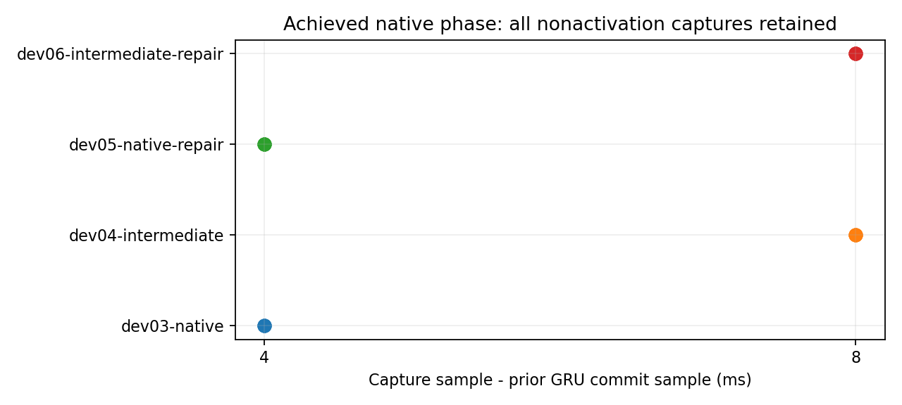
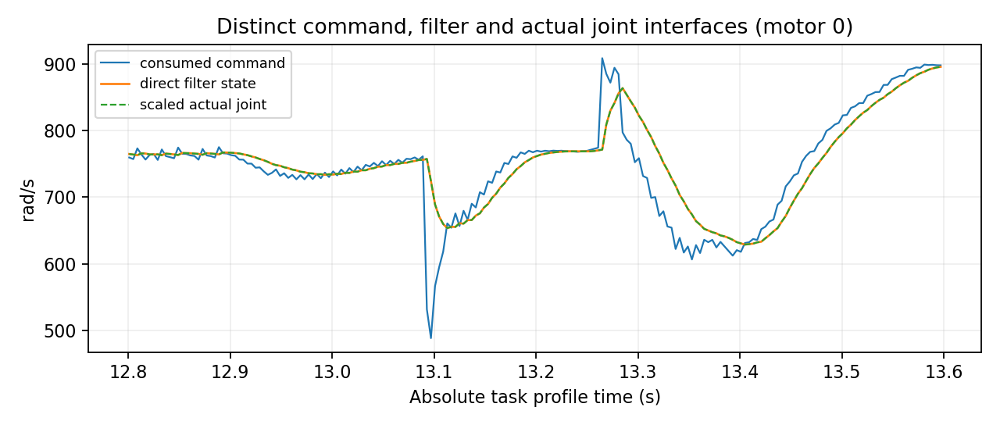
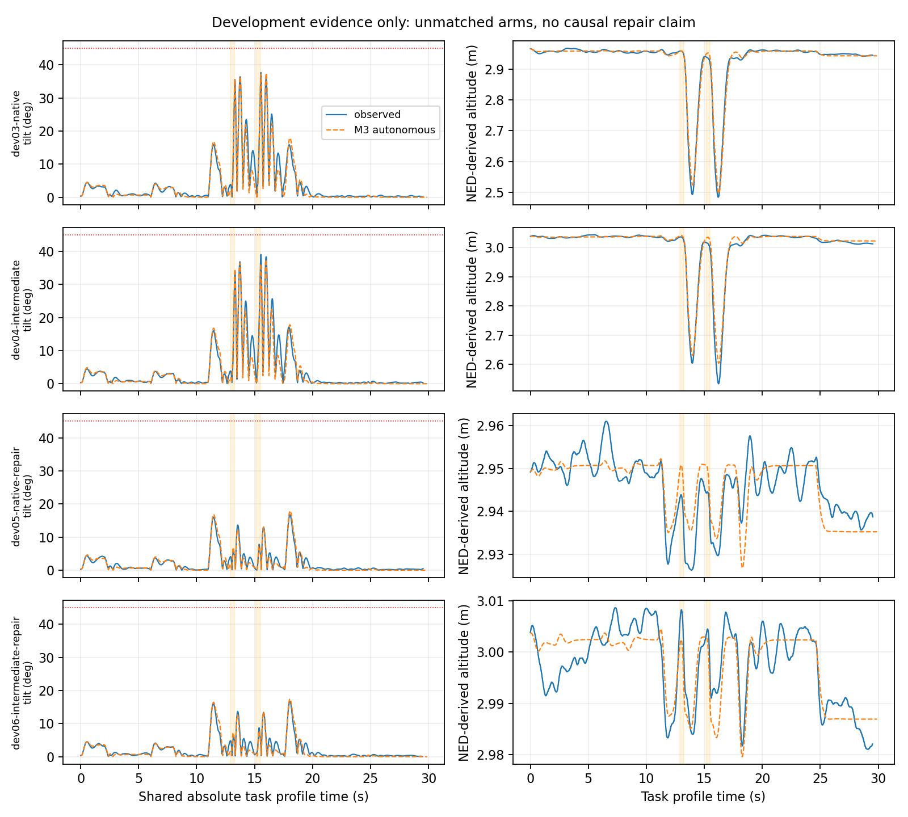

# P12：双时钟、历史耦合、真实相位与修复约束

**评分修订说明：任务/高度/截断评分以[独立v2修订](THOR_P12_SCORE_CORRECTION.md)及`data/p12-20261026-score-review/`为准；原v1结果完整保留。**

**执行结论：开发9/12次、正式0/48次；在共同前状态配对门失败后停止正式设计，未创建正式冻结。** 所有9次启动已结束且计数保留，无重飞替换。容量后来已通过，最终停止原因是缓存/估计状态与增量适用域问题，不能再归因于磁盘。P11第70条无效、两条pending及全部历史结论不变；未启动P13、P10 B/C/D或额外批次。

## 先回答六个问题

1. **可信组合与相位证据？** 两类实际读取/捕获相位已在开发中分离，依据真实executor计数、实际commit和捕获，而非0/2/6ms主机意图。但没有可信的“单事件成功、组合失败”新证据：NORMAL/A/B正式臂均未启动，3组开发配对均NOT_MATCHED，不能计算或解释正式非加性，也不能把AB开发成功冒充组合研究完成。
2. **哪些状态和时序决定结果？** 任务epoch、native/sample分离、真实GRU提交、mean/count及LP/姿态缓存阶段都重要。v2固定共同NED任务参考，并用真实提交回执定义实际任务epoch，使125个比较点的count/commit差异从125降为0；LP年龄仍125处不同、姿态年龄122处不同，hidden/速度差及动作增量界仍超限。此处是实际同步改善，既没有事后平移旧数据，也没有把剩余状态称相同。
3. **执行初始化和动态接口？** 新增每物理步直接读取FirstOrderFilter内部状态、实际JointVelocity、缩放转速、旋翼推力及显式parent世界力矩。7条开启记录共666,048个电机步，滤波连续重放误差最大4.55e-13rad/s，实际关节幅值与filter-before最大差9.01e-8rad/s。初始滤波和关节均直接读为0；模型任务前初值来自已发生的执行记录，未用末命令稳态替代。但整机wrench、估计误差、完整排队状态及未来动态误差界仍未证明。
4. **得到什么可检查约束？** 同源捕获的成对跳变、整个减速参考持有段的增量界、捕获瞬时修复条件，以及允许加/减速分支切换的滤波有限时域界均给出解析推导和工具。实际权重的增量系数以精确有理数构造、独立复核。完整闭环储能未建立，不能称整段修复安全证明。
5. **覆盖实际记录且有用吗？** 新接口重放包含P11第70条合法native平台和本轮全部active记录；可用于拒绝错误恒时钟假设、检查修复捕获与执行初态、定量拒绝过宽配对。已知输入重放通过不等于自主闭环预测或未来硬覆盖。M3只完成开发期隔离点预测；7条均为开发成功案例，不能泛化危险预测。没有新正式留出，也未证明完整队列/物理/估计误差覆盖。A4误差球反例仍NOT_PROVEN_EXCLUDED。
6. **离完整理论最近的具体缺口？** 需要可实现的共同观测/估计状态与时钟阶段初始集合，以及命令消费后首个物理/估计更新的有状态误差接口，联入网络/history/事件模式的完整反馈储能。目前不能独立每步塞入自由误差球，也不能仅靠归一化计数或局部Jacobian消除这些障碍。

## 基线、修订、预算及停止

开始与再次核验的远端main均为`72d5d2a1f4637fbfd7fb40b0de92315b871815e1`。已读P11报告/接口/计划、冻结manifest和模型seal、机器结论/配对结果、70时钟记录及P10-A4证明/反例/源码。AGENTS.md适用，`.agents`为空。旧未跟踪AGENTS/P11发布记录/P9锁保留。

| 开发身份 | 内容 | 峰值倾角° | 损高m | 工程结果 |
|---|---|---:|---:|---|
| dev01-off | v1关闭；注入锚点问题保留，非末版对照 | 37.239 | .4757 | 完成 |
| dev02-off-final | 末版关闭对照 | 38.409 | .4995 | 完成 |
| dev02-on | 末版开启、原消费路径 | 36.597 | .4539 | PASS |
| dev03-native | native调用消费门 | 37.670 | .4738 | PASS |
| dev04-intermediate | intermediate调用消费门 | 39.036 | .5025 | PASS |
| dev05-native-repair | native门，实验捕获才修复 | 16.742 | .0169 | PASS |
| dev06-intermediate-repair | intermediate门，实验捕获才修复 | 16.690 | .0248 | PASS |
| dev08-common-native | 固定共同NED参考＋真实提交epoch | 38.367 | .5124 | PASS；配对未通过 |
| dev09-common-native-repair | 同v2任务规则＋捕获修复 | 16.314 | .0248 | PASS；配对未通过 |

表中是各自完整开发任务结果；9条均原冻结飞行判据及任务判据成功，无安全截断。它们不是匹配的因果修复比较。开发身份不等于序号，START_INTENT账本真实序号连续1–9；未用开发3次不挪给正式。40个主设计槽和最多8个未实例化调度槽均明确未冻结/未启动，不把它们记成已飞后NOT_REACHED。

最初容量不足，随后用户在独立任务授权清理其他文件。本任务未删除、迁移历史或调整ext4保留块。重新核查可用20,005,978,112B，按当时剩余开发＋48正式、每次128,182,720B暂估、另2GB分析/构建和2GB保留量，需10,793,684,160B，容量通过；该体量是开发估计而非所有未来条件的数学上界。

停止登记：`data/p12-20261026-preparation/formal-design-stop.json`、`attempts.jsonl` DESIGN_STOP。正式未尝试，非权限拒绝、非不确定启动；无冻结批次混版。受控追赶装置未验收，不能继承读取门PASS，未执行建议的8次调度对照。

## 生产语义与实验装置

[状态机、双时钟图及字段规范](THOR_P12_INTERFACE.md)定义真实p/v、世界高度、观测缓存及年龄、外部/捕获目标、GRU、previous/mean/count、滤波/关节/待消费命令、sample/native/host及排队关系。流动、输出、提交、fresh/stale/capture/resume、重复拒绝和消费分别处理，不压成恒4ms映射。

`MC_RAPTOR_P12`默认关闭，且须P11/RSH启用。P12PH门按真实executor index选择是否消费最新外部uORB消息，保留实际读取、finite验证和严格`age>200ms`守卫，不伪造时钟或强制capture。它是实验交付延迟机制，改变接入时序，非生产默认语义。P12R首次activation强制原T0，只在active、非activation且已有实际外部读取后选已有RTGT2/RTDEC2/RREC0；没有hidden/reset/history/权重或飞行中参数写副作用。

v2固定NED[0,0,-3]、yaw96°任务参考；这是固定任务坐标，并非Gazebo/EKF完整状态分叉。runner先确认真实native提交行，再以该行实录CLOCK_MONOTONIC为随后实际任务表的epoch，保留查询区间与年龄；旧记录不改轴。只有累计index的偶数偏移可证明不改变`index%2`，不能互换mean count0/1或宣告history数值等价。

旧runner无覆盖Gazebo求解器、EKF、神经/history、执行队列及所有时钟的快照协议；本轮也没有构造完整分叉。不能以同种子或只保存controller memory冒充精确分叉。

## 观测、真实相位与配对可行性

9条共78,688个active控制调用完整重放；新增history前后值及count直接核验。单步h/action容差1e-5、连续1e-4、输入1e-4沿用P11浮点依据。末版关/开峰值差1.812°，完整周期p99为41.04/41.26us，全部开发p99不超过48.02us（门槛2500us）。所有发送/读取匹配检查通过。单对开销/等价证据不证明全称无干扰。

native读取门的有效读取全部落在native调用；intermediate门反之。7条开启记录的21次非激活捕获（含末段停止发送）实际类别稳定：native读取门捕获在上次提交后4ms的中间调用，另一门捕获在8ms后的提交调用。3条修复的9次非激活捕获水平速度输入误差均为0；首次激活均mode0。84个电机/捕获对中，同物理步消费位于捕获host括号之前，捕获调用产生的命令首次消费位于括号之后；这是记录内事实，工具仍保留重叠UNKNOWN和latest-value未消费可能性。



配对门来自可计算子约束：`.5s参考段 E_p+.5E_v<=.02m`、权重导出的单调用动作误差界<=.2，并另查p/v/SO3/h/previous/mean/执行状态及离散缓存阶段。标准在配对计算前固定，未因结果放宽；这些子约束也不自动成为完整闭环等价证书。

| 同相位AB—修复开发对 | 最大位置差m | 速度差m/s | hidden L2 | count/commit不同点（共125点） | LP年龄不同点 | 结果 |
|---|---:|---:|---:|---:|---:|---|
| v1 native门 | .04337 | .03891 | .08419 | 125/125 | 125 | NOT_MATCHED |
| v1 intermediate门 | .06756 | .04711 | .10179 | 125/125 | 3 | NOT_MATCHED |
| v2固定任务/真实epoch | .02017 | .03894 | .08093 | 0/0 | 125 | NOT_MATCHED |

v2最大时间配对差约.358ms，仍有姿态缓存年龄122点不同。其真实更新阶段已同步一部分，连续状态和缓存并未相同，保守动作界仍为2>.2。未挑看起来匹配的子集、未按峰值/捕获对齐，也未以修复峰值明显降低证明纯因果贡献。主组合设计因此停止。

## 执行、预测、区间及理论

直接滤波状态与末命令稳态的整程最大差达609.30rad/s，说明两者不能混称；本轮任务前M2稳态初值近似误差则为.115–.381rad/s，应分别报告。实际JointVelocity带转向符号，记录slowdown后与filter-before比较；旋翼推力与parent显式drag/rolling torque不是整机总wrench。独立held Gazebo世界高度保留采样年龄，不能用内部捕获目标差或控制器NED z替代全称绝对高度界。



M3采用冻结P11 M2机体系数/权重，增加显式native守卫、真实提交计数、mean/count、相关capture和直接执行初值接口；无新拟合。已知输入单步/连续网络、目标及执行重放与自主演化分开。7个开启开发案例的M3隔离自主点预测完整峰值误差约.051–1.613°；仅开发数据、均为成功案例，不支持危险分类泛化或准入。M2在原T0任务上误差较小，但未实现P12新增capture-only修复语义，修复臂误差20–21°不能全归因于双时钟/记忆结构。

相同案例/参数的四消融均保留。普通名义时钟下single-clock可能与M3相同，不能据此说真实平台无关；no-history明显改变预测，no-filter改变执行响应，去掉相关capture可导致预测提前出域。它们改变模型方程，不是完整飞行因果干预；完整证书状态仍均未建立。



P11第70条在新目录完整重放8745调用，连续action误差1.03e-6；native跳进/平台原样保留，除零比率定义为UNKNOWN/null而非0。该条实际读取年龄与单时钟最多差4ms、守卫标签未翻转。采用其时钟模式另构造合法无消息词，严格守卫可提前一调用；这是构造反例，不是该条实际捕获。旧无效结论不回写。本轮dev02-on也真实记录到一次native平台及其相邻追赶边，新工具保留并通过完整已知输入重放；不把这些有限出现次数当自然概率。

[理论推导与适用范围](THOR_P12_THEORY.md)给出：

- 同源capture后位置输入误差为0，水平速度误差为`(1-alpha)v`，memory跳变为恒等；减速参考整段`||delta r(t)||<=||delta p0||+T||delta v0||`、`||delta s(t)||<=||delta v0||`。
- 捕获瞬时不裁剪的参数条件`(1-alpha)L+epsilon<=1`，实际P12固定alpha1。它不是整个后段安全保证。
- 滤波分支切换下`E_next<=max(rho_up E+(1-rho_up)U,rho_down E+(1-rho_down)U)`；同命令初态误差`E(T)<=exp(-T/.025)E0`。
- 精确dyadic权重的H/X矩阵由独立有理实现复核；允许native提交与intermediate不提交。全域保守界在示例第4次调用退化为整个动作箱；不是“GRU必须孤立收缩”或完整闭环LMI不可能的结论。

时序/初值区间尝试明确枚举跨严格守卫的capture/hold两种模式，并传播网络、参考与滤波子界。完整机体/估计器/缓存/调度词误差连接缺失，因此没有已证明的整程包络；M3按调用推进经验机体，尚不能宣称真实排队/追赶物理及绝对世界高度均被覆盖。A4的22步p/v/q自由创新反例未被这些子约束证明排除，旧NOT_PASSED保留。

## 历史、测试、复现及交付

旧81,742份登记项无缺失，普通历史文件无改写。首次审计报告711个hash变化全部是旧cli符号链接对当前Lab PX4二进制的解引用；P12正常重建改变了共享目标。711个链接文本逐一与起点Git对象一致，原审计和独立解释都保留。这些CLI链接不是历史二进制快照，执行旧路径会指向当前共享Lab二进制；不能将其当作旧构建的可执行重放。P11原727个raw路径（654个唯一inode）全部hash一致。P12的109个raw路径/100个唯一inode、ULog与metadata一致，仍留本机；rootfs ULog与flight.ulg硬链接不重复计量。另9份完整执行raw的压缩NPZ副本仅留本机，其哈希见raw-repack-manifest.json，未因格式转换上传Git。

原生构建、两次注入幂等、ASan/UBSan主机单元通过；沙箱LeakSanitizer的ptrace环境错误未冒称代码失败或测试通过。最新全套运行216通过、7失败；其中4项旧P10 oracle stub缺少P12依赖，3项旧冻结身份拒绝新源码。旧检查未削弱。另有28项P11/P12专项通过，包含新真实源码oracle、关闭P12保留旧RTGT2激活、严格守卫/无效消息/重复前捕获、实际native任务锚点及预算封闭检查。工程门、本地测试、实验完成度和理论状态分别记录。

最后一条开发记录独立重算后，6个模型及消融trace数组逐元素相同；目标/网络/执行审计及隔离检查再通过。复现PASS只指此数值流程，不是正式或理论PASS。

```bash
# 全部只离线，输出必须为全新目录
uav_lab/.local/venv/bin/python tools/p12/reproduce.py \
  --run data/p12-20261026-development/dev09-common-native-repair/run \
  --output /tmp/p12-new-reproduction \
  --compare data/p12-20261026-analysis/dev09-common-native-repair-predictions
uav_lab/.local/venv/bin/python tools/p12/pairing.py --output /tmp/p12-new-pairs.json
uav_lab/.local/venv/bin/python tools/p12/verify_theory.py \
  data/p12-20261026-analysis/theory-v1/rational-matrices.json --output /tmp/p12-new-weight-audit.json
```

主交付：`config/p12.json`、本报告/[计划](THOR_P12_PLAN.md)/[接口](THOR_P12_INTERFACE.md)/[理论](THOR_P12_THEORY.md)，`tools/p12/`、`research/state/P12Controls.hpp`及新topic、独立`patches/p12-20261026-development/`，`data/p12-20261026-{preparation,analysis,delivery-v1,reproduction-v1}/`。机器结论在`delivery-v1/conclusion.json`，逐次启动、48个未启动槽、mode/配对/原始hash均可查。正常commit/push后另记录远端SHA和实际CI查询回执；不将本地测试写成CI通过。
