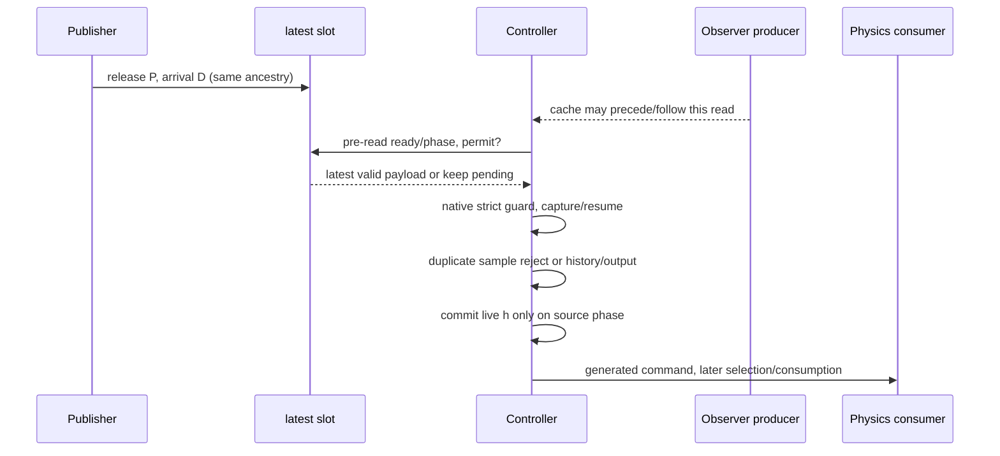

# P14G接口与量词

独立基线5d035fc10b80fc171a24fe33d728db8af4a43d31。全轮离线，SITL/启动器/历史预算均0。主入口 `tools/p14g/pipeline.py`，结果在 `data/p14g-20261027/`。

## 源状态与时间分区

沿用P14R分阶段过去状态：物理COM p/v/q/omega与model/body/IMU杆臂、估计q、导航LP原点、gyro DFII、OP环缓冲/校正积分/bias、cache值/样本年龄、h/previous/mean/count、临时h、filter、pending/consumed、publisher/transport/readslot、sample/native/index/force_sync及COM/LP各自H0/L/D。物理yaw与估计yaw差不旋转LP导航速度。

`partition.resume_zones`用共同变量P（发布）、D（送达）构造连续区域：`b≤P≤b+10ms, P≤D≤P+4ms, previous_allowed_read<D≤first_allowed_read`。保留整个P/D多边形；同一离散顺序不保证目标载荷或连续轨迹相同。host服务/运输上界是环境条件，不是实测最大值定理。固定正常读取网格与非标准native/sample词分开。

`partition.transition`保留最新槽，只有允许读取才消费；无效消息不刷新last_valid_read。严格native年龄`>200000us`决定stale/capture，在重复sample拒绝之前；重复sample不更新NN/history/index。GRU提交与普通输出分离，命令消费在生成之后的物理步。native平台/追赶与sample、host独立，示例债务图只覆盖声明±8ms，不宣称源系统所有未来跳变均有此界。

消费序号不倒退仅是“单生产者有序运输、无Actuators组件覆盖”条件。真实motor源码只取最新到达槽；组件优先，源码不检查payload时间戳倒退。程序显式区分这个模式，允许保持同一已消费ID；不把条件守卫冒充普适源不变量。实际20个motor日志无倒退/组件覆盖只是后验支持。

## 联合传播与方向选择

主域严格复用d02/d03两个真实过去端点的同源联合曲线、两个publisher-clock fiber×四分段。raw index为4583/4589，均odd，count均0；sample/native与cache戳各自保存，不能将其宣布相同初态。每fiber只继承自己的离散元数据，连续内插是放宽域，内部点未证可达；不覆盖全部现实初始化或d06两步OP滞后模式。

四法：默认方向；同90 CPU秒窗无压缩；源关系；源关系+全前缀输出重要性。全域主窗0.8s；zero/small仅d02/64ms，不能跨面板称同覆盖。源关系为capture同源copy、temp h→clip(W2 h+b)→pending、commit时live h复制；非commit不套到live h。非线性仍由原余项/clip外包处理，不是假线性等式收紧。后继的NN/OP/执行/队列/D均不清零。

最终版本修复post输出/pre输入混用：`Zpre[k]=(Fpost[k]+Zpre[k+1])A[k]`，`Wpost[j]=Fpost[j-1]+Zpre[j]`；旧结果保留但不能支持预期输出目标的H2比较。临时hh使用live h方向代理、0.05范数保底，名义clip/时序分支固定，均非完整全过程Gramian。方向依据是解析源链的192调用离散伴随，输出含物理/缓存Rzz、COM和LP高度与末端W。8行固定符号投影涵盖全部前缀，用于便宜的重要性排序；它不是完整观测Gramian，更不是全域证明，可能抵消重要方向。保留根/二次ID，丢弃列仍按来源类别转成逐行L1外包。敏感性错误不会使数学删列“安全”；数值向外认证仍未完成。

`rich_sets.annotate`只用NumPy读取当前中心/G，独立输出COM/LP L/D及物理/缓存倾角区间，断言不改变Context.n。预算停止保留64ms数值检查点和逐调用前缀；最后一行若未确认已走过域检查保守排除。超域为TOP，资源截断不称实际飞行发散。

## 观测创新

真实OP的传播、缓冲、误差积分及校正关系继承源码；新候选只增加过去两次融合残差斜率的衰减状态，时间常数取OP源码0.25s。该选择是代理假设：OP内部跟踪时间常数不等于外部EKF误差时间常数。逐融合独立、持久误差和衰减均保留比较。所有参数来自过去、未用d06留后调参；全部结果回顾性。

五条实际记录离开小创新预算后，所有依赖该预算的真实安全覆盖均UNKNOWN；不改条件源码代数，也不改点预测漏判分母。`C-source-transfer-v1`给42维单轴缓冲/积分的精确实数递推，未来fused-target误差仍是输入。共模速度PI在常gain `0<g≤1` 满足Jury条件，不推出完整角/物理/神经闭环稳定。

## 选择与整合量词

35候选含7个相同NORMAL输入别名，实际29不同配置。竞争F（衰减融合、名义交付）、T（固定融合、多合法代表交付）、FT。模型输出集合是有限条件假设点的包围盒，不是认证的真实不确定集合。最小标准化间隔区分这些模型，不能自动识别现实机制。

旧lexical并非真正均匀、旧危险基线用了COM代理；两者保留。v3采用协议seal确定的均匀排列与源预测LP高度基准，属于暴露后独立修订，不能包装成原冻结或独立前瞻验证。集合分离排序、模型参数与池保持不变。只有5个offset0锚点有实际核验，其余是未执行设计。

条件安全：对声明联合初态及全部已包含模型分支，全前缀上界满足阈值，且模型/时序/数值/模式前提成立。条件危险：需要覆盖所有可行分支的下界失败见证；名义失败或外包上界碰线不够。本轮未取得完整事件的此类结果。真实模型覆盖UNKNOWN、传播保守、合法模式混合、真实域结果多样性未证和数值认证不足分别标记，不能统一改称危险边界。
