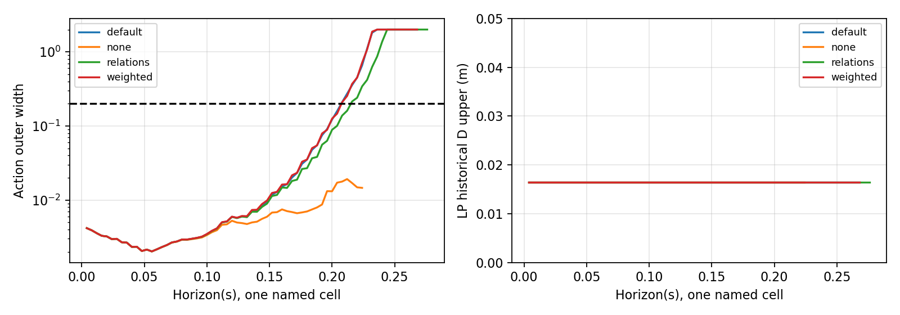
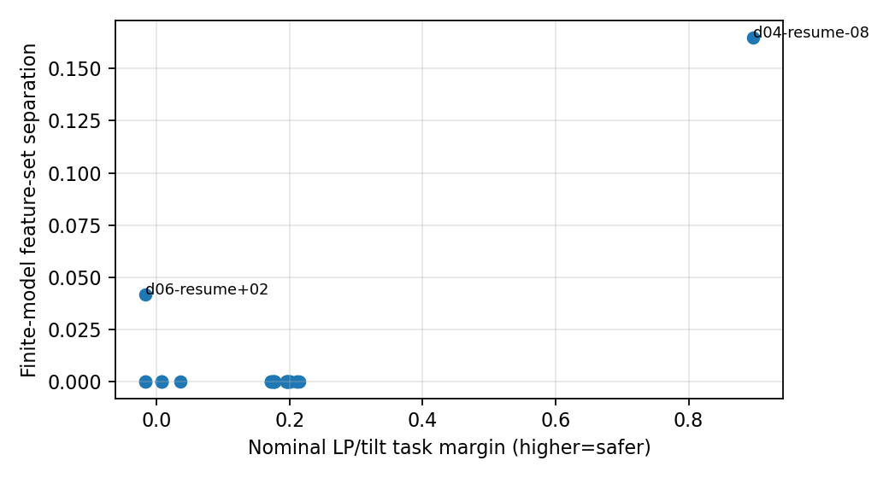

# P14G：方法检验报告

**H1条件性部分支持；H2本实现未获支持；H3独立证据不足。** 源码约束确实把读取边界和非法顺序说得更具体；源码关系带来毫秒级前缀改善，但本次8行全过程输出优先方向没有改善联合域传播。模型区分排序选择低危险NORMAL而非F4，但有限模型集合并未覆盖所有实际观测，尚不能证明测试效率提升。本轮SITL、启动器调用、历史预算使用均为**0**，没有使用P14R剩余两次。

最终证据入口：`data/p14g-20261027/delivery-v5/`；完整逐前缀、停止与重算在 `rich-v3/`、`analysis-v2/`；可执行流程在 `pipeline-v4/`（包括最终后状态伴随数据引用修订；不改变模型参数或选择池）。全部数据已暴露，所有新成绩统一回顾性，旧P11–P14R成绩/失败/停止/A4不回写。

## 1. 三个假设分别判决

|假设|实际发现|判决与限制|
|---|---|---|
|H1 源合法分区比固定8词覆盖更完整、定位更有效|预读ready/phase/最新槽/重复sample/commit/消费状态机；连续P、D区域；native与sample独立。6个闭合gap的12事件，8词点包络漏6，新条件区间漏0；原P13 B捕获早8ms反例保留|**条件性部分支持**。6→0区间结果继承P14R deadline外包，并非本轮独立新覆盖成绩。新实现增加连续分区/合法性/共同起源，不能称覆盖全部合法未来模式或轨迹等价|
|H2 源关系＋全过程安全输出方向降低保守性|同双clock×四段；源码关系首次信息失效从51→53调用；工作域有效前缀65→68。输出加权首次失效仍51，有效前缀仍65|**本固定实现不支持**。全联合域完整单事件增量0。8行伴随sketch是优先级近似，不否定所有更强的方向/约束方法|
|H3 集合分离选测优于危险排序|35候选中29不同物理配置；模型分离先选NORMAL，危险排序先选F4。只有5个既有实际锚点|**独立证据不足**。未执行候选没有标签，不能计算检出效率；若竞争模型都不覆盖现实，模型间分离不等于真实机制可辨识|

没有用H1的工程正确性抵消H2/H3不足，也没有用某个预测词的成功覆盖主要漏判。

## 2. 案例、冻结与异常保留

起点本地/远端均为 `5d035fc10b80fc171a24fe33d728db8af4a43d31`，没有后续提交。已读AGENTS及P14R报告/接口/复现/地图和引用源码，`.agents`没有文件。开工dirty、输入hash、容量见start-state。所有新文件独立放在tools/config/data/docs的P14G路径。

核心仅旧d02、d03单A，d04 NORMAL，d05 F2-AB-short，d06 F4-AB-medium。d01保持隔离，本轮不重新评分；P14R已有有效前缀诊断保留。d05安全截断、实际高度UNKNOWN；d06倾角失败发生在B之前，之后高度失败，**不能说成单事件安全、组合才失败**。本轮没有新随机块或严格同初态反事实。

计算前 `protocol-v1` 固定H1/H2/H3、同源域、指标、池、并列规则和资源。错误处理均独立留痕：

- B首次进度写入触发“禁止覆盖旧文件”保护，已完成2项按job与核心hash引用复用；其余继续新目录，未替换物理运行。
- C首个bwrap因受限命名空间NETLINK权限未启动；宿主同语义隔离完成，旧失败保留。
- P/D成员检查补齐运输上界；消费序号守卫明确为有序单生产者条件。真实plugin没有payload时间戳防倒退，组件覆盖路径单列。
- NORMAL别名offset和canonical id错误分别修正，所有物理输入、预测集合与物理排序不变；旧错误报告保留。
- 旧lexical并非均匀，旧危险基线用了COM代理而非LP任务判据。保留旧排序，v3/v4独立修正为协议hash种子的均匀排列和源预测LP基准。**这是暴露后修版，不冒称原冻结前瞻比较。** 集合分离标准和模型未调参。
- 最终复核发现伴随阶段错误：原C取post状态但递推套在pre状态，原自洽测试未查出该语义问题。原加权结果保留且撤回其H2比较效力；独立weighted-v4重算两条192调用链和全部10项加权任务，同域/同阈值/同资源，累计实测CPU183.56秒。修正后的总体判决仍无增益。
- 原集合输出缺少逐前缀LP界，独立只读标注器补齐；64项全量回查，共同前缀核心指标最大差0。未改初态域、阈值或方向参数。

## 3. H1：源事件结构和边界

发布P、送达D与first allowed read使用同一组时间变量：`b≤P≤b+10ms`、`P≤D≤P+4ms`、`R_prev<D≤R`，而非每步任意抽延迟。保留区域内时间宽度和载荷共同起源；source publisher的gap退出立即发送、重新启动period计时、最新槽覆盖/保留均延续。10ms/4ms只是未来环境条件，不能从spin timeout或实测max认证。

初始化来自同次pre-read状态，未用last-GRU或笼统忽略第一行。native年龄严格`>200ms`、capture在重复sample拒绝之前；重复sample不推进h/history/index。提交与普通输出分离，执行选择不要求“每次输出均被消费”。实际五条全部源预读和history/commit核对通过。

motor源码在组件存在时优先取组件，否则取mutex保护的最后到达消息；**没有payload戳倒退拒绝**。程序只在有序单生产者、无组件覆盖条件下拒绝消费ID倒退，允许保持同一ID。20个实际motor日志无倒退/组件覆盖属于后验支持，不是未来不变量。

P11第70条sample/native跳进—平台原样容纳；实际守卫未翻转与另构造词可提前一调用分开。有限±8ms债务图在1/2/4/8调用分别有12/62/245/1081个离散状态；这只是时间状态投影，不能把1081称完整闭环分支数。没有穷尽任意大跳进或连续producer换序。

原P13 A接回发布在前次允许读取之后约0.19ms，等待约8ms。新模型用**计划的**P=R±0.19ms检验四个事件案例，接回相差8ms，首动作L2差约0.0025/0.0041/0.0034/0.0262。它再现源码机制，不是新增真实相位实验，也不是只移动capture的纯相位效应。d04无A，保留为控制，不造resume。

## 4. H2：同域、同资源的实际对照

主域为d02/d03同源连续状态的两个本源clock fiber×四分段，保留OP ring/积分、gyro、q与LP分离、h/previous/mean/count、filter、pending及COM/LP历史D。端点有实际来源，内部未证可达；这是覆盖两条过去状态的放宽集合，不是全部初始化。原index4583/4589均odd，count均0，各自原始时间戳/发布年龄保留，不宣布同状态。

主窗0.8s，各任务90 CPU秒、110秒墙时、24GiB地址空间上限。**zero/small仅d02/64ms**；可面板内比较四法，不能跨三类域称同覆盖。

|真实联合域，8个cell合计|首次信息失败最早调用|共同有效源工作域前缀|CPU秒（LP回查实测）|完整A hold/resume|
|---|---:|---:|---:|---|
|默认压缩|51|65调用/260ms|142.60|未达|
|同预算无压缩|未见失败，右删失；至少保留55调用|55调用/220ms，下界|719.98|8项均CPU上限停止|
|源码关系|53|68调用/272ms|149.46|未达|
|源码关系＋输出优先|51|65调用/260ms|152.65|未达|

信息门不是安全失效或理论准入门；域外是外包不能再认证，不是实际飞行发散。资源停止最后一行若未确认域检查则保守排除，数值64ms检查点和完整已保存前缀均保留。不可与P14R单quarter/900CPU秒的更长结果当同预算比较。

正确的后状态伴随为`Zpre[k]=(Fpost[k]+Zpre[k+1])A[k]`，在第j次post状态压缩时用`Wpost[j]=Fpost[j-1]+Zpre[j]`。独立两步系统回归将旧公式结果16与正确结果15区分。方向来自192调用解析离散链与全部前缀的物理/缓存倾角、COM/LP高度及末端W；用8行固定符号sketch降成本。它保留了时变交叉影响，但可能抵消关键方向；只沿名义clip/符号/时序分支线性化，临时hh沿用live h权重代理，另有0.05行范数保底，均为有限近似；权重仅排序，不是全域证明。丢弃方向仍按来源类别L1外包，根与共享二次ID保留。非线性clip/符号跨界仍由原外包承担，未靠假线性等式收紧。

共同48调用处，八cell最坏动作宽为：默认0.1190、无压缩0.00908、源码关系0.07646、加权0.12008。加权没有改善；LP/COM历史D上界在该时刻均主要由初始D决定，无高度收益。源码关系仅增加8ms信息前缀、12ms工作域前缀，不能称完整事件理论改善。zero/small的16调用全部完成，不能泛化长窗。

地图仅给声明实数源模型/时序条件下的正余量前缀；数值向外认证、EKF未来创新和执行缺陷预算未闭合。所有**实际**安全后继仍UNKNOWN，完整联合域事件增量为0。外包碰危险不是必然危险，放宽曲线包含不可达点也不是已证真实结果分叉。

## 5. C：创新状态、条件关系和预测

候选只使用过去两次融合残差斜率，按源OP的0.25s速度时间常数衰减；没有在d06上重新拟合。source OP及真实角/平移/执行/history反馈保持，物理q、估计q、gyro、LP原点与cache独立。

**结构性负面结果：OP内部跟踪滤波的时间常数不能推出外部EKF误差按相同时间常数衰减。** 在实际五条上，小创新盒都被离开；fading没有建立真实未来覆盖，部分还更早违背该条件。所有依赖它的真实安全结论在withdrawal-ledger全量标UNKNOWN，不用点预测掩盖。

同完整联合域的小预算集合：持久/逐融合独立/fading+持久最早信息失效30/28/31调用，有效域前缀50/46/50调用。4ms变化没有闭合事件。该预算是条件对照，非实测最大值定理，也不覆盖实际记录。

主点词的tilt/height/task漏判仍1/1/1，误报0、预测UNKNOWN0；实际倾角/任务失败2条，高度失败1条，另1条高度删失UNKNOWN。分类分母5/4/5，整程误差分母4。全部8时序词逐对比P14R分类均未改变；某些词已能判d06失败，不能事后挑它替换主词。有限词集合里d06有成功/失败混合，也不能把漏判简单改UNKNOWN后宣布改善。

2秒物理SO(3) RMSE（held→fading）：d02 4.154→4.148°，d03 5.075→5.181°，d04 0.376→0.833°，d05 2.040→2.012°，d06 6.768→6.871°。d06 LP向量RMS略降0.1587→0.1570m，但动作RMS略增0.2539→0.2548。所有0.5/2秒、hold/resume及整程窗口、首偏离和clip轴持续时间完整留在C-errors-v1，没有用峰值或任务OR掩盖时程错误。

已有source OP关系被推进成42维单轴buffer/积分传递：`delta x_k=A^k delta x0+sum A^(k-1-j)B delta u_j`。同输入q/IMU/bias条件下，C++速度小扰动核查误差约1.3e-7。常gain共模PI的特征式为 `lambda²-(2-g-.1g²)lambda+1-g`，`0<g≤1`满足Jury条件；数值慢极点约0.9964/8ms。完整角/NN闭环不因此稳定，外部delta u仍需约束。有限全前缀增益与浮点认证分开，既非采样Jacobian证明也非未来安全保证。

现有ULog有IMU、GPS、baro、mag、estimator states/innovations；以d06为例，日志从native3.796s开始，有25个nominal state字段及24个对角covariance字段，缺完整交叉协方差和早期辅助融合/队列身份。对角相同并不决定Kalman gain，2×2正定反例留存。若从已知reset和完整早期输入能重建P则仍可能离线恢复，**尚未证明输入完整性，不能直接说已完整EKF闭合或绝对不可恢复**。

## 6. H3、整合流程与成本

候选池改变A接回相对读取边界，保留任务、B绝对时刻及保护。NORMAL无A，七别名代表同一输入，计作一个；其余28个不同配置，共29。F/T/FT是有限条件模型，不是所有真实未来的认证集合。

集合分离首选NORMAL，然后F4 resume+2ms；危险排序首选F4的+2/+4/+8ms。最高分离主要为约0.805°缓存姿态差，F4+2ms只有约0.00415的一个动作分量间隔。NORMAL实际特征在所有三套hull外，表明模型覆盖不足；其他3个锚点落入T和FT而不在F，仍不能唯一识别物理机制。来源、误差范围和时序条件没有认证，不能把模型间空隙当真实可分保证。

均匀、危险、集合分离的校正排序及五个锚点位置见delivery-v5/D-retrospective-v3.json。其余24配置未执行，不能计成功/失败或声称H3更快。旧排序及暴露后修版同时保留。

可执行pipeline输出：合法分区→同域前缀传播→全前缀余量和UNKNOWN来源→选离线细化/诊断/危险测试→单独读取实测做前提核验→记录修正并回查。当前连续时间cell后段未传播、合法模式未穷尽，必须输出TOP而非safe。真实模型覆盖、传播保守、合法模式混合、真实可达域结果多样性未证、数值认证分别标记。新observer跨第二事件的状态序列化校验，states/cache差0、trace约1.8e-15，保留D/history；这是点状态恢复，不是集合深度增加。

本轮记录了丰富修正版1552.53秒精确CPU；先前B宿主采样累计约1196.45秒。旧C/D/weights已退出，CPU缺测，使用cap/四核墙时保守扣账而非补0。加入90秒采样竞态裕量后的扣账含后状态伴随修复183.56秒，合计5216.28秒，另留100秒验证，总数值扣账5316.28秒；其中含200秒未实测allowance，**不能称5400秒全轮CPU硬帽已经认证**。单任务CPU/地址空间帽及后续逐项资源预留已执行；旧整体RSS峰值未保存，资源失败任务峰值UNKNOWN。墙时与CPU分别报告。错误修复/全量回算、建模及旧锚点成本都计入，成本不是把模型4ms当仿真4ms的速度比。

直接审计同五条已有原始记录也不需新增飞行；29候选的现实结果尚未知，当前没有可认证剪枝或等目标搜索对照，净成本收益NOT_ESTABLISHED。历史P14R六次物理约596秒、P13 78次约7833秒及旧建模依赖单列，不当免费锚点、不重复相加重叠墙时。

## 7. 路线决定和最小后续验证

保留源码状态/合法序分区和带来源的联合地图接口。停止把本8行sketch＋类别L1降阶当默认“更好传播”主张；停止把OP跟踪tau当EKF误差衰减依据；不能据当前候选作整程安全筛选或承诺节省仿真。A4仍NOT_PROVEN_EXCLUDED：小创新预算不能包含真实记录，不能用它排除不利误差序列。

最重要的后续离线问题是：重建/约束接回附近的外部融合创新状态及其时间相关性，先证明初始P/辅助输入可恢复范围，再在同一真实域检验界。更多相似数据不会消除当前降阶保守和数值认证问题。已有几何、gyro/history重放无需再采。

若另行授权独立采集，最小机制验证可为**同一F4单A工况，P=R±0.19ms两交付臂×两个新seed，共4次START_INTENT上限**。它区分“未读到新目标”与“读到但融合/cache状态不符”，主要验收实际读取关系和首动作，风险/恢复为次要结果；两seed只检查重复性，没有总体效率检验功效。固定原权重/保护、预事件规则/总轨迹，原始初态差异照留，不称纯相位或严格同初态。

必需字段是publisher唯一generation及before/after、receiver/uORB pending-generation/read/consume对应sample/native/物理步、fusion前后输入与OP ring/correction/integral/bias、实际cache stamp及首动作/执行连续状态。已有数据可匹配载荷，但没有每次slot到达generation的精确身份；完整EKF路线还需完整P或可重建reset/早期融合顺序，不能自动无边界加日志。身份/时间/保护异常隔离依赖部分，科学失败保留不替换。本轮**没有执行该方案**。

最终版本本地回归 **106项通过**（tests-final-v3.log，约4.4秒）。覆盖时序成员/非法序、共享来源包含、后状态伴随、同域及64项指标回查、保存恢复、全前缀高度、排序隔离与前提撤回。宿主实际进程独立快照无PX4/Gazebo/Agent；旧原始hash、封存输入和P14R账本全部一致。发布SHA与真实CI在推送后本地publication回执保存；没有CI结果不能称绿灯。工程通过不代替H1/H2/H3成功。

完整逐项离线账本与源/输入/数据hash索引见 `final-index-v1/`。图只显示已确认工作域内前缀；LP历史D用实际米尺度显示，不放大约1e-15的舍入差异。
