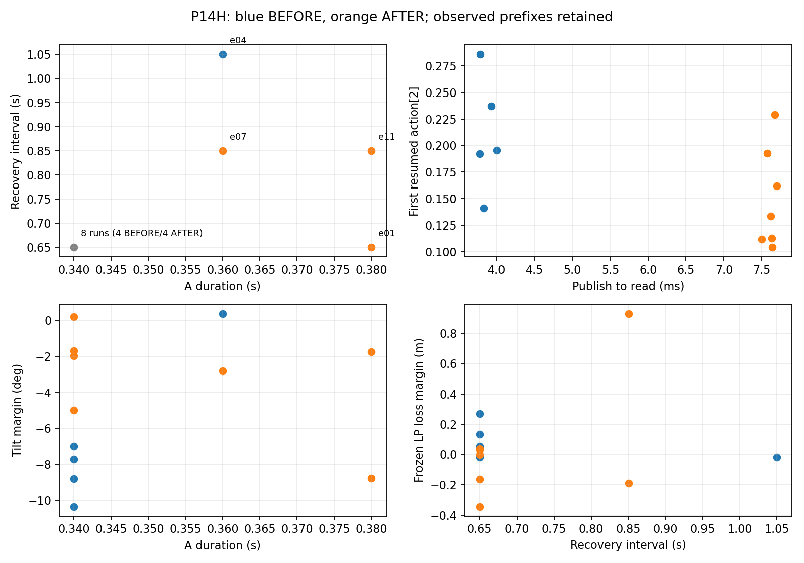
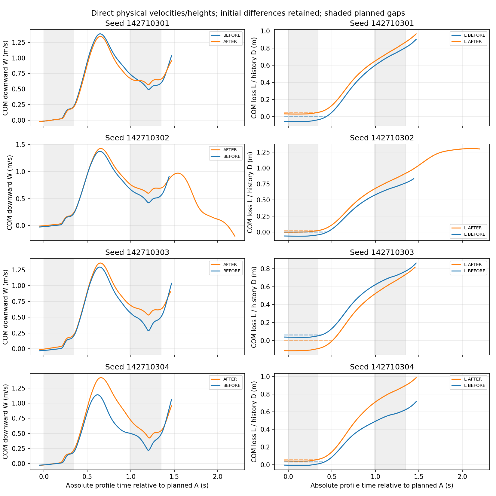

# P14H：分支事件敏感性与闭环地图检验

本轮完成16次headless SITL：机制4次、独立选测12次，预算用尽；没有替换、补跑或实机飞行。冻结提交为`419a2c304fe987e38aaf49f0e00e083741d6d510`，先正常推送并回读，再启动独立队列。原P14G及更早FAIL、UNKNOWN、模型成绩和冻结不回写。

最明确的新结构是：**初始化积压、生产阶段、缓存年龄与未来延迟必须分别建模**。IMU下采样决策和时间队列可以从过去dt恢复；LP、姿态在Run内部依次读取，不能把Run开始戳当精确读取时刻。固定4ms生产模式仍不能覆盖真实全部顺序。

|假设|本轮判决|证据及限制|
|---|---|---|
|H1 分支和事件时刻敏感性优于纯连续敏感性|局部、条件支持；真实余量预测优势未建立|模型内4个跨读取边界验证，连续外推归一化误差0.436–1.578，右侧分支内独立步长预测误差0；16次真实目标读取侧均达到。实际四块余量方向混合，初态不相同|
|H2 名义有偏仍可能得到准确差分|不能作为通用可复用规则；部分局部响应准确|独立四块动作差分L2误差0.0591、0.0164、0.0319、0.0174，只有2/4低于事前0.02尺度；初态、缓存和融合误差不能假定抵消|
|H3 分支搜索计全成本后更有效|本轮未支持|三法各4次、各4/4任务失败，均第一次发现失败。饱和失败池判别力不足；建模、求导、管束与诊断增加成本，未显示净仿真节省|

运动中心的A→接回→恢复→B点连接成立，拼接最大差约1.8e-15；真实来源联合域的完整事件覆盖增量仍为0。完整输出储能从192调用扩展到490调用/1.96s，覆盖声明源码名义分支的A、B及B接回后约0.53s，前后向能量恒等式误差6.62e-24。非线性、浮点、未来观测与模式预算仍未闭合，不能把它写成实际安全保证。

## 运行、工程与分析修订

新被动接口`P14HSnapshot.hpp`在每次成功EKF update后、LP publish前记录25维nominal状态与完整24×24交叉P，未以对角P替代。131072行有界mmap、每行4320字节，正常和异常退出前缀/溢出宿主验证完成。完整P并不等于完整EKF恢复：aiding队列、辅助滤波和更新前状态仍有缺项。

实际PX4、研究电机插件、`policy.tar`及提取的`policy.npz`保存普通文件副本和hash。权重、物理步长、保护不变；源码剥离证明只增加被动记录，另做构建、原注入两次幂等和字段/连续重放核查。固定观测平台是研究对象，没有关闭平台动态等价主张。首飞之前的旧buffer/build错误均保留。

机制d02原整程sample计数FAIL来自inactive阶段累计8次latest-value跳读；活动前缀逐条完整且计数不增加。d04原辅助Timing尾行缺失FAIL及其路径错误保留，新分析明确P11/direct连续状态的完整前缀和未知辅助尾字段。它们没有被改成旧协议PASS。

独立e11的原observer审计FAIL也保留。末OP CALC_POST与末控制调用sample都为68432000，OP在控制读取前25150ns完成；全部序列、成对调用、溢出及错误检查正常。旧实现要求上游生产者末墙时晚于消费者，错误拒绝合法源顺序。独立分析修订仅允许**精确同末sample、生产者先完成、完整pre/post对且无其他失败门**，没有增加时间容差；缺末sample、反向因果、未成对或额外门失败均仍拒绝。15条已完成记录全量回查后确认实验层hash未变、旧进程结束，才继续唯一未启动e12。12条独立记录的结论带此分析资格说明，不混称原audit全部通过。原数据、旧FAIL和新依据见`terminal-audit-revision-v1/`。

宿主独立检查与每条process_stopped证据确认16个PX4正常退出，16条candidate均未漂移，最终无所属仿真进程。新增START_INTENT恰好16；P14R剩余额度未使用。

## 初态和时间语义的实际修正

源`ImuDownSampler`目标参数10000us不等于恒定10ms：float平均、roundf、count和累积dt共同决定触发。四条开发记录的过去触发成员精确恢复，正常主要8ms，也保留其他合法长度。恢复的是决策及20项时间队列，未虚构完整IMU/aiding payload。旧cadence-v2字段“completed”实际取FUSION_PRE开始，scope-v3更正单列。

诊断初态的OP滞后0/4/16ms、LP缓存年龄4–16ms、姿态年龄0–16ms并不相同。新增候选H1保留实际缓存戳、积压、OP环与生产待发布槽，随后假定名义PRE_COMPLETE/4ms生产；H0保留原held实现。三标量error-state原型无约束theta率为−0.470/s，投影到0，v/p率约0.969/0.937/s，训练残差改善很小；失败原型保留，没有继续调参。

进一步全量时序审计确认：Runstart在LP/attitude update之前，外部读取结束是其后的上界；16条记录中有65次姿态生产完成落在该读取区间内，另有1次OP完成样本领先选中控制样本4ms，位于d03约22.45s后段，不能解释此前所有接回误差。旧producer诊断按Runstart取词只是**下界完成词**，部分缺载荷属于诊断时点错误，不能唯一归因EKF。原v1/v2结果保留，4个DIAGNOSTIC_UNCLOSED不计自主成绩。

同样，h_after及当行缓存的可用上界是Timing cycleend，不能声称全部在Runstart以前。全16条初态完成行均在事件A前，最小提前约6.785ms，且早于下一预测控制调用。因此保留“事件前已知信息”的解释，撤回“Runstart瞬时全状态快照/严格Runstart前可用”的主张。物理、OP和缓存仍具有各自年龄与未恢复阶段；输入包和既有评分未重写，未用事后时间平移改善误差。详见`timing-window-audit-v2/`。

已知未来OP完成词替换在d02有效接回前缀把动作RMSE约0.102降到0.0084，d01相应误差反而略增。该替换使用未来时间词，不使用未来物理/融合/cache载荷；它是联合时序敏感性定位，不能称自主改进或唯一因果解释。其余缺失生产模式与一次sample领先提示需要异步事件队列，不能继续把物理步和控制样本压成同一时钟。

## 独立试验与预测

18候选：D=.34/.36/.38s，A接回至B间隔=.65/.85/1.05s，BEFORE/AFTER。B持续.36s，全部运动参考表逐值相同，post_gap只补偿总cruise。随机法均匀选池；连续法使用局部分支导数；分支法保留两个release侧的截距/导数。4个新种子块，块内顺序事前随机固定，三法同域、各4次，全部初态差异保留。

此处的分支法只显式展开两个resume读取侧。±.5ms导数的16项源检查同分支，但+.01s D /+.1s间隔前向核查全部跨了其他离散分支，目标外推误差0.059–0.273；选中的较大步长没有获得严格信赖域认证。原规则及这种失败保留，未在正式结果后改排序。它限制了本轮对完整多参数分支搜索H3的判决，不能推广为所有分支敏感方法无效。

12条独立记录全部任务失败，10条安全截断、2条完整（e04/e05）。11条达到B capture，e07未达到B，按NOT_REACHED保留；它不能作为A安全、组合才失败。没有把不同seed或初态下的单A与AB拼成严格反事实组合证明。BEFORE发布到读取约3.77–4.01ms，AFTER约7.51–7.70ms；估计对象包括缓存与交付总效应。

|方法|启动/任务失败|完整任务|B capture到达|物理墙时|
|---|---:|---:|---:|---:|
|随机|4/4|1|3|324.12s|
|连续敏感性|4/4|1|4|325.50s|
|两侧分支敏感性|4/4|0|4|295.17s|

三条随机法记录e01/e07/e11在B之前已出现任务失败见证，其余9条首次跨阈值在B之后；两敏感法均选D=.34/G=.65，8条都在B前尚无任务失败见证并达到B。这个实际序列覆盖差异有信息量，但两敏感法之间没有独占增益，也不能在缺少对应A-only/B-only时称纯组合诱发。

11条达到B的记录中，B前直接COM当前损高约0.486–1.011m、W约−0.215至+0.922m/s。e04的W已为负（回升），历史D仍约0.785m，随后完整任务高度失败；当前速度恢复不能恢复已消耗的高度余量或撤销历史失败。该例倾角峰值预测仅差约0.13°，完整高度预测仍漏判，进一步说明峰值不能替代L/D/W时间过程。

三法均首次找到失败。安全截断会缩短墙时，不能把分支法较短的物理时间解释为等覆盖计算加速。当前失败饱和、无成功侧边界括号，无法建立普遍发现率/低漏判率或边界收紧优势。

预测分三层：启动前四个开发初态的先验预测/排序是真正事前材料；新记录的实际初态包按冻结配方在事后重建，预测进程隐藏全部未来数据，属于冻结模型的条件回查；未来时间词替换和八项同初态反侧传播全部单列诊断。它们不增加独立飞行样本，也不能重新包装成task0全任务前瞻验证。M3/M4/M5及旧轮前瞻成绩不变。

原评分v2的`risk`使用共同观察窗，完整预测的更远未来另有forward峰值；因此下面保留的是**共同窗/失败时刻漏判**，不能误称全部都是完整任务标签漏判。

|项目（H0/H1相同）|实测危险/安全/未知|共同窗漏判|误报|预测UNKNOWN|可评分覆盖|
|---|---|---|---|---|---|
|倾角|10 / 2 / 0|0/10|1/2|0|12/12|
|LP高度|6 / 0 / 6|3/6|0/0，不可评|0|6/12|
|任务OR|12 / 0 / 0|1/12|0/0，不可评|0|12/12|

`risk-scope-v1/`另外使用完整事前预测时域，保留旧分数：完整预测高度漏判1/6，其他5条已知高度失败的预测首次越界仍迟约0.060–0.452s；e02/e10的共同窗高度漏判对应约0.20/0.14s迟判，e04完整预测也未跨过1m。完整任务OR仍漏1/12。这样既不把迟判包装为成功，也不通过UNKNOWN消除旧漏判。实际高度未知6条来自安全截断，完整实测仅2条。

原始四块AFTER−BEFORE的接回后0.5s倾角峰值变化依次约−0.648、+0.360、−0.183、+4.642°，方向不统一。物理COM初态相差2.76–8.19cm、LP初态1.39–2.86cm、h差0.0246–0.0655、估计姿态差0.222–1.447°。八项后验同初态反侧传播预测的倾角增量均约+1.16–1.48°，不能把它当真实同初态实验。来源、差分、幅值误差和缓存年龄均原样交付，未做事后筛组或回归校正来制造匹配。

时间过程仍有实质误差：11条达到B的记录中，B前COM高度误差约0.001–0.107m、W误差0.009–0.225m/s、物理SO(3)误差1.52–6.77°。例如e01在A后约45ms已超过0.1rad/s角速误差尺度，早于2.5°姿态差及0.1m位置差。不同误差阈值的先后不构成唯一因果证明。逐条首次偏离、0.064/0.5/2s窗口及全共同前缀见`physical-errors.json`和各evaluation目录。

上图使用固定绝对任务坐标；阴影是计划窗口，未按实际capture、峰值或终止事后对齐。实线L可恢复，虚线历史D保留。W来自同物理步直接COM速度，未用回调差分冒充物理速度；LP/COM/model-origin高度在事件表分列。四组初始差异仍然存在。

## 相关管束、储能与地图后继

同P14G原来源联合域的全部两个fiber×四quarter保留，没有只选最佳quarter或缩为微小盒。其间连续插值可达性未证明，也没有宣称该旧域覆盖全部新的P14H初态。零/小域64ms面板与实际域2s请求分别报告，不能混成同覆盖比较。

源码关系压缩的实际域信息尺度约在53–54调用失效；完整输出W压缩约51–53调用，显式AB尝试的外包在264–272ms失域。这里是条件外包/算法精度终态，不能推断真实轨迹必然分叉或实际退出工作域。动作宽度先超过0.2尺度；代表quarter当时初始同源项约0.00375、非线性项约0.0645、round/libm预算项约0.0227，clip项约0.025。它们是算法分项，非真实噪声或可相加因果贡献。浮点/libm预算没有因此得到完整认证。

完整W避免八行随机sketch的符号抵消，保留全前缀输出的平方能量，但本次降阶更贵且未改善精度：八项实际域W比较约1048 CPU秒，源码关系约152秒。discard方向仍逐状态行外包，capture/hidden/action/pending等源关系恢复；没有通过删除后继必要状态取得窄界。这只否定当前有限构造的优势，不否定所有输出导向或多步储能方法。

点地图`map-v1/result/edge.json`实际连接A前→capture→完整hold→resume→recovery→B capture/resume，并从后继状态续算；h/previous/mean/count、OP环、生产/交付队列、filter、reference与D不重置。四个来源点均完成两次capture，续算差约1.8e-15。它保留原P14R三/四事件点接口；本轮没有把点深度提升为联合域深度，也没有把B书签当实际事件。完整联合事件深度仍0，首失域后后继为TOP/UNKNOWN。

储能先做192调用/.768s、856维全前缀pullback，再在同一方法上扩展到真实AB计划490调用/1.96s，覆盖B接回后约0.53s。后者335.37 CPU秒、峰值RSS约8.15GiB；前后向能量数值差6.62e-24，无名义源域退出。首版checkpoint重名错误在32调用被不可覆盖写入器拒绝，旧矩阵前缀和错误保留；新版逐段保存前向J/C，未重飞。整个C理论范围累计约2907.26 CPU秒，低于事前3000上限。

具体关系是

`Qpre[k] = Jkᵀ (Cpost[k]ᵀ Cpost[k] + Qpre[k+1]) Jk`，

`W=eᵀQe`，`sqrt(Wnext) ≤ sqrt(eᵀJᵀPnextJe) + ||Pnext^(1/2) r||`。

固定线性模式、r=0时，初始W控制所声明时域全部输出误差能量；高度输出使用H0差，仍需检查初始D和所有前缀绝对名义余量。捕获/接回按`e+=S_m e-+j_m δt+r_m`连接；仅靠半范数复用还要求核空间兼容，否则必须携带完整联合后继。单步放大可以存在。轮询/顺序边界采用离散分支比较，没有不满足横截前提的saltation公式。

未完成的是非线性r、模式/时序、真实未来融合与数值预算；完整H1新producer也没有被这个H0名义分支W自动认证。新490调用W未重新用全联合域降阶测试，不能用其线性恒等式改判先前管束失败。F4不安全名义中心也不可能靠任意缩小周围集合制造安全证书。A4保持NOT_PROVEN_EXCLUDED。

交接仍沿已有同一接口：真实C→N入口、shadow/history选择、连续执行器及N段停流/接回可复用；已有N→C首原始控制输出协调条件保留。运动N→C经典参考模型、allocator等活跃流状态未恢复，后继仍TOP_FOR_ACTIVE_CLASSIC_FLOW。本轮没有新增交接有效性主张。

## 成本、决策和后续

16次物理运行合计墙时1299.72s、wrapper及所属子进程CPU约616.23s，包含全部4条开发；独立12次约944.79s。离线建模、编译、求导、重算、失败分析、集合、锚点与图表均计入追加账本，最终计费见`final-cost-receipt.json`。其中944 CPU秒是历史管理缺测/命名空间漏计的保守allowance，不是实测；不能声称全局14400秒硬帽已形式认证。前期legacy管理CPU与很小的发布/退出尾项仍未完整测量，缺测未填0。继承的P13约7833s物理记录、P14R/G依赖成本另列来源，未当成免费模型训练证据。

本轮随机法已在第1次找到失败；方法额外费用没有换来已证的试验节省。相同目标、相同执行预算才可比较，不能用4ms模型步长和仿真墙时作速度比，也不能把安全截断较短当覆盖效率。图表和模型版本不增加独立样本数。

当前值得保留的是源码合法分区、真实读取门、完整联合状态/历史D接口，以及分开记录模型误差与传播保守性的流程。停止“由OP时间常数推出EKF衰减”、已被记录否定的小创新硬预算、八行sketch优越性及本次稠密W压缩优势主张。连续外推穿越未显式展开的D/G分支也不能作为认证搜索步长。

下一项最重要工作是**按源码读取区间实现异步物理/producer/cache/控制事件状态，并在每个D/G合法cell内限制导数步长，边界两侧显式比较**。现有16条时间和物理记录足以先离线检验：实际顺序应全部成为合法成员；完成行初态上界必须早于事件；独立前向步长逐轴检查；动作0.02、倾角2.5°、高度0.1m等事前尺度上标明哪段可信及首次失效。不能再把下界Runstart当唯一消费瞬间。

|后续问题|已有数据是否足够|最小后续需求与停止规则|
|---|---|---|
|异步事件队列、读取区间、D/G cell及误差归因|可先离线完成，新增飞行0|保留上下界与所有合法源顺序；不偷读未来词作自主输入；失域输出UNKNOWN|
|非线性余项关联、稀疏/结构化储能和向外数值认证|属于离线算法/证明工作|同一原始域和资源对照，不能用实测max当未来界；本轮有限C预算不继续追加|
|未来融合响应的初始化及aiding状态闭合|post-EKF P不足以唯一恢复|若离线重建仍失败，再独立授权最少4次：resume边界两侧×2新seed。只在接回窗口保存更新前完整P/辅助状态、实际aiding样本身份/方差/创新/门控、相关队列和gyro/cache copy阶段。用于区分生产时序与融合响应，不是总体可靠性验证；先宿主格式/容量/异常保存，身份/时序错误隔离，科学失败保留|
|运动N→C活跃经典流|缺特定源状态|另案保存q_ref、omega correction/command/init、yaw torque滤波和allocator首消费状态；不挪用本轮额度或自动运行|

## 交付与复核入口

- `data/p14h-20261027/experiment-freeze-v1.json`、`freeze-publication-receipt.json`：冻结、普通运行版本和远端回读。
- `attempts.jsonl`、两版independent-execution：16条唯一身份、终态、修订及未重启证明。
- `delivery-v2/`：逐事件COM/LP/L/D/W/history/执行状态表、三法结果、物理误差、原始hash、条件地图及机器摘要；`risk-scope-v1/`单列完整预测与共同窗/迟判。
- `producer-diagnostic-v1/v2`、`timing-window-audit-v1/v2`、`counterfactual-response-v1`：未来实测用途、失败前缀、时点纠正和有限反侧诊断，均未混入自主成绩。
- `sets-v1`、`sets-AB-v1`、`gramian-v1`、`AB-storage-v1/v2`：全量失败、资源、矩阵与条件关系。
- `host-after-all.json`：真实宿主及16条所属进程终态；最终测试、历史保留和CI回执分别记录。GitHub无工作流/检查项时报告“未报告CI”，不写绿色通过。

复现见`THOR_P14H_REPRODUCE.md`。原始大文件保持本地，不删除历史；发布只包含小证据、源码、参数、报告与图。没有P15、额外SITL或借用历史预算。

分析修订均有旧版留痕：paired-v1把旋转列误作速度列，paired-v2按源p[0:3]/v[12:15]和原始目标框重建裁剪；response-trials-v2意外重复24项开发计算，全部计成本、不增加样本；selection-v1相对exec路径失败、v2漏计namespace子进程、v3复用23项并补计；timing-window-v1只纳入information.json漏掉两条v2记录，v2全16条回查；producer-v1终点ceil多取一调用与读取时点解释问题在独立版本修正，失败前缀保留。上述改动未修改冻结模型、阈值或物理处理。
