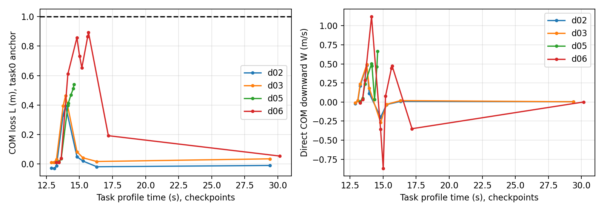
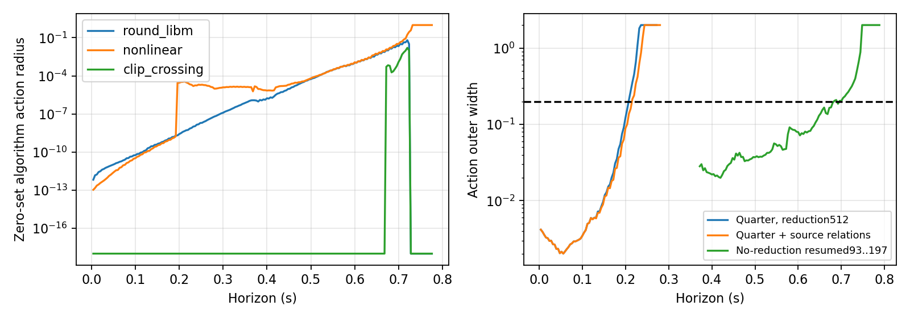

# P14之后独立方法打磨报告（P14R）

本轮把“日志很像”和“模型能自主推进”进一步分开：真实OutputPredictor及缓存选择可以重建，运动源物理核在恰当事件初态下的已知命令重放非常准确；但自主模型的未来融合创新与时序假设仍不足，F4倾角/高度漏判未消失。相关集合的主要新发现是后段降阶会制造显著反馈保守性；关闭降阶获得更长的保持—接回传播，同时暴露计算成本瓶颈。地图状态/交接骨架值得继续，当前尚不能替代真实仿真做完整安全筛选。

## 实际执行与证据边界

基线与远端main均为 `69ca54ff3029df671de740cf0a4ab4495b03b44a`，开工dirty清单和容量见 `start-state.json`。所有新输出在 `data/p14r-20261027/`，旧P11–P14 motion的失败、停止、前瞻成绩和A4不回写。本轮6/8次START_INTENT，5条有效、1条隔离，剩余2次不凑跑。

|身份|用途/版本|实际终态|
|---|---|---|
|d01 NORMAL seed142710101|首版被动记录|飞行后PX4 -11；fusion满16384并丢6908，隔离；不替换|
|d02 A seed142710101|v2进程寿命记录|退出0，工程/物理/观测PASS，任务成功完整|
|d03 A seed142710102|同分支诊断复核|退出0，三接口PASS，任务成功完整|
|d04 NORMAL seed142710102|被动正常复核|退出0，三接口PASS，任务成功完整|
|d05 F2 AB-short seed142710103|预封存后的定向组合诊断|退出0，三接口PASS，原保护触发，失败截断，A/B均到达|
|d06 F4 AB-medium seed142710103|另一条件的定向组合诊断|退出0，三接口PASS，任务失败但完整|

d01的静态析构/后台写入风险被定位并通过20次宿主异常生命周期及容量试验缓解；不能把溢出或该风险直接宣布为崩溃唯一原因。已独立核实所属PX4/Agent/Gazebo均结束。v2无析构关映射，完整性依赖已退出进程、committed序列、长度、hash及活动窗覆盖，不能以complete标志代替。

新增状态记录是固定研究平台的一部分，不宣称相对旧无观测控制器零扰动。权重、保护与控制赋值未改变；source-closure、实际构建/副本、唯一注入及幂等记录均保留。新大文件保持本机，不删除历史。

## 1. 观测与交付链实际闭合到哪里

每条记录在55秒之后只初始化一次，后续给实际IMU增量及实际融合输入，真实OutputPredictor源码对所核31个q/v/p/垂向/偏置/校正积分字段连续重放逐位一致。d01虽在完整fusion文件溢出后，仍可用此前环缓冲加core实际输入重建，原隔离状态不变。启动早期单步fusion误差最高约1e-4、first-write重建限制保留，不能宣称整场每个字段逐位一致。

给实际物理轨迹但固定未来融合残差，单A前2秒仍有约0.1m LP、2°级姿态偏差。替换实际融合输入后明显下降；再给实际缓存选择词，LP和姿态重建到数值精度。三种来源分层保存，不混入自主成绩。gyro由原DFII延迟状态及source-shaped输入产生，残余约0.002rad/s；并未把原始机体角速直接当控制器gyro。

具体两调用差：历史F2短间隔A接回的发送落在前一次允许读取之后约0.19ms，等到下一次约8ms读取。发布器是ROS服务循环后的stream更新、gap退出立即发送，不是固定4ms周期。原8个固定poll代表词不能容纳该记录的B捕获；该失败保留。新的有状态deadline投影在显式host服务/运输条件下覆盖78条记录112次capture/resume；这不是host未来硬保证。

缓存更新与读取还会换序。实际姿态缓存年龄0/4ms，LP可0/4/8ms；d06起点OP比控制sample落后8ms，d02–d05为4ms。自主8词只覆盖持久PRE/POST/运输代表，不包含全部逐步切换。未来时序条件不能从实际词偷取。

## 2. d06漏判的有限替换调查

所有新计算统一为回顾性/诊断；d05/d06之前结构和参数封存，但预测是在事后读取各自A前初态运行，不能称task0全程独立前瞻。未来数据目录在自主子进程中隐藏，已知未来注入另存。独立初态阶段审计核对了五条同次调用的起止和下一次调用：初态包含observe缓存与该调用的post h/history，OP/物理/gyro前缀则截止Run开始；所有信息均早于首次预测调用，但它是分阶段历史表示，不能称同一瞬间的完整仿真器快照。初始调用内尚未纳入的异步生产者推进由名义时序近似，d06的8ms滞后因此仍是模型义务，未事后改初态或重算美化分数。

新增已知命令重放从真实A前COM/相位/filter初始化一次，后续只给已消费命令，不重置物理状态。五条记录前2秒位置/速度误差约1e-9–1e-8m量级，SO(3)约1e-8–1e-7°；完整任务共享前缀另列。原从任务起点延伸到降落/域外的长尾误差仍保留，不能拿它解释A后最早漏判。

给实际缓存和实际读取/native词，连续携带h/previous/mean/count的动作误差约1e-6；只换其中一层仍有显著误差。d06前2秒：固定融合模板+名义交付的动作RMSE约0.276；只换实际交付约0.205；实际缓存+名义交付约0.188；两者实测给定后约3.4e-7。这不是可相加归因比例，而是两条连接共同影响反馈的证据。现有证据不支持把最早漏判直接归因于SERVO求解残差。

|主名义词，5条有效记录|真实失败|漏判|误报|预测UNKNOWN|有效分类/整程误差分母|
|---|---:|---:|---:|---:|---|
|倾角|2|1|0|0|5 / 4|
|高度|1|1|0|0|4 / 4；d05实际高度UNKNOWN|
|任务OR|2|1|0|0|5 / 4|

短窗表现也不能由分类替代。主词的物理SO(3) RMSE（旧互补→源OP）在0.5秒/2秒窗分别为：d02 1.902→1.858° / 5.531→4.154°；d03 1.156→0.942° / 6.595→5.075°；d05 1.451→1.687° / 2.913→2.040°；d06 1.835→0.761° / 10.191→6.768°。d05短窗变差与d06剩余漏判都保留。

实际clip发生在目标yaw坐标各轴：d04正常无clip；d05在B前已有横向位置约0.224秒饱和，B接回后出现垂向位置约0.052秒饱和；d06在B前垂向位置连续约0.988秒饱和、B后再约1.536秒。主名义模型后者仅约1.028秒，说明完整时程差异未被任务OR汇总消除。相同A的d02/d03也有不同垂向裁剪（d03约0.244秒，d02没有），不能把clip存在直接当唯一失败原因。本轮没有新增修复对照，不据这些定向记录增加修复因果主张。

8词不是40条飞行；共享窗口/模型也不增加独立样本。其余词和全部0.5/2秒事件窗、全前缀误差、首偏离位置见 `registered-score-v1/`、`registered-errors-v1/`。任务OR正确不能抵消倾角漏判。

## 3. 历史残余与绝对高度

|记录，在计划B到来前|COM当前L m|历史D m|直接向下W m/s|
|---|---:|---:|---:|
|d02 单A，B仅时间bookmark|.395|.395|.114|
|d03 单A，B仅时间bookmark|.464|.464|.184|
|d04 NORMAL，B仅时间bookmark|.0083|.0286|-.0105|
|d05 F2 AB|.413|.413|.472|
|d06 F4 AB|.857|.895|-.358|

d06在B前已经向上运动，仍只有约0.105m历史COM高度余量；恢复的W不能撤销已消耗的D。其倾角首次超过45°约13.676s，在A接回后、B开始14.815s之前；高度首次越界约15.892s，在B之后。不能把这条记录说成“单事件安全、组合才失败”。d05倾角首次越界约14.544s，紧接B接回。没有新的同seed单A/B/AB随机块，不能据两条定向记录给出纯组合因果或总体风险概率。

事件表分别记录COM、model-origin、body、LP高度和各自基准、W来源、h/action/history、filter/joint/命令、缓存年龄/提交阶段及实际capture/resume。真值与LP不等同，回调差分不冒充物理速度。早期事件表将D从起飞前地面累计的错误独立保留，v2只从固定task0前向累计；冻结评分未更改。

## 4. 相关域、结构改进与失精度

B先保存旧66个真实前缀，以离散模式/cache类别分组。8方向外包具有显式成员见证，不止逐轴box投影；旋翼相位与pending/consumed被补齐。实际传播严格按预登记每族12点，共24点，未按结果选点。旧日志没有OP环缓冲，使用旧观测近似并明确限制；不能把旧平台支撑冒充新增平台覆盖。

新增d02/d03的连续联合曲线有真实端点，但内部未证可达。目标读取年龄虽均8ms，publisher年龄不同；最终用两个本源时序fiber的保守并集、每fiber四段。D0分别.00745/.05869m，必须同源携带；v6之前仅取一条D0及一个publisher状态的结果保留，但不能支撑整个联合初态。

实际完成的有限结构对照：

- 操作数对应的gamma预算、稳定clip/ReLU、解析局部曲率；不调低验收阈值。
- 同源二次单项式及smooth二阶项、三阶解析余项，压缩时保留单项式ID；四分段联合曲线的并集没有删除原域。
- N-only源OP的死状态投影，移除旧互补模型专用状态；精度基本未改善，只略减计算。
- 源图关系恢复：临时h→action→pending，以及提交时live h复制；相对默认压缩只小幅延缓失精度，未取得完整事件证书。
- 完整无压缩对照与相关后继检查点续算，检验后段重整化影响，而非重复假设B处rebox为主因。

同尺度第一阶与相关高阶的改进是有限的：全曲线信息门约24→26调用，四分段代表约49→52调用；默认512方向仍在约66–70调用离开外包工作域。它不是实际飞行已经发散的证明。无压缩在同一quarter上显著延长保持/接回传播，原900 CPU秒试验到180调用，生成列约50万。数值G与源状态在resume检查点恢复8调用逐位一致，随后继续A恢复至B的有限尝试。续算完成105次调用（原编号93–197），约746秒；信息门在141调用首次失效，源工作域在197调用首次失效。因此同一quarter在A接回后保留约192ms的信息精度，工作域包络保留至约416ms，未到B、0.5秒或2秒恢复目标。恢复8调用动作宽逐位相同不代表此后仍精确或有用。原180调用进程的137/SIGKILL与预设900 CPU秒硬限相符，但未独立证明信号来源。原失活进程未保存全部早期倾角行，不能由resume后93–196的安全余量推断整段所有前缀倾角安全；检查点和保存的前缀范围单列。不能用单quarter取代两个fiber全域。

零物理初值半径不等于零算法宽度：旧源OP对照约177调用过信息门、194调用外包失域。0.0334的round_libm分量是算法gamma/假定libm预算经反馈与外包放大，不是认证的实际binary32舍入误差。运动中心与源float/NED近似之间的差异也独立列出。无压缩64ms与压缩很接近，但后段明显分开；说明不能据短窗排除后段压缩影响。

四项事前登记的未来创新对照也已完成：小预算（姿态0.001rad、速度0.01m/s、位置0.01m）的持久创新与每次融合独立创新分别在34/30调用失精度、52/47调用失域；大预算（0.05rad、0.15m/s、0.1m）均在6调用失精度、27调用失域。这些是不同时间相关假设的条件外包，不是由未来实测最大值认证出的误差界。创新条件本身不能从剩余两次类似飞行中认证，更多同类数据也不能解决压缩/余项算法的证据缺口。

浮点求和、libm、线性代数降阶的完整向外认证未完成；源NED近似、真实未来EKF创新、SERVO/约束模式仍是不同义务。条件实数外包不是实际PX4/DART的未来保证。A4仍NOT_PROVEN_EXCLUDED。

## 5. 地图组合、储能和交接

点地图已实际完成四次合法停流/接回事件，保存OP完整环缓冲、传感器积分/gyro delay、publisher/运输/读取槽、h/mean/count、filter及COM/LP历史D。各边输出直接恢复续算，与不中断轨迹最大差约3.6e-15，不能以重新清空状态制造一致。有限24个旧来源支撑点也完成2/3/4事件名义计算，但不成为连续集合证书。

相关管束的resume检查点续算是集合层实际组合进展，受明确模式/时序/模型缺陷条件限制；不能在失域后仍发safe后继。全部合法native平台/追赶未由代表词覆盖，输出接口保留相应条件/UNKNOWN。

时变储能使用真实解析一阶链，16调用、含联合状态交叉项；最终重新计算版本为 `storage-v2/`。`P_k=C_k^T C_k+A_k^T P_next A_k` 数值恒等式残差约4e-20，p/h交叉块范数约5.68。另检查捕获/接回copy/select矩阵与不变物理/history行。它提供可复核接线，不是完整非线性恢复证书；所有前缀绝对余量及r预算仍须同时满足。

真实C→N RINI4的shadow h/classic previous复制误差0，首个hidden/action重放约1e-7；mean先按源重置，再由count0覆盖，执行滤波连续。实际混合词是C→N入口加N段断流/恢复，不宣称运动N→C经典闭环已完成。

N→C可独立做的部分继续完成：实际PX4 Position/Attitude/Rate源码核已离线编译运行，同一输入但保留/冷置姿态参考状态使首角速差0.473rad/s，保留rate积分使首torque差0.0748；线性积分差关系误差3.7e-9。另用独立预设raw torque目标(0.01,-0.015,0.005)反求 `I_req=target-Kp(rate_ref-omega)+Kd*omega_dot-Kff*rate_ref`：最大所需积分0.111623小于源码限幅0.3，真实控制核首输出误差9.3e-10。这是非空、可计算的首个原始控制输出协调条件；不是物理Nm、分配后力矩或整段交接安全证明。现有日志有13719条rate积分输出和7228条姿态setpoint，却只有9条route证据，不能唯一还原参考模型初态和消费词。还需q_ref/omega_correction/omega_command/init、yaw torque滤波及首个allocator状态；同接口明确停在TOP_FOR_ACTIVE_CLASSIC_FLOW，不伪造经典冷启动。

### 全前缀高度条件的具体可计算结果

在无接触、理想四SERVO、转速150–1000、物理速度范数≤8m/s、各角速≤8rad/s、倾角≤80°、零风的声明源模型域内，以源码质量/惯量、旋翼阻力与杆臂导出COM向下速度增量界约15.38m/s²，几何离散位置缺陷界约2.87e-6m/步。这里包含推力方向、旋转/惯量及filter关系，没有把实测最大值当硬界。

`L_j ≤ L0 + j dt W0 + A dt² j(j+1)/2 + j eta`，
`D_j ≤ max(D0, max_(i≤j) L_upper_i)`。

以单quarter续算140调用的条件区域为例，L/D上界0.11648m，W上界0.99465m/s；128ms全离散前缀损高上界0.37382m，余量0.62618m；该保守关系允许的最大整数时域为276ms。它是充分储备、不是实际必要损高或最优恢复时间。未来保持该工作域、实际joint/SERVO与浮点缺陷、LP创新桥、倾角判据仍待闭合；该例也不补齐失活进程丢失的早期倾角前缀。详见 `height-constraint-v1/result.json`。

## 6. 用途、成本与下一步

本轮适合做源连接诊断、识别事件/缓存模式、构造保留真实历史的候选地图cell与选择核验位置。尚不适合整程风险安全准入或宣称减少仿真。

同目标直接取得这六条诊断原始信息，仍需要六次仿真；本方法加上了离线构建/集合/诊断开销。旧78条P13数据的实际物理进程时间约7833秒也列为依赖成本，不能当免费锚点。单24支撑点的名义计算约14.5秒不能直接与24飞行作等覆盖速度比。全部新增启动、失败构建、宿主测试、可记录计算墙时、端到端建模时间及未计量CPU项见成本账本，净收益NOT_ESTABLISHED。

下一步最重要的不是再扫A/B矩阵：先把接回后的融合创新/读取顺序变成有来源的联合条件，并用避免后段包裹的表示传播它。数值方面需要保留时生余项的相关性和经认证的数值外包；更多同样短飞行不会消除这个算法瓶颈。完整EKF不是唯一表示，但若不用它，就必须有可检验的输出创新状态/时序契约，不能把过去最大残差当未来界。

确需新采集的最小候选是一个移动N→C工况×两个seed，专门保存参考模型、消费次序、经典缓存/积分/分配器到首物理消费的同身份字段；先宿主格式/异常保存验证，原保护不变，关键身份/时间缺失停依赖部分。它用于区分参考模型残留与积分/分配边界，不是总体可靠性样本。本轮未执行，剩余2次不因配额而启动。d06误差定位所需的信息已在已有记录中离线使用，没有为分析错误重飞。

## 验证与发布

所有旧错误和修正版分开：首版记录崩溃/溢出、旧协议绑定、种子uint32纠正、B支撑预算解释、ABI路径、目标待消费槽、D累计与联合初态时序覆盖、旧ULog测试锚点均有证据。旧测试失败保留；当前测试改为唯一canonical direct trace的相同前后顺序，未放宽预读契约。

最终版本89项Python回归通过（含新增D全前缀/分阶段初态/不支持的恢复配置拒绝/经典首输出条件）；80ms自主重复传播逐位一致，8调用集合恢复检查单列。实际PX4构建、注入幂等、宿主容量/异常生命周期、旧hash保护与GitHub CI分别记账。最终交付机器结论、地图和成本入口为 `data/p14r-20261027/delivery-v3/`；旧delivery-v1/v2均保留。发布SHA与真实CI另见最终发布回执。没有P15或额外飞行批次。未完成项是具名的观测创新/时序覆盖、非线性集合精度与数值认证，以及经典活跃流输入；不会用工程PASS代替它们。
