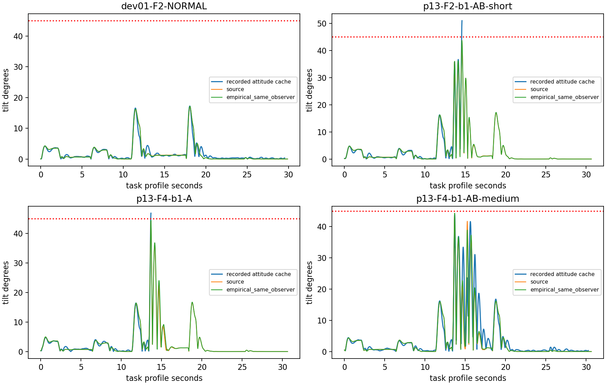
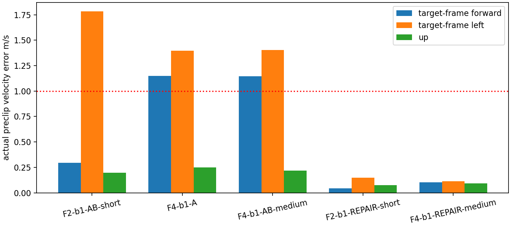
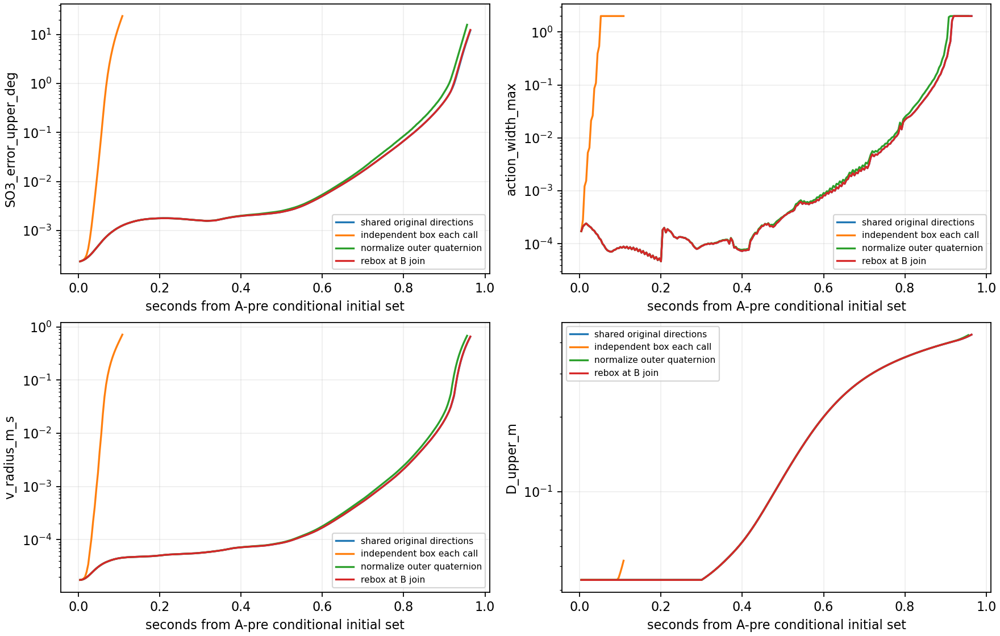

# P14 独立离线补充：运动名义轨迹、相关管束和事件地图

基线本地/远端 `eed2f84daca23f7a36fce8c4ab0ea8b1fba1512c`，没有覆盖后续工作。新增 SITL=0，启动器调用=0，历史预算使用=0。新路径 `tools/p14_motion/`、`data/p14-motion-20261027/`；原 P14 canonical、前瞻分数、FAIL/STOP/A4 均保留。

## 六个直接回答

1. **非零名义角运动能被运动中心吸收。** 原 extension 只否定固定 level/zero-omega 名义点的源不变性，没有否定运动管束。本轮源角/平移/执行、观测/cache、NN/history 的完整条件连接实际走过 capture、整个保持、接回和 .5s 恢复。真正瓶颈是现实观测/时序覆盖尚缺，以及较宽集合内 NN/观测/执行联合非线性与外包余项增长；不是名义 omega 非零本身。
2. **最小观测模型需要动态状态。** 源 gyro 的两组三维 DFII delay、bias/device 模式可以从已有前缀恢复；LP p/v、独立 origin、姿态校正/漂移、缓存值和更新年龄不能合成一个常量偏差。完整 EKF 不是表达输出动态的必要条件，但未来融合校正集合和未知内部 buffer 初态仍需源码/数据认证；现在的互补替代没有覆盖声明。
3. **第一条边在很小条件域内有可计算后继，尚不是现实精度的通用地图。** F2 的微小场景通过整段 A 和接回+.5s（起点后 .868s），p 半径 .495mm、SO(3) .213°，离散全前缀倾角/高度余量 10.43°/.618m。到 B 前仍有区域，但动作宽 1.63 已失去辨识精度。1cm 等原场景仅8ms便超信息门；不能拿微米初态盒冒充真实 EKF 覆盖。整次 .964s 到域失效计算21.78s、约107MiB峰值RSS，当前 Python 实现不宜称实时轻量核。
4. **可与时变/分模式储能连接，但没有收缩证书。** 已将实际 checkpoint 联合生成元转成相关椭球并计算；capture 是共享列的线性复制，hold/resume/commit 各有算子。接回后 Gram 形状快速增长。下文给出具体多步条件关系，不要求孤立 GRU 收缩，也不宣称已经证明整事件安全。
5. **地图应保存条件转移与误差来源，按恢复/交付边界自适应细化。** 保留相对任务状态、物理/估计分离、活跃 history/filter/cache/clock 和 D；共享平移可以商去，独立 EKF origin 不可。优先细化接回的消息消费/缓存阶段与误差创新，而非只在 A/B 两持续时间上建二维格。最有信息的后续真实测试是同一单 A 接回前后同步取完整输出预测器/缓存状态，区分观测校正与一调用交付差异；本轮不采集。
6. **外部字段缺口具体在融合时间过程，不是缺更多完整求解矩阵。** 所需字段及阶段见接口页末前一节：融合前/后 q/v/p、output buffer/索引和误差积分、delta-angle correction、bias/device/filter delay 与各 publish/read sample/native/物理步对应。已有输出 topic 不唯一恢复内部状态；现有重型 SERVO 数据继续保留，无新增矩阵采集。

## 源码解释的纠正

[逐项语义表与交接接口](THOR_P14_MOTION_INTERFACE.md) 给真实实现、旧 M14、替代模型、原始可用范围和源码定位。M14 只新增垂向互补近似，角/水平仍来自 M4；`att=oldq` 是一模型步延迟，gyro 是经验 omega，LP8ms/native4ms 是声明名义词，不是实际未来状态读取。

本次首先发现并保留一个被否定的坐标假说：物理与估计姿态有约5.3–5.8°初始航向差，**不能据此旋转 LP 导航速度**。GZBridge 直接传 N/E/D GPS 速度。四例不旋转的 body/LP 水平速度 RMSE约.035/.035/.035/.043m/s；按姿态差旋转约.072/.077/.061/.075。最终 Nav=I，姿态 align 独立；未按结果拟合新角度。

原 P14 共享生成元可使 capture p/v、减速 reference 和同源物理量相消；实际 h/previous/mean/filter 也共同推进。但 ReLU/clip 跨模式、乘积二阶余项、姿态归一化外包、SVD 独立坐标振幅、丢弃列的逐行 L1 盒都会丢失高阶或列间约束。把每个新变量重新装成独立盒损失更大。当前方向保留法保留初始列与512条原余项方向，尾部才逐行外包；不能称无损压缩。

## 实做与误差定位

四例在计算前固定：开发 `dev01-F2-NORMAL`，正式块1 `p13-F4-b1-A`、`p13-F2-b1-AB-short`、`p13-F4-b1-AB-medium`。它们是有意选择的诊断案例，**不是4个新独立块**。全部新成绩回顾性，原 M3/M4/M5/M14 前瞻或既有成绩不变。

唯一主要运动连接含源推力/阻力/转子惯量/spin/FreeJoint，物理姿态随动作推进；独立观测 q/gyro/三轴 LP、8ms cache，真实 NN 权重和 h/previous/mean/count，原滤波/消费/超时/接回语义。有限对照为同一观测下经验角核、去gyro滤波、去姿态一步延迟；F2另有两个明确调度/消费情景。未知未来调度没有从日志借入。自主子进程隐藏全部 data/export、隔离网络/PID，只复制过去初态和计划。

**给定实际未来命令的开放重放与自主分开：** 四例每步真实Pre的源核核对 p/v约3e−13m、omega≤4.6e−12rad/s，这是后验单步关系。只初始化一次、用未来已选择命令，F2短AB全14.58s记录最大p=.00494m、v=.00927m/s、倾角=.104°；F4-A全13.68s最大p=.00140m、v=.00204m/s、倾角=.0152°。NORMAL和F4-AB-medium长期分别在约22.00/22.47s离开预定域；不解释失效长尾。它们不能称自主预测，也不证明所有 DART 未来模式相同。

**gyro的可定位改善：** 已有 raw sensor +当时实际估计bias的独立重建，在四例 RMS 2.7–4.8e−6rad/s、最大≤1.19e−4；不滤波 RMS .0064–.0422、最大可达.425。raw/bias未来输入仅用于该诊断。自主仅用初始前缀确定两组delay和输出bias；未来bias冻结是近似，动态notch在本参数域关闭。物理 omega 与过滤后的实际控制输入不能混称。

`analysis-v2/<case>/analysis.json` 给 p/v/SO(3)/omega、LP/cache、input、h/action 每层首次超阈值括号和各事件阶段。阈值预先固定为.1m/.15m/s/2.5°/.1rad/s、input .1、h .5、action .1。source 的物理角速首次偏差在 F4-A 约.052–.056s，其他三例约11.34–11.78s；cache姿态超2.5°约11.68–12.03s，h差>.5约13.444–13.452s，进入A捕获附近。物理姿态偏差可更早超过2.5°，与独立估计姿态参考不同，不能混为一个误差。

|source自主：固定四例|倾角峰值°|倾角比较|高度比较|OR|
|---|---:|---|---|---|
|NORMAL|16.927|一致|一致|一致|
|F2-AB-short|43.699|漏判|实测截断UNKNOWN|漏判|
|F4-A|44.164|漏判|实测截断UNKNOWN|漏判|
|F4-AB-medium|44.101|一致|漏判|漏判|

这四例真实倾角失败2条，漏2/2，误报0，倾角UNKNOWN0；高度真实失败1条，漏1/1，误报0、实测删失2条。四例OR失败3条均漏，不能宣传源角模型已改善危险预测。有限对照和全部逐窗分母均入机器表。F2 A后.5s倾角最大误差约3.02°，延长到2s/第二事件出现漏判；F4-AB-medium A后2s最大倾角误差22.56°。峰值相近不等于时程准确。

未来缓存替换另存 `cache-diagnostics-v1/v2/v3-edge`：v1按profile最近过去，v2按精确sample，v3从A前条件初态开始，均不进入自主成绩。v3中换实际姿态/gyro/三缓存后，F2首个明显input/h/action差仍在名义接回13.616s；实际接回约13.624s。说明仅改物理角核/滤波不足，接回交付和缓存时间词需要独立闭合。单独替换还可能破坏联合物理/观测一致性、引起更早出域；不相加分摊原因。P14已有全真实输入连续h/action重放约1e−6的证据仍有效，但不是盲闭环预测。

**裁剪假说的实证范围：** 目标yaw-FLU逐轴裁剪，而非世界轴/速度范数。F2短AB的A hold约.172s，仅left速度轴超1m/s（43行）；F4-A约.180s，forward/left分别31/45行；F4-AB-medium约.164s，29/41行。对应旧修复例不裁剪，18修复/18AB全部保持/恢复的进入退出时间已计算。它支持“捕获参考和饱和段改变反馈”的机制，不证明裁剪是唯一原因，也不把它称纯神经记忆因果贡献。

## 运动相关管束的实际边界

先16调用64ms，再完整保持/接回/.5s/2s，实际均尝试；达到后的结果继续传播，失域记TOP。姿态初态局部3D、后继共享四元数并保留单位群关系；没有冻结角运动。已知估计四元数binary32范数原样保留。原外盒、SVD24、方向保留、单位群/归一化及B处独立化的有限结构尝试全部留档。

|F2微小场景，共享方向、单位群|p半径m|v半径m/s|SO(3)界°|omega半径rad/s|action最大宽|
|---|---:|---:|---:|---:|---:|
|64ms|.0000189|.0000366|.000688|.000144|.0000818|
|首次接回（92调用）|.0000337|.0000663|.001819|.000171|.000100|
|接回+.5s（217调用）|.000495|.00780|.2125|.0512|.0880|
|B前（229调用）|.001289|.0316|.6928|.268|1.630|

微小场景是原半径的千分之一：p/v为1e−5、角1e−4°、h/action1e−6、filter .001rad/s。它是算法/条件模型域，不声称现实初始不确定度如此小。F4-A/F4-AB-medium也过完整hold、接回+.5s；后者B较晚，未到B前已失域。

原1cm等全域在第2调用超信息阈值，27调用108ms即外包失域；把观测/history条件化得更准，仍只到60调用240ms。微小F2共享方向在224调用896ms首先因角速/动作宽失去辨识，241调用964ms失去工作域；独立外盒11调用44ms已失精度、27调用失域。零初态半径也仅到298调用，说明解析余项/舍入外包和重整化本身会积累；不是实际轨迹已分叉的证明。旧SVD24约88ms退化，原方向保留明显延缓，但仍不是全程认证。

B处rebox实际比较：瞬时 p/v 轴向半径几乎不变，SO(3)外包倾角界轻微变宽，后续同在241调用失域；不能预设这一次拼接就是主膨胀来源。此时h/action非线性余项已主导，B捕获尚未被外包覆盖。没有通过B处重置history/D获取窄界；2s恢复和两条完整capture边保持未完成。

最终`delivery-v6-edge/map-edge.json` 给输入、中心、全状态生成元checkpoint、局部姿态图、离散全前缀安全余量、后继及成本；v6仅补序列化queue/last-send/后继clock等离散字段，数值数组/界沿用v5。上述10.43°/.618m分别是**物理倾角和真实COM高度**的条件余量；考虑独立姿态align及已知非单位浮点范数后，接回+.5s的缓存倾角保守余量约9.67°。它没有证明LP任务高度判据等同于COM高度。F2 B前的D上界.40282m仍携带task0基准和历史最大值，L不在capture/resume清零。D采用单调区间并保留D>=当前L关系，不宣称整个历史max的生成元相关性已闭合。F4-A结果中的B前只是原计划的时间bookmark，删除B的分支并未执行B；两事件组合实例采用实际有B的F2。采样间连续安全尚需角速/加速度预算，不能从离散前缀偷换。完整计算峰值RSS约107–109MiB，单例约2.4–26.5s；RSS是进程已达到的累计峰值，不是各例隔离测量；这也不是本机物理仿真时间的严格速度比。

可压缩项：共同任务/物理/LP/reference/H0的全局平移在实数模型中是对称性；同移1cm数值检查action差约5.3e−8，float32目标转换仍需预算。count=0时旧mean下一次乘0可精确遗忘；绝对index仅在证明控制只依赖modulo后可投影，审计原计数留档；接回后的旧capture仅可从未来活跃状态中消去，不可删已经留下的物理/h/filter/D影响。独立估计origin、gyro delays、previous/mean/count、待消费命令和clock-age不能凭经验省略。

## 与多步储能的具体连接

每步实际生成元可写 `e_next=A_mode(t)e+R_mode(t)xi`，线性/拷贝部分沿共享列，非线性余项有解析界；不是局部采样Jacobian替代证明。给正权重w_j和sum w=1，`Q=sum g_j g_j^T/w_j` 包含整个联合zonotope，`V=e^T Q^dagger e<=1`（e在Q像空间）由加权Cauchy成立。若误差与余项独立椭球，则可用

`Q_next >= (1+alpha) A Q A^T + (1+1/alpha) Q_R`。

capture的同源复制是 `Q_jump=J_capture Q J_capture^T` 加独立取整预算；resume替换reference，保留物理/内部状态块及交叉项。分模式gain可有单步放大，检查完整多步乘积和全前缀绝对余量即可，不要求GRU孤立收缩。

本轮checkpoint实际计算了13类联合状态的加权相关椭球：F2最大特征值从64ms的3.33e−5、接回4.56e−5增至+.5s的3.96、B前504（按预定状态尺度归一化；它不是物理能量）。所以接线和相关跳变可计算，**尚无有用的整段递减储能函数**。浮点/libm/线性代数gamma预算仍是条件假设，实际SERVO缺陷、EKF融合、全部合法时序及连续采样间域不变性未认证。A4仍NOT_PROVEN_EXCLUDED。

## 地图方法的下一步

第一版地图不是二维事件表，而是带模式、活跃内部状态、时序条件和误差来源的短时转移；每边输出联合后继、D和精度/域标记。先用已验证平移对称性消去绝对origin网格，再按消息消费/LP更新/GRU提交及输入裁剪模式分块。对接回后非线性创新采用约束生成元、相关高阶余项或局部切分；对无关已死亡状态做可证明liveness投影。遇到观测融合未知，则标该接口待实测，不能把全部责任转给NN绝对增益。

最有信息的真实测试建议仍不执行：NORMAL和单A（含接回）两臂×两个新种子，固定同一轻量平台、有限接回窗口被动快照；不是继续扫大量A/B网格。区分“完整output-predictor状态给定后剩余误差显著缩小”与“仍由交付/时间或源动态驱动”。同步保存融合前后output buffer及校正、bias/gyro delays、实际read/consume sample/native/step；字段/时序/保护或身份错误停受影响队列，不替换。四次仅为机制重复，不能支持总体漏判率保证；预算需另行授权。

## 历史、失败与复现

所有早期补充尝试保留：inputs-v1的旋翼Pre/Post初始化修正；point-v1/tubes-v2等导航航向假说；旧tube的A前相对高度误作全任务D；binary32估计四元数被重复归一化；旧SVD/fullrank/无压缩/512方向；汇总重复写、缺输出目录、相对路径序列化失败。它们没有改旧P14，也不混入最终条件边。旧版本源码按原seal逐hash恢复归档，修正前后分开。

最终四例全部受影响评分与时程重算，有限tube11项完整记账；不把未到阶段计通过。点包含性、共享capture、局部图、D/条件语义及P14/P13/v2评分回归原38项通过；补齐显式后继序列化后39项通过，四checkpoint恢复离散状态与live-loop一致，接回+.5s确有待消费target消息，不能省略该槽。独立隔离复现一例四变体数组及16调用管束逐字段完全一致。普通sandbox的bwrap NETLINK权限失败单独保留，获授权宿主同一离线隔离复现通过，没有取消未来数据隔离。工程复现、回顾预测和条件理论分别报告。正常提交推送与真实CI回读见本轮发布回执；没有新飞行或额外实验预算。
