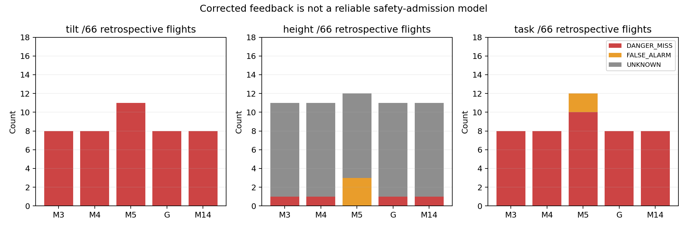
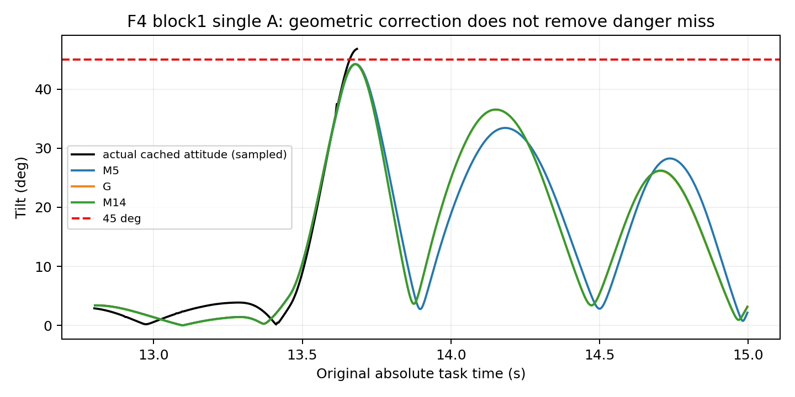
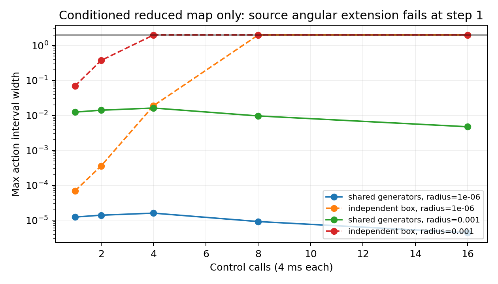

# P14：离线闭环修正与方法可行性判决

基线本地/远端均为`4e18dbcce39edd23c07347526ab0de4818fccb24`，无后续提交或被覆盖工作。**新增飞行0、启动器调用0、历史预算消耗0。全部新评分是回顾性分析；旧前瞻分数、FAIL/STOP/未启动项不变。**

## 首页六个回答

1. **主要问题已不是捕获或GRU代码无法重放，而是自主反馈的状态/估计/角动态闭合不足。** 78条实际记录的target重建误差0、stale模式差0；连续h/action重放L2最大约1.70e−6/1.75e−6。原参数没有被意外换掉。修正几何后仍漏8/14个正式倾角失败，证据强于“只差一个杆臂”的解释，但不证明唯一原因或整个研究问题无价值。
2. **本轮实际修正了反馈内COM→body点和恒定速度偏差近似。** 一个主要候选M14及一个有限几何对照G覆盖全部12开发+66正式记录；M5的11/14倾角漏判降到8/14。新互补近似没有进一步改善分类，逐时最大倾角误差约27.44°、LP高度.494m、垂速.644m/s，完整自主风险模型仍不合格。没有靠增加UNKNOWN消除真实失败漏判。
3. **当前方法在固定平台的机制审计、有限条件映射和部分F2风险对照中有用。** M14识别3/3个F2短间隔AB失败、全部F2中长成功及18条修复成功；但漏掉F4单A三次失败，不能用于安全准入。已有分块实验支持小样本总处理效应，不是严格同初态反事实或跨平台保证。
4. **应停止当前独立外盒+非负绝对增益的全程保证分支，以及原M5错误测量点和“常量偏差足够”的主张。** 值得继续的是源物理/观测接口与相关联合集合。实做的共享生成元在条件化64ms子模型保持窄动作界，独立外盒退化；但扩展到源角动态时第一步即违反固定姿态假设。不能将该子结果改称真实闭环证书。
5. **下一步唯一优先问题：把真实body/IMU→估计器/gyro/姿态cache→控制输入的联合时间过程闭合，而非继续拟合整程标签。** 应先离线恢复可取得的输出缓冲/融合关系，并与源角/物理模型联合。验收需同时达到既定.1m/.15m/s/2.5°过程尺度，解释首次越界括号、完整保持/接回/恢复及全部F4危险例外；随后用独立封存新记录评估漏判/误报/UNKNOWN，不能只看OR或峰值。未通过前不扩充候选搜索。
6. **本轮不需要、也没有新飞行。** 现有数据足以继续源算法预算、估计链重构、相关集合和重评分。只有确证缺失的完整EKF/output-buffer初态不能恢复时，才建议另行授权的最小6次诊断：NORMAL、F4-A、F2-AB-short三臂×两个新种子，共同启动且只加有界被动状态快照；用于区分“可从完整初态重放”与“仍缺融合/时间或源动力学关系”。两种子仅为机制重复，不支持总体低漏判率。字段/身份/保护/时序语义错误立即停受影响队列，不替换；科学失败保留。若要用零漏判宣称独立危险样本漏判率<5%的一侧95%上界，至少需59个独立危险样本，而非6次诊断或窗口堆数；这不是本轮追加授权。

## 证据链与障碍分类

完整逐主张证据表见`data/p14-20261027/evidence-v1/evidence-table.{json,md}`：包含版本、独立单位、前瞻性、条件、原始/源码/结果hash、反证和当前状态。已完整阅读P11/P12各续轮/评分修订/P13及A4报告、接口、理论、复现材料，并沿引用回查关键原始输入。

|类别|实际问题|当前判决|
|---|---|---|
|实现/契约|P11第70条对native平台除零；P12截断任务评分；续轮第27条初始化旁路审计；P13 M5测量点|有明确反例/源码依据；修正独立版本，不撤销原无效/停止|
|设计/估计目标|P11主机相位重叠、修复首次激活混杂；早期严格配对失败；P12b/c非同初态off/on不足|限制因果与等价主张，不等于组合问题不成立；保守动作界2不应单独拒绝后续随机机制实验|
|模型结构|M4经验角/水平及cache；M5错误杆臂、独立恒定z/v偏差；未知EKF缓冲/融合|正确几何有有限改善；单步准确不保证已知命令多步，更不保证自主闭环|
|理论构造|独立盒/绝对增益快速退化；全盒修复区间空；A4自由误差球反例|当前构造失败/保守，不推出全部Lyapunov或研究路线不可能|

P11旧M2：38开发组、31有效整组留出原评分分别全一致；P14从69份独立score和69个原始ULog回查。P13 M3/M4所用M2数值系数与P11逐值相同，网络权重相同，不能称参数意外回归。P11原任务、PH0/激活修复与P13固定PH1、capture-only门、6秒匀速新任务、三恢复间隔及直接物理初态接口不同。分布/任务/接口变化和模型结构不足共同存在；没有单一受控变更可将性能差异百分比分摊。P11的两个局部首次越界漏判及长开放重放漂移仍保留，原31条整程标签好不等于时序或未来硬保证。

P12各次停止分别为原共同状态/理论配对门、续轮新审计错误、P12b/c各自冻结工程规范；P13改研究对象为固定轻量平台并不回写旧NOT_PASSED。严格同初态需要完整仿真/EKF/队列快照，未具备；分块随机估计的是包含初始/cache变化的总处理效应；后验实测注入只能定位敏感环节。三者不可互换。

## 原始数据与状态语义

78条P13所需ULog、物理body/rotor、连续观测/history、旧预测和封存输入均在Thor实际目录，全部核对路径/hash；未用报告摘要冒充原始复核。P11第70条raw再次确认sample4ms而native允许平台；P12第27条raw缺pre-read initialized，不能补造。P12b一个完整重型原始求解记录独立重算23,827系统、95,304 servo行，最大连接误差7.53e−15rad/s。其余旧求解汇总的支持范围保留，不把这一个重算当五飞行新验证。

详见[状态与时间规范](THOR_P14_STATE.md)。COM、named origin、base/body、IMU、LP分别保留；body杆臂.001869m、named杆臂.241869m，速度含ω×r和实际关节残差。全部task窗口Post→下一Pre的p/v/q/ω及simTime连接通过；当前文件完整可读不等于析构最后header/fclose计错完整或断电持久性。物理姿态与LP姿态差包含独立时间、航向估计/参考和cache，不称同瞬间纯估计误差。

原始ULog有IMU增量、气压/GPS/磁场、部分estimator_states；没有完整EKF交叉协方差、融合/重置状态、内部延迟ring buffer和output tracking积分初值快照。可以继续已知传感器输入下重构，但不能仅凭这些字段宣称精确完整EKF已恢复。没有把callback差分速度改名物理速度，没有将局部LP原点或独立估计误差塞进named杆臂。

## 分层实做结果

所有首次明显偏离尺度在计算前固定：p .1m、v .15m/s、姿态2.5°、倾角5°、omega .1rad/s、h L2 .5、action L2 .1。原绝对时间不平移，不对峰值或capture做事后评分对齐。

|层|使用的未来实测信息|结果与限制|
|---|---|---|
|A 单步|每步真实Pre、已选择命令|四个固定代表案例COM p/v约1e−13、omega约1e−12；后验源关系核查|
|A 多步|只初态一次，未来实际命令|四例首次v误差>.15在17.22–18.52s，p>.1在17.42–18.77s，倾角误差>5°在18.49–19.92s；之后出域，不解释失效长尾|
|A 替换顺序|两个固定案例的实际joint/转角、逐步实际COM速度或姿态|原6个有限诊断独立重算；joint/相位几乎不消除长期漂移，真实速度/姿态重置有影响；不能相加归因或混入自主成绩|
|B 估计近似|四例未来物理body p/v，LP仅初态|动态互补近似z误差最大.039–.102m、v .015–.102m/s；F4-AB在15.868s越.1m。给真物理也不能消除全部估计差，非自主成绩|
|C 事件|全部78条真实native/sample、读取消息、缓存p/v/q|target误差0、stale不同0；不证明名义未来时序可预测或一般初始化覆盖|
|D 记忆反馈|全部78条真实前18输入和提交词|h/previous/mean/count仅初始化一次，连续h/action L2最大1.70e−6/1.75e−6；没有逐步注入真实h|
|E 自主|只过去封存初态+事前计划+名义调度|M14仍漏F4危险，过程误差大；不是把C/D成功当E成功|

`layers-v1`及每记录的`evaluation-v1/process.json`给每层首次偏离、保持/接回/恢复、B前及尾段指标。例如F4块1-A，M14在实际cache13.656–13.660s的倾角失败未预测越界；h差>.5约在13.444–13.448s。F4块1-AB-medium在B前LP损高低估约.161m、W低估.399m/s、倾角低估17.15°；这是联合反馈时程不足，不支持将漏判唯一归为求解残差。

## 全量回顾性预测评分

比较规则先封存；唯一主要候选M14无新拟合，`.25s`取相同源参数，其互补结构仍是近似。G仅修正整个反馈内几何并保持恒定偏差，是一个机制对照。隔离子进程隐藏全部data/export、网络和父进程；只复制78份过去输入、任务、原参数/权重。实际未来只进评分及明确诊断。独立新目录重算代表案例的G/M14数组逐元素相等。

全部78条旧M3/M4/M5用v2评分在新目录重新计算，**78/78模型字段与原score完全相等**；原文件未写入。下表仅66正式记录（6独立种子块、每条件3块）；这些旧飞行在P14中已暴露，全部新结果都为回顾性。

|模型|倾角漏判/14|倾角误报|倾角UNKNOWN|高度漏判/4|高度误报|高度UNKNOWN|任务OR漏判/17|OR误报|OR UNKNOWN|
|---|---:|---:|---:|---:|---:|---:|---:|---:|---:|
|M3|8|0|0|1|0|10|8|0|0|
|M4|8|0|0|1|0|10|8|0|0|
|原M5|11|0|0|0|3|9|10|2|0|
|G|8|0|0|1|0|10|8|0|0|
|M14|8|0|0|1|0|10|8|0|0|

真实高度4失败、53成功、9截断UNKNOWN，倾角14失败/52成功，OR17失败/49成功。M14倾角覆盖66/66；高度可分类56/66；OR66/66。M14高度10UNKNOWN是6预测截断+4实测删失；真实高度失败没有被转成预测UNKNOWN。完整预测/实测轨迹分母与分类分母不同，各自见JSON；UNKNOWN不计agreement。M14的开发12条：倾角漏2/4、高度漏0/1、OR漏2/5，仍不是新留出。

正式M14函数总计算约108.38s（G108.13、M5旧记录111.15、M3/M4旧记录74.92/74.19s）；不同时间的旧耗时仅描述，不作为速度因果比较。完整隔离批次wall时间另记录。逐前缀最大误差M14为27.437°、高度.4938m、垂速.6436m/s，未较M3改善。首次越界括号、原LP A基线高度、完整/截断前缀、.5/2秒窗口、P0连续2s联合恢复各自给分母，cache首次见证与fulltopic分类分开，未混为连续精确越界。

短窗具体证据（G/M14分类相同）：每种窗96个预定事件窗口，来自66条相关飞行而非96独立样本。0.5秒倾角89一致/7漏判/0误报/0UNKNOWN，高度85一致/1漏判/10UNKNOWN，OR88一致/8漏判；2秒倾角仍89/7，高度82一致/1漏判/13UNKNOWN，OR89一致/7漏判；双方完整窗口分别86/83。倾角可分类96/96，高度分别86/96和83/96，OR96/96。窗口OR没有误报或UNKNOWN。

F2每种长度48窗口倾角全部一致，0.5秒有3个危险见证窗口，2秒有6个（重叠窗口重复包含同3条危险飞行）；然而最大逐时误差仍14.32/18.83°，不是短窗轨迹准确或准入证明。F4每种长度48窗均有7次倾角漏判/10个危险见证，最大逐时误差17.22/27.44°。因此“固定F2标签对照回顾性有用”必须与“0.5秒也不能普遍可靠预测危险”并列，不能用C/D重放精确替代这项评价。

重点分组：F2短AB危险3/3被M14识别，中长安全6/6一致；F4-A三次倾角/OR均漏，F4-B及AB的全部例外逐项保留；F4块1-AB-medium高度/OR漏判。18修复均预测安全且实测安全，不补强为“修复可证明安全”。共享NORMAL/A、三个间隔、模型或窗口都不增加独立样本数。

## 理论路线：实做、可计算结果与失败位置

证据类型分别为：源码实数关系；有限数据后验数值核对；未认证未来模式/浮点域；必要余量；充分条件；精确反例。没有把实测最大残差写成未来硬界。

**执行。** 四SERVO的显式逆和有界rhs仍有效于声明域。用精确有理数检查扰动Neumann条件：若`||ΔA||₂≤1e−6`、独立`||η||∞≤.001rad/s`等前提成立，冲量L2界约.01082410Nms，scaled joint误差上界约.0100042rad/s，可满足Ej≤1的条件闭合。无限force limit没参与有限界。这是可离线认证的数学蕴含；实际DART全域pivot/矩阵舍入、mode/接触、filter浮点和几何域尚未认证，旧1e−15观测残差没有填上这些义务。

**高度。** 独立精确有理数全前缀恢复例：L0=.3、D0=.4、W0=.8，若净向上加速度整段≥1、每步位置预算3e−6m，则1.2/2s恢复段D≤.619m，W分别≤−.4/−1.2m/s；.55s只覆盖137完整4ms步，W≤.252、另有2ms未覆盖。D不在capture/resume撤销。源推力/阻力与cosθ≥.93、Vrel≤2、Ej≤1给可计算执行充分条件filter/命令全段≥871rad/s（上限1000），是非空代数区间；尚未证明神经闭环能维持它或整个B及后段。连续采样间安全另需预算。`W²/(2 ar)`方向是充分储备，不能称实际必要损高；P13执行上限产生的必要储备也不能当准入充分式。

**全盒为空。** body点纠正后全局加速度外盒仍约34.36m/s²，保持修复区间为空；这说明当前外包络/参考不裁剪充分式过宽，不能推出真实a2不可行。实测36保持段均不限幅、但有6段不满足假想A=2投影，说明选择较小A也不能无证回填。接回/缓存/姿态与执行域仍必须覆盖。

**一次相关联合集合尝试。** `affine.py`实做共享生成元，含实际权重Dense/GRU、native/intermediate、previous/mean/count、clip、切换filter及条件垂向反馈。乘积余项界rx·ry；sigmoid二阶导≤.1、tanh≤1，ReLU跨界用解析secant strip，非采样Jacobian。初态共同捕获位置/速度使用同一生成元，h/动作/filter另保留不确定性；预定半径1e−6和.001、1/2/4/8/16调用，不按结果扩展搜索。

在声明的固定level姿态/零gyro/名义cache的**条件化降阶映射**中，.001半径在16调用64ms的动作最大区间宽约.004734，独立外盒在4调用已到完整宽2；1e−6半径的独立外盒在8调用退化，相关界仍约4.39e−6。它证明保留相关性在该映射中有信息，不能由此证明实际h初态集合可实现或完整事件安全。实数包含关系有解析依据；实现采用gamma_n浮点扩张和1e−14 libm假设，未做独立区间libm认证，数值不是全系统机器安全证书。

随后对同一个名义成员、固定16步做源扩展，不增加候选：第一物理步源阻力/力矩耦合即给非零角速度约.004449rad/s，固定level/zero-omega条件不具源不变性。**最早失效连接明确在角/水平动力学进入姿态与cache反馈处**；不能保持这些外生量固定后宣布完整闭环证书。这是具体扩展失败，不是求解器“找不到LMI”或整个联合集合方法不可能。

**A4。** 旧CLI因A3源码依赖改变拒绝重新生成，原失败日志保留，未移除guard。P14从hash绑定的封存startup/trace/P矩阵独立有理重算，w、P范数和q22下界逐字等于原反例，q22>10.3284465>g。该w违反假想同梯形p/v创新关系`w_p=h w_v/2`，但真实LP/cache/融合误差不是同一物理梯形创新；尚无覆盖所有实测（包括run70）的缺陷界，因此**NOT_PROVEN_EXCLUDED**。日志未出现不是排除证明。

## 路线判决、剩余项及发布

研究问题成立，机制证据和状态/时间接口值得保留；当前经验预测只在限定F2/修复对照具有回顾性诊断价值，不能作安全边界查询的可靠替代。停止扩大自由误差球、绝对增益外盒和以任务OR掩盖分项漏判的保证主张。继续源码物理核、真实body/IMU/估计/cache联合状态及保留相关性的短时集合，先闭合角/估计时间过程，再扩到完整保持—接回—恢复。不能以此模型失败否定整个事件测试问题。

可继续离线：完整传感器日志/估计状态的可恢复性核验，输出缓冲源重建，实际四SERVO数值预算，相关集合含姿态/gyro/cache的保守扩展，A4可实现残差关系。真正缺失的内部初态/融合记录、未覆盖新模式才依赖未来独立采集；首页6次方案只是建议，不执行、不自动授权。

全部旧模型分数精确复核、78条受影响新评分与过程指标、4个代表源核、一个旧完整solver、A4有理复核、27项新增相关单元已完成。理论v1的NED损高符号错误保留并独立v2纠正，不影响预测/分类；复用v2 scorer中的“no new predictions”文字指评分函数自身不生成预测，P14另有明确的新回顾预测，未冒称没有新模型计算。工程/预测/理论/CI分别报告。原始大文件和完整数组留本机，清单hash入Git。

最终合并本轮、P13相关与评分回归为31项通过（前一轮27项记录也保留）。开工dirty状态由本轮最初命令输出留证，当时没有另写专用磁盘快照；最终基线观察说明明确区分该事实与现在的整理时间，不伪造早期时间戳。`.gitignore`唯一旧跟踪文件修改仅增加P14完整派生NPZ本地保存规则，不改变P11–P13已有规则；旧冻结文件、账本和输入另做逐hash保留核对。

[离线复现与索引](THOR_P14_REPRODUCE.md)。最终正常提交、推送、远端SHA及真实CI读取记录于发布回执；不把本地检查通过称CI成功。
