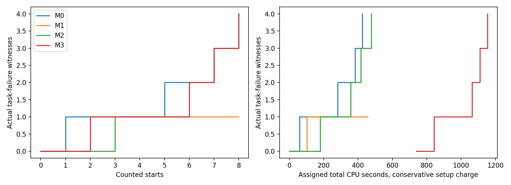
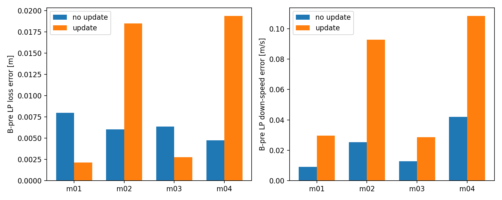

# P15：独立搜索与后继地图交付

本轮完成 **42 次唯一启动：开发6/8、独立搜索32/32、地图4/8**，没有替换或补跑。P14H 已先行发布为 `82ac9fa476a73a61b5dd31619921ec5e6de68856`；P15 正式实验冻结为 `b303af4f847f5f46488f2d9864b122eafbd808d4`，推送与远端回读在首次正式启动前完成。权重、物理步长和原保护不变；仅 headless SITL。

**结论：有限候选上的有向模型确实改变了选择，但尚未证明比廉价基线更有效。** 匹配候选池的 M2、M3 各发现4/8任务失败，M3 尚无稳健总成本优势。地图接线完成，四次更新均未改变选择，两个新种子上的下降速度误差均增大。可保留的实用进展是完整模型后继与时钟网格复用；实际状态域上的误差保证和选测收益仍未成立。

本轮两个关键问题已得到具体答案：B前局部模型比整前缀峰值更能区分候选；单个垂向恢复率差异不足以稳定改善后继预测。停止将这项标量更新作为已验证的地图改进。继续研究会改变候选次序的恢复/观测误差，而无需先重建完整EKF或证明全域安全。

## 独立性、公平性与证据范围

新独立数据为两个种子块，每法每块4次；8条飞行不等于8个独立块。各法支付本次暖机、实际前缀、查询、排名和后处理费用。前A与后A日程分别保存状态可得时间、决策完成时间和B开始前的门；同种子不被当作同状态。COM物理缓冲退出后才落盘，未进入在线排序。在线输入为已完成的LP/姿态/gyro/history行，以及带实际年龄的执行记录；未观测的运输pending身份保持UNKNOWN。主模型没有读取未来实测目标、capture、cache、hidden、终止时间。

四法不是完全相同条件支持的四路消融：M0从全D集合抽样；M1–M3在F2/F4使用冻结的不同难度子集。M0与其余方法只能比较“全局抽样”和“前缀＋难度先验”捆绑政策，不能单独归因于前缀分区。**严格同候选池、前缀和信息对照为M1/M2/M3。** 配置缺陷和修正后的未来规则见 `controlled-support-audit-v2.json`，保留全部32条，不事后筛一个子组冒充新的独立试验。

另有两项放行局限必须保留：逐法成本归属规则在前两次正式START后登记，因此全轮成本研究不具完全事前封存资格；“登记时未查看标签”只有作者陈述，没有独立访问审计。前两次完整candidate/plan哈希门为事后回查，从第3次才逐次强制。两次原运行身份与冻结实物一致，不据此补造事前门证据。开发d01的preA决策晚于A约40.431ms，仅支持接口诊断，不能算preA时限验收。后续实际门与封存分别保留。

## 模型、理论如何改变决策

A保留P14H源队列候选为结构参考。本轮在线B/C模型L15使用既有P11 M2经验输出plant，连接原NN、h/previous/mean/count、目标守卫、动作滤波和待执行状态；LP、物理COM和完整EKF保持不同语义。名义4ms、固定读取/提交相位是条件模型，不是未来真实调度的已证覆盖。没有将L15名称冒充P14H源队列模型的成绩。

开发仅一次结构修订：整前缀max被共同A峰值支配，改为B后倾角/45与“新增历史D/剩余高度余量”的最大值；整前缀峰值、D和失败锁存保留。d05的设计排序由G1.2变为G1.8。正式中M2/M3有4/8政策对选择不同，来自相同冻结候选集合；其实际初态仍不同，政策差值不解释为同初态因果效应。源码guard/read/commit直接用于候选传播，未使用不满足前提的saltation。

高度关系明确区分：真实COM有 `Ldot=W`，全前缀 `D=max(D0,sup L)` 单调；LP缓存还需更新、创新和年龄跳变项。给定真实净向上减速度下界b>0，`W_+²/(2b)`是条件充分储备，不能把水平RTDEC当作b，也不能称实际必要损高。误差关系中保留加速度残差积分、位置/速度创新跳变和cache年龄。未来预算尚未闭合，无安全跳过证书；A4继续 `NOT_PROVEN_EXCLUDED`。交叉项储能仅为接线候选，没有凭名字计作已验证决策收益。详见独立 `final-analysis-v2-source/theory-scope.json`。

## 搜索结果及全部费用

|方法|任务失败/8|倾角失败|高度失败/UNKNOWN|安全截断|B捕获/接回|
|---|---:|---:|---:|---:|---:|
|M0 全局随机|4|4|1 / 3|3|8 / 8|
|M1 分区均匀|1|1|0 / 1|1|8 / 8|
|M2 廉价幅值|4|2|2 / 0|0|8 / 8|
|M3 有向模型|4|4|0 / 4|4|8 / 8|

全部32条到达计划B并有实际capture/resume见证；没有A前缀先失败而把未达到B算组合成功。所有政策B-only/AB各4，F2/F4各4，preA/postA各4。机制覆盖显示M2与M3发现的失效分项不同，但每法仅两个种子块，不能把这一差异推广成总体低漏判率或M3更优。科学失败保持原阈值计入。

主成本归属将新增开发、地图、模型准备、失败修订、共享诊断全部计入M3，并保留四等分共享费用敏感性，以及把所有L15评分诊断单列M3的更保守口径。在线评分CPU已包括在物理进程中，不重复计费。费用表、失败-启动/CPU曲线、首次失败的直接确认费用分别见最终成本补充与`first-failure-direct-cost-v2.json`；全程序分摊曲线含之后发生的地图成本，不能称按时间发生的首次发现成本。历史模型训练、早期直接shell/首条manager、收尾I/O和管理墙时有缺测，均未补零。成本数值是已测组成，不认证整个子树的硬CPU上限；人工建模以起止墙时单列。

物理费用下M3较短的部分来自安全截断，不能直接解释为算法计算更快。按主口径，M3同时支付共享开发/地图成本（最终数值见封账表），足以消除其物理运行时间表面的优势。后续收尾成本按最终补充入账。

## 预测与误差：不以OR遮盖分项

冻结配方从**实际决策时的封存过去输入**离线计算完整预测；这是条件预测核查，非task0全任务独立前瞻。正式期间用于选择的是冻结的短窗评分。未来数据只用于评分与机制定位。

|分项|实测FAIL / SUCCESS / UNKNOWN|漏判|误报|预测UNKNOWN|
|---|---|---|---|---|
|倾角|11 / 21 / 0|1/11|2/21|0/32|
|高度|3 / 21 / 8|3/3|0/21|0/32|
|任务OR|13 / 19 / 0|1/13|0/19|0/32|

三值规则：有效前缀有失败见证判FAIL；完整覆盖且无失败才SUCCESS；无失败但截断的高度记UNKNOWN。模型本轮没有主动放弃判断，因此高度漏判不能通过UNKNOWN藏起来。任务OR正确不提供高度分项保证。

0.5s窗口32条LP损高RMSE中位/最大为0.00268/0.01083m，W为0.00970/0.06660m/s，倾角1.80/2.51°；2s窗口分别0.00458/0.04027m、0.01277/0.09807m/s、1.88/4.37°。完整共同前缀最大绝对倾角误差中位8.64°、最大14.58°；LP损高中位0.0832m、最大0.1826m。短窗局部可用性不能扩写为整程准确。

全部事件窗、首次阈值括号、首个误差越阈时间、B前p/v/SO(3)/gyro/h/action/mean/count、clip轴/持续时间保存在 `delivery-v4` 和逐条 `evaluation`、`extra-metrics`。倾角/LP判据与COM、model-origin、物理速度、执行状态分别标注；真实物理无效案例不补零。输入clip与误差是关联诊断，未升级为单一神经记忆因果解释。

## 地图闭环、修正和复用

四条地图均执行D=.30、G1.80，全任务成功；两条本次适配、两条新seed读取先前FINISH更新，payload和来源hash可追溯。更新为A后W相对自身A前预测的恢复模式加速度差，冻结限幅±.5m/s²，未改控制器或权重。四条更新均未改变选择。严格B前、同控制缓存H0比较：F2损高误差两条下降，F4两条上升；W误差四条均增大。故仅支持合法闭环接线，**没有实际选择、边界扩展或物理复用收益证据**。

初次拼接错误保留：D未传、浮点ceil多一次调用；后修正完整h/history/cache/reference/filter/pending/D并核验完整A—hold—resume—recovery—B及第三边。再尝试六个第三事件查询，3/6在原浮点时钟算术下失败：段局部起点改变恰在边界的发布/超时词，capture差16ms、倾角差3–5°。独立离线实现保留原始profile/sample时钟原点后6/6一致，轨迹最大差约3e-13；含锚点CPU0.5681s，对应逐条重算1.4075s。它说明**模型计算复用需要时钟格点属于后继状态**，不证明真实仿真可快照分叉，不把物理前缀费用免除，也不是联合域安全证书。原失败与计算成本全部保留。

## 异常、有效性与历史

开发6条均有终态；d01缺OP文件及晚决策限制保留。搜索第2条原OP完整active尾部NOT_PASSED保留，独立版本只资格化已覆盖的计分前缀，active尾部仍UNKNOWN。搜索第28条 `p15-e-b2-M2-t3-F4-B` 的5个物理文件仅有64字节头；Gazebo退出清理超时后SIGKILL，原IndexError和空文件保留。PX4/NN/LP/守卫/原保护可核查，任务范围有效；COM/物理动态范围隔离，绝非全平台PASS。

开发d06在科学窗口结束、返回经典、landing、DISARM后调整所属进程关闭顺序，验证先SIGINT Gazebo可完整落盘；观察/控制/任务窗口没有改版。一次正常验证不证明原hang根因，仍单列基础设施版本。确认旧所属进程结束后继续未START项，没有替换第28条。24个tap输出路径错误保留，独立修复只重算分析；全部36条tap与冻结模型核心输出逐位一致。

所有42 PX4 exit0，运行身份稳定。独立宿主ps确认无遗留实验进程；最终历史manifest/冻结源无漂移检查及原始唯一inode hash清单见 `final-retention-v2`。大数据留在本地，不盲目入Git；无历史FAIL、STOP、A4、未启动项回写。未用名额不转移，不启动P16。

## 路线判断与唯一下一关键证据

保留源码时序分区、完整后继接口、全前缀失败历史和时钟原点复用。保留廉价M2作为有竞争力基线。停止“当前标量恢复修正已提升地图”及“当前有向模型已有成本优势”的主张。全局证书可后置，但会改变B排序的高度/观测误差是关键问题。

下一最有价值证据是：在完全相同的条件候选支持上，找出M2/M3**预先排序分歧且高度预测敏感**的两侧，用独立seed比较冻结的恢复观测模型与廉价基线。先可离线复核现有早期创新/consume相位、全状态后继方向和排序鲁棒性；只有确实缺失的在线同步COM/观测初态才需要新采集。最小未来方案为两个分歧候选×两新seed=4次headless运行，共享同等级信息和费用；模型在前一批历史拟合后封存，失败不替换，关键记录/身份问题隔离。4次仅检验预定方向，不估总体发现率。本轮不执行该方案。

## 最终验收与费用封账

最终本地回归 **101 passed**，记录`final-regression-v3`；此前97通过1失败来自测试把历史NOT_PASSED写成FAIL，只修测试，原状态和失败日志保留。历史101,618文件与冻结72源逐内容核对PASS，`final-retention-v2`；首轮120CPU秒资源终止也计费。原始879个唯一inode文件共104,201,928,928字节，完整hash清单本地保留并提交小清单。`final-host-state-v1`为真实宿主无所属进程证据。

|方法|主归属总CPU秒|共享四等分CPU秒|全部L15诊断归M3的保守CPU秒|
|---|---:|---:|---:|
|M0|428.01|672.02|419.19|
|M1|459.66|703.67|450.75|
|M2|479.70|723.71|469.75|
|M3|1393.36|661.34|1421.05|

费用快照`final-cost-v1`，其自身尾部另有1.326CPU秒，未伪装计入快照之前。全部离线END合计728.49CPU秒，包含科学计算、评分、失败修订、最终回归与保留hash；不是所有人工/历史/未计shell成本的完整计量。主归属共享设置/地图为976.03CPU秒。图表保留早期delivery-v2作为历史快照，最终费用以final-cost-v1为准；不得择优口径。

最终机器结论`final-machine-v1.json`绑定费用、资格、101测试、保留证据和地图0/4变化。远端SHA与真实GitHub CI见发布回执；本地测试通过不代替CI成功。
