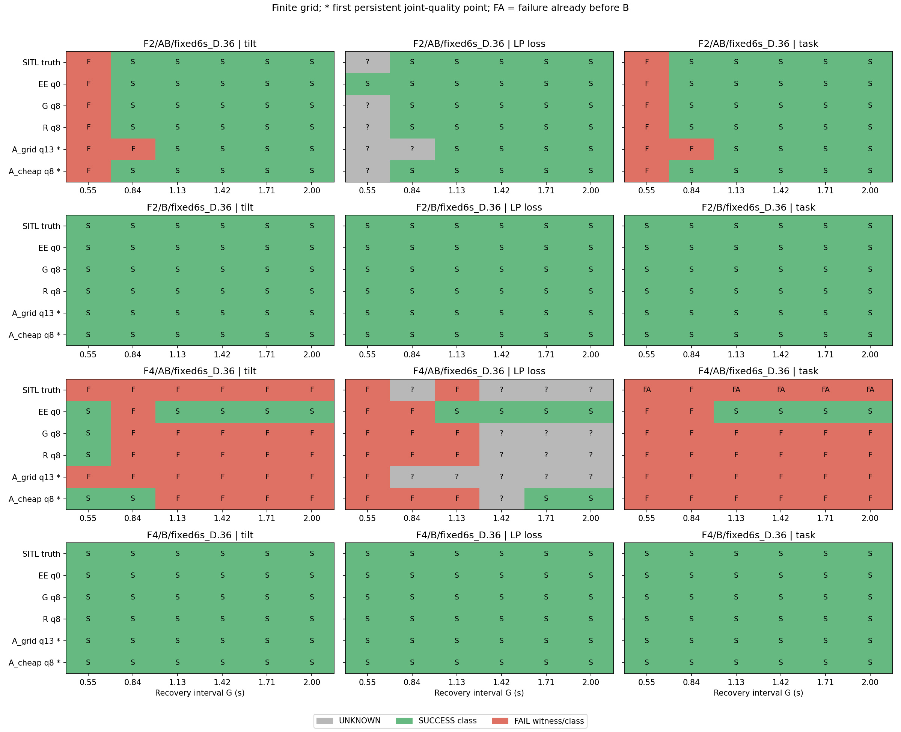
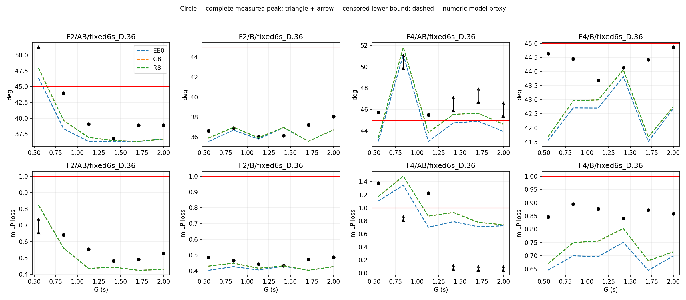
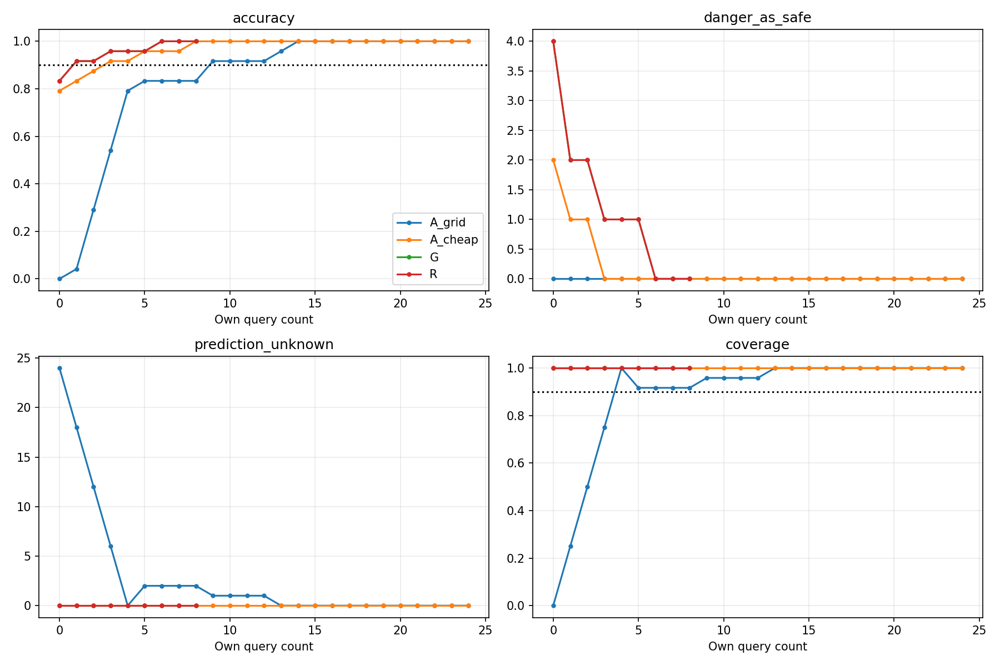
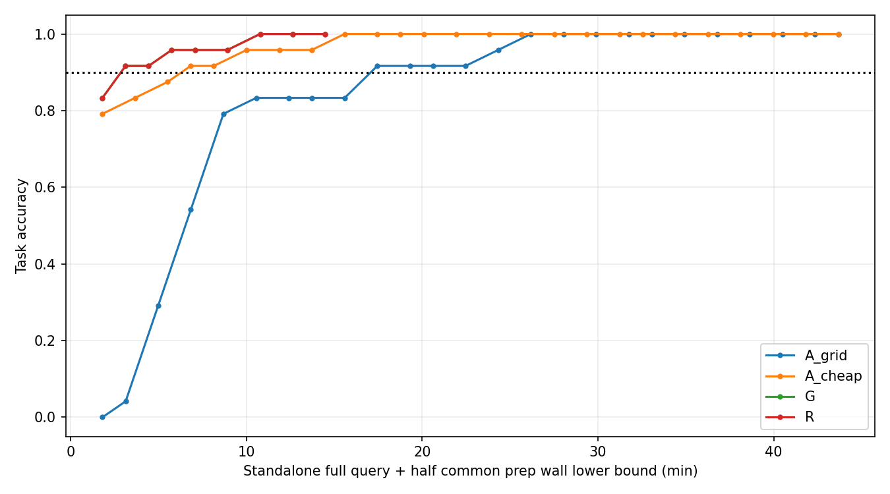

# P16：轻量灰箱的有限网格查询收益与条件复用检验

1. **已有灰箱在本固定池的预登记任务OR门限下减少了达标查询需求。**按事前四门及“首次达到且持续满足”规则，G需6次、强廉价历史RBF基线需8次，差2次（25%）；固定网格基线需13次。G与R实际都完成8次预定查询；6是完整真值验证后的达标点，并无能在未知真值时自动停在6次的保证。本轮验证实际支付32次唯一SITL，没有把共享结果或补真值当免费运行。
2. **条件边界复用没有取得额外收益。**R与G的八次选择相同，同为6次达标；364条跨地图迁移日志中接受0条（含重复与不同后缀结构拒绝，只有5个不同的同family/G供受体对），非平凡复用类0。R额外使用53.061 CPU秒的正式校准准备，未减少查询。空接受集不能作为复用正确率100%或充分条件已验证的证据。
3. **已测查询费用有优势，完整总成本净收益尚不能认证。**达标时G查询执行/必要审查/所属管理墙时537.816秒，强廉价基线825.961秒，差288.145秒。该差额不包括未测全的原始模型墙时、部分流程管理分摊、工程/历史获取费用；不得写成完整端到端净节省288秒。
4. **成功范围是任务OR有限网格分类。**倾角和高度各自仍存在漏判或UNKNOWN；不能据OR达标安全跳过真实测试。下一步适用场景是同平台、同计划族的小网格测试引导。近45度小余量、初始化/交付变化、非单调或多转换区域仍需真实SITL核验。

32次全部终态，开发2/2、主池24/24、第二Gazebo seed6/6，无补跑、无新旧预算混用。32条关键证据有效：25条完整、7条有效安全截断；任务21成功、11失败。32个PX4与32个Gazebo实际启动逐一对应账本，实际Gazebo `--seed`参数已核实。Gazebo seed不代表全系统随机源或同初态完全恢复。全部旧失败、STOP、NOT_PASSED及未启动清单保留。

**来源与冻结。**材料来自固定提交`5caca9a3509552408442fde74a9ec249067fd78d`；656文件hash、18训练轨迹重新辨识、两个冻结预测、12次顺序查询复现通过。采用`h2_strict_singles.json:model`的ordinary strict EE十参数非线性混合灰箱、原网络及四转子滤波；显式替换旧入口默认M2，移动初始目标和原h/history不清零。模型参数仅用历史18条NORMAL/A/B，当前开发提供严格prestream初态模板；新主池与第二seed结果未重辨识动力学。初始状态中的LP/估计姿态是有效模型代理，不冒称精确COM或完整EKF状态。源事件、读槽/提交和执行反馈保留，未来时序采用已声明4ms/native/sample、20ms发布名义假设。

正式冻结提交`dbd5aeaf2613add201cd7411cf81648d6b8bfad6`已正常推送、远端回读后启动。1573项源码/配置/runtime字段与48项冻结JSON无漂移，实际PX4/插件/权重普通副本在Thor保存。原保护、网络权重、仿真步长与控制语义没有修改。ToDesk等待48.55分钟单列；15:56:42UTC原宿主门放行，16:48后全部物理阶段结束。

**比较与信息。**主池为F2/F4 × B/AB历史 × G=[.55,.84,1.13,1.42,1.71,2]秒；A/B各.36秒、同6秒运动和总终点，删除事件不移动其余事件。四曲线分别分组，不跨历史插值。G/R同模型、同基本选点和返回白名单，按各自自身历史更新；另一政策只有自主选中后才揭示共享实际结果。G八次产生8个物理查询，R八次全部缓存揭示，反事实费用仍各自收完整查询费。双终态及六点第二seed预测先于真值补齐封存；之后没有模型或排序更新。

A_grid、A_cheap均为封存算法在同实际表上的盲oracle回放，非另一次独立A政策飞行。A_cheap为历史36条B/AB的固定RBF(length .5/noise .25)，不使用未查询P16标签。四门同时要求任务预测覆盖≥90%、全有效网格准确≥90%、危险判安全0、全部观察转换匹配误差≤1格；UNKNOWN留分母，非单调多转换有序一对一匹配。只比较双方预算内实际达标，不外推所需次数。

|政策|首次持续达标查询|当时任务正确|危险判安全|误报|预测UNKNOWN|自身完整查询墙时秒|
|---|---:|---:|---:|---:|---:|---:|
|G|6|24/24|0|0|0|537.816|
|R|6|24/24|0|0|0|537.816|
|A_cheap|8|24/24|0|0|0|825.961|
|A_grid|13|23/24|0|1|0|1350.348|

这些是策略查询需求及同表反事实费用。本轮实际G支付8次查询的760.153秒；A_cheap达标8次为825.961秒。G的537.816秒是前6次达标费用，不能谎称物理队列当时自动停在6次。实际整个验证项目含开发、补池、第二seed，共32次，另栏计费。G相对强基线的2次差额是经真实固定池验证的达标查询需求，尚无部署时自动停止规则或跨池同样节省的保证。

只有F2-AB存在观察到的任务转换，失败G=.55、成功G=.84，网格括号[.55,.84]秒；未证明区间内单调。另三条常量曲线为NO_TRANSITION，不能称其连续边界误差0或边界已找到。F4-AB六败中五条B前已失败，三条B未到达；没有本轮完整A-only臂，不能声称“单A、单B稳健安全而AB才失败”。F4-B虽六条成功，G=2时倾角44.861度，仅余0.139度，非稳健安全范围。

固定Grid的13次部分受删失高度UNKNOWN传播到联合标签影响。明确暴露后另做一次回顾性设计敏感性：保持原选点器，只插值直接任务标签，需9次；不替换冻结13次成绩。G6相对它仍少3次。主结论采用更强的预冻结A_cheap8次，避免只选较弱基线。

**预测能力与地图修正分开。**EE零查询任务20/24、4次漏危，倾角19/24、5次漏危，高度18/24、1次漏危及5条实测UNKNOWN。事前封存OE敏感性任务同为20/24、4次漏危，未用于选择。G/R八次自身揭示前任务5/8正确、3次漏危、0误报、0预测UNKNOWN；高度3/8正确、1漏危、4实测UNKNOWN。局部残差在F4-AB G1.42揭示前把原错误分类改对；仍保留三次前瞻漏危。

查询后G/R q8任务24/24。最终未查询的同16点，q0和q8都为16/16，未证明该子集有新分类泛化收益；收益来自有用先验、定位并核验错误附近，以及部分局部传播。不能把已查询标签覆盖当作自主动力学预测改善。

|达标快照|分项|正确/全有效池|危险判安全|误报|预测UNKNOWN|实测UNKNOWN|
|---|---|---:|---:|---:|---:|---:|
|G q6|tilt|23/24|1|0|0|0|
|G q6|height|19/24|0|0|4|5|
|A_cheap q8|tilt|22/24|2|0|0|0|
|A_cheap q8|height|19/24|0|0|2|5|
|A_grid q13|tilt|23/24|0|1|0|0|
|A_grid q13|height|17/24|0|0|7|5|

任务OR通过不能掩盖G倾角仍漏判1点，高度预测覆盖不足90%、完整高度边界未达标。删失的峰值只是已观测下界，图中用箭头标出；LP损高与物理COM不是同一量。

**第二seed。**六个ID/角色在首main标签前固定，参数与q8预测在补池前封存，未调参。六条任务结果与主seed一致（三成三败），G/R任务6/6，倾角5/6且漏危1，高度4/6、预测UNKNOWN2、实测UNKNOWN2。EE初始任务5/6、漏危1。仅描述性分类/前态复核，不用稀疏NO_TRANSITION证明网格一格精度。实际LP/姿态/history/filter及缓存初态差异完整输出，不以相同seed当同状态。

**复用机制及反例。**活动中RTGT0超时捕获覆盖目标p/零目标速度/yaw，保留机体、h/previous/mean/count、filter/pending、缓存和时钟；原H0/L/D失败历史不重置。复用要求同操作/合法分支、同family/G/未来后缀计划、继承状态经验容差，受体仅用事前预测，供体仅用自己的完成查询。0.3m/5度误差预算来自旧13个完整对的经验校准，非未来硬界。

14个实际同后缀诊断对（主池12、第二seed2）中4个缺少/未达捕获，余10个均不满足冻结经验状态门。previous和pending区间表示差异均拒绝10对，姿态拒绝9对；较长恢复也未自动消除这些差异。pending为可能命令区间，不能冒称精确运输槽实测差。不同记录仍有初始差异，不能把这些差全部归因A的神经记忆。门也没有覆盖全部发布/融合调度和联合不确定性，因此不构成充分状态等价证明。

开发2的具体账本反例：B前L=.831m、D=1.039m，后段新增损失仅.049m；`max(1.039,.831+.049)=1.039m`仍失败。去掉历史D会错误撤销已经发生的失败。两项离线消融保留同R查询历史：去掉继承/时序门，在中间q6打开2条迁移，任务正确从24/24降至22/24并产生2个UNKNOWN，没有新增危险判安全；q8因两端都已查询而回到同一地图。保留原门再去L/D没有触发迁移，不能据此声称本池消融证明其必要性；账本必要性的具体证据为上述开发反例。没有增加仿真或事后放宽正式门。原复用日志before别名错误在独立分析v2重建，v3再覆盖两项消融的全部18张地图、纠正5条迁移日志前后变化；原分数/预测不变，冻结地图/选点未变；0接受意味着没有正面迁移证书可检验。

**费用、限制与路线。**32次物理仿真已采集时间合计2862.892秒；每run完整执行/审查/管理墙时合计3333.249秒，开发加正式管理包络3348.228秒；正式流程外管理墙时14.978秒另列，不补0。原24条预测25.633 CPU秒，重复复现25.790CPU/26.773墙秒另列估计。新增研究已测、具名且不重复计的CPU下界约1943秒，仍不是完整CPU总额。历史数据获取、原始预测墙时、部分逐政策管理归属、工程/人力和命令尾部存在缺测，完整冷启动/摊销盈亏平衡未知。

主要半摊/全承担共同开发视图均保留：G达标已测墙时下界647.190/756.564秒，A_cheap为935.335/1044.709秒；它们不是完整费用上界。额外已知分析修复、标定v1/v2、复现/OE和审计等按不同进程列账，嵌套CPU不重复求和；重构费用与后验估计注明版本，不按结果挑有利分摊。暖启动的查询执行差有证据，完整总净收益和冷启动盈亏不能据此认证。R未节省查询，额外计算成本保留为负结果。

当前普通灰箱适合继续作为有限工况测试引导基线；完整风险预测、安全跳过和通用条件边界复用均未成立。需要密集SITL的情况包括小安全余量、初始化/时序变化、可能多转换和源模型覆盖不足。未来若独立继续，应先取得可用的同后缀锚点、约束继承执行/历史及未来交付，不靠放宽本轮门制造复用。本轮已结束，不自动P17或追加启动。

**证据与复现。**

- [冻结/规则](../data/p16-20261028/freeze-receipt.json)、[模型参数](../data/p16-20261028/frozen/model-parameters.json)、[完整账本](../data/p16-20261028/attempts.jsonl)、[实际启动和Gazebo seed](../data/p16-20261028/process-evidence-v1.json)。
- [主机器结论](../data/p16-20261028/analysis-v2-results/delivery.json)、[全部消融日志修订](../data/p16-20261028/analysis-v3-log-repair/receipt.json)、[同未查询集/类去重](../data/p16-20261028/analysis-supplement-results-v1/supplement.json)、[揭示前成绩](../data/p16-20261028/pre-reveal-score-results-v2/scores.json)、[实际同后缀诊断](../data/p16-20261028/actual-pair-diagnostic-results-v1/pairs.json)。
- [原费用](../data/p16-20261028/analysis-v2-results/costs.json)、[分层费用重构](../data/p16-20261028/cost-inventory-results-v4/inventory.json)、[Grid任务标签敏感性](../data/p16-20261028/task-only-grid-sensitivity-results-v1/result.json)。
- [新原始文件路径/hash](../data/p16-20261028/final-audit-v1/raw-manifest.json)、[历史/源码/实物审核](../data/p16-20261028/final-audit-v1/audit.json)、[复现命令](THOR_P16_REPRODUCE.md)。ULog、telemetry、Gazebo原始数据和普通二进制副本保留Thor；小证据入Git。

145项物理结束后的相关回归、151项产物回归及最新152项最终回归均通过，原日志保留。旧tracked文件除授权.gitignore新增规则外无变化；没有全量重读整个历史raw的虚构声明。正常最终提交/推送、远端SHA和实际CI查询由发布回执记录，本地测试与CI分别报告。

交付提交`359a995f891e0974005e19e3d0c37441f3092b70`已正常推送并核实远端一致；该SHA实际CI为0个workflow、0个check、0条status，标为NO_CI_REPORTED，非绿灯。[发布回执](../data/p16-20261028/publication-receipt-v1.json)与[完成机器结论](../data/p16-20261028/delivery-v5.json)仅更新发布状态，不改变科学分数。
