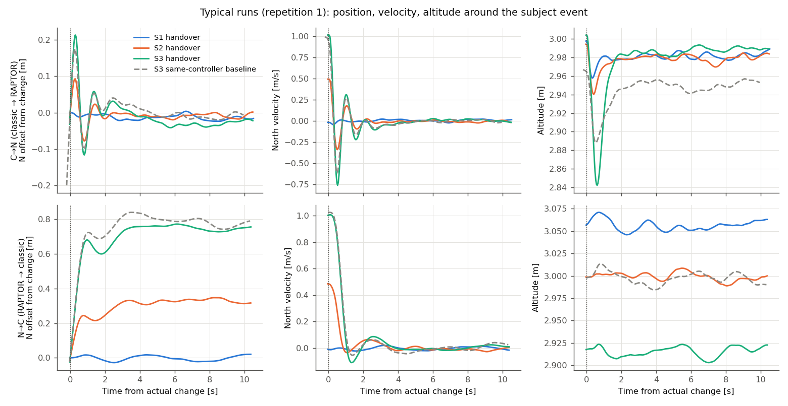
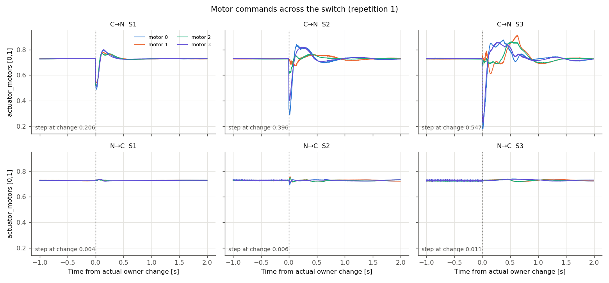
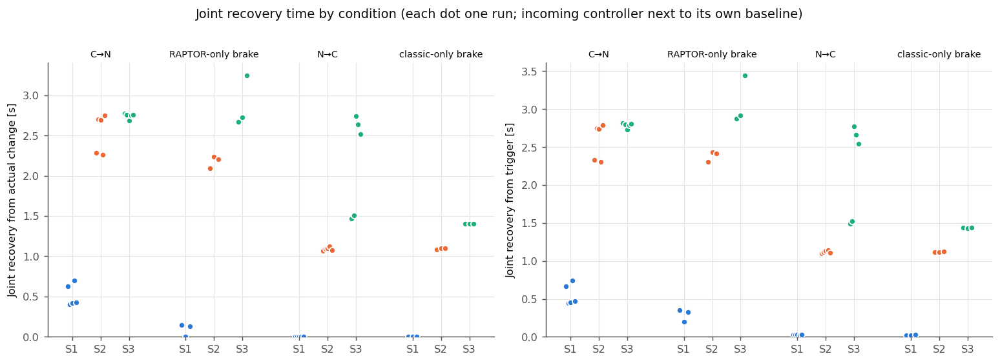
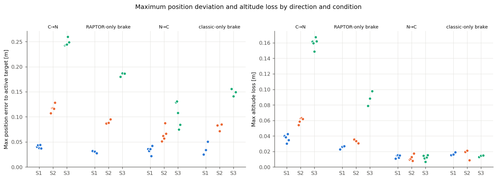

# Thor P1：原始双向交接性能实验

日期：2026-10-13（Asia/Shanghai）。范围：冻结 x500、本机 headless SITL；未实飞。本报告的全部数值来自一个完整冻结批次 [batch-02](../data/p1-20261013-batch-02/)（48/48 接受，复核 [batch-audit.json](../data/p1-20261013-batch-02/batch-audit.json) `passed=true`）。batch-01 因输出链路门槛停止，按规则保留为失败记录，不与 batch-02 拼接（见“实验经过与问题”）。

## 问题与结论摘要

不修改任何控制器内部状态处理（RAPTOR 用原始模式进入 reset，经典侧用原始 AUTO_LOITER 接管），C→N 与 N→C 在悬停（S1）、0.5 m/s（S2）、1.0 m/s（S3）水平运动下各交接 5 次，共 30 次；另做每个控制器自身制动的基线（每工况 3 次，共 18 次）。

- **30 次交接全部完成，全部在 10 s 观察窗内联合恢复（SETTLED），全部未触及安全包线**（半径 10 m、高度 8 m、倾角 45°、角速度 8 rad/s）。无崩溃、无传感器就绪失败、无测量缺失；executor 验收 48/48 PASS（0 告警），全部 144 个恢复阶段 SETTLED。
- **C→N 的代价随速度明显增大**：交接瞬间电机指令阶跃 S1/S2/S3 均值 0.21/0.39/0.54，最大倾角 1.4°/16.3°/32.1°（S2、S3 全部 10 次超过 P0 悬停倾角限 15°），最大高度损失 0.04/0.06/0.16 m，联合恢复（自持权变化）0.51/2.54/2.75 s。
- **N→C 与经典控制器自身制动几乎无法区分**：电机阶跃 ≤0.012，高度损失 ≤0.018 m，倾角 ≤9.7°，窗口约束 15/15 满足；恢复时间与经典基线一致（S3 的双峰见下文，是速度阈值附近的判定效应）。
- 两个方向的接管参考不同（RAPTOR 回到激活点；经典 Loiter 刹停在制动点），控制带宽也不同，**恢复时间不能用来比较哪个方向更危险**；方向内应与该方向接入控制器的自身基线比较。
- **进入 P2 的建议**：C→N S1（只有内部状态 reset 的影响，阶跃 0.21 对基线 0.02，恢复 0.51 s 对 0.09 s）与 C→N S3（高度损失为基线的 1.8 倍、倾角 32°）；N→C S3 作阴性对照。理由见末节。

## 实验条件

| 项目 | 设置 |
|---|---|
| 平台与版本 | Jetson AGX Thor，ROS 2 Jazzy，Gazebo Harmonic；P0 冻结的 RAPTOR 构建（二进制、补丁、策略权重未改）；项目提交 `6cb05d5`，候选身份见 [candidate.json](../data/p1-20261013-batch-02/candidate.json)，批次前后一致 |
| 配置 | [config/p1.json](../config/p1.json)：阈值与 p0.json 完全相同（联合恢复 0.2 m / 0.1 m/s / 0.1 rad/s、2 s 驻留、20 ms 观测间隙；悬停误差 1.0 m、倾角 15°；安全包线同 P0）；种子 42 |
| 运动工况 | 交接前由**一条相同的外部参考**驱动：保持 3 s → 2 s 线性加速 → 4 s 匀速，沿 +N，高度 3 m，偏航取当前目标偏航。S1 0、S2 0.5、S3 1.0 m/s（保留了建议起始值：S3 行程 5 m + 制动 < 7 m，距 10 m 安全半径留 ≥3 m，加速度 0.5 m/s²） |
| 交接前控制方式 | 经典：OFFBOARD（位置+速度+加速度前馈）；RAPTOR：其外部 trajectory_setpoint 输入（MC_RAPTOR_OFFB=0 的独立模式原本就读取它）。两者都从各自当前目标起步，无参考跳变 |
| 触发 | 参考流持续发布期间取 PX4 原生时间下界（listener）作为“触发时刻”，随即停流并立即发模式请求；停流到请求 ≤ 一个发布周期（20 ms） |
| 观察 | 交接后 10 s（`post_event`），之后 C→N 和基线回到经典 Loiter、降落 |
| 运行时长 | 每轮约 2–2.5 min；batch-02 共 48 轮，约 2 h；Gazebo 实时因子 0.996–0.999，主机 CPU 均值 7.8–22.5% |

### 接管参考是怎样捕获的（每次都从原始日志核对）

- **C→N（RAPTOR 原始 reset）**：模式进入时 `reset()` 清除轨迹设定点有效标记，RAPTOR 在第一次激活运行中把**当前位置与偏航、零速度**写为内部目标（日志 `trajectory_setpoint turned stale at: x y z`）。15/15 次分类为 `activation_reset_hold`，且与进入后 state read 的 values[20:26] 完全一致（速度分量为 0）。即：以 1 m/s 交接时，RAPTOR 的目标是“停在交接点”，必须反向回到它。
- **N→C（经典原始接管）**：commander 切到 AUTO_LOITER，navigator 计算 loiter 点，FlightTaskAuto 从当前位置和速度出发生成平滑制动轨迹。15/15 次首个 trajectory_setpoint 在持权变化后 4–20 ms 内出现，速度等于当时实测速度，最终目标为制动后的停止点（S2 前移约 0.34 m，S3 约 0.76 m）。
- **基线**：经典基线 = OFFBOARD 运动后切 AUTO_LOITER（同一接管机制，无控制器切换）；RAPTOR 基线 = RAPTOR 自身运动中停流，200 ms 设定点超时后以同一规则捕获当前位置（无 reset、无切换）。RAPTOR 基线的“变化时刻”是该捕获时刻（触发后 196–208 ms），其间位置目标冻结、速度前馈仍在，RAPTOR 已开始减速，所以 S2/S3 基线捕获时速度为 0.47/0.96 m/s，略低于标称。

### 指标口径

- 时间均为 PX4 原生仿真时间。**触发**＝请求前读取的原生时间下界；**实际变化**＝research_actuator 持权变化（交接）、AUTO_LOITER nav_state 变化（经典基线）、RAPTOR 捕获日志时刻（RAPTOR 基线）。
- **联合恢复**：沿用 P0 判定函数和阈值，参考为“控制器当前目标”：经典阶段用 trajectory_setpoint（同 P0），RAPTOR 持权阶段用其日志记录的内部捕获目标（RAPTOR 的内部目标不发布到 trajectory_setpoint，这一点在 P0 悬停中差几厘米，P1 运动中会差到交接滞后量）。每个结果同时给出仅用 trajectory_setpoint 与固定 NED 参考的对照。该扩展用于 P1 前已对 P0 batch-05 全部 70 轮重新验证：P0 配置下 metrics 逐字节相同；用新口径分析时所有判定、阶段状态和恢复时间均不变，见 [summary.json](../data/p1-20261013-p0-reverify/summary.json)。
- **最大高度损失**：[触发, 窗口结束] 内相对触发时高度的最大下降。**窗口约束**：同一窗口内安全包线 + P0 悬停限（相对当前控制器目标误差 ≤1.0 m、倾角 ≤15°）。
- **最大位置偏差**：持权变化后相对当前控制器目标的最大距离；另报告相对最终停止点的偏差和沿运动方向的越过量（p1-metrics.json）。
- **电机阶跃**：持权变化前后相邻两次 actuator_motors 的最大单电机差；另报 [-0.1, +0.5] s 内最大相邻阶跃。**饱和**：任一电机 ≥0.999 或 ≤0.001 的持续时长。
- **请求→持权延迟**：触发下界到实际变化；因触发是下界，这是上界估计。

## 30 次交接结果

“窗口约束”列只列出被超出的项；所有超出都是 15° 悬停倾角限，安全包线从未触及。饱和时长 30 次均为 0，省略该列。

|运行|交接时速度 m/s|最大高度损失 m|恢复(持权变化) s|恢复(触发) s|窗口约束|最大倾角 °|最大位置偏差 m|电机阶跃|请求→持权 ms|接管参考位置 NED m|
|---|---:|---:|---:|---:|---|---:|---:|---:|---:|---|
|S1-C→N-1|0.02|0.040|0.62|0.66|满足|1.2|0.041|0.206|40|[0.03, 0.00, -3.00]|
|S1-C→N-2|0.04|0.038|0.40|0.44|满足|1.5|0.044|0.193|44|[0.03, -0.04, -3.05]|
|S1-C→N-3|0.01|0.030|0.42|0.45|满足|1.5|0.038|0.221|36|[-0.04, 0.02, -2.92]|
|S1-C→N-4|0.01|0.043|0.70|0.74|满足|1.3|0.044|0.199|44|[0.02, -0.00, -3.00]|
|S1-C→N-5|0.01|0.035|0.42|0.47|满足|1.3|0.037|0.220|44|[0.01, -0.03, -2.97]|
|S2-C→N-1|0.49|0.054|2.29|2.33|倾角 15.4°|15.4|0.107|0.396|40|[2.52, 0.02, -2.99]|
|S2-C→N-2|0.52|0.059|2.70|2.75|倾角 16.6°|16.6|0.118|0.390|44|[2.50, -0.01, -3.00]|
|S2-C→N-3|0.50|0.063|2.70|2.74|倾角 16.2°|16.2|0.117|0.387|40|[2.47, -0.03, -3.00]|
|S2-C→N-4|0.51|0.063|2.26|2.30|倾角 16.2°|16.2|0.116|0.405|40|[2.51, -0.04, -2.92]|
|S2-C→N-5|0.52|0.062|2.75|2.79|倾角 17.0°|17.0|0.128|0.384|44|[2.53, -0.07, -2.98]|
|S3-C→N-1|1.01|0.162|2.78|2.81|倾角 32.1°|32.1|0.243|0.547|36|[5.05, -0.03, -3.00]|
|S3-C→N-2|1.01|0.159|2.76|2.80|倾角 31.8°|31.8|0.244|0.545|36|[5.06, 0.05, -2.96]|
|S3-C→N-3|1.01|0.149|2.69|2.73|倾角 31.4°|31.4|0.244|0.540|44|[4.99, -0.04, -3.01]|
|S3-C→N-4|1.04|0.167|2.75|2.79|倾角 32.8°|32.8|0.259|0.546|44|[5.03, 0.00, -2.93]|
|S3-C→N-5|1.02|0.162|2.76|2.80|倾角 32.5°|32.5|0.248|0.543|44|[5.01, -0.00, -3.02]|
|S1-N→C-1|0.02|0.011|0.00|0.03|满足|0.3|0.036|0.004|28|[0.01, -0.01, -3.06]|
|S1-N→C-2|0.00|0.015|0.00|0.03|满足|0.4|0.032|0.006|32|[0.00, 0.02, -3.04]|
|S1-N→C-3|0.02|0.015|0.00|0.03|满足|0.3|0.036|0.004|32|[-0.07, -0.02, -3.02]|
|S1-N→C-4|0.02|0.012|0.00|0.02|满足|0.3|0.022|0.004|24|[-0.01, -0.01, -2.97]|
|S1-N→C-5|0.02|0.015|0.00|0.03|满足|0.3|0.042|0.003|32|[-0.02, 0.02, -3.00]|
|S2-N→C-1|0.48|0.010|1.06|1.10|满足|5.5|0.051|0.006|32|[2.52, -0.01, -3.00]|
|S2-N→C-2|0.52|0.011|1.09|1.11|满足|5.8|0.062|0.003|20|[2.53, -0.02, -2.95]|
|S2-N→C-3|0.50|0.013|1.10|1.13|满足|5.9|0.057|0.012|36|[2.53, -0.01, -2.99]|
|S2-N→C-4|0.51|0.008|1.12|1.14|满足|6.3|0.088|0.007|20|[2.49, -0.01, -2.94]|
|S2-N→C-5|0.48|0.018|1.08|1.10|满足|5.7|0.067|0.002|28|[2.48, 0.01, -2.92]|
|S3-N→C-1|1.00|0.015|1.46|1.49|满足|9.7|0.129|0.011|24|[4.99, -0.04, -2.92]|
|S3-N→C-2|1.00|0.011|1.50|1.52|满足|9.7|0.131|0.005|20|[5.02, 0.03, -2.93]|
|S3-N→C-3|0.99|0.007|2.74|2.77|满足|9.2|0.108|0.011|32|[4.99, 0.04, -2.95]|
|S3-N→C-4|1.01|0.012|2.64|2.66|满足|8.6|0.075|0.002|24|[5.04, 0.05, -2.99]|
|S3-N→C-5|1.00|0.015|2.52|2.54|满足|8.7|0.084|0.009|24|[5.05, 0.03, -3.01]|

C→N 的接管参考速度全部为 0（激活捕获）；N→C 的首个 Loiter 参考速度等于交接时实测速度（S2 0.48–0.52、S3 0.99–1.01 m/s），S1 两侧均为悬停。逐次完整数值（含对照恢复、偏差分解、饱和、首末参考）在各运行目录的 `p1-metrics.json`，汇总表另见 [p1-table.md](../data/p1-20261013-batch-02/p1-table.md)。

### 与各自控制器独立运行的基线对比（均值，括号内为范围）

| 方向 / 工况 | 交接：恢复(变化) s | 基线：恢复(变化) s | 交接：高度损失 m | 基线：高度损失 m | 交接：电机阶跃 | 基线：电机阶跃 | 交接：最大倾角 ° | 基线：最大倾角 ° |
|---|---|---|---|---|---|---|---|---|
| C→N vs RAPTOR 自身制动，S1 | 0.51 (0.40–0.70) | 0.09 (0–0.14) | 0.037 | 0.025 | 0.208 | 0.017 | 1.4 | 0.8 |
| C→N vs RAPTOR 自身制动，S2 | 2.54 (2.26–2.75) | 2.18 (2.10–2.24) | 0.060 | 0.033 | 0.393 | 0.193 | 16.3 | 14.1 |
| C→N vs RAPTOR 自身制动，S3 | 2.75 (2.69–2.78) | 2.88 (2.67–3.24) | 0.160 | 0.088 | 0.544 | 0.480 | 32.1 | 28.0 |
| N→C vs 经典自身制动，S1 | 0.00 | 0.00 | 0.014 | 0.017 | 0.004 | 0.000 | 0.3 | 0.4 |
| N→C vs 经典自身制动，S2 | 1.09 (1.06–1.12) | 1.09 (1.08–1.10) | 0.012 | 0.016 | 0.006 | 0.000 | 5.8 | 5.8 |
| N→C vs 经典自身制动，S3 | 2.17 (1.46–2.74) | 1.40 (1.40–1.40) | 0.012 | 0.014 | 0.008 | 0.000 | 9.2 | 9.3 |

解读：

- RAPTOR 自己在 1 m/s 下“停在当前点”也会倾斜 28°、阶跃 0.48：**S2/S3 中的大部分倾角和阶跃来自 RAPTOR 的原始参考捕获（以零速度目标停在交接点）和它的高带宽，不来自交接本身**。交接带来的增量在 S1 最纯：阶跃 0.21 对 0.02、恢复 0.51 s 对 0.09 s，这只能来自 reset（GRU 状态清零与 previous action 复位）；在 S3 表现为高度损失 0.16 m 对 0.09 m（约 +7 cm）。S3 的 C→N 恢复时间与基线相当，不说明交接无害。
- N→C 交接后的行为与经典自身制动在电机、倾角、高度上几乎一致：经典接管时以实测状态初始化轨迹，交接瞬间电机阶跃 ≤0.012。S3 恢复时间的双峰（1.46/1.50 s 与 2.52–2.74 s）来自制动后第二个缓慢速度回摆：快的两次峰值约 0.087 m/s，慢的三次约 0.110 m/s，正好跨过 0.1 m/s 判据，属于阈值附近判定的离散效应，不代表两种不同的动力学行为。基线 3 次均未出现回摆超阈。可能与交接前 RAPTOR 的高度偏差（交接时高度 2.92–3.01 m，经典基线 2.95–3.00 m）有关，未证实。
- 两方向请求→持权延迟：C→N 36–44 ms（其中 nav_state→持权 12–16 ms），N→C 20–36 ms（nav_state 与持权同一时刻）。

## 图

1. 两个方向的典型位置/速度/高度曲线（每工况第 1 次重复；虚线为 S3 同控制器基线；时间以实际变化为零点）：
   
2. 切换前后电机命令（每工况第 1 次重复）：
   
3. 各工况联合恢复时间（每点一次运行；左为自持权变化，右为自触发；接入控制器与其自身基线并列）：
   
4. 各方向最大位置偏差和高度损失：
   

图由 `tools/p1_report.py` 从各运行的 `p1-metrics.json` 生成。

## 重复性与统计限度

- 5 次重复（基线 3 次）使用相同种子和配置，但**没有任何两次结果完全相同**：每次持权变化后 500 个位置样本的指纹全部不同，指标有小幅离散（如 C→N S3 恢复 2.69–2.78 s，高度损失 0.149–0.167 m）。离散来源是按墙钟发出的 ROS 参考流和模式请求：触发落在仿真时间上的相位每次不同，不是独立的随机扰动。
- 30 次交接是探索预算，不构成统计结论；不报告置信区间或显著性。重复之间的一致性只说明在这个配置下结果是稳定、可复现的。

## 验收与完整性

- batch-02：48/48 接受，候选身份全程不变，0 失败、0 未运行。复核脚本 `tools/p1_audit.py` 从原始证据独立重算：PX4 退出码 0、无崩溃标记、ULog 哈希一致、分析判定 PASS、全部恢复阶段 SETTLED（144/144）、executor 验收 PASS（0 告警）、preparation trace MEASURED，`p1-metrics.json` 48/48 重算一致。
- 输出链路（P0 门槛，逐电机）：神经持权期间 651568 个电机物理步，被覆盖 32 次（0.0049% < 0.1%）；每轮 P99 4 ms；最坏单轮最大年龄 12 ms、最长连续超目标 2 步，**均恰好处在门槛上限**，说明尾延迟余量很小。
- 运动参考链路由运行器新增（`p1_*` 场景），没有改动控制链路、阈值或策略权重。

## 实验经过与问题

1. **开发运行**（保留，不计入结果）：`data/p1-20261013-dev-*` 四类场景各 1 次（S3），确认流程和测量可用。dev-01 的运行内分析因捕获日志正则未处理尾随逗号而崩溃；修正后按规则重新分析到新目录 `…-reanalysis-02`，原目录未改（`…-reanalysis-01` 是那次失败调用留下的空目录）。
2. **batch-01 停止**（[results.json](../data/p1-20261013-batch-01/results.json)，[diagnosis.json](../data/p1-20261013-batch-01/diagnosis.json)，[batch-audit.json](../data/p1-20261013-batch-01/batch-audit.json)）：按计划先跑 S1（16/16 通过），暂停复核后续跑 S2（16/16）。第 34 轮 S3-n_to_c-1 的其它检查全部通过，但输出链路“连续超目标步数”为 3（门槛 ≤2，四个电机相同）。定位：发生在 RAPTOR 自身 S3 巡航中，比交接触发早 6.6 s。某个物理步没有收到新命令（该样本到达比步进晚，到达→步进 5.0 ms，典型 3.4 ms），随后 3 步施加 8 ms 旧命令，下一步补到 2 条（覆盖 1 条）后恢复。主机 CPU 均值 12%，executor 无漏样本或告警。判断为与 P0 同类的主机调度尾部事件，未发现代码或控制器问题。按规则停批，不放宽门槛、不原地重跑、不拼接：batch-01 原样保留（33 接受、1 失败、14 未运行），在同一冻结候选上重新完整跑 batch-02。batch-01 已完成部分与 batch-02 数值量级一致，但不用于本报告的任何统计。
3. **P0 重新验证**：分析口径扩展前对 P0 batch-05 全部 70 轮重新分析到 [p1-20261013-p0-reverify](../data/p1-20261013-p0-reverify/)，结论见“指标口径”。

## 哪些工况值得进入 P2 状态干预实验

| 候选 | 建议 | 理由 |
|---|---|---|
| **C→N S1** | 优先 | 交接前后参考几乎不变，交接增量只来自 RAPTOR 原始 reset：阶跃 0.21 对基线 0.02，恢复 0.51 s 对 0.09 s，高度损失 0.037 对 0.025 m。最适合检验 snapshot/restore 或 inject（例如注入同工况 RAPTOR 稳态 GRU）能否消除这部分，且信号干净、离散小 |
| **C→N S3** | 优先 | 绝对代价最大：倾角 32°、阶跃 0.54、高度损失 0.16 m（基线 0.09 m）。需要注意，大部分倾角和阶跃来自原始参考捕获（零速度停在交接点），状态干预只能改变 reset 的那部分；P2 应同时报告相对 RAPTOR 基线的增量，避免把参考捕获效应归因于内部状态 |
| C→N S2 | 可选 | 介于两者之间，可用于检验干预效果是否随速度单调变化 |
| N→C S1–S3 | 仅作阴性对照 | 与经典自身制动不可区分（阶跃 ≤0.012，高度损失 ≤0.018 m，约束全满足）；对 rate/velocity 积分器的干预基本没有改善空间。S3 恢复时间双峰是判定阈值效应，不是状态问题 |

P2 若改变参考捕获方式（例如让 RAPTOR 以当前速度起步制动），就超出“内部状态干预”的范围，需要单独提出。

## 范围限制

只做 headless SITL，单一 x500 模型、单一运动方向（+N，机头约 96°）和高度；native RAPTOR 约 125 Hz，而训练为 100 Hz，这一差异仍在；尾延迟受主机负载影响，本批最坏值已到门槛上限；联合恢复和窗口约束都用 P0 冻结阈值（15° 悬停倾角限是悬停口径，用于制动过程是保守的约束）；结论不授权实飞。
