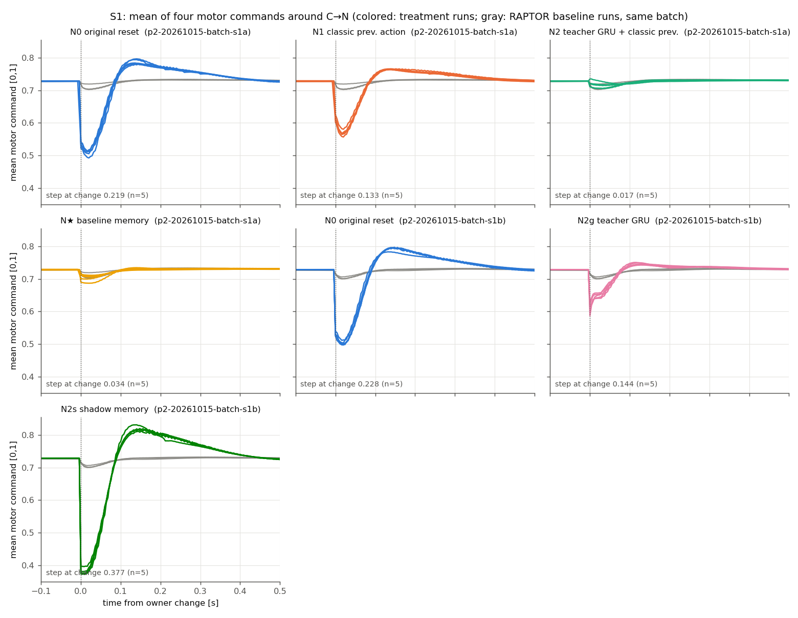
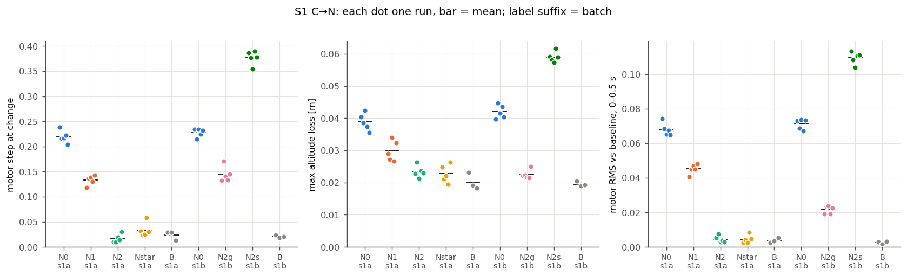
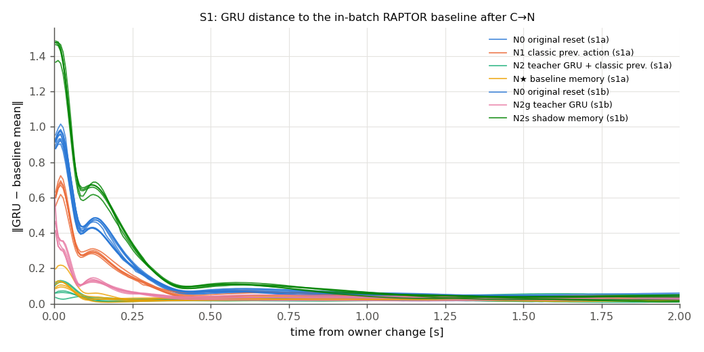
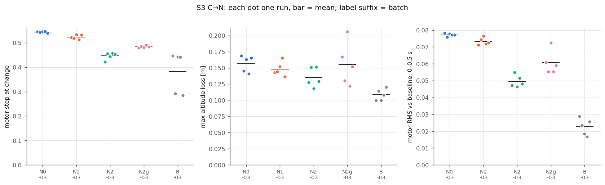
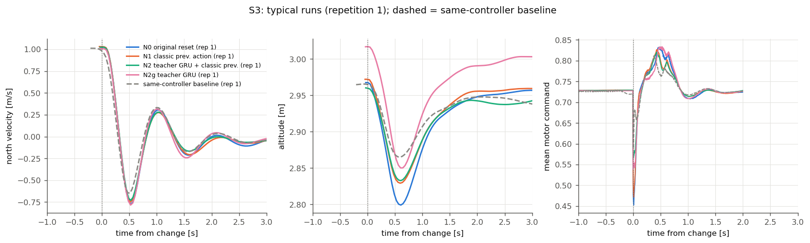
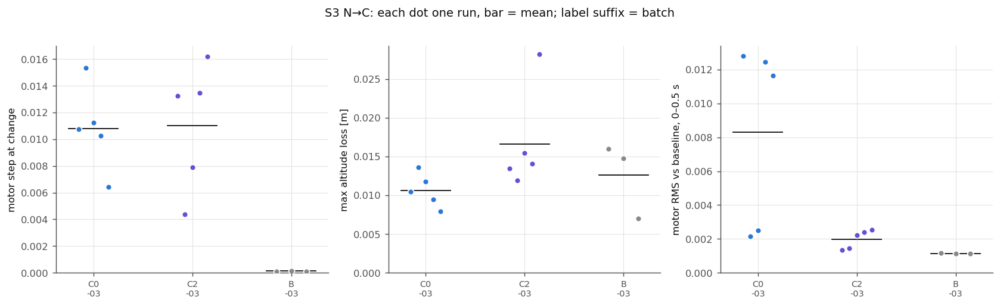
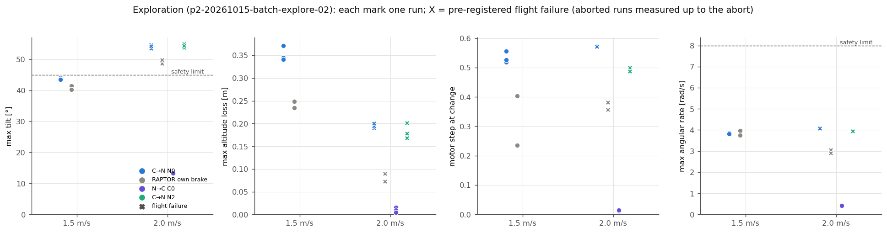

# Thor P2：RAPTOR 接管时的内部状态干预

日期：2026-10-14 至 2026-10-15（Asia/Shanghai）。范围：冻结 x500、本机 headless SITL；未实飞。数值均来自完整、通过独立复核的冻结批次：

- [S1 批次 A](../data/p2-20261015-batch-s1a/)（23/23）
- [S1 批次 B](../data/p2-20261015-batch-s1b/)（18/18）
- [S3 批次](../data/p2-20261015-batch-s3-03/)（25/25）
- [N→C S3 批次](../data/p2-20261015-batch-nc-03/)（13/13）
- [推高速度探索批次](../data/p2-20261015-batch-explore-02/)（16 轮：8 轮接受，8 轮记为预登记飞行失败）
- 候选等价性检查：[equivalence-02](../data/p2-20261015-equivalence-02/)（7/7，等价）

停批的批次全部原样保留，不与上述批次拼接（见“批次记录与问题”）。

## 问题与结论摘要

**问题。** P1 中 C→N 悬停交接的电机阶跃（0.21，RAPTOR 自身基线 0.02）分别有多少来自 GRU 清零、多少来自 previous_action 复位？用真实飞行历史准备这两项状态，能否消除这个阶跃？

P2 中 RAPTOR 的接管目标不变：激活时以零速度捕获当前位置。只改写 GRU 和 previous_action。

- **S1 悬停：两项缺一不可，同时准备即可完全消除阶跃。**
  - 电机阶跃：N0 原始复位 0.219/0.228（两批），RAPTOR 基线 0.024/0.021。
  - 只补 previous_action（N1）：0.133，消除 44%。
  - 只保留经典指令 teacher forcing 下的影子 GRU（N2g）：0.144，消除 41%。
  - 两者同时准备（N2）：0.017，消除 104%，与上界 N★（注入 RAPTOR 基线同相位记忆，0.034，95%）一致。
  - 交接后 0.5 s 电机 RMS 偏离（N0 0.068 → N2 0.0045，基线 0.0038）和高度损失（0.039 → 0.023 m，基线 0.020 m）同样被消除。
  - GRU 部分主导交接后的瞬态：N2g 消除 RMS 偏离的 72%、高度损失的 87%，N1 只有 36%/48%。
  - previous_action 部分约占瞬时阶跃的一半。
- **影子推理原有的记忆有害。** 现有 RINI=1（N2s）保留影子推理自身的 GRU 和动作：阶跃 0.377，比原始复位还大 72%，RMS 和高度损失也更大。影子推理以自己从未执行的动作为输入，内部状态与实际飞行不一致。改用经典实际电机指令做 teacher forcing 后，影子 GRU 在交接时距 RAPTOR 基线记忆 0.054，与注入的 N★ 相当（0.062）；N0 为 0.905。
- **S3（1.0 m/s）：内部状态只能消除部分代价。**
  - N2 消除电机阶跃的 60%、高度损失的 44%、RMS 偏离的 51%；N1 只有 13%/17%/7%。
  - 最大倾角几乎不变（N0 32.3°，N2 31.9°，速度匹配的 RAPTOR 基线 29.8°）。
  - 剩下的代价来自零速度目标捕获本身：交接瞬间速度误差观测从 0 跳到上限 1 m/s，这不是内部状态问题。
- **N→C（阴性对照）：** 经典接管 C0 与经典自身制动不可区分（阶跃 0.011，高度损失 0.011 m）。
  - 按 RAPTOR 最后输出协调速度积分器（C2）在接受批次中同样无差别。
  - 但在全部 9 次 C2 施加中（含两个停批批次），有 3 次把水平积分器写到约 1.87 m/s²，其中 2 次越过停止点 0.76–0.81 m、10 s 内未联合恢复。
  - 原因：C2 用积分器抵消了接入方 AUTO_LOITER 自己的制动加速度。是否发生取决于经典第一次控制周期是否已含制动指令（时序竞态）。
  - 结论：“匹配退出方输出”的无扰切换与接入方自己的参考相冲突，不是安全的 N→C 干预。
- **推高速度探索：在 2.0 m/s 测出失败，但失败不来自交接或内部状态。**
  - 1.5 m/s 全部恢复，C→N 最大倾角 43.7°，已接近 45° 包线。
  - 2.0 m/s 下 C→N N0（3/3）、C→N N2（3/3）和 RAPTOR 自身制动基线（2/2）全部在 RAPTOR 捕获目标后 0.28–0.29 s 倾角越过 45°，运行器安全中止。
  - 同速 N→C（经典接管，3/3）正常恢复，最大倾角 13°。
  - 失败机制是 RAPTOR 以零速度目标制动时的激进姿态，与是否交接、记忆是否准备无关。按预登记规则在 2.0 m/s 停止加速。

## 实验条件

| 项目 | 设置 |
|---|---|
| 平台与版本 | Jetson AGX Thor，ROS 2 Jazzy，Gazebo Harmonic；PX4 RAPTOR 构建 = P1 冻结源码 + P2 研究改动（二进制 `4b84cb2b…`，策略权重 `5327c83d…` 未变）。6 个接受批次的候选身份二进制/策略一致，见各批 `candidate.json` |
| 配置 | [config/p2.json](../config/p2.json)：联合恢复、包线、悬停误差阈值与 p1.json 逐项相同（由 `tests/test_p2.py` 检查）；种子 42 |
| 主机 | `jetson_clocks`：14 核固定 2601 MHz、CPU idle 关闭、EMC 最高、nvpmodel 120W。PX4 绑核 8–11、Gazebo 12–13、Agent 6–7、运行器 4–5（taskset）。远程桌面断开。nc-03 起用户会话进程限制在核 0–3。每批开始时的频率和负载记录在 `host.json` |
| 运动工况 | 与 P1 相同的外部参考：保持 3 s → 2 s 加速 → 4 s 匀速，沿 +N，高度 3 m。S1 0、S3 1.0 m/s。S3 RAPTOR 基线指令 1.05 m/s，使捕获速度落在 1.00–1.04 m/s（开发标定 [dev-05](../data/p2-20261015-dev-05/)；批内实测 0.980–1.029，1 轮略低于 1.00，如实报告） |
| 探索工况 | 先以 0.5 m/s 后退 6 m、保持 3 s，再 2 s 加速、1.5 s 匀速，1.5/2.0/2.5/3.0 m/s 逐级 |
| 交接机制 | 与 P1 相同：参考流停止后立即请求模式。RAPTOR 进入时 reset 并以零速度捕获当前位置（未改），经典接管为 AUTO_LOITER |

### 处理条件（MC_RAPTOR_RINI / MC_RAPTOR_NCO）

| 处理 | 参数 | GRU（交接时） | previous_action（交接时） | 非活动期间 |
|---|---|---|---|---|
| N0 | RINI=0 | 清零（原始） | 0（原始复位值） | 影子推理，原样 |
| N1 | RINI=2 | 清零 | 经典最后一次实际 actuator_motors（换算到动作空间） | 原样 |
| N2g | RINI=3 | 保留影子 GRU | 0 | previous_action 每周期替换为经典实际电机指令（teacher forcing） |
| N2 | RINI=4 | 保留影子 GRU | 经典最后一次实际指令 | teacher forcing |
| N2s | RINI=1（P0 已有） | 保留影子 GRU | 保留影子动作 | 原样（影子推理以自己的动作为输入） |
| N★（仅 S1） | RINI=5 | 注入 RAPTOR S1 基线同相位 GRU | 注入同相位动作 | 原样 |
| C0 | NCO=0 | — | — | 经典原始接管 |
| C2 | NCO=1 | — | — | 经典第一次位置控制周期，速度积分器设为使推力等于 RAPTOR 最后实际集体推力 × 当前机体 z 轴 |

N★ 的记忆取自开发运行中的 RAPTOR S1 基线：触发后 36 ms（开发运行 C→N 触发到持权变化的中位数），即第 k 个原生步提交的 GRU 加第 k 步输出的动作。三次基线之间 GRU 差 ≤0.018，见 [nstar-memory.json](../data/p2-20261015-nstar/nstar-memory.json)。

### 指标口径

时间均为 PX4 原生仿真时间。电机阶跃、最大高度损失、联合恢复、窗口约束沿用 P1 定义（`tools/p1_metrics.py`）。P2 新增：

- **0.5 s RMS 偏离**：[持权变化, +0.5 s) 内四个电机相对**同批**同工况同控制器基线均值曲线的 RMS（1 ms 零阶保持对齐到各自的实际变化时刻）。基线自身用留一均值。
- **消除比例**：(N0 − Nx)/(N0 − 基线)，按同批组均值计算。N→C 用 (C0 − C2)/(C0 − 经典基线)。基线差很小的指标（如 N→C 的高度损失）比例没有意义，只看绝对值。
- **GRU 距离**：持权变化后给定时刻提交的 GRU 与同批 RAPTOR 基线同时刻均值的欧氏距离。
- **恢复时间**只作参考，不再用 15° 悬停倾角判窗口约束。

## 实现与每轮验证

- **在 RAPTOR 自己的线程完成。** 新模式在模式进入的那个 Run 中、原始 `reset()` 之后，只写 GRU（`policy_state` 与 `policy_state_temp`）和 previous_action，不写内部目标。RINI=0/1 的代码路径与 P1 逐句相同。teacher forcing 在非活动期间每个 Run、`observe()` 之前替换 previous_action。N★ 用新增的 `state raptor stage` 在解锁前暂存 20 个值，进入时由 RAPTOR 自己写入。全部由 `#ifdef __PX4_POSIX` 与 `MC_RAPTOR_RSH` 门控，注入方式与 P0/P1 相同（`tools/apply_research.py`，幂等检查通过，每段插入只出现一次）。
- **动作映射**（[action-map.json](../data/p2-20261014-action-map/action-map.json)）：
  - 用 P1 batch-02 全部 9 次 RAPTOR 基线的 54,495 对 `research_timing.action`/`actuator_motors` 拟合，得 `motor[j] = 0.5·action[k] + 0.5`。
  - 电机顺序为动作 0→电机 0、1→3、2→1、3→2；残差 ≤3.3e-8，交叉项 ≤1.6e-8。
  - 反变换在 `research/state/ActionMap.hpp`，越界截断并计数。P2 全部运行截断计数为 0。
- **新增证据话题 `research_memory`**：每次推理后记录 GRU、所用 previous_action、是否 teacher forcing；模式进入时额外记录写入前后的记忆。每轮 `p2-metrics.json` 独立核对：
  - 当时生效的 RINI/NCO 参数（ULog 参数）与处理一致；
  - 写入值与该处理应写值一致（≤1e-5）。N1/N2 的经典动作由 `research_actuator` 中同一条经典指令用拟合映射独立重算，指令年龄 ≤8 ms；
  - 进入后第一次推理确实使用写入的 previous_action；
  - N2g/N2 在交接前 1 s 内 teacher forcing 比例为 1.0，逐行与经典指令一致。锁步下偶有同一仿真步发布两条经典指令，检查接受其中任一条并计数；
  - 其它处理从不出现 teacher forcing；
  - 每轮捕获仍为 `activation_reset_hold` 且目标速度为 0。接受批次中 64 轮 P2 C→N 全部满足，进入写入全部核对通过；另有等价性批次 3 轮 RINI=0 的 C→N。
- **C2**：在 mc_pos_control 自己的线程、RAPTOR 持权后第一个经典位置控制周期执行，记录协调前后的积分器。
- **单元测试**（ASan/UBSan）：`tests/action_map_test.cpp`、`tests/memory_init_test.cpp`（全部模式、缺少经典指令、暂存维度、STAGE 校验），以及原有 `state_ops_test`、`sample_clock_test`。Python：`tests/test_p2.py`（映射与拟合一致、计划交错、探索参考轨迹、阈值与 P1 相同），全部 32 个 Python 测试通过。
- **候选等价性**（[equivalence.json](../data/p2-20261015-equivalence-02/equivalence.json)）：新候选在 RINI=0 下重跑 P1 C→N S1 ×3、RAPTOR S1 基线 ×2、P0 state_restore/state_injection 各 1 次。
  - C→N 电机阶跃 0.203–0.217（P1 0.193–0.221）、高度损失 0.036–0.039 m、请求→持权 40 ms，全部落在预登记的 P1 范围内。
  - 捕获为 `activation_reset_hold`，进入时写入的 GRU/动作精确为 0。
  - P0 两个场景判定、状态校验、恢复阶段和 executor 验收与 P0 batch-05 一致。
- **尾延迟**：固定频率并绑核后，[dev-04](../data/p2-20261015-dev-04/) 10 轮 S1 每轮最大施加年龄 ≤8 ms（p99 4 ms），此后才冻结。全部接受批次每轮最大年龄均为 8 ms，覆盖比例 0.0025–0.014%。门槛（p99 4 ms、最大 12 ms、连续 2 步）未改。

## 结果

### S1 悬停（两批各自独立，均值 [范围]）

| 批次 | 处理 | n | 电机阶跃 | 消除 | 0.5 s RMS 偏离 | 消除 | 最大高度损失 m | 消除 | 恢复(变化) s | GRU 距离 @0 s / 0.25 s |
|---|---|---:|---|---:|---|---:|---|---:|---|---|
| s1a | N0 | 5 | 0.219 [0.204, 0.238] | — | 0.068 | — | 0.039 | — | 0.56 | 0.905 / 0.193 |
| s1a | N1 | 5 | 0.133 [0.118, 0.143] | 44% | 0.045 | 36% | 0.030 | 48% | 0.52 | 0.550 / 0.132 |
| s1a | **N2** | 5 | **0.017** [0.009, 0.030] | **104%** | **0.0045** | **99%** | 0.023 | 83% | 0.03 | 0.054 / 0.022 |
| s1a | N★ | 5 | 0.034 [0.024, 0.058] | 95% | 0.0045 | 99% | 0.023 | 86% | 0.16 | 0.062 / 0.020 |
| s1a | 基线 | 3 | 0.024 [0.013, 0.030] | | 0.0038 | | 0.020 | | 0.15 | 0.022 / 0.009 |
| s1b | N0 | 5 | 0.228 [0.215, 0.234] | — | 0.071 | — | 0.042 | — | 0.55 | 0.942 / 0.216 |
| s1b | N2g | 5 | 0.144 [0.132, 0.170] | 41% | 0.022 | 72% | 0.022 | 87% | 0.20 | 0.619 / 0.042 |
| s1b | N2s | 5 | 0.377 [0.354, 0.390] | −72% | 0.110 | −56% | 0.059 | −76% | 0.80 | 1.445 / 0.319 |
| s1b | 基线 | 3 | 0.021 [0.019, 0.024] | | 0.0027 | | 0.020 | | 0.16 | 0.021 / 0.012 |

- 两批 N0 一致（0.219 对 0.228），也与 P1（0.208）一致。所有 S1 运行均联合恢复。
- N2g 的 GRU 写入时接近基线，但进入后第一步用错误的 previous_action（0，对应电机 0.5，而悬停约 0.73）推理，GRU 被推离（@0 s 距离 0.62），随后很快收敛（@0.25 s 0.04）。N1 正好相反。
- 两项的作用近似可加，但只准备任一项都消除不到一半的阶跃。

### S3 1.0 m/s（同一批次，基线为速度匹配的 RAPTOR 自身制动）

| 处理 | n | 交接时速度 m/s | 电机阶跃 | 消除 | 0.5 s RMS 偏离 | 消除 | 最大高度损失 m | 消除 | 最大倾角 ° | 恢复(变化) s |
|---|---:|---|---|---:|---|---:|---|---:|---:|---:|
| N0 | 5 | 1.017–1.026 | 0.544 [0.540, 0.547] | — | 0.077 | — | 0.157 [0.141, 0.168] | — | 32.3 | 2.93 |
| N1 | 5 | 1.009–1.030 | 0.524 | 13% | 0.073 | 7% | 0.148 | 17% | 32.3 | 2.75 |
| N2g | 5 | 1.006–1.039 | 0.483 | 37% | 0.061 | 30% | 0.155 [0.122, 0.206] | 2% | 32.6 | 2.90 |
| **N2** | 5 | 1.002–1.031 | **0.446** | **60%** | 0.050 | 51% | 0.136 | 44% | 31.9 | 2.64 |
| 基线 | 5 | 0.980–1.029 | 0.381 [0.285, 0.446] | | 0.023 | | 0.108 | | 29.8 | 2.72 |

S3 的“步骤 1 最好处理”是 N2，已在 N0/N1/N2 中，所以第四组用 N2g 区分 GRU 部分。即使在 N2 下，交接时 GRU 与基线同时刻的距离仍有 0.95（N0 1.19）。基线自身在捕获时刻也偏离其均值 0.39：捕获使速度误差观测跳到上限，GRU 随之剧烈变化。S3 交接代价的主体是这次观测跳变和零速度目标，内部状态准备只能消除其中较小的一部分。

### N→C S3（阴性对照）

| 处理 | n | 电机阶跃 | 0.5 s RMS 偏离 | 最大高度损失 m | 最大倾角 ° | 恢复(变化) s | C2 写入的积分器 m/s² |
|---|---:|---|---|---|---:|---|---|
| C0 | 5 | 0.011 [0.006, 0.015] | 0.008 | 0.011 | 9.0 | 2.28 [1.40, 2.91] | — |
| C2 | 5 | 0.011 [0.004, 0.016] | 0.002 | 0.017 | 9.1 | 2.13 [1.37, 2.76] | 水平 0.11–0.13，垂直 0.02–0.06 |
| 经典基线 | 3 | 0.000 | 0.001 | 0.013 | 9.3 | 1.83 [1.38, 2.71] | — |

接受批次中 C2 与 C0 无差别，但这不代表 C2 安全。停批的 [batch-nc](../data/p2-20261015-batch-nc/) 与 [batch-nc-02](../data/p2-20261015-batch-nc-02/) 中，同一候选、同一工况的 4 次 C2 中有 3 次积分器被写成水平 1.86–1.89 m/s²：

| C2 施加（停批批次中的观测，不计入接受结果） | 积分器 x | 越过停止点 m | 联合恢复 |
|---|---:|---:|---|
| nc C2-1 | 1.867 | 0.756 | 10 s 内未恢复 |
| nc-02 C2-1 | 0.127 | 0.053 | 2.69 s |
| nc-02 C2-2 | 1.885 | 0.812 | 10 s 内未恢复 |
| nc-02 C2-3 | 1.859 | 0.774 | 恢复（窗口内） |

C2 设置的是“RAPTOR 推力 − 经典本周期加速度指令”。当经典第一次周期已包含 AUTO_LOITER 的制动加速度（约 −1.75 m/s²），积分器正好抵消了制动，飞机越过停止点；当第一次周期尚无制动指令，写入量很小，结果与 C0 相同。这个分叉由两线程的时序决定，在 nc-03 中 5/5 落在小写入一侧。

### 推高速度探索

| 速度 | C→N N0 | RAPTOR 自身制动 | N→C C0（最高级） | C→N N2（失败级） |
|---|---|---|---|---|
| 1.5 m/s | 3/3 恢复；倾角 43.5–44.1°，高度损失 0.34–0.37 m，阶跃 0.53，恢复 3.4 s | 2/2 恢复；倾角 40.3–41.4°，高度损失 0.24 m | — | — |
| 2.0 m/s | **3/3 失败**：倾角 ≥45°（安全中止） | **2/2 失败**：倾角 ≥45° | 3/3 恢复；倾角 13.3°，高度损失 ≤0.015 m，恢复 3.4–5.2 s | **3/3 失败**：倾角 ≥45° |

- 2.0 m/s 下 8 次失败全部在 RAPTOR 捕获目标后 **0.28–0.29 s** 越过 45°。交接与否、记忆是否准备（N0/N2）都相同。N2 只把交接阶跃从 0.572 降到 0.492。
- 失败轮在中止前的角速度 ≤4.1 rad/s，高度损失 ≤0.20 m，未触地，无电机持续饱和。中止后测量窗口截断到中止时刻，表中这些指标只到中止为止。
- 按预登记规则在第一个出现失败的速度级停止加速，2.5 与 3.0 m/s 未运行。
- “坠地后能否干净重启”在探索前单独测试（[crash-probe-01](../data/p2-20261015-crash-probe-01/)）：空中强制上锁，3 m 自由落体落地后 PX4 退出码 0，所有进程正常停止，紧接着的运行正常启动并通过。

逐轮完整数值见各批 `p2-table.md` 和各运行目录的 `p2-metrics.json`。

## 批次记录与问题

所有停批批次和开发运行原样保留，各有 `diagnosis.json` 与 `batch-audit.json`，没有原地重跑，也没有拼接。

| 批次 | 结果 | 原因与处理 |
|---|---|---|
| [p2-20261014-equivalence](../data/p2-20261014-equivalence/) | 第 1 轮停 | 输出链路 p99 8 ms（门槛 4 ms）。当时远程桌面会话约占 170% CPU、CPU 未锁频。处理：锁频、绑核、断开远程桌面 |
| [dev-03](../data/p2-20261015-dev-03/)（开发） | 第 4 轮停 | 一是锁步下同一仿真步两条经典指令导致核对歧义，改为匹配任一条并计数；二是一轮最大年龄 12 ms，定位为 VS Code 文件监视和 git 自动刷新扫描 `data/`，已从监视中排除。之后 dev-04 10/10 ≤8 ms |
| [batch-s3](../data/p2-20261015-batch-s3/)、[batch-s3-02](../data/p2-20261015-batch-s3-02/) | 均第 1 轮停 | Agent 收到 SIGINT 后 5 s 未退出。原因是我把这两批作为非交互 shell 的后台作业启动，SIGINT 被继承为忽略（已复现）。改用会话后台机制启动并在日志记录信号掩码，s3-03 完整通过 |
| [batch-nc](../data/p2-20261015-batch-nc/) | 第 2 轮停 | C2 首次施加即发生预登记飞行失败，按标准规则停批。经用户同意（2026-10-15），后续 N→C 批次把预登记飞行失败记为结果（与探索组相同），基础设施失败照常停批 |
| [batch-nc-02](../data/p2-20261015-batch-nc-02/) | 第 10 轮停 | 输出链路最大 16 ms、连续 4 步（主机调度尾部事件，与 P1 batch-01 同类）。处理：用户会话进程限制在核 0–3，nc-03 完整通过 |
| [batch-explore](../data/p2-20261015-batch-explore/) | 第 6 轮停 | 2.0 m/s 飞行失败被误判为基础设施失败：安全中止时日志在 RAPTOR 持权中结束，输出链路覆盖计数缺少后括号行。只把这一项归因于中止，其余检查不变，explore-02 从 1.5 m/s 重新完整运行 |
| explore-02 完成后 | 断电 | 结果与复核已写完。重启后重新运行 `p2_audit.py` 结果一致，git 仓库完整性检查无误 |

## 对 Idea 1/2 的含义

仓库中没有 Idea 1/2 的书面定义。以下按本项目两条主线理解：

- Idea 1：交接代价来自接入控制器内部状态与实际飞行不一致，可以通过状态准备消除。
- Idea 2：快照/恢复/注入等外部状态干预作为通用交接机制。

如理解有误请指正。

- **Idea 1 在悬停下成立且被完整定位。** C→N 悬停阶跃完全来自内部状态：GRU 和 previous_action 各贡献一部分，两者都需要。仅凭真实飞行历史（经典实际电机指令做 teacher forcing，加上经典最后一次指令）就能达到注入 RAPTOR 自身记忆的上界，不需要离线保存 RAPTOR 的状态。关键条件是影子推理必须以实际执行的动作为输入。保留影子推理自身的记忆（N2s）比清零更差。
- **Idea 1 在运动中只部分成立。** 1 m/s 时状态准备只消除 40–60% 的交接增量。2 m/s 时交接本身不再是瓶颈：RAPTOR 以零速度目标捕获后的制动在 0.3 s 内超过 45°，同样发生在不交接的 RAPTOR 自身制动中。要改善运动中的 C→N，必须改变参考捕获（例如以当前速度起步的目标），这已超出“内部状态干预”，需要单独提出。
- **Idea 2：注入/恢复机制可用，但退出方状态不能盲目搬给接入方。** 研究接口在两个方向上都能在控制器自己的线程、模式进入周期精确写入并留下可核对的证据。但 N2s 与 C2 两个反例说明，直接沿用退出方或影子方的内部量是有害的：
  - N2s：影子记忆与实际不一致；
  - C2：积分器抵消了接入方自己的参考，并且受时序竞态影响。

  可行的做法是用实际执行的历史为接入方重建与其自身参考一致的状态（N2 一类），而不是复制对方的内部量。
- **N→C 方向不需要状态干预。** 经典接管在 1 m/s 和 2 m/s 都与经典自身制动不可区分。

## 范围限制

- 只做 headless SITL：单一 x500 模型、单一运动方向（+N）和高度。native RAPTOR 约 125 Hz，训练为 100 Hz，这一差异仍在。
- 每组 3–5 次是探索预算，不构成统计结论，不报告置信区间。相同种子下重复之间不完全独立，离散来自墙钟定时的参考流与请求相位。
- 尾延迟依赖固定频率、绑核和空闲主机。重启后锁频失效，需重新执行 `jetson_clocks`。
- C2 的分叉只在 9 次施加中观测到 3 次，触发条件的时序机制是推断，未逐周期证实。
- 探索失败轮的指标只覆盖到安全中止时刻。
- 结论不授权实飞。
