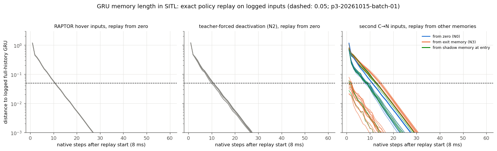
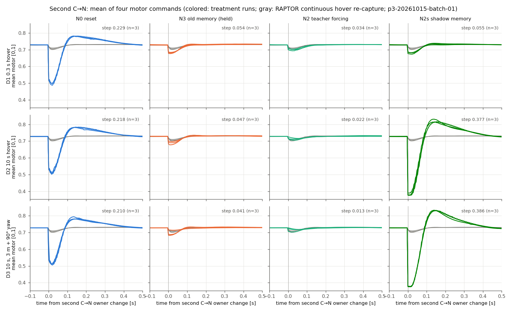
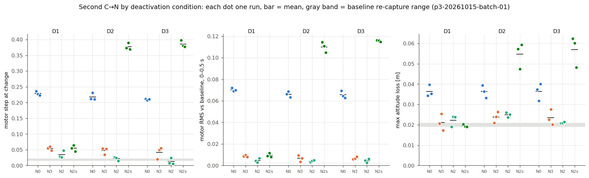
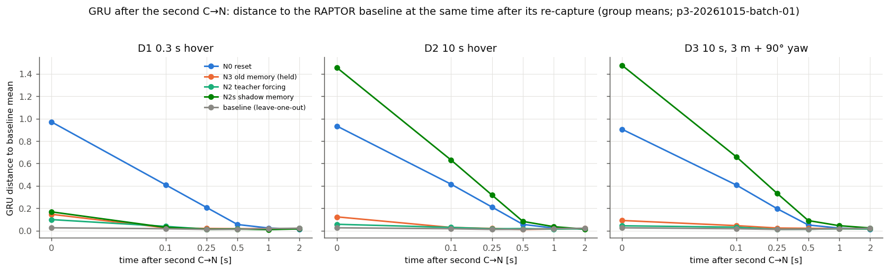
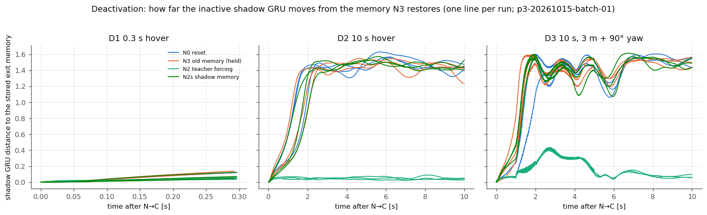

# Thor P3：反复交接与 RAPTOR 记忆的生命周期

日期：2026-10-15（Asia/Shanghai）。范围：冻结 x500、本机 headless SITL；未实飞。数值均来自完整、通过独立复核的冻结批次：

- [主批次 batch-01](../data/p3-20261015-batch-01/)（39/39 接受，无飞行失败，[batch-audit.json](../data/p3-20261015-batch-01/batch-audit.json) 通过）
- 候选等价性：[equivalence](../data/p3-20261015-equivalence/)（4/4，等价，[equivalence.json](../data/p3-20261015-equivalence/equivalence.json)）
- 冻结前尾延迟检查：[dev-10b](../data/p3-20261015-dev-10b/)（10/10，每轮最大施加年龄 4 ms）

未达标的 [dev-10](../data/p3-20261015-dev-10/) 原样保留，附 `diagnosis.json`；不与任何批次拼接（见“批次记录与问题”）。

## 问题与结论摘要

**问题。** RAPTOR 退出后再次接管时，记忆该怎么处理？离线实验显示 RAPTOR 的记忆只依赖交接前约 0.1–0.2 s 的历史。P3 在 SITL 中检验三点：

- 极短停用时，旧记忆是否仍优于原始 reset；
- 长停用、尤其停用期间飞行状态变化大时，旧记忆是否有害；
- P2 的 N2 是否始终有效。

序列：经典起飞悬停 → 第一次 C→N（N0）→ RAPTOR 悬停 → N→C（C0）→ 经典停用段（D1/D2/D3）→ 第二次 C→N（处理变化）→ RAPTOR 悬停 → 结束。两次 C→N 的接管目标都是 RAPTOR 原有的激活捕获：当前位置与偏航，零速度。处理只改变 GRU 和上一动作。

- **旧记忆（N3）在三种停用条件下都有效，没有观察到有害。** 第二次接管的电机阶跃（N0 0.21–0.23，基线 0.018）：
  - D1（0.3 s）0.054，消除 83%；
  - D2（10 s）0.047，消除 85%；
  - D3（10 s，平移 3 m、偏航 90°）0.041，消除 88%。

  0.5 s RMS 偏离消除 91–93%，高度损失消除 76–93%。D3 并不比 D2 差。
- **有害的不是旧记忆，而是停用期间自由运行的影子记忆（N2s）。**
  - D1 下 N2s 与 N3 相当：阶跃 0.055，消除 83%。
  - D2/D3 下比原始 reset 还差：阶跃 0.377/0.386，消除 −80%/−92%；高度损失 0.055/0.057 m（N0 0.036 m）。
  - 未被 teacher forcing 的影子推理以自己从未执行的动作为输入。停用 0.8–1.6 s 后，其 GRU 离退出时记忆超过 0.5；最终停在约 1.45 远处，上一动作约 −0.22（电机约 0.39，悬停约 0.73）。
  - 这与 P2 S1 的 N2s 结果（−72%）一致：记忆随停用时长恶化的速度由影子的自激漂移决定，而不是由记忆长度决定。
- **P2 的 N2 始终有效且最好。**
  - 阶跃消除 92%（D1）/98%（D2）/103%（D3），RMS 偏离消除 97%，高度损失消除 69–93%。
  - D3 平移和偏航期间，teacher-forced 影子 GRU 离退出记忆最多 0.43；回到悬停后回到 0.07 以内。
- **D3 的状态变化在 RAPTOR 的观测中不可见。**
  - RAPTOR 的观测全部相对其目标：位置/速度误差在目标偏航坐标系中，姿态相对目标偏航。重新接管时以当前位置和偏航捕获目标。
  - 因此“平移 3 m、转 90° 后回到悬停”与原地悬停在观测空间中相同，退出时的悬停记忆仍然一致。
  - 本设计（第二次接管在悬停下触发）检验不到“旧记忆与当前飞行不一致”的情形。要让旧记忆真正失配，需要在 RAPTOR 观测意义下的状态差异（例如运动中再接管），见“范围限制”。
- **SITL 中 GRU 的记忆长度约 10 个原生步（0.08 s），与离线结论一致。** 用冻结策略精确回放 SITL 记录的输入：
  - 回放与记录的 GRU 吻合：303,121 个原生步，最大误差 6×10⁻⁷。
  - 从清零开始，与完整历史的 GRU 距离保持在 0.05 以内所需步数：RAPTOR 悬停输入 10 步（117 例全部为 10）；teacher forcing 输入 9–10 步；自由影子输入 6–10 步。
  - 第二次接管时把其它记忆换上去（反事实），最多 14 步（0.11 s）就与实际 GRU 一致。
  - 但在闭环中，错误记忆造成的姿态与推力扰动会改变后续输入：N0/N2s 的 GRU 在 0.25 s 时离基线仍有 0.2–0.33，要到约 0.5–1 s 才回到基线水平。
- **N→C 方向不需要干预**（与 P2 一致）：经典 OFFBOARD 原地接管的阶跃 0.002–0.007，高度损失 ≤0.013 m，D2/D3 的分段全部联合恢复。
- **第一次 C→N（N0，39 次）与 P2 S1 N0 一致：** 阶跃 0.213 [0.187, 0.230]，高度损失 0.040 m，恢复 0.53 s。P2 两批分别为 0.219/0.228。

## 实验条件

| 项目 | 设置 |
|---|---|
| 平台与版本 | Jetson AGX Thor，ROS 2 Jazzy，Gazebo Harmonic。PX4 RAPTOR 构建 = P2 冻结源码 + P3 研究改动（二进制 `1a5b5fd8…`，策略权重 `5327c83d…` 未变）。等价性、dev-10、dev-10b、batch-01 的候选二进制/策略一致，见各批 `candidate.json` |
| 配置 | [config/p3.json](../config/p3.json)：联合恢复、包线、悬停阈值、电机饱和、飞行失败判据与 P1/P2 逐项相同（`tests/test_p3.py` 检查）；种子 42 |
| 主机 | `jetson_clocks`（14 核 2601 MHz，CPU idle 关闭）。PX4 绑核 8–11、Gazebo 12–13、Agent 6–7、运行器 4–5。远程桌面断开。dev-10b 起用户会话进程限制在核 0–3（P2 nc-03 的做法）。各批 `host.json` 记录开始时的频率与负载 |
| 交接机制 | 每次 C→N 都从经典 OFFBOARD 跟踪一条静止参考开始，参考流停止后立即请求 RAPTOR 模式（P2 S1 机制），RAPTOR 在激活周期捕获目标。第一次 C→N 后，运行器在 RAPTOR 的精确捕获位置和偏航重启静止参考，RAPTOR 外部输入，目标不变 |
| N→C（C0） | 在参考流运行中请求 OFFBOARD：经典接管目标就是 RAPTOR 当前目标，NCO=0，无状态干预。不用 P2 的 AUTO_LOITER 有两个原因：一是 AUTO_LOITER 会发布有效的 trajectory_setpoint，RAPTOR 再次激活时先跟随它 200 ms 再捕获，捕获不在激活周期；二是 0.3 s 停用无法经 AUTO_LOITER 再回到 OFFBOARD。最后着陆前的 N→C 仍为 AUTO_LOITER（不测量） |
| 时间安排 | 经典悬停 10 s → OFFBOARD 保持 3 s → 第一次 C→N → RAPTOR 悬停 5 s（第 1 s 末设置处理参数）→ N→C → 停用 → 第二次 C→N → RAPTOR 悬停 10 s（测量窗口）→ N→C（AUTO_LOITER）→ 8 s → 着陆 |

### 停用条件

| 条件 | 设置 | 实测 |
|---|---|---|
| D1 | 两次请求间隔 0.3 s，原地悬停 | 请求间隔 0.301 s；实际持权停用（经典首个指令到 RAPTOR 首个指令）0.308–0.312 s |
| D2 | 10 s，原地悬停 | 10.008–10.020 s |
| D3 | 10 s：N→C 后 1 s 开始沿东平移 3 m、偏航 +90°（同一梯形，1.0 m/s、1.0 m/s²、4 s），然后保持新点和偏航到第二次接管。开跑前检查终点在安全半径 10 m − 余量 2 m 内 | 平移 3.01–3.03 m，偏航变化 89.7° |
| R（基线） | 不停用：第一次 C→N 后 RAPTOR 继续跟踪静止参考 10 s，然后参考流停止，RAPTOR 200 ms 超时后重新捕获（虚拟第二次接管，P2 S1 基线机制） | 3 次 |

### 第二次接管的处理（MC_RAPTOR_RINI）

| 处理 | 参数 | 停用期间 | 再次进入时写入 |
|---|---|---|---|
| N0 | RINI=0 | 影子推理原样 | 原始 reset：GRU 0，上一动作 0 |
| N3 | RINI=6（P3 新增） | 影子推理原样；RAPTOR 在退出后第一个非活动周期保存的记忆保持不变 | 保存的退出记忆（GRU + 上一动作）原样写回 |
| N2s | RINI=1 | 影子推理原样（以自己未执行的动作为输入） | 保留影子 GRU 和影子动作 |
| N2 | RINI=4 | teacher forcing：上一动作换为经典实际电机指令 | 保留影子 GRU，上一动作 = 经典最后一次指令 |

- 第一次 C→N 一律 N0：解锁前设置 RINI=0、NCO=0。
- 处理参数在第一次进入后 1 s（RAPTOR 持权时）设置并读回，在整个停用段和第二次进入时生效。
- 每轮主批次共 4 种处理 × 3 种停用 × 3 次，加 3 次基线，交错排列。

### 指标口径

时间均为 PX4 原生仿真时间，阈值与 P2 相同。

- **电机阶跃、最大高度损失、联合恢复、窗口约束**：沿用 P1/P2 定义（`tools/p3_metrics.py`）。
- **0.5 s RMS 偏离**：相对同批 RAPTOR 连续悬停基线在其重新捕获时刻对齐的均值曲线；基线自身用留一均值。
- **GRU 距离**：相对同批基线重新捕获后同一时刻的均值。
- **消除比例**：(N0 − Nx)/(N0 − 基线)，在同一停用条件内用组均值计算。
- **N→C RMS**：相对本轮第一次 C→N 前 0.5 s 经典保持的平均指令。D1 的 N→C 窗口只有约 0.3 s。

**D1 的经典停用段（0.3 s）短于联合恢复驻留时间（2 s）**，按定义无法 SETTLED。这条规则在 `config/p3.json` 的 `short_stage_rule` 中预登记：

- 该段报告为 INSUFFICIENT_OBSERVATION 并标记为预登记短段，不计入整轮判定；所有阈值不变。
- `p3_metrics` 要求本轮其它每一段都 SETTLED，且被豁免的恰好是 D1 的停用段。

## 实现与每轮验证

- **N3 在 RAPTOR 自己的线程完成。**
  - 每个周期在模式进入判断之前调用 `research_exit_lifecycle(next_active)`：活动时置位；退出后第一个非活动周期，在该周期的 teacher forcing 和推理之前，保存已提交的 GRU 和上一动作，并发布 `research_memory`（`KIND_EXIT`）。
  - 保存值在下一次退出前不变。RINI=6 在模式进入、原始 `reset()` 之后由 `entry_memory()` 写回，与 P2 模式 2–5 同一路径；没有保存值时不写入。
  - RINI=0–5 的行为与 P2 相同（等价性检查确认）。
  - 改动由 `#ifdef __PX4_POSIX` 与 `MC_RAPTOR_RSH` 门控，经 `tools/apply_research.py` 注入：P2 片段用 `migrate()` 升级，新片段锚在上游行上。两次应用后源码逐字节不变，每段插入只出现一次。
- **`research_memory` 新增 `policy_input[22]`**：每次推理时执行器实际送入策略的输入，即相对位置、旋转矩阵、速度、角速度，以及动作历史（自上一个原生步以来各次调用上一动作的均值，rl_tools 执行器的 `action_history`）。
  - 用于精确回放。`raptor_input` 是最新值话题，ULog 中约缺 3% 的原生步，不足以支撑连续回放。
- **每轮独立核对**（`p3_metrics.py`，全部 36 条序列 + 3 条基线通过）：
  - 处理参数：第一次触发时 RINI=0/NCO=0/RSH=1；N→C 持权变化、第二次触发和第二次持权变化时 RINI 为处理值；N→C 触发后无参数变化。
  - 退出记忆：N→C 时恰有一条 `KIND_EXIT`，与持权变化同一时刻（偏差 0 ms）。GRU 等于最后一次活动推理提交的 GRU，上一动作等于最后一次活动输出，差值 ≤1e-5（实测 0）。
  - 两次进入的写入值与处理应写值一致：第一次一律为 0；N3 等于退出记忆；N2 的经典动作由 `research_actuator` 用拟合映射独立重算；N2s 等于影子记忆。进入后第一次推理确实使用写入的上一动作。
  - teacher forcing：N2 在停用段（经典首个指令之后）比例 1.0，逐行与经典指令一致；停用段之前无 teacher forcing；其它处理从不出现。
  - 两次 C→N 的捕获都是 `activation_reset_hold`，且状态读取确认目标速度为 0；基线为 `setpoint_timeout_hold`。
  - 持权顺序为 C→N→C→N→C（基线 C→N→C）；N→C 在第二次触发之前完成。
- **单元测试**（ASan/UBSan）：`tests/memory_init_test.cpp` 新增 N3 写入、无退出记忆时不写、模式 2–5 不受影响、退出记忆生命周期（只在活动后第一个非活动周期保存一次，停用和再次活动期间不变）。
  - Python：`tests/test_p3.py` 检查阈值与 P1/P2 相同、D3 轨迹与安全余量、计划交错、策略复现检查点示例、动作历史均值与进入时重置、记忆长度计算。全部 38 个 Python 测试通过。
- **候选等价性**（[equivalence.json](../data/p3-20261015-equivalence/equivalence.json)）：新候选用 P2 的运行类型和配置重跑 S1 N0 ×2、N2 ×2，全部落在 P2 s1a/s1b 预登记范围内。
  - N0：阶跃 0.206/0.206，高度损失 0.039/0.040 m，触发到持权变化 40 ms。
  - N2：阶跃 0.012/0.016，写入的 GRU 范数 1.728/1.732（P2 1.679–1.782）。
  - 进入写入、teacher forcing 与捕获全部 VERIFIED。
- **尾延迟**：dev-10b 10 轮每轮最大施加年龄 4 ms（一个物理步，结构下限）。batch-01 共 647,808 个神经电机步：最大 8 ms，覆盖 16 个（2.5×10⁻⁵）；门槛（p99 4 ms、最大 12 ms、连续 2 步、覆盖 <0.1%）未改。

### 记忆长度的测量方法（`tools/p3_memory.py`）

策略是 Dense(22→16, ReLU) → GRU(16) → Dense(16→4)。

- numpy 复现与检查点自带示例的最大误差 7×10⁻⁷。
- 每轮从同一 `policy.tar`（哈希与运行一致）读权重，用 `research_memory.policy_input` 逐原生步回放，先从记录的状态单步复现记录的 GRU：解锁期间 303,121 步全部 <10⁻⁵。

记忆长度 = 在同一段记录输入上，从另一初始记忆回放的 GRU 与记录的（完整历史）GRU 距离保持 <0.05 所需的原生步数（原生周期 8 ms）。这是开环量：输入固定，测的是记忆本身持续多久，不是闭环后果。

| 片段 | 初始记忆 | 例数 | 步数 | 秒 |
|---|---|---:|---|---|
| RAPTOR 悬停（第一次进入后 1.5/2.5/3.5 s 起） | 清零 | 117 | 10 [10, 10] | 0.080 |
| N2 停用段，teacher forcing（N→C 起及其后 2/4/6 s） | 清零 | 24 | 9.9 [9, 10] | 0.079 |
| N0/N3/N2s 停用段，自由影子 | 清零 | 72 | 7.8 [6, 10] | 0.063 |
| 第二次进入后的实际输入 | 清零、退出记忆、影子记忆 | 108 | 0–14 | ≤0.112 |

距离按每步约 ×0.75 指数收缩，10 步约降一个半数量级。SITL 中这个长度与离线实验的 0.1–0.2 s 一致，落在偏短一端。按步数计约 10 步；SITL 原生步为 8 ms（125 Hz），在训练的 100 Hz 下 10 步约为 0.1 s。这只是换算，未单独验证。

## 结果

### 第二次 C→N（同一批次，均值 [范围]）

| 停用 | 处理 | n | 电机阶跃 | 消除 | 0.5 s RMS 偏离 | 消除 | 最大高度损失 m | 消除 | 恢复(变化) s | 最大倾角 ° | GRU 距离 @0 / 0.1 / 0.25 s |
|---|---|---:|---|---:|---|---:|---|---:|---|---:|---|
| D1 | N0 | 3 | 0.229 [0.223, 0.237] | — | 0.0704 | — | 0.036 | — | 0.45 | 1.6 | 0.972 / 0.409 / 0.207 |
| D1 | **N3** | 3 | 0.054 [0.047, 0.060] | 83% | 0.0087 | 91% | 0.021 | 93% | 0.05 | 0.7 | 0.146 / 0.025 / 0.019 |
| D1 | **N2** | 3 | 0.034 [0.026, 0.048] | 92% | 0.0046 | 97% | 0.022 | 86% | 0.22 | 1.0 | 0.099 / 0.038 / 0.013 |
| D1 | N2s | 3 | 0.055 [0.045, 0.064] | 83% | 0.0095 | 89% | 0.020 | 102% | 0.23 | 0.8 | 0.168 / 0.029 / 0.012 |
| D2 | N0 | 3 | 0.218 [0.211, 0.231] | — | 0.0661 | — | 0.036 | — | 0.64 | 1.3 | 0.935 / 0.415 / 0.211 |
| D2 | **N3** | 3 | 0.047 [0.035, 0.054] | 85% | 0.0066 | 93% | 0.024 | 76% | 0.07 | 0.9 | 0.123 / 0.028 / 0.019 |
| D2 | **N2** | 3 | 0.022 [0.014, 0.026] | 98% | 0.0041 | 97% | 0.025 | 69% | 0.27 | 1.0 | 0.057 / 0.029 / 0.016 |
| D2 | N2s | 3 | 0.377 [0.369, 0.390] | −80% | 0.1100 | −69% | 0.055 | −111% | 0.87 | 2.1 | 1.457 / 0.631 / 0.318 |
| D3 | N0 | 3 | 0.210 [0.207, 0.211] | — | 0.0656 | — | 0.036 | — | 0.59 | 1.5 | 0.905 / 0.407 / 0.195 |
| D3 | **N3** | 3 | 0.041 [0.019, 0.055] | 88% | 0.0069 | 93% | 0.023 | 78% | 0.04 | 0.7 | 0.091 / 0.045 / 0.023 |
| D3 | **N2** | 3 | 0.013 [0.006, 0.024] | 103% | 0.0044 | 97% | 0.021 | 93% | 0.00 | 0.5 | 0.043 / 0.031 / 0.012 |
| D3 | N2s | 3 | 0.386 [0.378, 0.398] | −92% | 0.1157 | −79% | 0.057 | −123% | 0.97 | 2.1 | 1.476 / 0.659 / 0.331 |
| R | 基线 | 3 | 0.018 [0.014, 0.022] | | 0.0024 | | 0.020 | | 0.05 | 0.9 | 0.025 / 0.017 / 0.011 |

- 所有第二次接管都联合恢复。
- 恢复时间很短的处理（N3、N2）只是说明扰动没有离开联合恢复带；0.1–0.3 s 的差别在零附近，不作排序依据。
- N3 与 N2 的差别主要在接管瞬间：N3 写回的上一动作是 RAPTOR 自己退出前的动作，GRU 来自 0.3–10 s 之前的悬停；N2 的 GRU 由同一段的实际执行历史形成。
- 两者在 0.1 s 后都与基线不可区分（GRU 距离 ≤0.045，基线自身 0.017）。

### 停用期间的影子记忆

| 停用 | 处理 | 停用结束时影子 GRU 离退出记忆 | 停用中最大 |
|---|---|---:|---:|
| D1 | N0 / N3 / N2s（自由影子） | 0.08–0.11 | 同左 |
| D1 | N2（teacher forcing） | 0.047 | 0.047 |
| D2 | N0 / N3 / N2s | 1.37–1.46 | 1.52–1.59 |
| D2 | N2 | 0.042 | 0.068 |
| D3 | N0 / N3 / N2s | 1.49–1.52 | 1.58–1.60 |
| D3 | N2 | 0.070 | 0.429（平移与转向期间） |

- 自由影子在 D2/D3 中 0.30–1.16 s 后离开 0.2，0.76–1.61 s 后超过 0.5，1.08–2.08 s 后超过 1.0，此后停在约 1.4–1.6。
- 这是影子以自己的输出为下一步输入形成的自激漂移；与记忆长度（0.08 s）无关，与 D2/D3 的飞行状态也无关（D2 原地悬停也同样发生）。
- 因此“停用越久越差”只对 N2s 成立，拐点在约 1 s；D1 的 0.3 s 落在漂移刚开始的阶段，N2s 尚与 N3 相当。
- teacher-forced 影子在原地悬停时离退出记忆始终 <0.07。说明 RAPTOR 自己悬停时的记忆与“看着经典悬停”的记忆几乎相同。

### N→C 与第一次 C→N

- **N→C（C0，36 次）**：阶跃 0.002–0.007，相对经典保持的 RMS 偏离 0.003–0.006，最大高度损失 ≤0.013 m，倾角 ≤0.4°（D3 因随后的平移与转向为 7°）。
  - D2/D3 的经典停用段全部联合恢复。D3 的 5.6 s 是从 N→C 算起、包含平移与转向的时间。
  - D1 停用段 0.3 s 不判恢复（预登记）。与 P2 一致，N→C 不需要状态干预。
- **第一次 C→N（N0，39 次）**：阶跃 0.213 [0.187, 0.230]，RMS 偏离 0.066，高度损失 0.040 [0.033, 0.047] m，恢复 0.53 [0.38, 0.86] s。
  - GRU 距离 @0 为 0.922、@0.25 s 为 0.205。与 P2 S1 N0（两批 0.219/0.228）和本批第二次 N0（0.210–0.229）一致：原始 reset 的代价与是否是第二次进入无关。

逐轮完整数值见 [p3-table.md](../data/p3-20261015-batch-01/p3-table.md) 和各运行目录的 `p3-metrics.json`、`p3-memory.json`。

## 批次记录与问题

| 批次 | 结果 | 说明 |
|---|---|---|
| 开发运行 [dev01–dev06](../data/)（`p3-20261015-dev0*`） | 开发 | 用于调试序列与分析工具，不计入结果。dev01–dev04 在新增 `policy_input` 之前运行，回放不完整；其 `p3-metrics.json` 由开发中的工具重新生成过 |
| [equivalence](../data/p3-20261015-equivalence/) | 4/4，等价 | 见上 |
| [dev-10](../data/p3-20261015-dev-10/) | 10/10 通过冻结门槛，但未达到冻结前余量 | D2-N3-1 在第二次 RAPTOR 悬停中出现一次 12 ms 施加年龄（等于门槛上限；Gazebo 一步迟到 7 ms），其余 4–8 ms。预登记要求每轮 ≤8 ms，按规则停在冻结前，主批次未开始。当时用户会话进程未限制在核 0–3，VS Code（约 45% CPU）出现在 PX4 的核上。见 [diagnosis.json](../data/p3-20261015-dev-10/diagnosis.json) |
| [dev-10b](../data/p3-20261015-dev-10b/) | 10/10，每轮 4 ms | 用户会话进程限制在核 0–3 后，同一二进制完整重跑 |
| [batch-01](../data/p3-20261015-batch-01/) | 39/39 | 主批次 |

## 对 Idea 1/2 的含义

- **Idea 1（单向 C→N 的执行历史感知 GRU 状态初始化）：N2 在三种停用条件下都是最好的 C→N 初始化，并且对停用时长和停用期间的飞行变化不敏感。**
  - 阶跃消除 92–103%，RMS 偏离消除 97%。
  - 所需的执行历史很短：teacher forcing 从任意状态开始，约 10 个原生步（0.08 s）就与完整历史的 GRU 一致。
  - 因此 Idea 1 的实际要求是“接管前至少约 0.1 s 用经典实际指令驱动影子推理，并在接管时给出经典最后一次指令”，不需要更长的历史或额外存储。
- **Idea 2（双向 C↔N 状态协调，激活—退出—停用—再激活的生命周期）**：
  - **退出时**：保存 RAPTOR 自己的记忆并在停用期间保持不变（N3），是一个廉价、与停用时长无关的再激活选项。在悬停再接管下消除 83–88% 的阶跃，即使停用期间平移 3 m、转 90° 也不变差。
  - **停用期间**：不能让影子推理自由运行后再沿用其记忆（N2s）。约 1 s 后就自激漂移到错误状态，比原始 reset 更差。生命周期中“停用”这一段必须二选一：冻结（N3）或 teacher forcing（N2）。
  - **再激活时**：有经典实际指令可用时，N2 优于 N3。N3 适合没有可靠经典指令流的情形，例如经典输出不可观测、或停用段由非 PX4 经典控制器执行。
  - **N→C 方向**：不需要状态协调（P2 的 C2 反例与本次 C0 结果一致）。
  - 旧记忆在本设计中没有被证明有害，原因是 RAPTOR 的观测相对目标、记忆只有约 0.1 s：悬停的记忆在任何位置和偏航的悬停中都适用。旧记忆可能有害的条件是：再接管时 RAPTOR 观测意义下的状态与退出时不同（例如以速度运动中再接管）。这需要单独检验，并且会与 P1/P2 已知的零速度捕获代价叠加。

## 范围限制

- 只做 headless SITL：单一 x500 模型；第二次接管只在悬停下触发（按设计，只研究记忆）。native RAPTOR 约 125 Hz，训练为 100 Hz。
- 每组 3 次是探索预算，不构成统计结论，不报告置信区间。相同种子下重复不完全独立。
- D3 的平移和偏航在 RAPTOR 观测中会被重新捕获抵消（见结论），不能代表“记忆与当前飞行在观测上不一致”的情形。
- N→C 改为 OFFBOARD 原地接管（理由见实验条件），与 P2 的 AUTO_LOITER 接管不完全相同；两者在悬停下的代价都可以忽略。
- 记忆长度是开环回放结果；闭环中错误记忆的后果（扰动后的输入变化）持续约 0.5–1 s。
- 尾延迟依赖固定频率、绑核、断开远程桌面和用户会话进程限制在核 0–3。重启后需重新执行 `jetson_clocks`。
- 结论不授权实飞。
