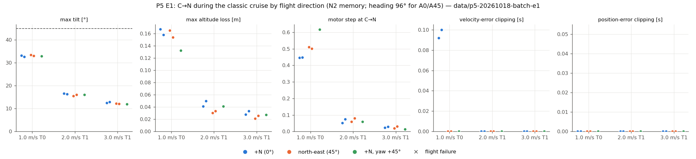
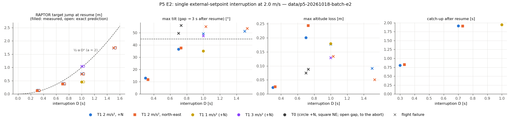
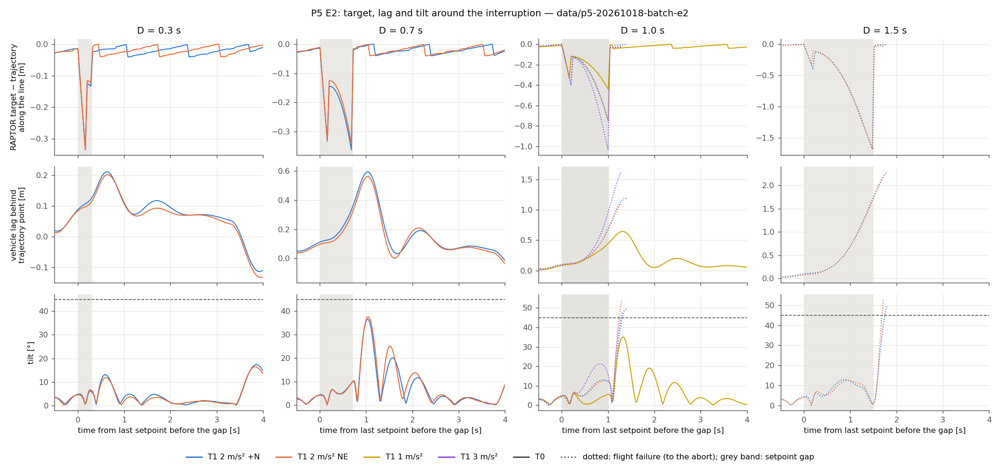
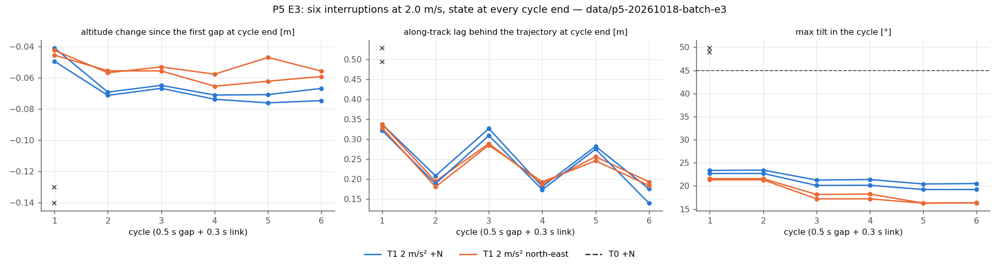
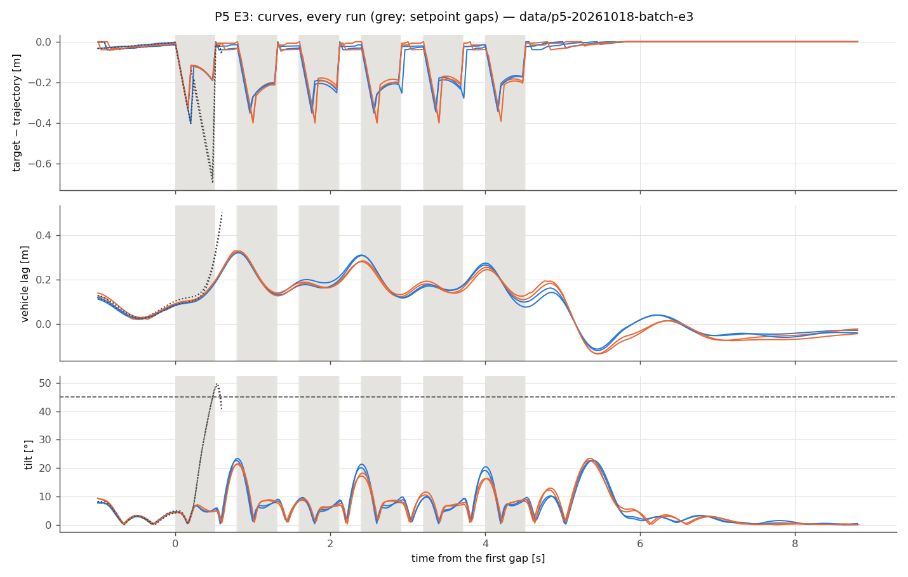

# Thor P5：RAPTOR 目标接口补充先导（飞行方向、setpoint 中断、跳回、反复中断、运动中 N→C）

日期：2026-10-18（Asia/Shanghai）。范围：冻结 x500、本机 headless SITL；未实飞。探查性质：每格 1–2 次，**不做统计结论**。所有数值来自同一冻结候选上完整、通过独立复核的批次：

- E1 飞行方向：[batch-e1](../data/p5-20261018-batch-e1/) 15/15 接受，[batch-audit.json](../data/p5-20261018-batch-e1/batch-audit.json) 通过
- E2 单次 setpoint 中断：[batch-e2](../data/p5-20261018-batch-e2/) 12/12 完成（5 接受 + 7 预登记飞行失败），审计通过；T0 两轮在中断中被中止，补充测量见 [open-gap-supplement.json](../data/p5-20261018-batch-e2/open-gap-supplement.json)
- E3 反复中断：[batch-e3](../data/p5-20261018-batch-e3/) 6/6 完成（4 接受 + 2 预登记飞行失败，均为 T0），审计通过
- E4 运动中 N→C：[batch-e4](../data/p5-20261018-batch-e4/) 2/2 接受，审计通过
- 候选等价性：[equivalence](../data/p5-20261018-equivalence/) 4/4 等价（[equivalence.json](../data/p5-20261018-equivalence/equivalence.json)，见“候选与批次”中的说明）；冻结前尾延迟 [dev-10](../data/p5-20261018-dev-10/) 10/10（6 接受 + 4 飞行失败为结果），每轮最大施加年龄 ≤8 ms，复核通过
- 开发运行（不计入结果）：dev01、dev02-*、[dev-03](../data/p5-20261018-dev-03/)，说明见 [dev-notes](../data/p5-20261018-dev-notes.json)

记忆一律 N2（`MC_RAPTOR_RINI=4`），每轮独立 Gazebo 种子；主机设置同 P4（`jetson_clocks`、ToDesk 断开、用户会话核 0–3、PX4/Gazebo/Agent/运行器绑核）。门槛、包线、飞行失败判据、截断限值均未改；没有拼接，没有原地重跑。

## 四个问题的回答

1. **截断会不会让后果随飞行方向变？会，但只在误差超过截断限值时。** 截断在**目标偏航系**逐轴进行，起作用的是运动方向相对目标偏航的夹角。误差都在限值内的事件（E1 的 T1 2.0/3.2 m/s 接管、E2 D ≤ 0.7 s）没有方向差别：倾角差 ≤1.2°，高度损失差 ≤0.05 m。误差超限的事件（E2 D ≥ 1.0 s、T0 在 2 m/s 下的零速度捕获）在 45° 时两轴同时被截断，RAPTOR 看到的误差最多大 √2 倍：倾角更高（D=1.0：55.2° vs 49.3°；T0：56.1° vs 49.6°），越过 45° 也更早（T0：0.20 vs 0.28 s）。在本次所有配对里，成功/失败的结果没有因方向改变。Y45（沿 +N、偏航转 45°）与 A45（沿东北、偏航不变）在单轮差异内一致，所以起作用的是相对目标偏航的方向，不是世界方向。
2. **外部 setpoint 超时走哪个分支？T1 是否作用于飞行中的超时？** 前 200 ms 保持最后一条 setpoint（位置冻结、速度前馈不变）；超时后走的是**与模式激活完全相同的捕获分支**（当前位置、当前偏航、零速度），之后保持不动。P4-01c 的 T1（RTGT=1）**只作用于激活**，飞行中的超时仍是零速度捕获。本次加了 `MC_RAPTOR_RTGT=2`，让 T1 也作用于飞行中的超时（改动小、同一参数门控、默认不变）。每个中断都实测核对：捕获在最后一条 setpoint 后 204–208 ms，模式 2，剖面与闭式解一致，并由恢复的 setpoint 结束。
3. **恢复时目标跳变有多大？** 实测跳变与精确预测之差 ≤0.01 m（E2 ≤0.002 m，E3 ≤0.009 m）。½·a·D² 不准：它忽略了前 200 ms 的保持，也没算捕获时机体相对轨迹点的滞后，D 很短时偏小、D 较长时偏大（D = 0.3/0.7/1.0/1.5 s：实测 0.13/0.38/0.76/1.73 m，½·a·D² 为 0.09/0.49/1.00/2.25 m）。正确的估计是：捕获时的滞后 + ½·a·(D−0.2 s)²（T1 仍在减速时），T1 停下后为 v·(D−0.2) − v²/(2a)。真正决定后果的是速度跳变 a·(D−0.2)（上限为 v）：约 1.0 m/s 时可恢复（倾角 37°），≥1.6 m/s 时 4/4 越过 45°。
4. **反复中断是否累积？** T1：6 个周期（0.5 s 中断 + 0.3 s 恢复）不累积。4/4 成功，周期末高度变化在第 2 周期后停在 −0.06 m 左右，轨迹滞后在 0.14–0.34 m 之间摆动、不增长。T0：2/2 在第一次中断就越过 45° 被中止（48.9°/49.9°），正式数据无法观察累积。一次开发运行中，倾角峰值落在运行器两次采样之间、没有被中止，周期末高度损失 −0.46/−1.27/−1.97/−2.68/−2.99 m，第 5 周期触地（只是开发证据，不作结论）。

## E0 源码核对
行号：`mc_raptor.cpp` / `mc_raptor.hpp` 指 Lab RAPTOR 检出（pinned `4ae21a5`）注入研究代码后的文件；括号内为未注入的上游文件（`git show HEAD:src/modules/mc_raptor/mc_raptor.cpp`）行号。

**1. 外部目标的接收。** `Run()` 每个周期（由 `vehicle_angular_velocity` 驱动，4 ms）读 uORB `trajectory_setpoint`（`mc_raptor.cpp:718`（574）），8 个字段全部有限时整条替换 `_trajectory_setpoint`（位置、速度、偏航、偏航速率，`:748`（604）），并记接收时刻 `timestamp_last_trajectory_setpoint = current_time`。没有插值、外推或速率限制：RAPTOR 看到的就是最近一条 setpoint 的位置和速度前馈（加速度字段不用）。

**2. 超时判定与超时后的目标。** 条件 `current_time − timestamp_last_trajectory_setpoint > TRAJECTORY_SETPOINT_TIMEOUT`（`:913`（769）），`TRAJECTORY_SETPOINT_TIMEOUT = 200 ms`（`mc_raptor.hpp:135`）。分三段：
- **0–200 ms（过期前）**：目标仍是最后一条 setpoint——位置冻结，速度前馈仍是原速度。机体继续前进，位置误差逐渐变大（2 m/s 时 200 ms 约 0.4 m，减去原有跟踪滞后）。
- **超时那个周期**：只在“刚变成过期”或“激活周期”捕获一次（`:916`（772））：目标 = 当前位置、当前姿态偏航、**零速度**（`:917–925`（773–781））。这和模式激活时是**同一个分支、同一段代码**：激活时 `reset()` 清掉 `timestamp_last_trajectory_setpoint_set`（`:147`（47）），所以激活周期也走过期分支。
- **之后**：保持这个目标，不再更新，直到下一条 setpoint 到达。
- 另外：RAPTOR 不活动时这段分支同样运行（捕获经典 FlightTask 的 setpoint 流过期），只是不影响电机。

**3. 恢复时目标的变化。** 下一条有效 setpoint 到达的那个周期，`_trajectory_setpoint` 被整条替换（`:748`），过期标志清零（`:944–951`（799 附近））——目标**一步跳回**当前轨迹点（位置和速度同时跳），没有任何过渡。

**4. T1 是否挂在超时分支上。** P4-01c 的 T1 挂在同一个捕获调用上，但条件是 `activation && mode==1`：**只在模式激活周期生效；飞行中的 200 ms 超时仍是零速度捕获**（P4-01c 的 `research_target_capture`）。
- 扩展改动很小：同一参数加一个取值 `MC_RAPTOR_RTGT=2`（激活和 RAPTOR 活动时的每一次飞行中超时捕获都用速度匹配目标），把门控写成纯函数 `speed_matched_capture(mode, activation, active)`（[research/state/TargetProfile.hpp](../research/state/TargetProfile.hpp)），捕获调用多传 `next_active`（`mc_raptor.cpp:927`、`:1238`）。RTGT=0（默认）与 RTGT=1 的代码路径逐字节不变；不活动时永不启动剖面。
- 恢复时剖面由外部 setpoint 结束（`research_target_step`，`:1250`，`END_EXTERNAL_SETPOINT`），与 P4-01c 相同。
- 单元测试 [tests/target_profile_test.cpp](../tests/target_profile_test.cpp) 新增门控真值表（ASan/UBSan）；注入经 [tools/apply_research.py](../tools/apply_research.py)，旧检出先 `migrate()` 再由原 edit 确认，幂等检查通过、每个插入片段只出现一次；RAPTOR 与经典 SITL 均重新编译。

**5. 截断在哪个坐标系、哪一步。** `observe()`（`:444`（344））：位置误差 = 位置 − 目标位置，速度误差 = 速度 − 目标速度（NED→FLU 变号），用目标偏航 `_trajectory_setpoint.yaw` 构成的旋转（只绕 z 轴，`:453–464`）转到**目标偏航系**（`:487`（387）），然后逐轴截断到 ±0.5 m / ±1.0 m/s（`:488–501`（388–401）；`mc_raptor.hpp:139–140`）。截断是观测交给执行器前的最后一步。
- 这不是世界系，也不是完整的机体系（不含横滚/俯仰），而是**目标偏航系**。目标偏航在激活/超时捕获时取自当前姿态偏航，在跟踪外部 setpoint 时取 setpoint 的偏航（运行器发送接管时的航向）。所以对截断起作用的是**运动方向相对目标偏航的夹角**。
- 先导各阶段的“沿 +N”在 Gazebo 偏航 0 下 PX4 航向为 96°：运动方向相对目标偏航 −96°，离侧向轴 6°（几乎沿单轴）。东北 45° 相对目标偏航 −51°，离对角线 6°。
- 因此 E1 两种都做：45° 组 A45 = 航向不变、沿东北飞（相对角 −51°）；Y45 = 沿 +N 飞、出生偏航 +45°（航向 51°，相对角同为 −51°，只是世界旋转了 45°）。Y45 每级 1 次，用来区分“相对目标偏航的方向”与“世界方向”。

**6. 运行器能力。** 现有运行器能让 RAPTOR 经外部 setpoint 跟踪直线（P2/P4 RAPTOR 基线），但只能停流一次、不能恢复。新增最小注入器（[tools/run_experiment.py](../tools/run_experiment.py) `start_stream(..., gaps)` 与 kind `p5_gap`）：在预登记的剖面时间窗内不发 setpoint，轨迹时间照走，窗口结束后立即在同一条按时间参数化的直线上恢复，可重复。每个间隙的实际时序由 RAPTOR 自己的接收记录（`raptor_status.subscription_update_trajectory_setpoint`）核对。

## 候选与批次

| 批次 | 结果 | 说明 |
|---|---|---|
| 开发 dev01、dev02-*、[dev-03](../data/p5-20261018-dev-03/) | 开发（不计入） | 检查代码路径与日志结构。发现并修复两个分析问题（冻结前）：`raptor_status` 偶尔缺行（RAPTOR 在重复陀螺样本的周期跳过发布），接收时刻改为与记录的 `trajectory_setpoint` 行取并集；未截断误差的重建改用 RAPTOR 记录的 `research_timing.local_position_sample`（残差 0.05 m/s → 1×10⁻⁷）。见 [dev-notes](../data/p5-20261018-dev-notes.json) |
| [equivalence](../data/p5-20261018-equivalence/) | 4/4 等价 | RTGT=0 的 P4 M1 N2 ×2（`config/p4.json`）与 RTGT=1 的 01c V1.0 T1 ×2（`config/p4c.json`），每轮独立种子。M1 N2：阶跃 0.449/0.436，高度损失 0.145/0.154 m，恢复 2.77/**3.20** s，倾角 31.9/32.9°；V1.0 T1：倾角 17.9/18.0°，高度损失 0.042/0.046 m，阶跃 0.047/0.026。**说明**：“已有范围”在批次前预登记为同一条件下所有完整正式批次的运行（M1 N2 = 01b M1 N2 3 轮 + 01c V1.0 T0 3 轮，两者剖面、记忆、RTGT 都相同；V1.0 T1 = 01c 3 轮），容差未改。M1-N2-2 的恢复时间 3.20 s 落在已知的高值一侧（M1 恢复时间约 2.7 或 3.2 s，两种取值）；只对照 01b 的 3 轮会不通过（同 P4 c-equivalence-02）。参考集的选择由我在批次前决定，结论以用户接受这一选择为条件 |
| [dev-10](../data/p5-20261018-dev-10/) | 10/10 | 覆盖全部 P5 运行类型；每轮最大施加年龄 4 ms（2 轮 8 ms）；4 次飞行失败（D1.5 T1、D1.0 T1a3、D0.7 T0、R6 T0）为结果；复核通过 |
| [batch-e1](../data/p5-20261018-batch-e1/) | 15/15 接受 | 157,068 个神经电机步，覆盖 0，最大施加年龄 4 ms |
| [batch-e2](../data/p5-20261018-batch-e2/) | 12/12 完成：5 接受 + 7 飞行失败 | 291,400 步，覆盖 0，最大 4 ms |
| [batch-e3](../data/p5-20261018-batch-e3/) | 6/6 完成：4 接受 + 2 飞行失败 | 172,040 步，覆盖 0，最大 4 ms |
| [batch-e4](../data/p5-20261018-batch-e4/) | 2/2 接受 | 24,400 步，覆盖 0，最大 4 ms |

- 候选：PX4 侧只改了 T1 门控（RTGT=2）；策略权重未变。新增工具 `tools/p5_{batch,metrics,audit,equivalence,report}.py`，运行器 kind `p5_gap`，配置 [config/p5.json](../config/p5.json)（全部组、条件、安全预算、判据预登记）。`p2_metrics`/`p4_metrics` 对 N→C 不再要求接管前的 teacher forcing（E4 中 N2 只作用于悬停时的设置进入；对已存 P2/P4 运行不改变结果）。`p0_metrics`/`p1_metrics` 把模式 2 的剖面行同样当作 RAPTOR 的主动目标。
- 每轮核对（`tools/p5_metrics.py`，失败即停批）：种子与航向实现（Y45 起飞前航向 51.0–51.1°）；参数 RINI/RTGT/RTDEC 等于计划；所有模式进入使用 RINI=4 且已施加；每个中断的无 setpoint 时长在 [D−0.01, D+0.06] s 内（实测 D+0.00–0.02 s）；每个中断恰有一次飞行中捕获，在最后一条 setpoint 后 200–216 ms（实测 204–208 ms）；模式与减速度等于计划；捕获的机体状态等于 RAPTOR 所用的局部位置样本；T1 剖面与闭式解一致（≤1×10⁻⁴）且在恢复时由外部 setpoint 结束；T0 为零速度、无剖面行；飞行方向误差 ≤5°（实测 ≤2.1°）。
- 安全半径：开跑前逐轮检查（直线以 RAPTOR 悬停捕获点为中心，起点 −L/2；起终点半径 + 1.0 m 余量 + 中断漂移 ≤ 8 m）。各条件 6.3–7.8 m，中断漂移项全部为 0（中断期间机体追不上仍在前进的轨迹点）；**没有条件被取消**。为放进去，E2/E3 用 1 s 线性加速，E3 第 6 周期后直接减速。实际最大水平半径 7.43 m（安全半径 10 m）。
- 飞行失败判据同 P2 explore-02/P4-01c，飞行失败记为结果，基础设施或证据失败停批；四个正式批次都没有停批。

## E1 飞行方向（C→N，P4-01c 机制）

每格 2 次（Y45 每级 1 次）。“相对目标偏航”为运动方向减 RAPTOR 接管时的目标偏航（航向）；A0 的 −96° 离侧向轴 6°，A45/Y45 的 −51° 离对角线 6°。

| 级别 | 方向 | 相对目标偏航 ° | 最大倾角 ° | 最大高度损失 m | 电机阶跃 | 速度误差截断 s（逐轴最大分量） | 位置截断 |
|---|---|---|---|---|---|---|---|
| 1.0 m/s T0 | A0 | −96 | 33.2 / 32.7 | 0.167 / 0.158 | 0.446 / 0.448 | 0.09 / 0.10，只在单轴（0.11, **1.00**） | 0 |
| 1.0 m/s T0 | A45 | −51 | 33.5 / 33.0 | 0.165 / 0.154 | 0.510 / 0.501 | 0（0.65, 0.79） | 0 |
| 1.0 m/s T0 | Y45 | −51 | 32.9 | 0.132 | 0.616 | 0（0.65, 0.78） | 0 |
| 2.0 m/s T1 | A0 | −96 | 16.7 / 16.3 | 0.041 / 0.050 | 0.052 / 0.075 | 0（≤0.40） | 0 |
| 2.0 m/s T1 | A45 | −51 | 15.5 / 16.0 | 0.031 / 0.034 | 0.059 / 0.080 | 0（≤0.31） | 0 |
| 2.0 m/s T1 | Y45 | −51 | 16.1 | 0.041 | 0.060 | 0 | 0 |
| 3.2 m/s T1 | A0 | −96 | 12.5 / 12.9 | 0.028 / 0.034 | 0.023 / 0.030 | 0（≤0.39） | 0 |
| 3.2 m/s T1 | A45 | −51 | 12.2 / 12.1 | 0.021 / 0.026 | 0.020 / 0.031 | 0（≤0.26） | 0 |
| 3.2 m/s T1 | Y45 | −51 | 11.9 | 0.027 | 0.015 | 0 | 0 |

- 15/15 成功，无饱和。与 P4-01c（沿 +N）一致：T0 1.0 m/s 32.3°/0.145 m/0.451，T1 2.0 m/s 16.3°，3.2 m/s 13.0°。
- E1 的事件误差基本都在限值内，只有 T0 1.0 m/s 沿近单轴方向时车速（1.02–1.04 m/s）略超 1 m/s，被截断 0.09–0.10 s；45° 时分量 0.65/0.79，不截断。截断造成的信息损失很小（被截断行中保留的误差比例 0.97–0.99）。T1 从不截断。
- 方向没有改变倾角和高度损失。45° 时 T0 的电机阶跃更大（0.50–0.62 vs 0.45；两个水平通道同时受到阶跃），只是单轮级别的观察。恢复时间不作解读（M1 剖面恢复时间有两种取值）。

## E2 单次 setpoint 中断（2.0 m/s，RAPTOR 跟踪外部直线）

D 是计划的中断长度。“跳变”是 RAPTOR 目标沿直线的跳变（恢复后第一条 setpoint 减去恢复前一个周期的 T1 目标）；“预测”= −捕获时偏移 + v·(恢复−捕获) − T1 目标在这段时间走过的距离。倾角和高度损失统计到下一段 3 s 内（失败轮统计到中止）。

| 处理 | D s | 方向 | 结果 | 跳变 m | ½·a·D² m | 预测 m | 速度跳变 m/s | 最大倾角 ° | 高度损失 m | 追上轨迹 s | 恢复后截断 位置/速度 s |
|---|---|---|---|---|---|---|---|---|---|---|---|
| T1 2 m/s² | 0.3 | A0 | 成功 | 0.138 | 0.09 | 0.138 | 0.22 | 13.1 | 0.023 | 0.80 | 0/0 |
| T1 2 m/s² | 0.3 | A45 | 成功 | 0.125 | 0.09 | 0.125 | 0.19 | 11.8 | 0.026 | 0.83 | 0/0 |
| T1 2 m/s² | 0.7 | A0 | 成功 | 0.392 | 0.49 | 0.391 | 0.99 | 36.6 | 0.201 | 1.91 | 0.30/0.20 |
| T1 2 m/s² | 0.7 | A45 | 成功 | 0.374 | 0.49 | 0.374 | 1.00 | 37.6 | 0.243 | 1.91 | 0/0.09 |
| T1 2 m/s² | 1.0 | A0 | **失败**（倾角，中止） | 0.768 | 1.00 | 0.766 | 1.59 | 49.3 | 0.178 | — | 0.40/0.26 |
| T1 2 m/s² | 1.0 | A45 | **失败** | 0.751 | 1.00 | 0.751 | 1.60 | 55.2 | 0.134 | — | 0.31/0.22（两轴） |
| T1 2 m/s² | 1.5 | A0 | **失败** | 1.728 | 2.25 | 1.728 | 2.00 | 51.4 | 0.092 | — | 0.31/0.29 |
| T1 2 m/s² | 1.5 | A45 | **失败** | 1.737 | 2.25 | 1.737 | 2.00 | 53.7 | 0.051 | — | 0.22/0.22（两轴） |
| T1 1 m/s² | 1.0 | A0 | 成功 | 0.455 | 0.50 | 0.454 | 0.81 | 35.1 | 0.180 | 1.95 | 0.41/0.22 |
| T1 3 m/s² | 1.0 | A0 | **失败** | 1.041 | 1.50 | 1.041 | 2.00 | 47.5 | 0.130 | — | 0.30/0.30 |
| T0 | 0.7 | A0 | **失败**（中断中中止） | — | — | — | — | 49.6（捕获后 0.28 s 越过 45°） | 0.075 | — | — |
| T0 | 0.7 | A45 | **失败**（中断中中止） | — | — | — | — | 56.1（捕获后 0.20 s 越过 45°） | 0.088 | — | — |

- **时序**：无 setpoint 时长 = D + 0.00–0.02 s；飞行中捕获在最后一条 setpoint 后 204 ms（12/12）。中断期间（捕获前后）从未截断：前 200 ms 位置误差增长到约 0.27–0.30 m（冻结的位置 + 原速度前馈），T1 捕获时误差归零。
- **T1 在飞行中超时上生效**（RTGT=2）：初始目标速度 = 车速（1.98–2.03 m/s），之后按闭式剖面减速；D ≥ 1.2 s（2 m/s²）时目标在恢复前已停下（D=1.5 两轮；3 m/s² 在 0.67 s 停下）。
- **跳变的来源**：前 200 ms 的保持不产生跳变（捕获时目标被重置到机体位置）；跳变 = 捕获时机体落后轨迹点的距离（E2 为 0.11–0.15 m）+ 之后轨迹与 T1 减速目标之间拉开的距离。所以 D=0.3 时 ½·a·D² 偏小，D ≥ 0.7 时偏大，D=1.5 时 ½·a·D² 已不适用（目标停下后差距按线性增长）。
- **后果由速度跳变决定**：速度跳变 ≈0.2 m/s 时倾角 12–13°，约 0.8–1.0 m/s 时 35–38°、0.18–0.24 m 高度损失，≥1.6 m/s 时 5/5 越过 45° 被中止。同样 D=1.0，1 m/s² 的跳变更小（0.46 m、0.81 m/s）、能恢复，3 m/s² 更大、失败。这正是 T1 本身的代价：链路断得越久、减速度越大，恢复时目标离轨迹越远。
- **T0** 在飞行中超时就是 2 m/s 下的零速度捕获（与 P4-01c 的 T0 2.0 m/s 同一机制），捕获后 0.20–0.28 s 越过 45°，在中断还没结束时就被中止。冻结的 `p5_metrics` 只测完整的中断（之后有接收），所以这两轮只有正确的结果分类（FAILURE，运行器安全中止），没有中断内的数值。表中数值来自批次后写的补充工具 `tools/p5_open_gap.py`，只读原始证据，结果写到单独的文件，没有改动运行目录。

## E3 反复中断（2.0 m/s，6 × [0.5 s 中断 + 0.3 s 恢复]）

| 运行 | 结果 | 每周期跳变 m | 周期末滞后 m（1→6） | 周期末高度变化 m（1→6） | 全程最大倾角 ° | 全程高度损失 m |
|---|---|---|---|---|---|---|
| T1 A0 #1 | 成功 | 0.18–0.27 | 0.34, 0.21, 0.33, 0.18, 0.28, 0.18 | −0.04, −0.07, −0.07, −0.07, −0.07, −0.07 | 22.7 | 0.112 |
| T1 A0 #2 | 成功 | 0.18–0.25 | 0.32, 0.19, 0.31, 0.17, 0.28, 0.14 | −0.05, −0.07, −0.07, −0.07, −0.08, −0.08 | 23.4 | 0.128 |
| T1 A45 #1 | 成功 | 0.20–0.24 | 0.34, 0.19, 0.29, 0.19, 0.26, 0.19 | −0.04, −0.06, −0.05, −0.06, −0.05, −0.06 | 22.7 | 0.104 |
| T1 A45 #2 | 成功 | 0.21–0.25 | 0.33, 0.18, 0.29, 0.19, 0.25, 0.18 | −0.05, −0.06, −0.06, −0.07, −0.06, −0.06 | 23.5 | 0.103 |
| T0 A0 #1 | **失败**（第 1 周期，49.9°） | 0.76 | 0.53 | −0.14 | 49.9 | 0.140 |
| T0 A0 #2 | **失败**（第 1 周期，48.9°） | 0.72 | 0.49 | −0.13 | 48.9 | 0.130 |

- T1 不累积：滞后和高度在第 2 周期后就稳定，奇偶周期交替（奇数周期机体从约 2.0 m/s 开始，偶数周期从约 2.5 m/s 开始）。原因是 T1 在每次超时时**捕获的是机体当时的速度**：0.3 s 恢复期内机体正在加速追赶（2.4–2.5 m/s），下一次中断的 T1 目标就以这个速度开始，于是跳变的速度部分只有 0.1–0.2 m/s。0.3 s 的恢复期内从未满足追上判据（0.2 m / 0.2 m/s，驻留 0.5 s）。
- T0：每次中断都是 2 m/s 下的零速度捕获，第一次中断后恢复跳变 0.72–0.76 m、速度跳变 2.0 m/s，倾角越过 45° 被中止。是否累积在正式数据中无法观察；开发运行 dev02（未被中止）显示每周期约 0.3–0.8 m 的高度损失，直到触地（见 dev-notes）。
- 两个方向（A0/A45）在 T1 下没有差别（误差都在限值内）。

## E4 运动中 N→C（RAPTOR 2.0 m/s 外部直线 → 经典 AUTO_LOITER）

| 运行 | N→C 时速度 m/s | 最大倾角 ° | 高度损失 m | 电机阶跃 | 联合恢复 s |
|---|---|---|---|---|---|
| N2.0-C0-1 | 2.06 | 13.5 | 0.020 | 0.016 | 3.35 |
| N2.0-C0-2 | 2.07 | 12.4 | 0.013 | 0.026 | 3.42 |

2/2 成功。经典 AUTO_LOITER 从 2 m/s 正常制动，代价很小，与 P2 explore-02（同速 N→C 正常）和 P1/P2 的“N→C 与经典自身制动不可区分”一致。

## 仍然开着的问题

- **T1 在链路中断中的两难**：减速度越大，中断后的速度跳变越大（3 m/s² 在 D=1.0 失败）；减速度越小，链路一直不恢复时冲得越远。可以考虑的方案都没有测：中断时先按原速度外推一段再减速、恢复时对目标做限速的“重新接入”、或者 D 较长时用 C→N 式的目标匹配（恢复时以机体状态为起点追上轨迹）。
- **运行器的安全中止按 10 Hz 遥测采样判断倾角**，短暂超过 45° 的峰值可能漏检（dev02 因此触地）。飞行失败判据在日志上逐样本判定，不受影响；但中止本身不是保证。是否改为 PX4 侧逐样本中止需要用户决定（会改变冻结的运行器安全处理）。
- T0 的反复中断在更低速度（例如 1 m/s，单次可恢复）下是否累积，未测。
- 方向效应只有每格 1–2 次；超限事件中 45° 更严重的结论依据是 4 对单轮比较（D=1.0、1.5、T0、E1 电机阶跃），方向一致但没有区间。
- E2 中“恢复后第一条观测”在接收周期上有一个周期的不确定（setpoint 到达 PX4 的时刻早于 RAPTOR 读取它的周期），所以没有报告逐轮的“恢复瞬间观测值”，改用恢复后的截断时长。
- 等价性依赖预登记的参考集（含 01c V1.0 T0）；M1 恢复时间的两种取值问题仍开着，P4-01c 的结论仍以用户接受 c-equivalence-02 为条件。
- 控制频率（125 Hz vs 训练 100 Hz）仍未检验（P4-02）。

## 范围限制

- 只做 headless SITL，单一 x500 模型，无风；RAPTOR 原生约 125 Hz（训练 100 Hz）。
- 探查性质，每格 1–2 次；E1 的速度级别按要求只测 T0 1.0、T1 2.0/3.0 m/s（P4-01c 剖面，3.0 m/s 级别实际 3.17–3.20 m/s）。
- E2/E3 的减速度、D 与恢复间隔只测了预登记的取值；中断由运行器停发实现（同一时间参数化的直线），不含 DDS 链路本身的丢包特性。
- 结论不授权实飞。
