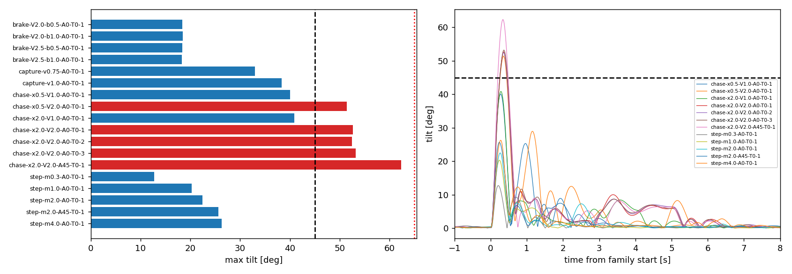
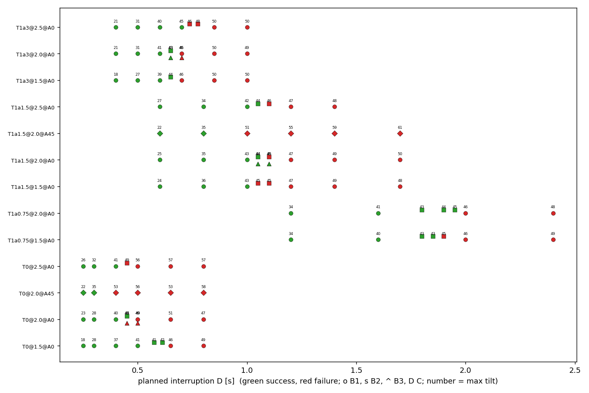
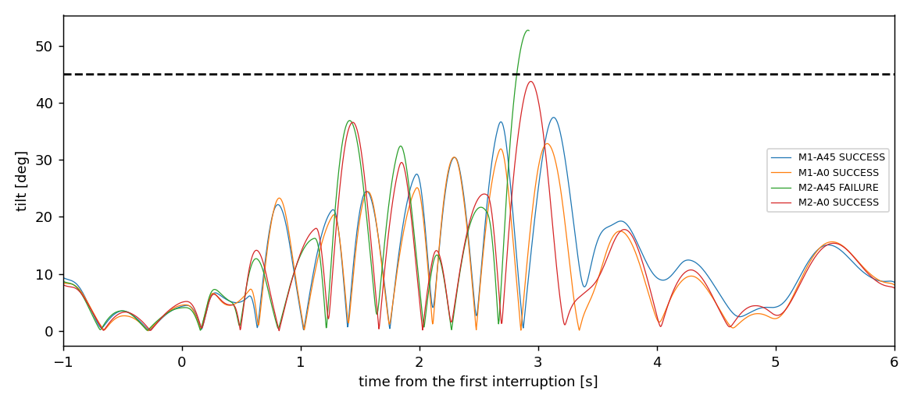

# Thor P6：在 SITL 上检验可行核方法（辨识飞行、留出检验网格、对角与多事件序列）

日期：2026-10-19 至 10-20（Asia/Shanghai）。范围：冻结 x500、本机 headless SITL；未实飞。本批只负责**飞行和导出**：没有拟合模型，没有拿核判三区（留出检验由项目那边用 A 的导出先写预测，再对照 B、C）。所有数值来自同一冻结候选上完整、通过独立复核的批次：

- 候选等价性：[equivalence](../data/p6-20261019-equivalence/) 4/4 等价（[equivalence.json](../data/p6-20261019-equivalence/equivalence.json)），审计通过
- A 辨识飞行：[batch-a](../data/p6-20261019-batch-a/) 18/18，审计通过；导出 commit `10d7d0e7` 已推送（之后才开始 B）
- B1 粗网格：[batch-b1](../data/p6-20261019-batch-b1/) 61/61 完成（33 成功 + 28 预登记飞行失败），审计通过
- B2 加密：[batch-b2](../data/p6-20261019-batch-b2/) 20 轮（12 + 8），审计通过，决策记录 [refinement.json](../data/p6-20261019-batch-b2/refinement.json)
- B3 重复：[batch-b3](../data/p6-20261019-batch-b3/) 12 轮（7 + 5），审计通过
- C 对角与多事件：[batch-c](../data/p6-20261019-batch-c/) 16 轮（7 + 9），审计通过
- 开发运行（不计入结果）：[dev-01](../data/p6-20261019-dev-01/) 8 轮，说明见 [dev-notes](../data/p6-20261019-dev-notes.json)
- 导出：[export/](../export/)（127 轮：A 18 + B1 61 + B2 20 + B3 12 + C 16，见 [manifest.json](../export/manifest.json)；47.9 MB，每轮 0.25–0.45 MB，未降采样）

记忆一律 N2（`MC_RAPTOR_RINI=4`），每轮独立 Gazebo 种子；主机设置同 P5（`jetson_clocks`、ToDesk 断开、用户会话进程核 0–3、PX4/Gazebo/Agent/运行器绑核；systemd 用户管理进程无权限改绑，同 P5）。飞行失败判据、截断限值、恢复判据、包线（除 `p6_ident` 的中止倾角外）均未改；B、C 网格按预登记跑完；没有拼接，没有原地重跑，没有补跑（没有基础设施失败）。

## 结论摘要

1. **A**：18 轮全部完成，没有一轮被中止。6 轮 chase 越过 45°（x0.5 V2.0：51.5°；x2.0 V2.0 A0 三个种子 52.5/52.7/53.2°；x2.0 V2.0 A45：62.3°，高度损失 0.93 m），按预登记标为 `ident_exceeded_45`，不算失败、不算检验数据。**最猛一档（水平加速度 |a| ≥ 9.5 m/s²）在 A 里只有 32 个控制周期（0.13 s），全部来自一轮（chase x2.0 V2.0 A45）**；A0 的满量程 chase 最大 |a| 低于 9.5 m/s²（EKF 加速度）。这一档的样本量没有因为 A 而变得充足。
2. **B**：11 个 A0 族全部单调、恰有一次“成功→失败”，加密后 11 个临界区间全部 ≤ 0.05 s（见下表）。**所有失败都是倾角越过 45°**；成功轮最大倾角全部 < 45°，临界附近倾角随 D 连续上升（约 43–46°）。
3. **SITL 的随机性**：B3 在临界两侧 6 个条件各加 2 个种子。最后成功的格子 3 个里有 1 个翻成失败（T0 D0.45：成功 2/3），首个失败的格子 3 个里有 2 个翻成成功（T1a3 D0.7、T1a1.5 D1.1：失败 2/3）；同一格不同种子的最大倾角差 0.4–1.7°。**翻转只出现在临界区间两端的格子上，即边界两侧 ≤ 0.05 s 以内**；离边界一格（0.05–0.1 s）之外没有出现翻转（重复数有限，见“范围限制”）。
4. **C1 对角**：两个族都有 **A0 安全而 A45 失败的 D**：T0 2.0 m/s D=0.4（A0 40.1° 成功，A45 52.9° 失败），T1a1.5 2.0 m/s D=1.0（A0 42.9° 成功，A45 50.5° 失败）。A45 的临界区间（T0 (0.3, 0.4]、T1a1.5 (0.8, 1.0]）比 A0（(0.45, 0.5]、(1.05, 1.1]）短约 0.1–0.25 s；两个方向都失败的 D 上，A45 倾角高 2.3–11°。这和 P5 “对角上倾角高但成败没变”不同：P5 只在离边界较远的 D 上比较过。
5. **C2 多事件**：每次中断单独看都在 P5 判为安全的范围（T1、2 m/s²、D ≤ 0.7 s），序列里 M2-A45 失败（第 4 次中断后 52.7°），M2-A0 成功但到 43.8°，M1 两个方向成功但第 4 次恢复后倾角 32.8/37.4°、高度损失 0.70/0.94 m。逐次的恢复跳变在增大（M1：0.24→0.46→0.59→0.77 m），原因可以直接看到：恢复期太短，下一次捕获时机体速度不是稳态（M2 第 4 次捕获时 1.53–1.59 m/s，而不是 2.0），速度跳变因此到 1.33–1.39 m/s。M3 因安全半径预算取消（见下）。

## 候选与批次

| 批次 | 结果 | 说明 |
|---|---|---|
| [dev-01](../data/p6-20261019-dev-01/) | 开发（不计入） | 8 轮覆盖全部新代码路径（4 个辨识族、RTDEC 0.75/1.5 的生成条件、C2 显式窗口、A45 T0），每轮最大施加年龄 4 ms。冻结前修复导出工具恢复时刻取值（见 dev-notes）。最终候选与 dev-01 只差 4 个只做分析的工具，飞行代码、配置、Lab、二进制、策略相同 |
| [equivalence](../data/p6-20261019-equivalence/) | 4/4 等价 | P5 的 `p5_gap:D0.7-A0:T1` 与 `D1.0-A0:T1a3` 各 2 次（config/p5.json，冻结 p5_metrics）：成败与 P5 相同（成功/失败），最大倾角 37.57/36.68°（P5 36.62°）、49.56/48.23°（P5 47.55°），差 ≤ 2.02° |
| [batch-a](../data/p6-20261019-batch-a/) | 18/18 | 最大施加年龄 4 ms，覆盖 0，最大水平半径 5.24 m |
| [batch-b1](../data/p6-20261019-batch-b1/) | 61/61 完成 | 两轮最大施加年龄 8 ms（v1.5-D1.2/D1.6 T1a0.75；前者 8 条电机命令被覆盖，覆盖比例 5×10⁻⁶，低于门限），其余 4 ms；最大半径 6.97 m |
| [batch-b2](../data/p6-20261019-batch-b2/) | 20 轮 | 4 ms，覆盖 0，最大半径 7.03 m |
| [batch-b3](../data/p6-20261019-batch-b3/) | 12 轮 | 4 ms，覆盖 0 |
| [batch-c](../data/p6-20261019-batch-c/) | 16 轮 | M1-A0 一轮 8 ms，其余 4 ms，覆盖 0，最大半径 7.06 m |

- **候选**：PX4 侧没有改动（新减速度只是 `MC_RAPTOR_RTDEC` 取值 0.75/1.5，参数范围 0.1–10）。运行器新增 kind `p6_ident`；`p5_gap` 的 `gaps` 支持显式窗口列表 `windows_s`，并能按预登记规则生成条件（`tools/p6_conditions.py`）。旧格式完全不变：P5 全部 28 个已存运行的剖面逐字节重现，P5 单元测试通过，P5 分析器在 P5 运行上的输出不变。窗口版分析器（`p6_metrics.analyze_gap_windows`，冻结 `analyze_gap` 的拷贝，只把 D 和恢复间隔改成逐次）把 P5 R6 运行改写成窗口格式后，结果与存档的 p5-metrics.json 完全相同。
- **候选标识**：B、C 的候选与 A、等价性的候选只差 `project_head`。这是按任务要求在 A 之后、B 之前提交并推送导出造成的（`10d7d0e7`、`4a7c2426`）；所有文件、二进制、策略的哈希相同。
- **安全半径**（预登记在 config 的 `p5.budget_table` 和 `p6.ident.budget_table`）：P5 规则不变（直线以 RAPTOR 悬停捕获点为中心，起终点半径 + 1.0 m + 中断漂移 ≤ 8 m；漂移项按最慢的 T1 目标 0.75 m/s² 计）。预登记时在出生点上算，另留 0.1 m 给悬停点偏移（P5 实测最大 0.072 m），否则一轮可能在起飞后被运行时检查拒绝、停批。按任务顺序缩短：恢复后保持 3.0 → 2.0 s（0.05 s 步长），再缩中断前巡航 1.0 → 0.75 s。
  - 缩短的条件：v2.5 的全部 T0 D ≥ 0.4、T1a3 D ≥ 0.4、T1a1.5 D ≤ 1.2（恢复后保持 2.15–2.95 s）；v2.5 D1.4 T1a1.5（保持 2.0 s、巡航 0.95 s）；v2.0 D2.0/D2.4 T1a0.75（2.9/2.5 s）；C2 M1（2.25 s）、M2（2.35 s）。B2 生成的条件同样按规则（见各运行 config.json 的 `p5_condition_spec`）。
  - **取消**（预登记，没有飞）：B1 **v2.5 D1.7 T1a1.5**（保持 2.0 s、巡航 0.75 s 时 8.07 m）；C2 **M3 两个方向**（8 次中断的线长约 18 m，10.2 m）。所以 B1 是 61 轮，C2 是 4 轮；没有改速度，没有改中断长度。
- **飞行失败**判据同 P5（`p5.failure_criteria`，日志逐样本）。任务里写的是“倾角 > 45° 或高度损失 > 1 m”；本批 50 次 B/C 失败全部是倾角：35 次日志越过 45° 且运行器中止，8 次在中断中被运行器中止（倾角取自 P5 的 open-gap 测量，47.2–57.7°），7 次日志越过 45°（45.0–46.3°）但 10 Hz 的运行器采样没有捕到（照常完成，判为失败）。没有一轮高度损失超过 1 m（全部批次最大 0.94 m，C2 M1-A45 成功轮）。
- **辨识飞行的包线**：`p6_ident` 的运行器中止倾角为 65°，并加一个高度损失 > 1.0 m（相对剖面开始时高度）的中止；其余包线不变，其它 kind 不受影响（config `p6.ident.safety_note`）。A 里没有一轮触发中止；离中止最近的是 chase x2.0 V2.0 A45（62.3°，0.93 m）。

## A：SITL 辨识飞行

**要回答的问题**（低阶模型和误差结构在 x500 上是否成立、饱和上限）由项目那边用导出回答；这里只给飞行事实和数据覆盖。RAPTOR 通过外部 setpoint 悬停，运行器按预登记剖面发 setpoint（kind `p6_ident`，复用 `start_stream` 的时间参数化发流）；路径以悬停捕获点为中心，先移到起点、保持 3 s，再开始剖面。chase 的“追上”判据是运行器最新 DDS 位置沿轴落后目标 ≤ 0.2 m，否则 3 s 后减速（1 m/s²）。

| 条件 | 结果 | 最大倾角 °（时刻 s） | 高度损失 m | 最大沿轴速度 m/s | 截断时长 位置/速度 s（两轴同时） | chase 减速开始 s |
|---|---|---|---|---|---|---|
| step 0.3 A0 | OK | 12.7 (0.21) | 0.029 | 0.56 | 0 / 0 | |
| step 1.0 A0 | OK | 20.3 (0.25) | 0.072 | 1.02 | 0.74 / 0.05 | |
| step 2.0 A0 | OK | 22.5 (0.27) | 0.083 | 1.05 | 2.04 / 0.10 | |
| step 4.0 A0 | OK | 26.3 (0.28) | 0.114 | 1.12 | 4.70 / 0.18 | |
| step 2.0 A45 | OK | 25.7 (0.24) | 0.112 | 1.39 | 1.48 / 0.08（1.16 / 0） | |
| chase x0.5 V1.0 | OK | 40.1 (0.28) | 0.216 | 2.30 | 0.52 / 0.33 | 0.77 追上 |
| chase x0.5 V2.0 | **>45** | 51.5 (0.36) | 0.336 | 3.63 | 0.73 / 0.80 | 0.93 追上 |
| chase x2.0 V1.0 | OK | 40.9 (0.28) | 0.226 | 2.34 | 2.40 / 0.44 | 3.00 追上 |
| chase x2.0 V2.0 #1/#2/#3 | **>45** | 52.7 / 52.5 / 53.2 (0.36–0.37) | 0.415 / 0.396 / 0.452 | 3.76 / 3.75 / 3.82 | 2.60–2.68 / 0.96–1.01 | 3.0 未追上（落后 0.29–0.33 m） |
| chase x2.0 V2.0 A45 | **>45** | 62.3 (0.34) | 0.932 | 3.96 | 2.20 / 1.29（1.20 / 0.73） | 2.98 追上 |
| brake V2.0 b0.5 / b1.0 | OK | 18.4 / 18.4 (0.53) | 0.023 / 0.017 | 2.15 | 0 / 0 | |
| brake V2.5 b0.5 / b1.0 | OK | 18.4 / 18.3 (0.52–0.54) | 0.030 / 0.016 | 2.71–2.73 | 0 / 0 | |
| capture v0.75 | OK | 33.0 (4.26) | 0.155 | 1.60 | 1.03 / 0.66 | |
| capture v1.0 | OK | 38.4 (4.25) | 0.205 | 1.95 | 1.52 / 0.99 | |

- 截断时长按 RAPTOR 的执行器输入（`research_memory.policy_input`）逐轴在目标偏航系统计。沿 +N（A0）在偏航 0 出生时几乎是目标系的侧向单轴，A45 两轴同时截断。
- capture：中断 2.004/2.012 s，各恰有一次飞行中零速度捕获，在最后一条 setpoint 后 204 ms，捕获速度 0.754/1.032 m/s；最大倾角出现在恢复（目标跳回前方运动中的轨迹点）之后。
- brake 的最大倾角来自 2 m/s² 的加速段（0.5 s），减速段（0.5/1.0 m/s²）更小；这两种减速度都不截断。
- 噪声：chase x2.0 V2.0 A0 三个种子最大倾角 52.5–53.2°，高度损失 0.40–0.45 m，最大速度 3.75–3.82 m/s。
- **加速度覆盖**：导出中水平加速度（`vehicle_local_position` ax/ay，EKF2 输出）|a| ≥ 9.5 m/s² 的控制周期：A 32 个（全部来自 chase x2.0 V2.0 A45，最大 11.1 m/s²），B1 21、B2 6、B3 0、C 13；|a| ≥ 7 m/s²：A 329、B1 954、B2 718、B3 500、C 249。A 的满量程 chase（A0）倾角 52–53° 时 EKF 加速度没有到 9.5 m/s²。

## B：留出检验网格（单次中断，A0）

**要回答的问题**：每族真实的临界中断时长 D* 在哪里，SITL 的随机性让边界有多宽。（D* 是否落在核给的区间里由项目那边对照。）

D 是计划的无 setpoint 时长（P5 定义；实测无 setpoint 时长 = D − 0.004 至 D + 0.022 s，每次中断恰有一次飞行中捕获，在最后一条 setpoint 后 204–207 ms，全部由 `p5_metrics` 逐轮核对）。B1 每格 1 次，顺序按 `random.Random(61019)` 打乱；B2 按预登记规则二分；B3 每个临界格再加 2 个种子。表中 S 成功、F 失败，数字为最大倾角 °；* 为在中断中被中止（倾角取到 RAPTOR 结束）；括号为 B1 之外的阶段。

| 族 | D s：结果/最大倾角 | 临界区间（最后成功, 首个失败] |
|---|---|---|
| T0 1.5 m/s | 0.25 S/17.7 · 0.3 S/28.5 · 0.4 S/36.9 · 0.5 S/40.7 · 0.575 S/41.0 (B2) · 0.6125 S/42.4 (B2) · 0.65 F/45.7 · 0.8 F/49.4 | (0.6125, 0.65] |
| T0 2.0 m/s | 0.25 S/23.4 · 0.3 S/28.5 · 0.4 S/40.1 · 0.45 S/44.0 (B2) · 0.5 F/49.0* · 0.65 F/50.9* · 0.8 F/47.2* | (0.45, 0.5] |
| T0 2.5 m/s | 0.25 S/26.1 · 0.3 S/32.3 · 0.4 S/40.7 · 0.45 F/48.6 (B2) · 0.5 F/55.8 · 0.65 F/57.2* · 0.8 F/57.4* | (0.4, 0.45] |
| T1a3 1.5 m/s | 0.4 S/17.9 · 0.5 S/27.1 · 0.6 S/39.4 · 0.65 S/43.8 (B2) · 0.7 F/46.1 · 0.85 F/49.9 · 1.0 F/50.3 | (0.65, 0.7] |
| T1a3 2.0 m/s | 0.4 S/21.2 · 0.5 S/30.9 · 0.6 S/40.8 · 0.65 S/43.3 (B2) · 0.7 F/46.4 · 0.85 F/50.2 · 1.0 F/49.0 | (0.65, 0.7] |
| T1a3 2.5 m/s | 0.4 S/21.4 · 0.5 S/30.6 · 0.6 S/40.2 · 0.7 S/45.0 · 0.7375 F/46.1 (B2) · 0.775 F/48.0 (B2) · 0.85 F/50.4 · 1.0 F/50.3 | (0.7, 0.7375] |
| T1a1.5 1.5 m/s | 0.6 S/23.6 · 0.8 S/36.3 · 1.0 S/42.7 · 1.05 F/45.3 (B2) · 1.1 F/45.5 (B2) · 1.2 F/47.4 · 1.4 F/49.4 · 1.7 F/48.3 | (1.0, 1.05] |
| T1a1.5 2.0 m/s | 0.6 S/25.3 · 0.8 S/35.1 · 1.0 S/42.9 · 1.05 S/43.7 (B2) · 1.1 F/45.2 (B2) · 1.2 F/46.9 · 1.4 F/49.2 · 1.7 F/50.1 | (1.05, 1.1] |
| T1a1.5 2.5 m/s | 0.6 S/26.8 · 0.8 S/34.0 · 1.0 S/42.4 · 1.05 S/43.9 (B2) · 1.1 F/45.9 (B2) · 1.2 F/47.3 · 1.4 F/47.9 ·（1.7 取消） | (1.05, 1.1] |
| T1a0.75 1.5 m/s | 1.2 S/34.4 · 1.6 S/40.5 · 1.8 S/43.2 (B2) · 1.85 S/43.3 (B2) · 1.9 F/45.0 (B2) · 2.0 F/45.7 · 2.4 F/49.4 | (1.85, 1.9] |
| T1a0.75 2.0 m/s | 1.2 S/34.3 · 1.6 S/41.3 · 1.8 S/42.6 (B2) · 1.9 S/44.0 (B2) · 1.95 S/44.7 (B2) · 2.0 F/45.6 · 2.4 F/48.5 | (1.95, 2.0] |

- B2：11 个族都满足“恰有一次成功→失败、无不单调”，全部加密；共 20 轮（预登记上限 33）。T0 2.0、T1a3 1.5/2.0 只需 1 轮，T0 1.5/2.5、T1a3 2.5、T1a1.5 三族各 2 轮，T1a0.75 两族各 3 轮；最终区间宽度 0.0375–0.05 s。
- 临界附近的规律（只是测量，不是模型）：最大倾角随 D 单调上升，在临界区间两端为 40.7–45.0°（最后成功）和 45.0–49.0°（首个失败）；速度越高 T0 的 D* 越短（0.61→0.45→0.40 s），T1 类在 1.5–2.5 m/s 之间几乎不随速度变（T1a3 0.65–0.74 s，T1a1.5 1.0–1.1 s，T1a0.75 1.85–2.0 s）。

**B3 重复**（新种子，每格 2 次；“B1/B2”为原有一次）：

| 族（2.0 m/s） | 格 | 原有 | B3 #1 | B3 #2 | 合计 |
|---|---|---|---|---|---|
| T0 | 最后成功 D=0.45 | S 44.0 | S 44.4 | **F 45.2** | 成功 2/3 |
| T0 | 首个失败 D=0.5 | F 49.0* | F 49.2 | F 49.2 | 失败 3/3 |
| T1a3 | 最后成功 D=0.65 | S 43.3 | S 42.9 | S 43.2 | 成功 3/3 |
| T1a3 | 首个失败 D=0.7 | F 46.4 | **S 44.9** | F 45.1 | 失败 2/3 |
| T1a1.5 | 最后成功 D=1.05 | S 43.7 | S 43.6 | S 44.0 | 成功 3/3 |
| T1a1.5 | 首个失败 D=1.1 | F 45.2 | F 46.3 | **S 44.6** | 失败 2/3 |

- 同一格三次的最大倾角差：0.2°（T0 0.5）到 1.7°（T1a1.5 1.1）；发生翻转的三格，三次的倾角都在 44.0–46.4° 内。B3 只在临界两端的格子上重复：翻转出现在临界区间两端（宽 0.05 s）的格子里；离边界一格以上的稳定性只来自 B1/B2 的单次结果和单调的倾角–D 关系，没有单独重复。

## C：对角方向与多事件序列

### C1 对角（A45，2.0 m/s，D 网格同 B1）

**要回答的问题**：单轴核在对角上是不是偏乐观。

| D s | T0 A0 | T0 A45 | T1a1.5 A0 | T1a1.5 A45 |
|---|---|---|---|---|
| 0.25 | S 23.4 | S 21.9 | | |
| 0.3 | S 28.5 | S 35.2 | | |
| 0.4 | S 40.1 | **F 52.9** | | |
| 0.5 | F 49.0* | F 56.0* | | |
| 0.6 | | | S 25.3 | S 22.1 |
| 0.65 | F 50.9* | F 53.2* | | |
| 0.8 | F 47.2* | F 57.7* | S 35.1 | S 34.9 |
| 1.0 | | | S 42.9 | **F 50.5** |
| 1.2 | | | F 46.9 | F 55.3 |
| 1.4 | | | F 49.2 | F 59.1 |
| 1.7 | | | F 50.1 | F 61.1 |

- **两个族都有 A0 安全、A45 失败的 D**（T0 D=0.4，T1a1.5 D=1.0）。A45 的临界区间：T0 (0.3, 0.4]，T1a1.5 (0.8, 1.0]；A0：(0.45, 0.5]、(1.05, 1.1]（C 没有预登记加密，A45 区间是粗网格宽度）。
- 最短的 D（T0 0.25、T1a1.5 0.6/0.8）两个方向倾角相近（差 ≤ 3.2°，A45 有时更低）；T0 从 D=0.3 起 A45 已高 6.7°；两个方向都失败时 A45 高 2.3–11°（T1a1.5 D=1.7：61.1° vs 50.1°），T0 越过 45° 也更早（捕获后 0.20 s vs 2.0 m/s A0 的 0.28–0.29 s）。误差超限时 A45 两轴同时截断（P5 同样观察到）。这和 P5 一致（P5：D=1.0 55.2° vs 49.3°），新的是在临界附近成败因此改变。

### C2 多事件序列（T1，RTDEC 2.0，2.0 m/s）

**要回答的问题**：每次中断单独都安全的序列，组合起来是否仍安全；逐次之间有没有累积。

| 运行 | 结果 | 每次中断 D s | 捕获时机体速度 m/s | 恢复跳变 m（实测 / 精确预测） | 速度跳变 m/s | 每段最大倾角 ° | 全程最大倾角 ° / 高度损失 m |
|---|---|---|---|---|---|---|---|
| M1-A0 | 成功 | 0.55 ×4（恢复 0.15） | 2.02, 2.13, 1.98, 1.96 | 0.249/0.248, 0.463/0.463, 0.609/0.608, 0.773/0.772 | 0.69, 0.57, 0.72, 0.74 | 10.7, 23.3, 25.1, 32.8 | 32.8 / 0.696 |
| M1-A45 | 成功 | 同上 | 1.99, 2.14, 2.02, 1.91 | 0.238/0.233, 0.454/0.448, 0.569/0.568, 0.768/0.766 | 0.70, 0.56, 0.68, 0.80 | 11.1, 22.1, 27.5, 37.4 | 37.4 / 0.938 |
| M2-A0 | 成功 | 0.4, 0.6, 0.5, 0.65（恢复 0.1, 0.2, 0.1） | 2.00, 1.95, 2.30, 1.59 | 0.162/0.162, 0.485/0.481, 0.629/0.629, 0.874/0.873 | 0.43, 0.86, 0.31, 1.33 | 6.4, 19.0, 36.6, 43.8 | 43.8 / 0.599 |
| M2-A45 | **失败**（第 4 段，52.7°） | 同上 | 1.99, 1.92, 2.40, 1.53 | 0.139/0.139, 0.459/0.459, 0.558/0.558, 0.844/0.841 | 0.42, 0.90, 0.21, 1.39 | 7.3, 22.3, 36.9, 52.7 | 52.7 / 0.621 |
| M3-A0/A45 | **取消** | 0.45 ×8（恢复 0.25） | | | | | 安全半径预算放不下 |

- 单次中断时，P5 E2 的 T1（2 m/s²）在 D=0.7 s 成功（36.6/37.6°）；M1/M2 里最长的单次中断 0.65 s。
- **有累积**：恢复期（0.1–0.2 s）内机体追不上轨迹，滞后逐次叠加，恢复跳变逐次增大（M1 0.24→0.77 m）。T1 在每次超时时捕获的是机体当时的速度：M2 第 3 次捕获时机体正在追赶（2.3–2.4 m/s），速度跳变只有 0.2–0.3 m/s；第 4 次捕获时机体还在第 3 次跳变后的减速里（1.5–1.6 m/s），速度跳变 1.33–1.39 m/s，大于单次 D=0.65 时按 P5 的 a·(D−0.2) 约 0.9 m/s。所以“每次重置单独安全”在这里不能推出序列安全，相关的是每次捕获时的实际状态，而不是只看单次 D。导出的每个事件都带捕获和恢复时刻的未截断状态，供逐次查核。
- 精确预测（P5：捕获时偏移 + 轨迹行程 − T1 目标行程，用实测的捕获速度和时刻）与实测差 ≤ 0.006 m；用计划 D 和 v 的 P5 闭式公式在序列里偏差到 0.23 m（捕获速度不是 2.0），两者都写在导出 summary 里。

## 导出（给项目那边，见第 5 节要求）

- `tools/p6_export.py` → `export/<run>/trace.csv.gz`（RAPTOR 每次推理一行，从设置进入到 N→C）、`summary.json`、`export/manifest.json`。列定义写在脚本文档和每个 summary 的 `trace.columns`、`sources` 里：
  - `ep_u, ep_w, ev_u, ev_w`：**未截断**误差（机体 − RAPTOR 目标），u 沿计划运动轴，w 为 u 顺时针 90°（NED，向右）；这是目标偏航系的固定水平旋转；
  - `*_clip`：网络实际看到的截断后输入（`policy_input`）转到同一 u/w 系；另给目标偏航系的原始截断值 `ep_f_clip, ep_l_clip, ev_f_clip, ev_l_clip`（截断在这个系里逐轴进行）和未截断值 `ep_f…ev_l`；
  - `a_u, a_w, a_z`：`vehicle_local_position` 的 ax/ay/az（EKF2 输出，RAPTOR 本周期所用的同一样本）；`tilt_deg`、`alt_loss_m`、`target_mode`（external / t0_capture / t1_profile）、`gap_active`、`recon_ok`；
  - 时间原点：辨识飞行为剖面族开始（第一条离开保持状态的 setpoint）；B/C 为第一次中断前最后一次接收。
- **重建方法和验证**：机体状态 = `research_timing.local_position_sample` 指定的样本；目标 = RAPTOR 实际读到的外部 setpoint（`raptor_status` 的接收周期，日志里缺行的周期用后一行判定）或它自己的捕获 / T1 剖面行。127 轮全部在未截断分量上与 `policy_input` 一致：最大残差 ≤ 2.2×10⁻⁷，0 个分量超过 10⁻⁴。
- 事件：每次捕获、每次恢复（恢复后取 RAPTOR 第一个使用新 setpoint 的周期）、chase 减速开始、运行器中止、流结束；每个事件给前一周期和事件后的未截断 `(ep_u, ev_u, ep_w, ev_w, a_u, a_w)` 等；恢复给实测跳变、精确预测和 P5 闭式公式。
- 大小：每轮 0.25–0.45 MB（gzip），总 47.9 MB，不需要降采样（规则仍在脚本里：超过 1 MB 时事件 ±3 s 外降到 50 Hz）。
- A 的导出在 B 之前推送（`10d7d0e7`）。之后导出工具改过一次：日志缺 `raptor_status` 行的周期里，以前会把开机检查时发出的旧 setpoint 当成刚读到（只影响 C 的一轮 `v2.0-D0.8-A45-T0`，悬停段 3 mm 级残差）；修正后全部重新导出，A 的 18 个 trace 与已推送的逐字节相同。

## 开发运行、修正与偏离

- dev-01 的 8 轮只用于检查代码路径；其中 4 次飞行失败只作开发观察（包括 M2-A45，正式批次里同样失败）。
- 冻结前的修正：导出工具恢复时刻取值（见 dev-notes）。批次后：导出工具上面的旧 setpoint 判定；审计和报告工具在家族表里对中断中被中止的轮次改用 open-gap 倾角（只读复核重跑，结论不变）。这些都是分析工具，不在飞行路径上；运行目录没有改动。
- 任务中“中止倾角 65° 或高度损失 > 1 m 被中止”：运行器原来没有高度损失中止，P6 为 `p6_ident` 加了一个（只对这个 kind 生效）。
- chase 的“追上”判据（运行器 DDS 位置沿轴 ≤ 0.2 m）和“3 s”从目标出现算起，都写在 config；x2.0 V2.0 A0 的 3 轮在 3 s 内没有追上（落后 0.29–0.33 m），按预登记 3 s 时减速；x2.0 V1.0 和 x2.0 V2.0 A45 在 2.98–3.00 s 追上。
- 辨识飞行“悬停 1 s 后”：实现为移到起点后保持 3 s（包含 ≥ 1 s 悬停），各族相同。

## 仍然开着的问题

- 最猛一档的样本仍少：A 里 |a| ≥ 9.5 m/s² 只有 32 个周期（一轮），B/C 另有 40 个；A0 满量程 chase 在 EKF 加速度上没有到这一档。若项目需要这一档，可能要更猛的剖面（例如 A45 的更大 x0）——那会进一步接近 65° 中止，需要先决定。
- C1 的 A45 区间没有加密（没有预登记），只知道在 (0.3, 0.4] 和 (0.8, 1.0] 内。
- B3 只在临界两端各 3 次；“带宽约 ±0.05 s”是这 6 格的观察，不是区间估计。
- 运行器 10 Hz 倾角中止仍会漏掉短暂越过 45° 的峰值（7 轮），不影响判据（日志逐样本），但中止本身不是保证（同 P5）。
- M3 取消后，较长序列（8 次）的累积在 SITL 上仍未测；需要更大的安全半径或分段直线才能飞。
- 控制频率（125 Hz vs 训练 100 Hz）仍未检验（P4-02）。

## 范围限制

- 只做 headless SITL，单一 x500 模型，无风；RAPTOR 原生约 125 Hz（训练 100 Hz）。
- 探查性质：B1 每格 1 次，B3 临界格 3 次；没有统计区间。
- 中断由运行器停发实现（同一时间参数化的直线），不含 DDS 链路本身的丢包特性。
- 结论不授权实飞。
