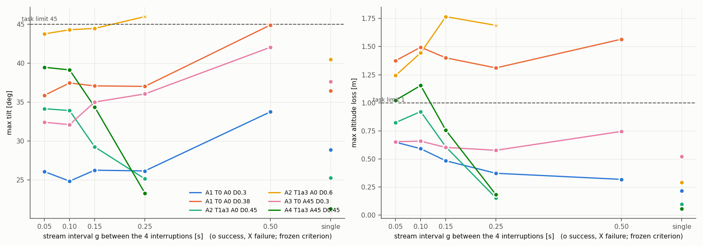
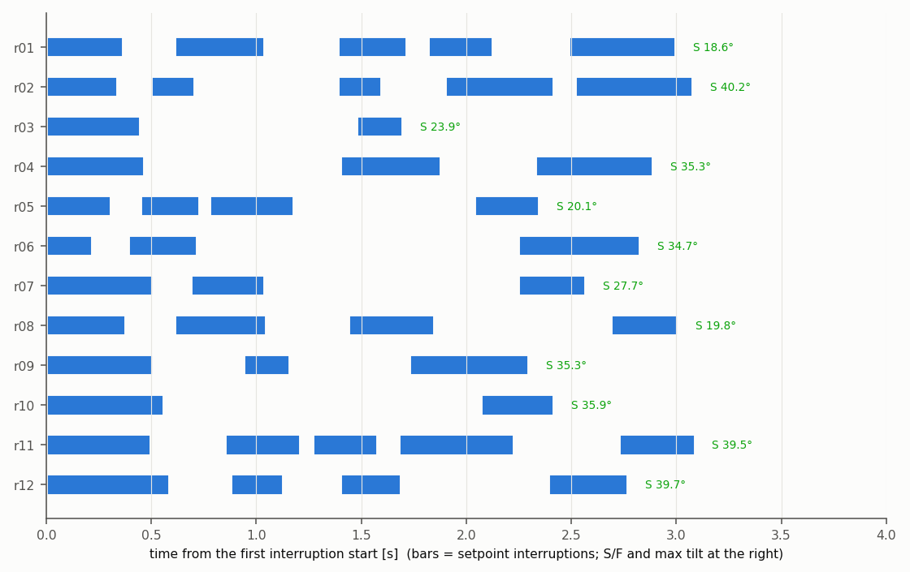
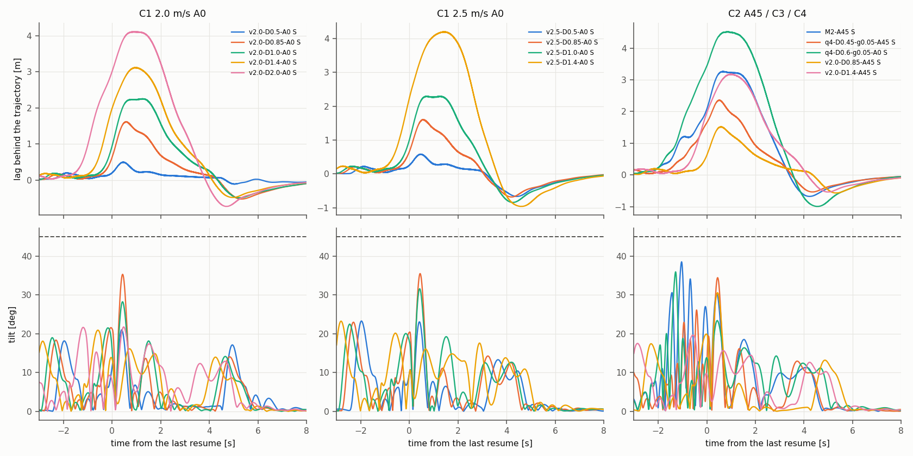

# Thor P7：多次中断、随机对照与限速恢复

日期：2026-10-20（Asia/Shanghai）。范围：冻结 x500、本机 headless SITL；未实飞。本批只负责**实现、飞行和导出**：没有拟合模型、没有做预测或判定（由项目那边做）。所有数值来自同一冻结候选（commit `966eb478`）上完整、通过独立复核的批次：

- 候选等价性：[equivalence](../data/p7-20261020-equivalence/) **3/4 等价，结论以用户接受为条件**（见下；[equivalence.json](../data/p7-20261020-equivalence/equivalence.json)、[diagnosis.json](../data/p7-20261020-equivalence/diagnosis.json)），审计通过
- A 多次中断间隔扫描：[batch-a](../data/p7-20261020-batch-a/) 33 轮（32 成功 + 1 预登记飞行失败），审计通过
- B 随机序列：[batch-b](../data/p7-20261020-batch-b/) 12 轮（12 成功），审计通过
- C 限速恢复：[batch-c](../data/p7-20261020-batch-c/) 14 轮（14 成功），审计通过
- 开发运行（不计入结果）：[dev-01](../data/p7-20261020-dev-01/)、[dev-02](../data/p7-20261020-dev-02/) 各 6 轮，说明见 [dev-notes](../data/p7-20261020-dev-notes.json)
- 导出：[export/](../export/) 新增 59 轮（A 33 + B 12 + C 14；[manifest.json](../export/manifest.json) 的 `p7` 块），32.8 MB，每轮 0.47–0.68 MB，未降采样
- 表格：[A](../data/p7-20261020-batch-a/p7-table.md)、[B](../data/p7-20261020-batch-b/p7-table.md)、[C](../data/p7-20261020-batch-c/p7-table.md)；图 `docs/figures/p7/`

记忆一律 N2（`MC_RAPTOR_RINI=4`），速度 2.0 m/s（C 另有 2.5），每轮独立 Gazebo 种子（master seed 20261020），出生偏航 0；主机设置同 P6（`jetson_clocks` 时钟 2.6 GHz 每批核对、四个批次开始时都没有 ToDesk 会话、用户会话进程核 0–3（systemd 用户管理进程无权限改绑，同 P5/P6）、PX4/Gazebo/Agent/运行器绑核）；四个批次在一个后台作业里顺序运行，期间没有提交、没有改动工具和配置。飞行失败判据、截断限值、包线、网格均未改；没有拼接，没有原地重跑，没有补跑（没有基础设施失败）。

## 结论摘要（只陈述测量）

1. **等价性**：RREC=0 时与 P6 行为一致的三项检查 4/4 通过（日志 `MC_RAPTOR_RREC = 0`、没有一行 `research_recovery`、用 P6 目标规则重建全部 `policy_input`：0 个分量超过 10⁻⁴，残差 ≤ 1.3×10⁻⁷）。成败与 P6 B1 相同 3/4；不同的一轮是预登记的临界格 T1a3 v2.0 D0.7（本次 S 44.4°，P6 B1 F 46.4°，B3 两次 S 44.9° / F 45.1°），最大倾角差全部 ≤ 2.0°。按预登记规则继续，**P7 结论以用户接受这一等价性为条件**。
2. **A**：按冻结判据 33 轮中只有 A2 T1a3 D0.6 g=0.25 失败（46.0°）。**但高度损失在 4 次中断中逐次累积**：单次参照 0.06–0.53 m，序列 0.15–1.77 m；按任务写的判据（倾角 > 45° 或高度损失 > 1 m）另有 10 轮失败：A1 T0 D0.38 全部 5 个 g（1.31–1.57 m）、A2 T1a3 D0.6 g ≤ 0.15（1.24–1.77 m）、A4 T1a3 A45 D0.45 g ≤ 0.1（1.02/1.15 m）。两种结果并列给出（冻结判据仍为主结果，见“判据”一节）。
3. **A 随 g 的走向两类捕获不同**：T1a3 组的最大倾角和高度损失随 g 增大而下降（A2 D0.45：34.2→25.1°、0.82→0.15 m；A4：39.5→23.3°；A2 D0.6：g = 0.05–0.15 都在 43.8–44.5°，g = 0.25 失败）；T0 组在 g = 0.5 最高（A1 D0.3 33.7°、A1 D0.38 44.9°、A3 42.0°，g ≤ 0.25 时 25–37°）。逐次可以直接看到：T1a3 短间隔下每次捕获的机体速度逐次下降（A2 D0.6 g=0.05：2.01→1.30→0.05→0.46 m/s），恢复跳变逐次增大（0.36→1.06→2.06→3.20 m）；T0 g = 0.5 时第 2–4 次捕获发生在追赶上一次跳变的途中（2.4–3.2 m/s）。
4. **B**：12 条随机序列全部成功，最大倾角 18.6–40.2°，高度损失 ≤ 0.57 m（同处理 T1a3 A0、同一故障预算下的 A2 构造序列：25.1–46.0°、0.15–1.77 m）。
5. **C（`MC_RAPTOR_RREC = 2`）**：14 轮全部成功，最大倾角 19.6–38.5°，高度损失 ≤ 0.83 m，最大水平半径 7.91 m。同名单次条件在 P6 B1（无限速恢复、恢复后保持较短）中 T1a3 v2.0 D0.85/1.0、v2.5 D0.85/1.0 都失败（49.0–50.4°）。代价：追回（虚拟目标与 setpoint 的位置差、速度差都 < 0.02）用时 7.8–8.8 s（v2.0 D0.5：3.4 s）；恢复后 6 s 内最大落后 0.48–4.18 m（单次）、多次序列最后一次恢复后 2.34–4.50 m；6 s 时机体**超前**原轨迹 0.19–0.41 m（虚拟目标在限幅下积累了相对速度后越过；v2.0 D0.5 为落后 0.02 m）。网络在恢复那一刻看到的目标跳变 −0.15…+0.36 m（同一时刻 setpoint 的跳变 0.17–3.56 m）。

## 候选、实现与批次

| 批次 | 结果 | 说明 |
|---|---|---|
| [dev-01](../data/p7-20261020-dev-01/) | 开发（不计入） | 预登记提交 `4fd31d7a`。发现每个 RREC 运行第一次恢复的 `research_recovery` 行缺失（话题第一次发布才被宣告，logger 约 0.3–0.4 s 后才订阅）；已记录部分重放残差 ≤ 2.4×10⁻⁷。一轮 q4-D0.6-g0.15 T1a3 高度损失 1.53 m，促成下面“任务判据”的并列报告 |
| [dev-02](../data/p7-20261020-dev-02/) | 开发（不计入） | `a2d7227c`（模块启动时宣告 `research_recovery`）。6/6 成功，最大施加年龄 4/8 ms，恢复证据完整、重建精确。h-M2-A45 一次 setup 中的零步“恢复开始”（见下）促成 `p7_metrics` 的记录方式修改；最终候选与 dev-02 只差这一个分析文件 |
| [equivalence](../data/p7-20261020-equivalence/) | 3/4，以用户接受为条件 | 见下表 |
| [batch-a](../data/p7-20261020-batch-a/) | 33/33 完成 | 最大施加年龄 4 ms（8 轮 8 ms），覆盖比例 3.3×10⁻⁵（门限内），最大半径 7.05 m |
| [batch-b](../data/p7-20261020-batch-b/) | 12/12 | 4 ms（4 轮 8 ms），覆盖比例 4.0×10⁻⁵，最大半径 6.98 m |
| [batch-c](../data/p7-20261020-batch-c/) | 14/14 | 4 ms（3 轮 8 ms），覆盖比例 3.2×10⁻⁵，最大半径 7.91 m |

**等价性**（config/p6.json、冻结 p6_metrics，新种子）：

| 运行 | 结果（P6 B1） | 最大倾角 °（P6 B1） | 差 ° | RREC / recovery 行 / P6 规则重建超限分量 |
|---|---|---|---|---|
| v2.0-D0.4-A0 T0 #1 | S（S） | 38.78（40.09） | −1.31 | 0 / 0 / 0 of 45063 |
| v2.0-D0.4-A0 T0 #2 | S（S） | 40.74（40.09） | +0.65 | 0 / 0 / 0 of 44997 |
| v2.0-D0.7-A0 T1a3 #1 | **S（F）** | 44.36（46.36） | −2.00 | 0 / 0 / 0 of 46112 |
| v2.0-D0.7-A0 T1a3 #2 | F（F） | 45.06（46.36） | −1.29 | 0 / 0 / 0 of 46128 |

预登记规则（`config/p7.json` `p7.equivalence`，在任何 P7 飞行前提交）：若唯一的不同是这一临界格的成败、且其倾角在 P6 该格范围 ±2.5° 内，则正式批次照跑、结论以用户接受为条件；其他差异停批诊断。本次属于前者（44.36° 在 [42.4, 48.9] 内）。

### 限速恢复（`MC_RAPTOR_RREC`）的实现

- 新参数 `MC_RAPTOR_RREC`（m/s²，0–10，默认 0）。默认 0 时观测代码路径完全不变：没有任何改写、没有任何证据行（等价性三项检查）。
- RREC > 0：在 RAPTOR 激活期间、**飞行中 setpoint 超时捕获之后**（不含激活时的捕获），外部 setpoint 重新变新的那个 RAPTOR 周期里，建虚拟目标，初值为该周期 RAPTOR 所用 `vehicle_local_position` 样本的水平位置和速度；之后每个 RAPTOR 周期 `acc = w²·(sp_pos − vt_pos) + 2w·(sp_vel − vt_vel)`，w = 1.5，水平范数大于 RREC 时按比例缩到 RREC，`vt_vel += acc·dt`，`vt_pos += vt_vel·dt`（dt 取陀螺样本时间差，≤ 0.05 s）；sp = RAPTOR 读到的最新外部 setpoint。更新后位置差、速度差（水平范数）都 < 0.02 即结束，同一周期起网络直接看 setpoint。追回期间再次超时：结束虚拟目标，原超时与捕获规则（RTGT/RTDEC）照常。
- 只作用于水平位置和速度；高度和偏航始终来自 setpoint（任务的限幅是水平范数；轨迹都是水平直线）。`notes/target-interface/experiments/common.py` 不在本机，按任务文字实现。
- 代码：`research/state/RecoveryTarget.hpp`（单元测试 `tests/recovery_target_test.cpp`），`tools/apply_research.py` 的 P7 块：转移判断紧跟在接管目标步骤之后；虚拟目标只在 `observe()` 执行期间换入 `_trajectory_setpoint`（RAII，返回时恢复），其余读者始终看到外部 setpoint。证据话题 `research_recovery`（START / 每周期 STEP / END：CONVERGED、STALE、INACTIVE），模块启动时宣告。
- 每轮核对（`p7_metrics`）：RREC=0 没有任何行；RREC>0 每个闭合中断恰有一次 START，在 RAPTOR 第一次读到恢复 setpoint 的周期（日志到达后 0–4.3 ms）；START 状态等于该周期的定位样本；每个 STEP 与离线按同一公式重放的结果一致（C 全部恢复最大残差 2.4×10⁻⁷ m）。
- 导出重建：恢复周期用 STEP 行的虚拟目标，C 每轮 848–2,318 个虚拟目标周期，59 轮 0 个分量超过 10⁻⁴，最大残差 3.0×10⁻⁷。
- **零步“恢复开始”**（dev-02 发现，按定义如实记录）：setup 中 RAPTOR 激活若发生在一条流前 setpoint 的 200 ms 内，激活时不捕获，随后的悬停超时按定义属于“激活后的飞行中超时捕获”，于是发流开始时记一次 START，并在同一周期以 CONVERGED 结束（虚拟目标 = 机体状态，与悬停点 setpoint 差 < 0.02），网络从未看到虚拟目标。`p7_metrics` 把这种 0 个 STEP 的开始记在 `starts_not_at_a_resume_without_virtual_target_cycles`，只有含 STEP 的非恢复开始才算问题。

### 预登记与预算（`config/p7.json`，提交 `4fd31d7a`，早于任何 P7 飞行）

- **安全半径**：P6 规则不变（P5 路径检查在出生点 + 0.1 m 悬停偏移余量 ≤ 8 m；先缩恢复后巡航 3.0→2.0 s，再缩中断前巡航 1.0→0.75 s，仍放不下则取消）。**取消（没有飞）**：A2 T1a3 A0 D0.45 g=0.5（8.15 m）、A2 D0.6 g=0.5（8.75 m）、A4 T1a3 A45 D0.45 g=0.5（8.15 m）；C1 v2.5 D2.0（放不下）。所以 A 为 33 轮（计划 36）、C 为 14 轮（计划 15）。
- **C 的保持时间**：字面的“恢复后巡航 ≥ 6 s”在 8 m 半径下没有一个 C 条件放得下（需要 12–15 m 直线）。按任务“放不下就按 P6 规则处理”：恢复后巡航从 6.0 s 起按 0.05 s 步长缩短直到放下（结果 2.0–4.4 s），中断前巡航必要时缩到 0.95 s；巡航之后直线以 2 m/s² 减速到静止，静止保持 `end_hold_s` 改为 6.0 s（P6 为 3.0，不改变路径），所以最后一次恢复后 setpoint 流持续 ≥ 9 s，6 s 落后窗口完全在流内，14 轮的虚拟目标都在流结束前追回（CONVERGED）。离线运动学检查估计虚拟目标越过线端 ≤ 约 1 m（在 1.0 m 制动余量和 2 m 包线余量内），只记录不用于取消；实测最大半径 7.91 m。
- **B 的抽样**：`random.Random(202610200)`；每条先抽次数（2–5，固定），再抽各次长度 U[0.2, 0.6] s 和间隔 U[0.05, 4.6] s（取 0.01 s），违反故障预算（5 s 窗口内结束、总中断 ≤ 2.4 s、长度和间隔界限）**或放不进安全半径**则重抽长度和间隔。共抽 16,083 次，故障预算拒绝 15,936 次，安全半径拒绝 135 次。安全半径把跨度限制在约 3.1 s 以内（实际 1.70–3.09 s），所以 5 s 窗口里长跨度的序列在这里不会出现——B 是“故障预算 ∩ 安全预算”上的均匀抽样，不是整个故障预算上的。次数分布 2/3/4/5 次：2/4/3/3 条。
- **判据**：冻结的 P5/P6 飞行结果判据（`p5.failure_criteria`：包线含倾角 ≥ 45°、运行器中止、电机饱和、触地、无联合恢复）没有高度损失项，仍为主结果、未改。任务文字写的是“倾角 > 45° 或高度损失 > 1 m”；P6 里没有一轮超过 0.94 m，两者从未不同。dev-01 出现 1.53 m 后，在等价性和正式批次之前（提交 `a2d7227c`）加了 `p7.task_failure_criterion`：`p7_metrics` 另报 `task_outcome`（同一窗口：从第一次中断到 post_stream 结束，最大倾角 ≥ 45° 或最大高度损失 > 1.0 m），审计列出两者不同的运行（A 10 轮，B、C 0 轮）。

## A：多次中断的间隔扫描

每条序列 4 次等长中断 D，相邻中断间恢复发流 g s（计划值）；单次参照为同名 P6 生成条件（与 P6 B1 同一剖面）。单次参照与 P6 B1 同格一致：T0 D0.3 28.9°（P6 28.5°），T1a3 D0.6 40.5°（P6 40.8°）。

S 成功、F 失败（冻结判据）；数字为最大倾角 ° / 最大高度损失 m（从第一次中断起到 post_stream 结束）；† 按任务判据（倾角 ≥ 45° 或高度损失 > 1 m）结果不同。

| 组（捕获 方向 D） | 单次参照 | g = 0.05 s | g = 0.1 s | g = 0.15 s | g = 0.25 s | g = 0.5 s |
|---|---|---|---|---|---|---|
| A1 T0 A0 D0.3 | S 28.9 / 0.22 | S 26.1 / 0.65 | S 24.8 / 0.59 | S 26.2 / 0.48 | S 26.2 / 0.37 | S 33.7 / 0.32 |
| A1 T0 A0 D0.38 | S 36.5 / 0.53 | S 35.9 / 1.37 † | S 37.5 / 1.49 † | S 37.1 / 1.40 † | S 37.0 / 1.31 † | S 44.9 / 1.57 † |
| A2 T1a3 A0 D0.45 | S 25.3 / 0.10 | S 34.2 / 0.82 | S 33.9 / 0.92 | S 29.2 / 0.61 | S 25.1 / 0.15 | 取消 |
| A2 T1a3 A0 D0.6 | S 40.5 / 0.29 | S 43.8 / 1.24 † | S 44.3 / 1.45 † | S 44.5 / 1.77 † | **F 46.0** / 1.69 | 取消 |
| A3 T0 A45 D0.3 | S 37.6 / 0.52 | S 32.4 / 0.65 | S 32.1 / 0.66 | S 35.0 / 0.60 | S 36.1 / 0.58 | S 42.0 / 0.75 |
| A4 T1a3 A45 D0.45 | S 21.3 / 0.06 | S 39.5 / 1.02 † | S 39.1 / 1.15 † | S 34.4 / 0.76 | S 23.3 / 0.18 | 取消 |

- 所有单次参照都成功（任务规则“参照失败也跑完”没有触发）。
- 唯一的冻结判据失败 A2 D0.6 g=0.25：第 4 次中断后日志倾角 46.0°（运行器 10 Hz 采样没有捕到，没有中止，4 次中断都完成，同 P6 的 7 轮）。
- **逐次的捕获速度和恢复跳变**（每轮第 1→4 次；`batch-audit.json` 的 `tables.A`）：
  - T1a3 A0 D0.6：g=0.05 捕获速度 2.01/1.30/0.05/0.46 m/s，跳变 0.36/1.06/2.06/3.20 m；g=0.25 1.88/2.65/2.16/1.69 m/s，0.39/0.60/0.83/1.45 m。
  - T1a3 A0 D0.45：g=0.05 2.01/1.67/1.41/1.23 m/s，0.23/0.53/0.82/1.13 m；g=0.25 2.03/2.44/2.24/2.33 m/s，0.23/0.33/0.30/0.30 m。A4（A45）几乎相同。
  - T0 A0 D0.38：g=0.05 2.00/0.76/0.70/0.81 m/s，0.49/0.84/1.47/1.96 m；g=0.5 1.95/3.21/2.81/2.93 m/s，0.50/0.95/0.78/0.81 m，每段最大倾角 37.0/43.3/43.7/44.9°。
- 0° 与 45°：T0 D0.3 A45 比 A0 高 6.3–9.9°（单次参照高 8.7°）；T1a3 D0.45 A45 在 g ≤ 0.15 时比 A0 高 5.2–5.3°、高度损失多 0.15–0.23 m，g = 0.25 时低 1.8°（单次参照低 4.0°）。

## B：同一故障预算下的随机序列（T1a3，A0）

| 序列 | 次数 | 中断 D s | 间隔 g s | 总中断 s | 跨度 s | 结果 | 最大倾角 ° | 高度损失 m | 每段最大倾角 ° | 每次恢复跳变 m |
|---|---|---|---|---|---|---|---|---|---|---|
| r01 | 5 | 0.37/0.43/0.33/0.31/0.51 | 0.24/0.35/0.1/0.36 | 1.95 | 3.0 | S | 18.6 | 0.09 | 16.6, 18.6, 14.6, 16.0, 17.7 | 0.17, 0.28, 0.21, 0.23, 0.22 |
| r02 | 5 | 0.34/0.21/0.21/0.52/0.56 | 0.16/0.68/0.3/0.1 | 1.84 | 3.08 | S | 40.2 | 0.57 | 8.3, 16.1, 11.4, 16.3, 40.2 | 0.16, 0.27, 0.12, 0.30, 0.70 |
| r03 | 2 | 0.45/0.22 | 1.03 | 0.67 | 1.7 | S | 23.9 | 0.08 | 23.9, 13.7 | 0.21, 0.13 |
| r04 | 3 | 0.47/0.48/0.56 | 0.93/0.45 | 1.51 | 2.89 | S | 35.3 | 0.28 | 26.8, 35.3, 28.8 | 0.25, 0.28, 0.07 |
| r05 | 4 | 0.31/0.28/0.4/0.31 | 0.14/0.05/0.86 | 1.3 | 2.35 | S | 20.1 | 0.08 | 6.4, 11.4, 19.6, 20.1 | 0.16, 0.26, 0.30, 0.11 |
| r06 | 3 | 0.22/0.33/0.58 | 0.17/1.53 | 1.13 | 2.83 | S | 34.7 | 0.20 | 6.4, 13.0, 34.7 | 0.14, 0.22, 0.31 |
| r07 | 3 | 0.51/0.35/0.32 | 0.18/1.21 | 1.18 | 2.57 | S | 27.7 | 0.17 | 12.7, 27.7, 13.4 | 0.27, 0.47, 0.16 |
| r08 | 4 | 0.38/0.44/0.41/0.32 | 0.23/0.39/0.84 | 1.55 | 3.01 | S | 19.8 | 0.09 | 17.5, 19.8, 13.9, 17.8 | 0.18, 0.29, 0.20, 0.10 |
| r09 | 3 | 0.51/0.22/0.57 | 0.43/0.57 | 1.3 | 2.3 | S | 35.3 | 0.22 | 28.9, 24.9, 35.3 | 0.26, 0.22, 0.36 |
| r10 | 2 | 0.56/0.35 | 1.51 | 0.91 | 2.42 | S | 35.9 | 0.20 | 35.9, 11.1 | 0.32, 0.16 |
| r11 | 5 | 0.5/0.36/0.31/0.55/0.36 | 0.35/0.06/0.1/0.5 | 2.08 | 3.09 | S | 39.5 | 0.43 | 34.2, 34.3, 13.9, 39.5, 29.2 | 0.28, 0.25, 0.13, 0.53, 0.13 |
| r12 | 4 | 0.59/0.25/0.29/0.38 | 0.29/0.27/0.7 | 1.51 | 2.77 | S | 39.7 | 0.29 | 36.6, 39.7, 17.9, 16.6 | 0.37, 0.52, 0.12, 0.09 |

- “每段最大倾角”为从该次中断前最后一次接收到下一次中断（或巡航结束）的窗口。最高的三条（r02 40.2°、r12 39.7°、r11 39.5°）各有一段 ≥ 0.52 s 的中断；跳变最大 0.70 m（r02 第 5 次 0.56 s 中断，前一间隔 0.10 s）。
- 和 A 的同处理组对照（只列数）：A2 的构造序列总中断 1.8–2.4 s、最大倾角 25.1–46.0°、高度损失 0.15–1.77 m；B 总中断 0.67–2.08 s、18.6–40.2°、0.08–0.57 m。

## C：限速恢复（T1a3 捕获，`MC_RAPTOR_RREC = 2`）

追回用时 = 虚拟目标从恢复到位置差、速度差都 < 0.02 的时间（STALE = 追回期间下一次中断开始，按规则结束）；落后 = 原轨迹点减机体位置沿运动轴（正 = 落后，负 = 超前），窗口为恢复后 6 s；网络看到的跳变 = 虚拟目标起点（机体）减恢复前 RAPTOR 的目标。多次序列只列最后一次恢复的追回与落后（较早恢复的 6 s 窗口跨过后面的中断，完整数值在 `p7-table.md` 和导出）。

| 运行 | 结果 | 最大倾角 ° | 高度损失 m | 追回用时 s | 限幅时长 s | setpoint 跳变 m | 网络看到的跳变 m | 6 s 内最大落后 m | 6 s 时落后 m | 对照（无 RREC） |
|---|---|---|---|---|---|---|---|---|---|---|
| h-v2.0-D0.5-A0 | S | 21.0 | 0.040 | 3.39 | 0.00 | 0.25 | 0.06 | 0.48 | +0.02 | P6 B1 S 30.9° |
| h-v2.0-D0.85-A0 | S | 35.3 | 0.138 | 8.83 | 1.47 | 0.76 | 0.13 | 1.59 | −0.39 | P6 B1 F 50.2° |
| h-v2.0-D1.0-A0 | S | 28.2 | 0.084 | 8.71 | 2.10 | 1.04 | 0.10 | 2.24 | −0.34 | P6 B1 F 49.0° |
| h-v2.0-D1.4-A0 | S | 20.9 | 0.049 | 8.40 | 2.43 | 1.84 | −0.15 | 3.10 | −0.29 | （P6 未飞） |
| h-v2.0-D2.0-A0 | S | 21.7 | 0.062 | 8.42 | 3.36 | 3.06 | 0.05 | 4.08 | −0.34 | （P6 未飞） |
| h-v2.5-D0.5-A0 | S | 23.1 | 0.041 | 8.04 | 0.74 | 0.28 | 0.03 | 0.57 | −0.25 | P6 B1 S 30.6° |
| h-v2.5-D0.85-A0 | S | 35.5 | 0.151 | 7.82 | 1.94 | 0.77 | 0.11 | 1.58 | −0.21 | P6 B1 F 50.4° |
| h-v2.5-D1.0-A0 | S | 31.6 | 0.108 | 8.08 | 2.99 | 1.11 | 0.10 | 2.27 | −0.27 | P6 B1 F 50.3° |
| h-v2.5-D1.4-A0 | S | 20.1 | 0.055 | 8.55 | 4.16 | 2.15 | −0.10 | 4.18 | −0.41 | （P6 未飞） |
| h-v2.0-D0.85-A45 | S | 30.6 | 0.059 | 8.83 | 1.36 | 0.76 | 0.14 | 1.50 | −0.40 | — |
| h-v2.0-D1.4-A45 | S | 19.6 | 0.038 | 8.42 | 2.52 | 1.88 | −0.07 | 3.16 | −0.31 | — |
| h-q4-D0.6-g0.05-A0（C3） | S | 35.9 | 0.432 | 8.54 | 3.91 | 3.56 | 0.13 | 4.50 | −0.39 | A2 同序列 S 43.8° / 1.24 m† |
| h-q4-D0.45-g0.05-A45（C4） | S | 34.4 | 0.592 | 7.79 | 1.68 | 1.75 | 0.10 | 2.34 | −0.19 | A4 同序列 S 39.5° / 1.02 m† |
| h-M2-A45（C4） | S | 38.5 | 0.831 | 7.89 | 3.17 | 2.25 | 0.18 | 3.24 | −0.22 | P6 C2 F 52.7° |

- 多次序列中前三次恢复都在追回前被下一次中断结束（STALE），每次持续 0.24–0.39 s；最后一次恢复的追回在 7.8–8.5 s。
- 对照列的条件差别：P6 B1/C2 的恢复后巡航 2.0–3.0 s、静止保持 3.0 s，C 的巡航 2.0–4.4 s、静止保持 6.0 s；这 5 次 P6 失败都在（最后一次）恢复后 0.26–0.32 s 越过 45°。A2/A4 对照来自本批 A（同候选、同序列、RREC=0），差别只有 RREC 和 C 的保持规则。
- 6 s 时机体在原轨迹前方 0.19–0.41 m（除 v2.0 D0.5 外全部 13 轮）：限幅期间虚拟目标积累的相对速度要以同一限幅减掉，越过轨迹点后再收回；超前在 6 s 后继续衰减到 0.02 以内才算追回。

## 导出（任务第 5 节）

- `tools/p7_export.py` → `export/<run>/trace.csv.gz`、`summary.json`；P6 的全部列和定义不变（未截断误差、截断输入、加速度、倾角、`target_mode` 等，见 `tools/p6_export.py`），另加：
  - `vt_active`（该周期网络看到虚拟目标）；`target_mode` 新值 `recovery`；
  - 网络实际看到的目标：`tgt_p_u, tgt_p_w`（相对直线中心，即 RAPTOR 悬停捕获点）、`tgt_v_u, tgt_v_w`；
  - 原轨迹 `traj_p_u, traj_v_u` 和机体位置 `p_u, p_w`（同一中心）。
- `summary.json` 另加：事件 `recovery_start`、`recovery_end`（含原因）；`recovery` 列表（每次中断：捕获、恢复、追回开始/结束时刻，追回用时，限幅时长，网络看到的跳变与 setpoint 跳变，恢复后 6 s 内最大落后（时刻）、最大水平距离、6 s 时的落后与距离，窗口是否被下一次中断截断或被记录结束截断）。A、B（RREC=0）同样给出落后数值，追回字段为空。
- 重建验证：59 轮全部 0 个分量超过 10⁻⁴，最大残差 3.0×10⁻⁷（恢复周期使用 STEP 行）。`export/manifest.json` 现有 186 轮（P6 127 + P7 59），P7 条目带 `export_script: tools/p7_export.py`，顶层 `p7` 块记录脚本哈希和提交。

## 开发运行、修正与偏离

- dev-01、dev-02 只用于检查代码路径（说明见 dev-notes）；其中 dev-01 一轮飞行失败只作开发观察。
- 冻结前的修正：模块启动时宣告 `research_recovery`（只影响记录）；`p7.task_failure_criterion` 并列报告；`p7_metrics` 对零步开始的记录方式；新增 `tools/p7_report.py`。之后四个正式批次在同一候选上连续运行。批次后只改了分析工具 `p7_audit.py`（A 单次参照的表项加高度损失）和 `p7_report.py`（表加高度损失列、图 1 加高度损失面板），四个审计用改后的工具只读重跑，结论不变。
- **偏离与解释**（均在预登记中写明）：C 的“恢复后至少 6 s”按上面的方式落实（巡航从 6 s 缩，静止保持 6 s）；B 的抽样同时以安全半径为条件；虚拟目标只作用于水平分量；追回期间再次断链时按原规则结束；“链路恢复”只指飞行中超时捕获之后的恢复。
- 等价性不完全（3/4），按预登记继续，结论以用户接受为条件。

## 仍然开着的问题

- **等价性**：请决定是否接受 3/4（临界格翻转，与 P6 B3 观察到的翻转同类）。P4-01c 与 P5 的等价性决定也仍待用户。
- **判据**：A 中 10 轮按冻结判据成功、按任务判据（高度损失 > 1 m）失败。哪一个作为 A 的结论需要项目决定；本报告两者并列。
- C 只有 RREC = 2 一个取值、每格 1 次；C 与 P6 对照的保持时间不同（见上）。
- B 受安全半径约束只覆盖跨度 ≤ 约 3.1 s 的序列；5 s 窗口里更长的序列需要更大半径或分段直线。
- A 每格 1 次，没有重复；P6 的临界附近翻转（≤ 0.05 s 内）提示单次结果在 45° 附近有随机性（A2 D0.6 g ≤ 0.25 的倾角 43.8–46.0°）。
- 控制频率（125 Hz vs 训练 100 Hz）仍未检验（P4-02）。

## 范围限制

- 只做 headless SITL，单一 x500 模型，无风；RAPTOR 原生约 125 Hz（训练 100 Hz）。
- 探查性质：每格 1 次，没有统计区间。
- 中断由运行器停发实现（同一时间参数化直线），不含 DDS 链路本身的丢包特性。
- 结论不授权实飞。
