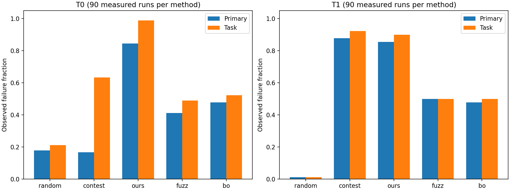
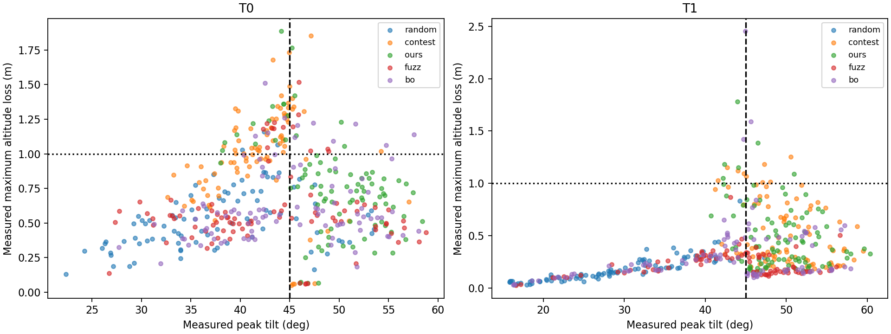

# P8 冻结预测核对：可验证部分与缺失项

本次只复用已有实验；未飞行、未拟合、未生成替代预测、未修改原结果、冻结工具或历史诊断。最新远程 main 于本次开工通过 `git ls-remote` 核实为 **bc188c2591a6fa22c9d5fb4d97a1801f51e016b4**，与本地 HEAD 一致；初始工作区干净，无实验/并发 Git 进程。现有实验与导出说明见[原报告](THOR_P8_REPORT.md)。

**结论边界：冻结预测核对尚不能闭环。** 仓库、可访问的 `/home/car` 和 `/tmp` 未找到 `p8_frozen.json`，Git 跟踪文件中也没有它；无读取权限的目录不声称已查遍。预登记哈希为 `fe784e62aa5ee8c1ea5cb29fc2ec2d44169c2d02a084130c31342d28d25ba7d4`，实际哈希 **NA（缺文件，并非哈希不符）**。`tools/p8/` 是空间、候选清单和搜索方法，不含可独立重现的原倾角模型及冻结误差/跳过规则。因此预测匹配 **0/900**，缺失 **900/900**；不能回答原模型在哪个范围可靠，也不能声称“可以跳过”无漏判。

## 固定计划、输入与复现

先保存[分析计划](../data/p8-frozen-check-20261024/plan.json)与[输入 manifest](../data/p8-frozen-check-20261024/input-manifest.json)，再运算；manifest 覆盖 2,750 个文件，记录字节数及 SHA-256，包含原报告、当前汇总、结果、配置、逐次指标/导出、原376次归档、源码和探索资料。脚本运行前后均验证全部哈希。保持原报告作为输入快照，本报告是新增分析，不覆盖其中历史记录。

```bash
MPLCONFIGDIR=/tmp/p8-mpl uav_lab/.local/venv/bin/python tools/p8_frozen_check.py
PYTEST_DISABLE_PLUGIN_AUTOLOAD=1 PYTHONPATH=tools uav_lab/.local/venv/bin/python -m pytest -q tests/test_p8.py tests/test_p8_frozen_check.py tests/test_export_target_association.py
```

[复现脚本](../tools/p8_frozen_check.py)不读取 ULog、不运行实验、不改变输入。依赖现有实验环境 numpy 1.26.4 与 matplotlib；Python 标准库完成统计。未来若拿到冻结文件，应先验证指定哈希，再另加有明确来源的分析层，保留本次缺失记录；不能把补算标为事前冻结预测。

## 完整匹配账本与排除

[900条执行账本](../data/p8-frozen-check-20261024/matching-ledger.csv)按方法、系统、搜索种子、轮号、Gazebo 种子、完整速度/方向/中断时长/恢复间隔、窗口、首末段预算逐条记录，并链接来源配置与导出。搜索种子与仿真种子分别列出。CSV 与逐次导出和结果的名称、种子、指标、判据已校验；峰值 CSV 的原舍入精度保留。900个身份和900个仿真种子均唯一，身份重复0、缺执行结果0、缺逐次导出0。按完整事件名称（含系统）去重为767种；125组事件重复，额外133条为不同战役/种子的真实执行，保留在900分母，不误作重复结果删除。各逐次导出重建超出1e-4的分量为0；这验证现有导出，不是重新解析原 ULog 的独立复验。

| 集合 | 数量 | 处理 |
|---|---:|---|
| B1 | 450 | 实测分母内 |
| B2 原样保留 | 376 | 与归档 results 前缀完整对象逐项相等 |
| B2 续跑 | 74 | 单独标记身份阶段，仍属原900次 |
| 离线清单实际执行 | 540 | random/contest/ours 各180，事件参数匹配 |
| 离线清单未执行 | 540 | 排除实测分母，不把1080清单当实验 |
| 在线 fuzz/bo | 360 | 实测分母内；无可验证事前预测，不因共享初始候选而借用他法预测 |
| 冻结预测缺失 | 900 | 倾角预测/误差/跳过/保形统计均 NA |
| 历史预算同执行配置 | 899 | 仅预算一致，未建立预测可比性 |
| 历史预算不同执行配置 | 1 | 排除原预测时域直接比较，实测仍保留 |

[1080条离线清单账本](../data/p8-frozen-check-20261024/offline-ledger.csv)列明每条执行/未执行理由；[事件账本](../data/p8-frozen-check-20261024/event-ledger.csv)保留接回/捕获/中止时刻与状态，未观测到的后续中断不补造。失败中止后的完整计划时域受到截断；账本明确 `aborted_horizon_censored`，配置预算不能冒充中止后真正经历的时长。

唯一预算差异为 **contest-T0-s0-k28**：完整输入 `v2.4-H28.0-W0.0-0.32_0.78-1.05:T0`；首段均1.00 s，冻结闭式/离线清单末段2.60 s，实际执行配置与导出均2.55 s。它是B2续跑74条之一。原900次中其余899条首末段与历史预算一致；未执行的 random/T1/0 第33条不计入此数。该案例的主/任务结果均不失败；不能把这解释为2.60 s预测正确。冻结预测本体缺失，无法确认其实际使用的终止时域；按不同计划时域不可直接比较处理，不擅改原模型。具体舍入原因已有[原报告预算修订节](THOR_P8_REPORT.md#b2-预算适配修订2026-10-23用户批准后续跑)。

## 实测结果与高度遗漏

所有比例分母仅900次B；倾角失败定义峰值≥45°，掉高失败定义损失>1 m，原主判据直接读原结果。此次倾角失败与主判据恰好同为432条，未把主判据重新定义为倾角。任务失败511条。下表每方法每系统分母90；更细的系统×方法×中断次数、系统×中断次数以及95% Wilson区间见[完整分组表](../data/p8-frozen-check-20261024/group-summary.csv)。

| 系统/方法 | 原主判据失败/90 | 任务失败/90 | 仅掉高失败/90 |
|---|---:|---:|---:|
| T0/random | 16 | 19 | 3 |
| T0/contest | 15 | 57 | 42 |
| T0/ours | 76 | 89 | 13 |
| T0/fuzz | 37 | 44 | 7 |
| T0/bo | 43 | 47 | 4 |
| T1/random | 1 | 1 | 0 |
| T1/contest | 79 | 83 | 4 |
| T1/ours | 77 | 81 | 4 |
| T1/fuzz | 45 | 45 | 0 |
| T1/bo | 43 | 45 | 2 |

总体原主判据 **432/900 = 48.0%**（名义95% Wilson 44.75%–51.27%），任务 **511/900 = 56.78%**（53.52%–59.98%）。111/900掉高超过1 m，其中32条也倾角失败，**79/900 = 8.78%**是仅掉高；相当于任务失败的 **79/511 = 15.46%**，倾角未失败的 **79/468 = 16.88%**。这些是倾角判据遗漏任务风险的量，不是冻结跳过集合漏判率。T0额外69/450，T1额外10/450。

区间是二侧95% Wilson边际二项区间，供描述；自适应搜索、同战役反馈、有限候选池和方法间共享输入破坏简单独立同分布解释，不能将其用作严格总体保证或同时显著性检验。900个互异仿真种子并不自动保证样本交换性。图中的高倾角实验可能早停，其后高度损失被截断；不能据散点反向趋势认定更大倾角改善高度。





最严重实测倾角 `ours-T1-s2-k02` 为60.342°，掉高0.325 m；最高掉高 `bo-T1-s2-k25` 为2.454 m，峰值倾角仅44.942°，是主判据通过、任务失败的明确案例。完整前10名见[机器汇总](../data/p8-frozen-check-20261024/results.json)。这不是“最大模型低估案例”，因为预测缺失。

## 冻结模型、跳过与保形：未能计算的项

每个计划组（系统、系统×方法、系统×次数、系统×方法×次数）均输出 `prediction_n=0`，秩相关、误差分布、低估频率/幅度、原规则跳过数、跳过集合倾角/掉高/主判据失败、漏判比例及其区间全为 **NA**。缺少规则时也不能从“实测倾角<45”反向定义可跳过。模型失效条件同样无法定位；下节仅解释实测现象。

已在运算前固定随机基线划分：各系统90条按 `SHA256('P8-frozen-check-v1|'+run_id)` 排序，前45校准、后45检验；其他方法720条全部仅评价，不进入校准。每条分配在执行账本中。划分与观测结果无关，不因结果调整，但这是事后确定的分析计划，不是实验开跑前预登记。

若原冻结模型与误差规则可验证，拟独立计算单侧90%保形倾角上界，n=45时取 `ceil((45+1)*0.9)=42` 阶残差；原跳过规则与新增校准层分开。缺模型时连残差都不可得，当前未运行这一步。原误差规则须先核实才能执行，不能用此说明替代原规则。分别报告倾角覆盖率、跳过比例、跳过集合原主判据/倾角/掉高失败率和分母；高度未纳入模型时，倾角覆盖不能声称任务安全覆盖。检验仅每系统45条，细分方法×次数会不足，不能靠混入他法校准扩充分母。

即使补齐模型，随机基线有限池抽样、按种子分层和不同初始状态会限制交换性；fuzz/bo依赖历史、contest/ours经过定向选择，分布偏移尤为明显。把随机校准移用于这些分布只能给经验覆盖，不能冒充分布无关的90%事前保证。所有要求的保形数值仍待原冻结文件/模型/规则齐备。

## T0 恢复后0.4–0.6 s再中断的假设

预先固定对照：以**一次飞行为单位**，任一计划恢复间隔属于闭区间[0.4,0.6] s为暴露组；对照是所有恢复间隔都在原[0.1,0.8] s域内且不落入该段的T0飞行。不是按中断事件重复计同一个整次结局。主分析用计划间隔，避免早停导致后续间隔不可观测的幸存者筛选；账本另外给出日志相邻接回至下一次末次接收的实测间隔，仅作时序核对，不能当完全观测的随机处理。

| T0分组 | 暴露组原主失败/n | 对照原主失败/n |
|---|---:|---:|
| 全部 | 123/275 (44.73%) | 64/175 (36.57%) |
| random | 8/36 (22.22%) | 8/54 (14.81%) |
| contest | 11/64 (17.19%) | 4/26 (15.38%) |
| ours | 33/45 (73.33%) | 43/45 (95.56%) |
| fuzz | 32/61 (52.46%) | 5/29 (17.24%) |
| bo | 39/69 (56.52%) | 4/21 (19.05%) |

总体暴露组95% Wilson 38.96%–50.64%，对照29.80%–43.92%；random分别11.72%–38.08%、7.70%–26.60%。**总体方向与假设一致，但方法间方向不一致，不能确认普遍恢复危险相位。** 按次数分层，2次中断组反向（23/71 vs32/86），3次组50/116 vs20/62，4次组50/88 vs12/27；方法×次数交叉分层与所有区间见[相位表](../data/p8-frozen-check-20261024/t0-phase.csv)，小组/空组均保留，空组区间为空，不做稳定推断。

混杂包括中断次数（次数越多越容易至少命中一次区间）、速度/方向、每次中断长度、此前历史/恢复状态、首末段缩短、搜索反馈与提前中止。对照包含<0.4和>0.6两侧，并非只比较紧邻窗口。未调区间、未穷举寻找最显著切点，未将跨方法或分层相关当因果。

## 时序证据与可能机制

[TargetProfile.hpp](../research/state/TargetProfile.hpp)明示：T0捕获当前位置并将目标速度置零；T1 `RTGT=2` 也在飞行中超时捕获时用当前水平速度，随后固定减速；竖直目标速度仍为零。[运行器](../tools/run_experiment.py) `p5_gap_windows` 在恢复期间沿原时间轨迹继续推进，接回可伴随位置和速度跃迁。[逐次指标工具](../tools/p8_metrics.py)记录这些捕获、跃迁和事件窗口。二者结合提供机制候选，不能证明模型遗漏了这些状态。

- `ours-T0-s0-k01`：0.204 s第一次T0捕获、0.351562 s接回（倾角30.62°），1.248 s第二次捕获、1.400381 s接回（45.97°），首次≥45在1.400 s、峰值1.468 s。这条原样有0.70/0.38 s恢复间隔，未命中假设窗口仍失败，否定“仅该窗口危险”的解释。
- `ours-T1-s2-k02`：第二次接回1.650659 s时8.33°，首次≥45在1.832 s，峰值1.948 s达60.34°；接回后约0.181 s才越阈。说明只检查接回瞬时倾角不够。
- `bo-T1-s2-k25`：四次中断都实际观测到，最大倾角44.942°但高度损失2.454 m，提示水平倾角单指标不足以覆盖累积高度损失。

这些是可追溯的实测证据；“恢复后的速度误差/加速度相位叠加及竖直状态累积可能导致失稳”是推断。没有原模型和残差，不能定位其失效集，更不能据此重新拟合。早停也妨碍把最大高度损失视为无截断的完整时域结局。

## 另24次T1探索与P9建议

[探索账本](../data/p8-frozen-check-20261024/exploration-ledger.csv)独立24条，18域内、6条负扰动恢复间隔<0.1 s属域外；12个不同种子复用，不称24个独立种子，全部不进900分母或校准集。原先四个输入每个三种子，随后选两条首间隔±0.05 s，属于选择后边界探索；不用于确认T0假设或冻结模型覆盖。原[探索计划/汇总](../data/p8-20261023-t1-boundary/summary.json)保留。

P9设计应据此：同时预登记倾角与高度任务风险；保留完整输入、预测时域、误差规则与冻结模型可获取的哈希工件；在runner权威预算上生成预测，单列边界时域差异；以独立新种子与匹配的速度/方向/次数/中断长度，预登记比较T0恢复相位，并把早停删失纳入设计；随机校准基线与自适应检验分开，先定义分布与交换性假设。此次不建议按缺失预测做跳过、不主张修改模型或扩大所谓安全域。

待补齐：正确哈希的冻结文件、原模型实现及依赖、原误差/跳过规则，才能完成900次预测匹配、低估与漏判、模型可靠范围和保形层。此次已交付独立可做的数据核对；预测核对本身保持未完成，不以实测整理替代。
