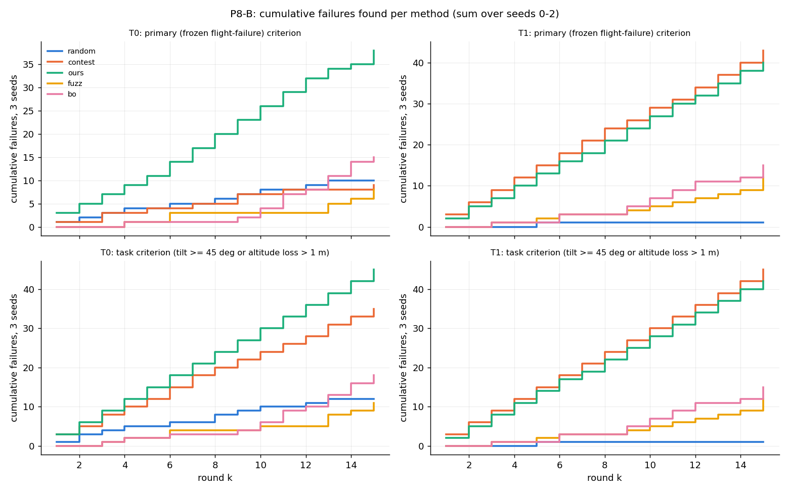

# Thor P8：补辨识飞行与测试生成基线对比

日期：2026-10-21（Asia/Shanghai）。范围：冻结 x500、本机 headless SITL；未实飞。本批只负责**实现、飞行和导出**：没有拟合模型、没有做预测。P8 分两段：A（补辨识飞行）先跑先推送；B（测试生成基线对比）等项目那边交来 `tools/p8/` 的冻结文件后开始。

**当前状态：A 完成并推送；B1（第 1–15 轮，450 轮）完成并推送；B2（第 16–30 轮）进行中。**

- 开发运行（不计入结果）：[dev-01](../data/p8-20261021-dev-01/) 2 轮，说明见 [dev-notes](../data/p8-20261021-dev-notes.json)
- 候选等价性：[equivalence](../data/p8-20261021-equivalence/) **2/2 等价**（[equivalence.json](../data/p8-20261021-equivalence/equivalence.json)），审计通过
- A 辨识飞行：[batch-a](../data/p8-20261021-batch-a/) 8/8，审计通过；表格 [p8-table.md](../data/p8-20261021-batch-a/p8-table.md)；图 `docs/figures/p8/`
- 导出：[export/](../export/) 新增 8 轮（[manifest.json](../export/manifest.json) 的 `p8` 块），每轮 0.54–0.59 MB，未降采样

记忆一律 N2（`MC_RAPTOR_RINI=4`），`MC_RAPTOR_RTGT=0`，`MC_RAPTOR_RREC=0`（显式设置并在日志中核对，`research_recovery` 0 行）；每轮独立 Gazebo 种子（master seed 20261021），出生偏航 0；主机设置同 P6/P7（`jetson_clocks` 2.6 GHz、无 ToDesk 会话、用户会话进程核 0–3、PX4/Gazebo/Agent/运行器绑核）；等价性与 A 在一个后台作业里顺序运行，期间没有提交、没有改动工具和配置。没有拼接，没有原地重跑，没有补跑（没有基础设施失败）。

## A：补辨识飞行

**要回答的问题**：飞机落后目标 1.5–4 m、目标还在走的时候，RAPTOR 在 x500 上追得多快、倾角和高度怎么变；1.5、2.5 m/s 与 2.0 有什么不同。这里只给飞行事实和数据；拟合与留出检验由项目那边做。

### 实现与预登记（提交 `9caf9558`，早于任何 P8 飞行）

- kind 复用 `p6_ident`（P6 的运行器路径、分析器和包线：运行器中止倾角 65°、高度损失 > 1.0 m 中止，其余包线不变），配置 `config/p8.json` 的 `p6.ident`。新增 **jump** 族（`tools/p8_conditions.py`；运行器对带 `p8` 段的配置用它，其他配置仍用未改的 `p6_conditions`，P6 测试全部通过）：参考保持 3 s（≥ 1 s 悬停）→ 1 s 线性加速到 v → 巡航 1.0 s → setpoint 沿运动轴前移 L（同一条按时间参数化的直线整体前移 L，速度前馈不变）→ 巡航 → 2 m/s² 减速到停 → 静止保持 6 s。中途不断流。chase 同 P6（追上判据：运行器 DDS 位置沿轴落后 ≤ 0.2 m），最长追赶时间按下面的规则，静止保持 6 s。
- **安全半径**（P6 ident 规则：以悬停捕获点为中心的计划路径两端 + 1.0 m 制动余量 + 0.1 m 悬停偏移余量 ≤ 8 m）：跳变后巡航 3.0 s 放得下就取 3.0，否则按 0.1 s 缩短；chase 最长追赶 4.0 s 起按 0.1 s 缩短。结果：v2.5 L1.5 → 2.7 s，v2.5 L3.0（A0、A45）→ 2.1 s，chase x4.0 V2.0 → 3.9 s；其余 3.0 s。**没有取消**，v、L、x0、V 未改。
- 运行器每轮再做一次路径检查（实际悬停点）；实测最大水平半径 6.96 m。

### 结果

| # | 剖面 | 巡航（计划 · 实测）s | 结果 | 最大倾角 °（时刻 s） | 高度损失 m（时刻 s） | 最大下降速度 m/s | 电机指令均值 | 跳变 m / 族时刻 s | 初始落后 m | 追上 s | 最大沿轴速度 m/s | 位置 / 速度截断 s（两轴同时） |
|---|---|---|---|---|---|---|---|---|---|---|---|---|
| 1 | jump v1.5 L1.5 A0 | 3.0 · 3.01 | OK | 21.8 (2.23) | 0.074 (2.52) | 0.26 | 0.65–0.80 | 1.500 / 1.993 | 1.57 | 2.26 | 2.49 | 1.68 / 0 |
| 2 | jump v1.5 L3.0 A0 | 3.0 · 3.01 | OK | 25.4 (5.98) | 0.087 (2.51) | 0.27 | 0.63–0.80 | 3.000 / 1.993 | 3.09 | 3.76 | 2.51 | 3.53 / 0.76 |
| 3 | jump v2.5 L1.5 A0 | 2.7 · 2.71 | OK | 23.0 (0.51) | 0.075 (2.51) | 0.22 | 0.66–0.80 | 1.500 / 1.991 | 1.64 | 2.59 | 3.45 | 1.97 / 0 |
| 4 | jump v2.5 L3.0 A0 | 2.1 · 2.09 | OK | 25.7 (5.72) | 0.087 (2.53) | 0.27 | 0.64–0.81 | 3.000 / 2.011 | 3.13 | 3.48 | 3.48 | 3.27 / 1.36 |
| 5 | jump v2.0 L3.0 A45 | 3.0 · 3.01 | OK | 27.8 (2.23) | 0.125 (2.57) | 0.37 | 0.63–0.83 | 3.000 / 1.994 | 3.08 | 3.34 | 3.38 | 3.04 / 0.15（2.17 / 0） |
| 6 | jump v2.5 L3.0 A45 | 2.1 · 2.11 | OK | 27.0 (2.22) | 0.098 (2.54) | 0.28 | 0.63–0.81 | 3.000 / 1.991 | 3.11 | 3.17 | 3.80 | 2.84 / 0.78（2.28 / 0.12） |
| 7 | chase x0 4.0 V2.0 A0 | 3.9 · 3.90（未追上） | **>45** | 54.0 (0.36) | 0.623 (0.88) | 1.21 | 0.42–0.91 | — | 4.05 | 5.71 | 3.70 | 5.38 / 1.00 |
| 8 | jump v2.5 L3.0 A0（新种子） | 2.1 · 2.12 | OK | 26.6 (5.70) | 0.091 (2.52) | 0.31 | 0.64–0.81 | 3.001 / 1.992 | 3.12 | 3.46 | 3.50 | 3.26 / 1.34 |

时刻从剖面族开始（第一条离开保持状态的 setpoint）算；“初始落后”“追上”从跳变 setpoint 到达（jump）或目标出现（chase）算，落后 = 按时间参数化的目标点减机体位置沿轴，追上 = 第一次 ≤ 0.2 m。高度损失窗口同 P6（族开始前 1 s 到 post_stream 结束，参考为族开始时高度）。截断时长按 RAPTOR 执行器输入（`policy_input`）在目标偏航系逐轴统计。

- **跳变本身是温和的**：8 轮里 7 轮跳变全部 IDENT_OK，倾角 21.8–27.8°，高度损失 0.07–0.13 m，最大下降速度 ≤ 0.37 m/s。原因可以直接看到：跳变只改位置、不改速度，网络看到的是截断在 0.5 m 的位置误差而速度误差为 0（v1.5/L1.5、v2.5/L1.5 全程不截断速度），于是以大约恒定的相对速度追赶。**位置输入饱和的时间很长**（L = 3.0：2.8–3.5 s，L = 1.5：1.7–2.0 s），但倾角和高度不随之增大。这一段正是 P6-A 缺的“落后很多、长时间（位置）饱和追赶”，但它在 x500 上的代价远小于 P7 序列里的恢复跳变（那里同时有速度跳变）。
- **追赶速度**：L = 3.0 的四轮追上用时 3.2–3.8 s，平均接近速度（初始落后 / 追上用时）约 0.8–1.0 m/s，几乎不随 v 变化（v1.5：3.76 s；v2.0 A45：3.34 s；v2.5：3.17–3.48 s）；L = 1.5 为 2.3–2.6 s。最大沿轴速度约为 v + 1.0 m/s（v1.5：2.5，v2.5：3.45–3.5；A45 v2.5 为 3.80）。
- **速度的影响**：1.5 与 2.5 m/s 的倾角、高度几乎相同（L3.0：25.4 vs 25.7/26.6°，0.087 vs 0.087/0.091 m）；L3.0 时速度输入截断 v1.5 0.76 s、v2.5 1.34–1.36 s，L1.5 两种速度都不截断速度。
- **方向（A45）**：两轴同时截断位置（2.2–2.3 s）；v2.5 L3.0 A45 倾角 27.0°（A0 两次 25.7/26.6°），高度损失 0.098 m（A0 0.087/0.091 m）；v2.0 L3.0 只飞了 A45（27.8°，0.125 m，8 轮中最大）。
- **重复**（#4 与 #8，v2.5 L3.0 A0 两个种子）：倾角 25.7 / 26.6°，高度损失 0.087 / 0.091 m，追上 3.48 / 3.46 s。
- **chase x0 4.0 V2.0**：唯一越过 45° 的一轮（54.0°，0.25 s 首次 ≥ 45°，标 `ident_exceeded_45`，不算失败），高度损失 0.62 m，下降速度 1.21 m/s，电机指令均值 0.42–0.91；3.9 s 内没有追上（按预登记在 3.9 s 减速），追上用时 5.71 s。和 P6 chase x2.0 V2.0 A0（52.5–53.2°，0.40–0.45 m）相比，倾角相近，高度损失更大。最大倾角在目标出现后 0.36 s，即起步加速段，而不是长时间追赶段。
- 所有轮次最大施加年龄 4 ms，覆盖 0。没有一轮被中止（最接近的 chase 54.0° / 0.62 m）。

### 等价性与开发运行

- **等价性**（预登记 `p8.equivalence.a`）：P6-A chase x2.0 V2.0 A0 在 P8 候选上用 config/p6.json 和冻结 p6_metrics 重飞 2 次：IDENT_EXCEEDED_45 / IDENT_EXCEEDED_45，最大倾角 52.48 / 52.67°（P6 三次 52.5–53.2°），高度损失 0.378 / 0.386 m（P6 0.40–0.45 m），日志 `MC_RAPTOR_RREC = 0`、`research_recovery` 0 行。2/2 等价。P6-A 是在加入 RREC 之前的二进制上飞的，这也检查了当前二进制在 RREC = 0 时的辨识行为。
- **dev-01**（候选 = 预登记提交 `9caf9558`）：jump v1.5 L3.0 A0 与 chase x4.0 V2.0 A0 各 1 次，全部检查通过（结果见 dev-notes，不计入）。之后只改了分析工具：jump 时刻容差从 [−5, +30] ms 改为 ±30 ms（族开始与跳变都落在 20 ms 发流网格上，dev 实测 −4.3 ms），并加入审计和报告工具（提交 `5d1153ad`）。

### 导出（A）

- `tools/p8_export.py` → `export/<run>/trace.csv.gz`、`summary.json`：P6 的全部列和定义不变（重建与验证同 `tools/p6_export.py`），另加：
  - `alt_m`：高度（RAPTOR 本周期所用 `vehicle_local_position` 样本的 −z，EKF2，原点为出生点）；`v_z`：同一样本的垂直速度（NED，向下为正）；
  - **推力**：`action_mean` = 本周期网络 4 个输出的均值（`research_timing.action`，[−1, 1]）；`motor_cmd_mean` = 同一 `timestamp_sample` 的 `actuator_motors.control` 均值（[0, 1]；电机顺序与网络输出顺序不同，均值不受影响；日志缺该样本的行时为空，每轮 summary 记行数）；
  - `p_u, p_w`：机体位置，`tgt_p_u, tgt_p_w`：RAPTOR 所用目标位置，都相对直线中心（悬停捕获点）。
  - P6 原有的 `alt_loss_m`、`ep_z`、`ev_z`、`a_z` 保留。
- `summary.json` 另加 `p8` 块（跳变大小与时刻、RAPTOR 读取延迟、实测巡航、落后与追上、垂直极值、任务判据）和事件 `jump`（RAPTOR 第一个使用跳变后 setpoint 的周期，前后状态）。
- 重建验证：8 轮 0 个分量超过 10⁻⁴，最大残差 3.0×10⁻⁷。每轮 0.54–0.59 MB。

## B：测试生成的基线对比

**要回答的问题**：同样的仿真预算下，五种用例生成方法各在两个接入层（T0 零速度捕获、T1 速度匹配目标 `RTGT=2`、`RTDEC=2.0`）上找到多少失败、多少种不同的失败。这里只给飞行结果；方法的比较和模型预测的检验由项目那边做（`p8_frozen.json` 的预测没有读、没有用）。

### 冻结文件与预登记

- `tools/p8/` 的 4 个文件按任务附录逐字写入，sha256 全部一致；`p8_build_lists.py` 生成的 `p8_lists.json`（`f3327225…`）和用例名哈希（`4f6a2b47…`）也一致（Python 3.12.3、numpy 1.26.4、scipy 1.11.4）。5 个文件原样提交（`807200cc`），之后未改。项目那边 `p8_frozen.json` 的 sha256 `fe784e62…` 登记在 `config/p8.json` `p8.b`。
- 预登记（`923ce8a9`，早于任何 B 飞行）：用例路径（运行器把 P8 用例名按 P6 `gap_spec` 规则生成条件，运动轴 `[cos h, sin h, 0]`）、30 个战役的轮转顺序（`random.Random(20261022)`）、在线方法的状态保存、每轮开跑前 `p8_space.budget` 与 `gap_spec` 的一致性检查、基础设施补跑规则、导出规则。T0/T1 显式设 `MC_RAPTOR_RREC=0`，记忆 N2。
- **开跑前对 1080 条离线用例的预算检查**：2 条不一致，都恰好在 8.000 m 边界上（`p8_space` 用闭式公式加 1e-9 容差判为放得下；`gap_spec` 走运行器路径检查，起点偏移取 6 位小数，终点超出 8.0 m 至多 5×10⁻⁷ m，于是取下一个缩短步长）：contest/T0/0 第 28 条（`v2.4-H28.0-W0.0-0.32_0.78-1.05:T0`，gap_spec (1.0, 2.55) vs budget (1.0, 2.6)）和 random/T1/0 第 33 条（不会飞到）。按任务规则，B2 到达 contest/T0/0 第 28 轮时停下写 `diagnosis.json`。我在开跑前报告了这一点；用户未另作决定，按原规则执行。
- **开发运行**（不计入）：[dev-b](../data/p8-20261022-dev-b/) 5 轮与编排器 [dev-bc](../data/p8-20261022-dev-bc/) 2 轮，说明见 [dev-b-notes](../data/p8-20261022-dev-b-notes.json)。代码路径（方向 4–89°、2–4 个窗口、缩短的预算）正常；但当时 ToDesk 远程桌面连着（ToDesk_Session 约 180 % CPU），实时因子约 0.92，中断实测比计划短约 8 %，每轮输出链门限（12 ms）不过，日志漏行导致重建不匹配。之后加了主机规则（`p8.b.host_rule`）：有 ToDesk 会话时编排器不开新的一轮，并逐轮记录会话状态。一轮（悬停点离出生点 0.108 m，超过预登记的 0.1 m 余量）在起飞后被运行时路径检查拒绝（8.01 > 8.00 m）——正式批次中这类情况按基础设施失败换种子补跑（B1 中没有发生）。

### 等价性

[equivalence-b](../data/p8-20261022-equivalence-b/) **6/6 等价**（[equivalence.json](../data/p8-20261022-equivalence-b/equivalence.json)），审计通过，ToDesk 断开后运行：

| 条件（新路径名） | P6 名 | 结果 | 最大倾角 °（历史） | 高度损失 m |
|---|---|---|---|---|
| `v2.0-H0.0-W0.0-0.3:T0` | B1 v2.0-D0.3-A0 | S / S | 28.99 / 28.66（28.5、28.9） | 0.22 / 0.21 |
| `v2.0-H45.0-W0.0-0.3:T0` | C1 v2.0-D0.3-A45 | S / S | 37.15 / 36.84（35.2、37.6） | 0.46 / 0.49 |
| `v2.0-H0.0-W0.0-0.55_0.7-1.25_1.4-1.95_2.1-2.65:T1` | C2 M1-A0 | S / S | 32.24 / 32.80（32.8） | 0.70 / 0.71 |

heading = 0 时生成的条件（去掉 description）和合并后的剖面与 P6 `gap_spec` 逐字节一致；RREC = 0、无 `research_recovery` 行、gap_timing 全部 VERIFIED；导出重建 0 个分量超过 10⁻⁴（ToDesk 断开后，开发运行中的重建不匹配消失）。等价性之后的门控发现导出脚本一处 bug（manifest 读 B 摘要缺的 `outcome` 字段），修复后提交（`3ba20d7e`）；**B1 候选与等价性候选只差这个分析工具和 project_head**，飞行路径、配置、Lab、二进制相同。

### B1（第 1–15 轮）

[batch-b1](../data/p8-20261022-batch-b1/)：450/450 完成，审计通过（[batch-audit.json](../data/p8-20261022-batch-b1/batch-audit.json)）。没有基础设施失败、没有补跑、没有遇到预算不一致，运行期间没有 ToDesk 会话（逐轮记录）。最大施加年龄 4 ms（77 轮 8 ms），覆盖比例 2.7×10⁻⁵（门限 10⁻³），最大水平半径 7.06 m。审计逐轮复算 p8_metrics 全部一致；30 个战役每轮恰好一个计数运行；离线清单按顺序、无跳过；在线方法（fuzz、bo）从种子按记录的 history 重放，每一轮提出的用例都与实际飞的相同，history 中的（最大倾角、主判据）与复算一致。主判据失败 191 轮，任务判据失败 236 轮。

### B1（第 1–15 轮）

| 被测 | 方法 | 轮数 | 主判据失败（种子 0/1/2 = 合计） | 任务判据失败（0/1/2 = 合计） | 不同失败格（主 / 任务，3 种子合并） | 第一个主判据失败的轮次（0/1/2） | 第一个任务判据失败的轮次（0/1/2） | 基础设施补跑 |
|---|---|---|---|---|---|---|---|---|
| T0 | random | 45 | 5/4/1 = **10** | 5/5/2 = 12 | 8 / 9 | 2/1/9 | 2/1/8 | 0 |
| T0 | contest | 45 | 4/2/3 = **9** | 11/11/13 = 35 | 6 / 13 | 3/3/1 | 1/1/1 | 0 |
| T0 | ours | 45 | 13/13/12 = **38** | 15/15/15 = 45 | 15 / 15 | 1/1/1 | 1/1/1 | 0 |
| T0 | fuzz | 45 | 3/4/1 = **8** | 3/5/3 = 11 | 3 / 4 | 4/6/6 | 4/3/6 | 0 |
| T0 | bo | 45 | 8/3/4 = **15** | 8/4/6 = 18 | 8 / 9 | 4/11/10 | 4/3/6 | 0 |
| T1 | random | 45 | 1/0/0 = **1** | 1/0/0 = 1 | 1 / 1 | 5/—/— | 5/—/— | 0 |
| T1 | contest | 45 | 15/15/13 = **43** | 15/15/15 = 45 | 23 / 24 | 1/1/1 | 1/1/1 | 0 |
| T1 | ours | 45 | 14/13/13 = **40** | 15/13/14 = 42 | 19 / 19 | 1/2/1 | 1/2/1 | 0 |
| T1 | fuzz | 45 | 4/5/3 = **12** | 4/5/3 = 12 | 5 / 5 | 6/3/5 | 6/3/5 | 0 |
| T1 | bo | 45 | 7/4/4 = **15** | 7/4/4 = 15 | 7 / 7 | 6/3/6 | 6/3/6 | 0 |

- 主判据 = P6 冻结的飞行失败判据（`p5.failure_criteria`）；任务判据 = 最大倾角 ≥ 45° 或高度损失 > 1 m（同一窗口）。“不同失败格”按 `p8_space.cell()`（方向 15° × 速度 0.5 m/s × 中断次数），3 个种子合并去重。在线方法的反馈是最大倾角（冻结窗口）和主判据。
- 只陈述测量，不做方法比较的解读，也没有用任何模型预测。

### B2（第 16–30 轮）

进行中。

## 仍然开着的问题

- jump 剖面没有产生项目预期的“猛”追赶：位置饱和时间长，但倾角 ≤ 28°、高度损失 ≤ 0.13 m。P7 序列里大的倾角和高度损失伴随速度跳变（捕获后机体速度与轨迹速度不同）；若模型需要“落后很多且速度也不匹配”的辨识数据，需要另定剖面（例如跳变时同时让 setpoint 速度高于机体速度），这超出本任务的取值，未做。

## 范围限制

- 只做 headless SITL，单一 x500 模型，无风；RAPTOR 原生约 125 Hz（训练 100 Hz）。
- A 每格 1 次（v2.5 L3.0 A0 2 次），没有统计区间。
- 结论不授权实飞。
