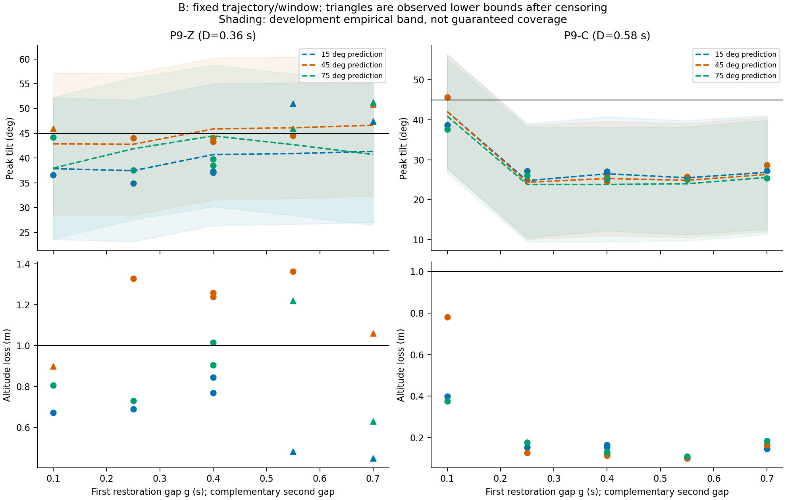
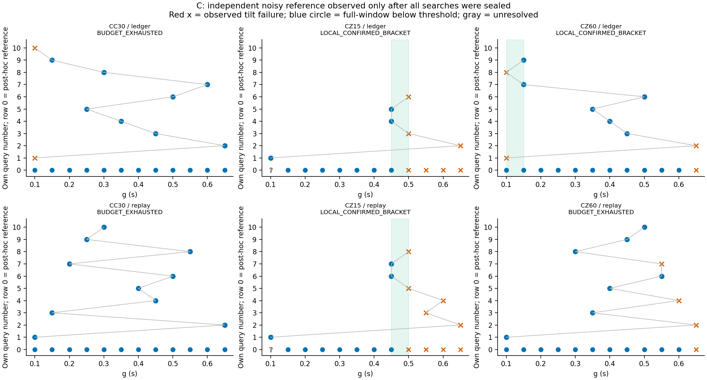
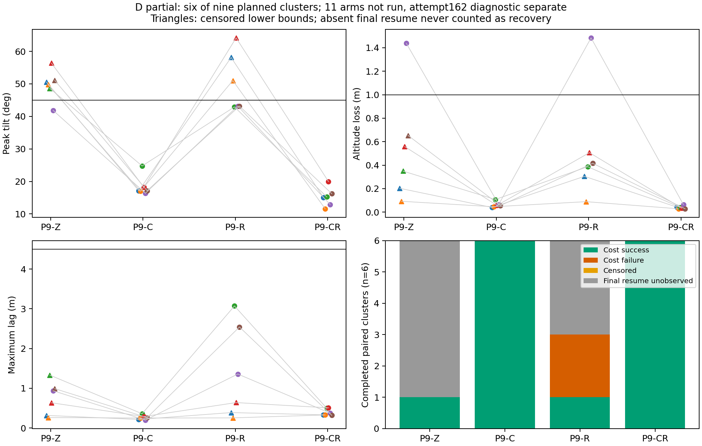

# Thor P9：续接结果、边界反例与第二次停止

**P9尚未全部完成；本报告交付全部现有证据，不宣称全批通过。** 2026-10-24（Thor UTC+8）开发10/12；正式162次启动，其中160条完成冻结P9测量，第102次原基础设施缺失，第162次有明确飞行失败但冻结P9分析异常。D另11条未启动；7个未用搜索槽不挪用。没有重跑、放宽保护或根据留出结果调参。

原批次的中断报告和FAIL保持在[原P9报告](THOR_P9_REPORT.md)。本报告更新参考和部分D结果；原报告的0参考/0D数字是当时历史状态。阶段性发布不等于P9研究完成。

## 身份、恢复依据与停止原因

原冻结提交`6a0292e4d7259f9396d5dad08486eb9e2a743427`，27项清单SHA-256 `95f0a8ca67749f7fe852791821edbd9d7211dd4fa9de989cf86732fb41ee58ea`。
续接冻结提交`95f424bafd040214dd834fb2737d29986c54913a`，59项清单SHA-256 `bf392c4f653aefc29f14292a6c1d61dcdf6b5d02c99b80870ccc5d3e96839346`；[冻结计划](THOR_P9_CONTINUATION_PLAN.md)先提交、非force推送并回读，再启动唯一用户systemd单元。只改变执行生命周期，不改变模型、飞行实现、参数、种子、阈值、观察窗或搜索/修复选择。原父进程消失原因仍未知；两项无飞行生命周期探针、候选等价核查和主机检查支持当时续接，不保证消灭所有异常。

新模型仍为`p9-horizontal-delay-v1`，SHA-256 `474509c9192ce270b897fdc1cbd69796be180c6a5a73b9f091678dbbca256b4a`。只用26条普通P6-A/P8-A辨识，旧900/24和历史失败均为已见背景，不进新独立验证分母。模型、事件源码依据、延迟/饱和/初值/读取顺序、23个整条件留出、14.2996°开发经验带及确定性重建见[原计划](THOR_P9_PLAN.md)与原报告A节。高度未建模；数值倾角预测不代表整体安全。失配账本保留位置积累、速度及延迟状态，存在正导数反例，没有带延迟实际系统的Lyapunov证书，也没有安全集合外必败的结论。

续接单元`p9-continuation-v1.service`（InvocationID `3715fc1f524448fca32f8870e3457400`）于11:12:18按异常路径退出1，MainPID现为0。它完成35条参考和D前六个四臂簇，共59条，随后启动第162次`D-07-P9-Z`。该次已进入首个计划中断，在接回前触发` safety: flight envelope exceeded`；P7冻结主结局为FAILURE，进程均正常清理。

P6/P7显式多窗口分析只列闭合中断，首个开口中断返回“not measured for explicit windows”；P9起点只从闭合中断或该开口字段取值，因而抛出`no observed first interruption; fixed-window origin cannot be established`。这是**已有飞行失败后发生的测量适用缺口**，不是又一次父进程无故失踪，也不能把真实失败伪装为普通随机缺失。未写FINISH/result、host-after及candidate-after，故不能补称完整冻结协议通过。

独立、明确标注事后的[第162次诊断](../data/p9-20261024-continuation-v1-stopped-analysis/attempt162-diagnostic/assessment.json)验证ULog哈希、P7原始重算一致、输出链路和策略输入重建；最后接收native时刻66492000μs、超时捕获66696000μs，间隔0.204s，之后没有接回。利用该实测锚点的**新诊断分析版本**仅观察约0.0054–0.4854s，倾角峰值47.1485°。这些数值不覆盖原文件、不补写冻结结果、不进入160条正式P9测量分母。该次仍占一次启动，P7主失败单列保留。

续接计划明确规定：“新基础设施错误立即停止新批，不自动重试或建立第三批。”因此单元没有重启，原102不补，第162不重跑，剩余11条保持NOT_RUN。恢复完整D需要另行登记测量缺口处置及执行版本，不能静默修改冻结分析器或直接续跑旧单元。

## 预算、审计与统计分母

|阶段|启动|完成冻结测量|其他状态|
|---|---:|---:|---|
|开发/等价性|10|10|四条等价性通过；余2未用|
|B|48|48|原批保存|
|C搜索|53|53|两法各族上限10；7槽未用且不转移|
|C独立参考|36|35|原102永久缺失|
|D|25|24|162已飞行失败但P9异常；余11未启动|
|正式合计|162|160|当前续接总上限173；原总上限180|

[全部162次事前预测—实测索引](../data/p9-20261024-continuation-v1-stopped-analysis/delivery-supplement/all-162-starts.csv)包含两个无冻结P9结果的启动，保留预测哈希、种子与真实状态；[160条详细测量CSV](../data/p9-20261024-continuation-v1-report-stopped-v1/prediction-measurement-ledger.csv)不混入开发或旧900/24。180个计划槽的逐条状态见[预算账本](../data/p9-20261024-continuation-v1-postanalysis-stopped-v1/budget-accounting.json)：160完成＋1原缺失＋1测量异常＋11未启动＋7未用搜索槽。

原批[审计](../data/p9-20261024-audit-interrupted-v1/audit.json)101/101逐条原始重测通过，全批完整性FAIL永久保留。续接[审计](../data/p9-20261024-continuation-v1-audit-stopped-v1/audit.json)59/59逐条原始重测通过，整体FAIL，三个全局错误为162≠173、续接60≠71及已启动记录未进入aggregate。运行时门控通过不等于独立原始审计通过，更不等于清单完整。两执行版本只做标明身份的描述性汇总，不拼成一个验收PASS。

原101条证据的808个输入哈希全部未变；原27和续接59项文件及对应Git提交blob均逐字节核验，冻结账本前缀一致，搜索封存未变。见[审阅校正和哈希核对](../data/p9-20261024-continuation-v1-stopped-analysis/delivery-supplement/delivery-assessment.json)。冻结统计器生成的`results.json`中续接started字段实际取完成行数59；真实START_INTENT为60，已在上述校正文件明确列出，保留生成器输出而不静默改写。原历史manifest对共享账本的哈希绑定当时Git版本；合法追加不改写其历史含义。

|阶段|冻结测量n|完整16s窗|原主失败|倾角失败/已知n|掉高失败/已知n|任务失败/已知n|完整窗MAE°|Spearman|
|---|---:|---:|---:|---:|---:|---:|---:|---:|
|B|48|42|7|7/48|7/44|12/48|1.8021|0.9244|
|C搜索|53|42|16|16/53|21/43|32/53|2.1918|0.7469|
|独立参考|35|30|5|5/35|14/32|17/35|1.9715|0.7519|
|D已完成四臂簇|24|16|8|8/24|2/16|10/24|3.6832|0.7373|

原主判据、保守倾角≥45°、任务倾角>45°或掉高>1m并列，不互换。160条中30条窗口删失；这些样本已观察到倾角失败，仍计入已知二元失败。高度只有135条结局已知（44＋43＋32＋16），44条已观察到掉高失败，另25条删失未越高度阈值的尾段未知。第162次额外P7主失败不在这张固定P9窗口表中，绝不隐匿。

## B：预测能排序，但不能据此跳过安全验证

B完整窗42条MAE1.8021°、排序相关0.9244；经验带42/42完整窗覆盖排除了六条中止失败的最终峰值，不能宣称全体100%覆盖。已观察倾角危险被点预测低估6条（T0五、T1一），分母为7条已观察倾角失败；这不是跳过集合漏判率。

倾角及整体两种事前跳过均为0，空集合失败率NA、分母0，不能声称零漏判或证明跳过有效。高度可靠预测缺失导致整体拒判，T0/45°/g=.55的倾角44.517°、掉高1.363m再次显示倾角安全不能当作任务安全。B两处理采用不同中断时长，组间计数不是捕获修复的因果对照。

固定完整路径11.79m、速度1.8m/s、首末段、减速时刻和16s窗口；中间事件变化使两恢复间隔互补，不称单一间隔的因果效应。单事件控制保留完整目标轨迹和绝对相位。六组g=.4的双种子重复均未翻转，T0/45°为44.029°与43.324°；每组仅2种子，不估概率边界。

12条单事件控制与对应g=.4多事件均未倾角失败。其他相位多事件失败缺少精确配套控制，本轮**未确证“全部单次成功、多次交互失败”**。位置/速度累积的具体capture/resume例子及其种子限制见原报告B节；不能借安全相位控制冒充失败相位证据。



## C：较少查询没有带来可靠边界定位

两法使用相同12点事件域、各自空历史与冻结模型、每族10次上限、0.05s停止精度；端点和复核均收费。账本结构提供模型曲线局部分段、正注入/曲率优先级，回放法按预测倾角接近45°排序；不把普通二分当理论贡献，不假定全局单调。参考只在53次搜索全部封存后执行，B/D/另一方法结果没有反馈搜索。

|事件族|账本法查询/局部结局|回放法查询/局部结局|事后独立参考|唯一参考中点误差|
|---|---|---|---|---|
|CC30|10，预算耗尽|10，预算耗尽|12点均未倾角越阈，无转变|两法NA|
|CZ15|6，复核[.45,.50]|8，复核[.45,.50]|11/12点；观察到[.45,.50]，g=.10缺失|两法NA，不能补缺格|
|CZ60|9，复核[.10,.15]|10，预算耗尽且种子翻转|完整12点；唯一转变[.60,.65]|账本0.50s；回放NA|

账本25次、2/3局部复核；回放28次、1/3。CZ60账本结果与参考相差0.50s，且两法都未匹配参考[.60,.65]转变。这是重要负结果：局部两端各两次一致不等于跨种子稳定边界，不能将查询较少解释成已证总体效率优势。CC30参考无转变不代表方法定位准确，也不代表整体安全。只有3个固定族，方法使用不同新种子，噪声与选点影响不可分；参考每格一独立种子，本身不是概率边界真值。完整性、停止精度和对参考准确性分别报告。

[逐次历史/封存记录](../data/p9-20261024-formal/searches-sealed-before-reference.json)、[35点含缺失参考网格](../data/p9-20261024-continuation-v1-report-stopped-v1/reference-grid.json)、[同条件种子波动](../data/p9-20261024-continuation-v1-postanalysis-stopped-v1/C-condition-seed-variation.json)均保存。



## D：六个已完成配对簇支持局部修复，但验证尚不完整

原计划9簇×四臂，共用簇内新种子；现只有前6簇完整。Z原规则，C速度匹配捕获，R仅RREC1，CR两者组合。组合处理族在开发阶段预选，RREC1来自六个合成开发探针上1/2/3三个候选的规则比较；不是对所有修复族的全局优化。D结果没有反馈候选选择，C/R只作因子诊断，不事后更换主比较。

|处理|n/完整窗|原主失败|倾角失败/已知n|掉高失败/已知n|任务失败/已知n|成本成功/失败/末接回未观察|末次机体追回已观察n|
|---|---:|---:|---:|---:|---:|---|---:|
|Z|6/1|5|5/6|1/1|6/6|1/0/5|1|
|C|6/6|0|0/6|0/6|0/6|6/0/0|6|
|R|6/3|3|3/6|1/3|4/6|1/2/3|3|
|CR|6/6|0|0/6|0/6|0/6|6/0/0|6|

CR对Z已知主/倾角结局6簇中5个失败→成功、1个同成功；任务6个失败→成功。高度仅1簇双臂结局已知，其余Z删失不能算高度安全。第7簇Z首中断飞行失败只单列诊断，不能配上未运行的修复臂推断效果。

CR峰值11.594–19.956°、掉高0.0286–0.0640m，完整16s及全部计划后续事件段内未观察新的45°/1m越阈；这仅适用于已完成6簇，不能扩展至未运行3簇或新平台。C也六簇主/任务/成本通过，CR不对每簇每指标占优，R单独处理仍有3条倾角失败与4条任务失败。不能宣称限速组件单独有效或组合普遍最优。

任务阈值始终为全窗最大落后≤4.5m、末次计划接回后6s绝对落后≤0.5m、10s内位置误差≤0.2m和速度误差≤0.1m/s持续0.5s。成本SUCCESS不意味着安全SUCCESS：Z的D05追回3.397s、成本通过，却掉高1.438m任务失败；R的D05也掉高1.484m。

|完整窗修复臂|最大沿程落后范围m|最大水平任务偏差范围m|累计绝对沿程偏差m·s|末次接回后6s沿程落后m|机体追回时间s|
|---|---|---|---|---|---|
|C，n=6|.199–.360|.199–.360|.772–.930|−.0401至−.0199|.836–1.256|
|CR，n=6|.319–.509|.319–1.090|1.101–3.878|−.2704至−.0423|.0438–1.192|

组合带来更大的累计任务偏差和部分水平偏差；机体提前于参考时“最大落后”不能表达全部任务偏差。R的三个已观察最终追回需7.260–9.248s，其中D03/D06在6s为−2.013/−1.466m，虽然10s内追回，仍因6s误差超限而成本失败。没有末次接回的Z五条/R三条为UNOBSERVED_FINAL_RESUME；其追回时间null，不填观察窗口端点，也不把虚拟目标收敛当机体追回。

逐条值见[24臂任务代价CSV](../data/p9-20261024-continuation-v1-stopped-analysis/task-costs/D-task-costs.csv)、[逐接回恢复记录](../data/p9-20261024-continuation-v1-postanalysis-stopped-v1/recovery-records.json)和[80个计划后续事件段](../data/p9-20261024-continuation-v1-stopped-analysis/delivery-supplement/D-planned-segment-risks.csv)。后者采用P9全窗高度基准，区分COMPLETE/CENSORED/NOT_REACHED，不与P7每段局部高度基准混淆。

连续值CR–Z只有1簇双臂完整，其倾角差−28.932°、掉高差−1.374m是单簇描述。冻结统计器对n=1生成退化bootstrap区间，仅是同一值重复抽样，**不能作置信区间或精度证据**。不报告可靠总体效应区间；二元失败簇和所有删失保留。六簇也不足以证明可靠性或跨平台机理，原定9簇验证仍不完整。



## 成本、复现与远端范围

160次完成尝试elapsed合计16165.735s，十次开发/等价性1038.072s，均含启动、飞行、测量、导出，不是纯物理或CPU/GPU时长。160次完成查询的预测计算21.293s，三个共享候选池合计4.610s、每族计一次；全部162条事前预测计时另见交付校正文件。原102的启动至清理421.028s另列，162启动至异常74.193s另列，二者无FINISH elapsed，不能算0成本，也不混称同一计时口径。

模型适配/识别单列：26条已见普通辨识复用、新辨识飞行0；历史事件墙钟跨度2347.904s不算新成本。全23折独立确定性重建11.456s，不冒充初次适配总成本。人工工时、初次拟合与冻结前全部预测总耗时未完整记录，均NA。执行工程的100s探针、异常清理探针和准备记录另存，无新增SITL。没有“包含工程成本的净效率优势”主张。

沿用流程为源码事件提取→选取能到达重置状态的辨识机动→建模/误差/拒判→固定域内生成测试→隔离信息的搜索→预选修复留出。此次进一步发现显式首开口中断测量器缺口、局部复核跨种子失配和恢复任务代价，均保留负结果，尚未证明跨平台/跨神经接入层的共同机理。

原运行与冻结命令见两份计划；**不要重新调用launch脚本或重跑已启动条件**。在含本地原始数据的Thor工作目录，以下是只读归档重现，写入全新目录，允许发布提交是原冻结提交的后代；只核对原冻结Git blob，不放宽任何飞行启动门：

```bash
uav_lab/.local/venv/bin/python data/p9-20261024-continuation-v1-stopped-analysis/reproduce_stopped.py --verify-only
MPLCONFIGDIR=/tmp/p9-mpl uav_lab/.local/venv/bin/python data/p9-20261024-continuation-v1-stopped-analysis/reproduce_stopped.py --output data/p9-independent-reproduction-NEW
uav_lab/.local/venv/bin/python data/p9-20261024-continuation-v1-stopped-analysis/task_costs.py --output data/p9-task-cost-reproduction-NEW
```

归档重现已实跑完成：59条逐条通过、整体FAIL保持，五个主要JSON/CSV逐字节相同（见`reproduction-review.json`）；不在历史run目录重写分析。原研究回归108项和续接纯执行契约5项通过，测试/确定性/等价性证据均保存；本阶段只新增读后分析，未更改冻结源码或飞行程序。输入/输出manifest分别保存在audit、report、postanalysis、诊断与成本子目录，发布清单另绑定所有相关小文件。

`flight.ulg`、telemetry/resources、Gazebo逐物理步电机数据及rootfs只留Thor本地，失败样本也保留；远端包含配置/身份/事件/日志/指标、压缩派生trace、预测历史、图及清单，**不含全原始数据**。克隆仓库可核查归档文件和模型，但不能无原始数据重算飞行审计。GitHub没有工作流/检查时只能报告数量和状态，不能称CI通过。

剩余阻碍是冻结P9分析器无法处理首个显式开口中断且当前执行版本按规则停止；11条D未执行，原102永远缺失。已完成部分的预测、搜索反例与六簇修复结果如实发布，不能把本次停止点称为P9全部完成。
