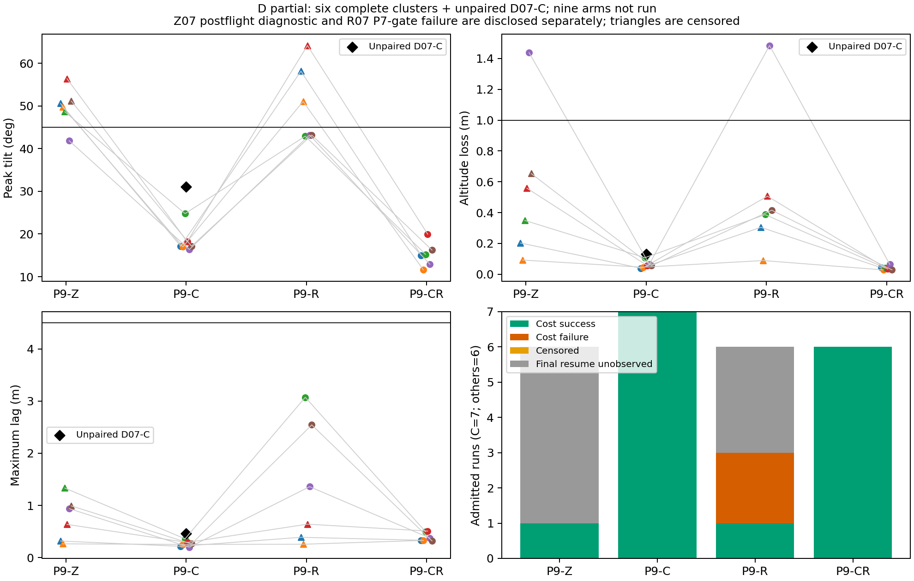

# P9 continuation-v2：首开口测量已恢复，P7恢复证据门再次停批

**P9尚未全部完成。** 用户批准继续后，已实现并冻结独立适配器；计划的11条中启动2条，第一条通过，第二条触发继承P7证据门，按冻结规则停止。没有重跑102/162/164、扩大预算、修改原分析器、重拟合或自动第四批。开发仍10/12；正式累计164次启动，余9条静态D未启动，7个未用搜索槽不挪用。

## 事前冻结、测试及执行

[新计划](THOR_P9_CONTINUATION_V2_PLAN.md)提交并非force推送为`0050ecee60af8f0640df6c105c560cd3536d169f`，远端回读后才启动。81项[冻结清单](../data/p9-20261024-continuation-v2-freeze/manifest.json)SHA-256为`805e3cfbef35d2c98021f1fa31aea924cda354d00b4e99a03be0e7690ea79bf3`；模型仍为`p9-horizontal-delay-v1`，SHA-256 `474509c9192ce270b897fdc1cbd69796be180c6a5a73b9f091678dbbca256b4a`。原27项、v1的59项以及新81项都保持原样；tools/research/config、Lab、策略和二进制不改，候选仅project_head不同。

正式前[24项无飞行测试](../data/p9-20261024-continuation-v2-preparation/unit-tests.log)通过，包括102拒判、162首开口删失、缺样本/捕获/目标、错误时序、恢复缺失、已启动ID及174次拒绝。[160条原始数据兼容回归](../data/p9-20261024-continuation-v2-preparation/compatibility-160.json)约79.944s，所有原兼容序列化逐字节相同，没有新开发飞行。11条原case/种子/顺序、生成域及runner预算和原预测逐条核验。启动前ToDesk无连接、无其他SITL竞争、CPU时钟/存储/身份门控通过。

唯一新单元`p9-continuation-v2.service`，InvocationID `a1d5bea8294e4e9184bc853644d314b1`，16:03:43启动，16:06:49按错误路径退出1，MainPID=0，Restart=no。原v1单元未重启。运行时没有修改冻结设计或提交Git。

## 两条结果与停止原因

|启动号/条件|固定窗口/计量版本|观察倾角/掉高|主/任务结局|协议证据|
|---|---|---|---|---|
|163，D07-C|完整16s，ORIGINAL_COMPATIBLE|31.0592° / .12978m|均成功|全部门控及独立原始重算通过|
|164，D07-R|约.0027–.5067s，OPEN_GAP_CENSORED|48.0539° / .08077m|P7主失败；新版任务已观察失败|P7 INCOMPLETE，整条不录入主测量分母|

163末次接回后的追回时间4.439901s、6s沿程落后−.02382m，最大落后.45775m，最大水平偏差.45782m，累计绝对沿程偏差.96305m·s；成本SUCCESS。第一接回的追回跨越后续事件，不能把它当作独立恢复试验。

164的新适配器确已修复原P9锚点缺口：末接收native 66364000μs，超时捕获66568000μs，0.204s；之后没有接回，P9时钟散布约267.8μs。已观察倾角越45°，但完整窗峰值仍未知；.08077m是观察到的掉高下界，不代表高度安全。recoveries为空、最终代价UNOBSERVED_FINAL_RESUME，不把未发生恢复当已恢复。

真正触发停批的字段是`checks.p7_measured=false`。冻结[tools/p7_metrics.py第71行](../tools/p7_metrics.py#L71)在RREC>0且无research_recovery数据时无条件报错；原控制器[source transition](../tools/apply_research.py#L844)在目标stale时只arm并return，只有外部目标重新fresh才启动虚拟目标并发布START。因此此次首次接回前已中止，没有观察到恢复机会；ULog无research_recovery数据与该作用时段一致，不能称恢复限速已执行或已收敛。原始ULog未记录dropout，策略输入重建无超限/未匹配，输出链路和新数值重算一致；这些都**不替代P7门控通过**。

[停止诊断](../data/p9-20261024-continuation-v2-delivery/stop-diagnosis.json)保存完整字段。`flight_outcome=FAILURE`；派生`flight_failure=false`仅因其定义同时要求infrastructure_ok，不能据此隐藏真实飞行失败。此次是飞行失败与证据门适用问题并存，不能笼统称环境崩溃。

本轮无飞行测试漏掉了“首开口RREC>0且尚无接回”与继承P7门控的联动。24项测试和160条回归只证明已覆盖路径，不代表完整证据链无缺口。冻结计划要求新错误停止、不自动第四批，故没有为了完成清单忽略该门或静默修改规则。

## 审计、账本与分母

|范围|启动|主测量可接纳|其余状态|
|---|---:|---:|---|
|原批|102|101|102永久基础设施缺失；全批FAIL|
|v1|60|59|162旧P9分析异常，只作事后诊断；全批FAIL|
|v2|2|1|164新计量有效但P7证据门失败；全批FAIL|
|正式合计|164|161|102/162/164各自单列，不拼成PASS|

164次中有162条FINISH；FINISH不等于协议通过。原101/101、v1 59/59逐条原始重算通过，v2[独立审计](../data/p9-20261024-continuation-v2-audit-stopped-v1/audit.json)为C通过、R失败；R数值重算和重建一致，失败项仍为candidate/infra not accepted。v2全局还记录164≠173和2≠11。原审计和FAIL原样保留。

[主161条逐条预测—测量CSV](../data/p9-20261024-continuation-v2-report-stopped-v1/prediction-measurement-ledger.csv)、[全部164次启动索引](../data/p9-20261024-continuation-v2-delivery/disclosure/all-164-starts.csv)、[180个原计划槽逐条状态](../data/p9-20261024-continuation-v2-report-stopped-v1/budget-accounting.json)完整区分161可接纳＋102缺失＋162诊断＋164门控失败＋9未启动＋7搜索未用。旧900/24及开发不进新验证分母。

B48、C搜索53、独立参考35均不变；B完整窗MAE1.8021°、点预测危险低估6条、跳过0且失败率NA。C账本25次/回放28次的局部复核数不能证明效率优势；CZ60账本与独立参考中点误差.50s，仍是负结果。模型无高度预测、整体安全拒判、无Lyapunov证书、安全集合外不判必败，详见[前轮完整研究报告](THOR_P9_CONTINUATION_REPORT.md)。

D当前27启动、25条主测量：D01–D06六个完整四臂簇，外加D07-C；Z/R/CR各6、C7。D07-Z162为事后诊断，D07-R164为新版测量但协议不接纳，D07-CR未启动；D08–D09八臂未启动。不能声称D27/36都有效，或把非配对的第7条C塞入六簇配对效果。

|臂|主n/完整窗|原主失败|倾角失败/已知n|掉高失败/已知n|任务失败/已知n|成本成功/失败/末接回未观察|
|---|---:|---:|---:|---:|---:|---|
|Z|6/1|5|5/6|1/1|6/6|1/0/5|
|C|7/7|0|0/7|0/7|0/7|7/0/0|
|R|6/3|3|3/6|1/3|4/6|1/2/3|
|CR|6/6|0|0/6|0/6|0/6|6/0/0|

预选CR对Z的六簇二元结果和任务代价结论不变；连续值仍只有1簇双臂完整，退化bootstrap不是可信总体CI。C单臂也通过，CR更大的累计任务偏差、R单臂失败及未观察末接回仍保留。163新完整窗及两个接回均满足阈值，但不因此换选修复。162与164都在首接回前失败，提示只在接回后作用的限速不能被当作该阶段的已执行干预；这是作用时段限制，不能从零恢复数据推出限速动力学故障。



[任务代价CSV](../data/p9-20261024-continuation-v2-delivery/disclosure/D25-admitted-task-costs.csv)和[Z07/R07分离记录](../data/p9-20261024-continuation-v2-delivery/disclosure/D07-Z-R-separate-failures.json)保留缺失、删失及版本界限。P7每段局部高度和P9全窗高度不混用。

## 复现、成本与剩余阻碍

```bash
# 仅只读，写入全新目录；不启动SITL、不编辑冻结文件
uav_lab/.local/venv/bin/python data/p9-20261024-continuation-v2-delivery/reproduce_stopped.py --verify-only
MPLCONFIGDIR=/tmp/p9-v2-repro uav_lab/.local/venv/bin/python data/p9-20261024-continuation-v2-delivery/reproduce_stopped.py --output data/p9-v2-reproduction-NEW
```

归档复现已实际执行，仍为C PASS、R FAIL、整批FAIL，没有将失败改判成功。原始和新审计、模型、预测、版本计划、source hash、输出manifest、账本与图均保存。原先v2的完整11条流水线报告程序未运行到该阶段；本次使用明确命名的stopped报告版本，不覆盖冻结程序或原run分析。

全部FINISH正式elapsed合计16348.496s，含失败164的75.867s；仅161条可接纳测量合计16272.629s，不能把排除样本的运行成本隐去。原102的421.028s启动至清理、162的74.193s启动至异常另列，不能冒充FINISH elapsed或0成本。164条事前预测共21.82334s。开发十次成本1038.072s、历史26条普通辨识复用、新辨识0、模型重建11.456s及离线候选池4.610s保持原口径；人工适配/初拟合总成本未知NA。v2兼容回归79.944s属无飞行计量工程，测试开销另见日志，不计SITL次数。

剩余9条为原D07-CR、D08四臂、D09四臂。继续的具体阻碍是：在不覆盖原P7 FAIL的前提下，需明确规定“未到达恢复机会”与“已接回却缺应有恢复证据”的新版本判定，并覆盖整个执行链测试；它改变证据接纳逻辑，当前冻结v2未授权该例外，不能静默继续。需要新的显式版本决定，而非重跑164或修改原判据。当前没有第四批，所有未执行项仍NOT_RUN。

全部原始ULog、telemetry/resources和Gazebo电机步数据仍仅在Thor，包含失败样本；远端发布小型证据、压缩派生trace、报告/图与清单，不能称完整原始数据远端齐全。当前P9未完成，发布的是完整现有证据和真实阻碍。
