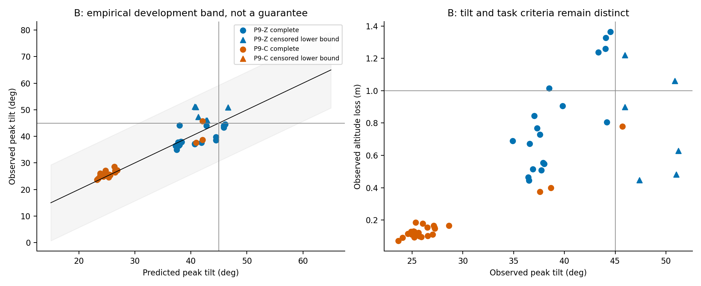
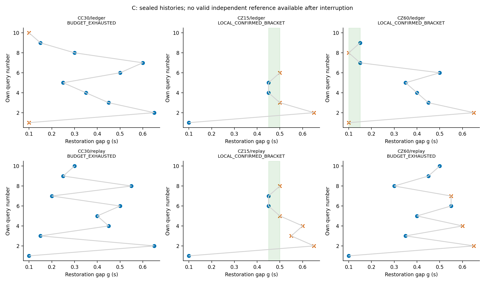

# Thor P9：新模型、事件预测、边界搜索与修复

**执行中断后的阶段性交付，P9尚未完成。** 开发10/12；正式102/180启动、101条完成、1条基础设施中断未测。
已完成B48与C搜索53；独立参考有效0/36，D留出0/36，未开始的71条静态任务保留NOT_RUN，7个未用搜索槽不挪用。
中断原因和稳定续接条件尚未确定；不得将局部搜索复核冒充参考准确性，或将开发修复试验冒充D验证。
实验日期按 Thor 的 Asia/Shanghai（UTC+8）记录；启动环境可能以 UTC 显示。

## 执行中断与当前阻碍

第102次`C-CZ15-g0.1-reference-P9-Z`于08:36:40启动；原正式会话78214及等待/监控会话失联，
已知campaign与后处理父进程不存在。最后runner事件为08:37:37的profile开始，遥测文件停止更新约08:37:47；
没有FINISH、正常清理或有效参考实测结果。该时段内核日志未查到OOM条目，**具体父进程消失原因未知**，不能据此断言某种系统故障。

五个残留进程组经本次启动事件、命令、启动时刻与成员逐一核实后，仅发送SIGINT正常退出；没有停止其他任务、实机操作或重启实验。
原始ULog保持原处，并另存本地`data/p9-20261024-interruption-v1/raw/flight.ulg`，哈希与来源见
[原始数据清单](../data/p9-20261024-interruption-v1/raw-manifest.json)。结构可解析不代表恢复了计划参考证据，孤儿控制尾段不计正式测量。

[冻结设计](THOR_P9_PLAN.md)规定：“正式基础设施异常停止该批，未执行留 NOT_RUN”。
因此没有绕过未完成启动保护、接管PX4继续采集、自动重跑第102次，或以搜索余额补跑。
继续参考/D需要先建立稳定执行条件并登记新的续接版本；当前原冻结版本到此停止。
原aggregate最后写入RUNNING及旧等待状态作为历史现场保留，当前状态以
[中断评估](../data/p9-20261024-interruption-v1/interruption-assessment.json)和动态检查点为准。

## 已保存的身份与输入

开工基线 main 为 `33897948be4ed452cc99d997cfa0427a972ef138`，已核实本地与远端一致。
正式前冻结提交为 `6a0292e4d7259f9396d5dad08486eb9e2a743427`，非 force 推送并回读验证。
[冻结设计](THOR_P9_PLAN.md) 与 [27 项输入清单](../data/p9-20261024-freeze/manifest.json) 已提交；
清单 SHA-256 为 `95f0a8ca67749f7fe852791821edbd9d7211dd4fa9de989cf86732fb41ee58ea`。
[推送回执](../data/p9-20261024-freeze/receipt.json) 保存实际提交、远端和清单哈希。

新模型名称 `p9-horizontal-delay-v1`，模型 SHA-256 为
`474509c9192ce270b897fdc1cbd69796be180c6a5a73b9f091678dbbca256b4a`。
P8 原冻结预测及原模型遗失的记录保持原样；此模型不代表原模型，也未补造原预测。
P8 的 900 次及旧 24 次 T1 探索不计入 P9 新验证分母。
拟合只使用 P6-A 的 18 次与 P8-A 的 8 次普通辨识；这些也是已见开发输入。
历史失败仅用于已知问题和开发背景，不作为新独立证据。

## A：模型、误差、拒判与理论结果

源码事件提取、坐标系、截断、初始状态、采样目标、超时捕获与恢复语义详见冻结设计。
水平代理保留位置 p、速度 v、姿态加速度代理 q 以及截断误差的延迟队列；
在目标偏航 FLU 系中，`p_dot=v`、`v_dot=q`，q 对位置/速度的饱和负反馈一阶滞后。
选定延迟 88 ms、时间常数 80 ms；位置增益约 (8.7904,9.2212)，速度增益约 (5.4531,5.8688)。
q 由姿态推算，依赖竖直推力补偿近似，不能等同真实水平加速度。
模型不包括 GRU 状态、竖直推力、阻力或完整机体耦合。

26 条输入按完整条件分为 23 个留出组，峰值绝对误差均值约 4.1387°，最大约 14.2996°。
经验带使用最大绝对开发残差；它既不是统计覆盖保证，也不是严格安全边界。
按全部留出组重新构建的模型与开发预测逐字节一致，独立重建约 11.46 s。
这些数值均为开发评估，最终的独立事件预测性能应读取 B 的正式结果。

高度尚无可靠模型，所有高度预测及误差范围均为 null；整体安全及整体跳过一律拒判。
新重置序列也没有事前独立倾角误差保证，因此倾角安全/跳过规则同样拒判。
本轮即使实测有成功样本，也不能事后把它们改称原本可以跳过。
跳过数量为 0 时，漏判率分母为 0，结果应为 NA，不能写成 0%。

失配账本为位置饱和反馈的积分势能与速度误差动能之和，保留饱和之外的位置积累。
其导数含名义耗散、延迟残差、目标加速度及采样运输失配；存在导数为正的简单反例。
当前没有覆盖实际延迟历史、代理误差及高度的负定证明，故未获得 Lyapunov 证书。
结构仅用于候选曲线分段、事件正注入优先级和修复代价约束，普通二分不算理论贡献。
没有证明的安全集合外不能判为必败。搜索效果不佳仍应作为负结果报告。

## 预算、时域与信息边界

开发与等价性共启动、完成 10 次，均通过基础设施检查，剩余 2 次未使用。
四次预注册等价性均通过，其中 T0 一条倾角与历史参考差约 2.457°，接近 2.5°阈值，未改阈值。
正式最大 180 个启动尝试：B 48、C 搜索最多 60、C 独立参考 36、D 36。
每次启动前持久保存数值预测、误差范围、拒判、种子、模型哈希及搜索自身历史，再记录 START_INTENT。
异常/失败尝试均占预算，不自动补跑，搜索提早结束的余额不转移。

统一速度 1.8 m/s、目标路径 11.79 m，首末段和减速起点固定；P9 使用基准首事件起固定 16 s。
三事件扫描只移动中间事件，两恢复间隔互补变化，不能解释成仅一个间隔变化的因果效应。
单事件控制删除其余事件，但保留同一完整目标轨迹和绝对相位。
生成空间的每个参数及 runner 安全预算分别验证，不以其中一个替代另一个。
飞行安全中止保留删失，已发生的越阈可判失败，未观察到的尾段不补造成功或恢复。

B 的 48 次包含 T0/T1、15/45/75°、五种相位、六次新种子重复及十二次单事件控制。
C 两法同候选空间、初始信息、每族最多十次和 0.05 s 局部夹逼精度；各自支付端点查询及复核。
不假定全局单调；参考是每格一个独立种子的含噪网格，不能当作概率边界真值。
搜索只接收冻结模型及自身观测，全部搜索封存后才运行参考；B、D、另一方法的结果均不反馈搜索。
D 使用九个留出序列簇、每簇共用新种子的四臂：原规则、捕获、恢复限速、组合。
RREC=1 的选择来自冻结前六个合成开发探针，不依据 D 验证再次选择或调参。

## B：已完成的独立事件验证（逐条原始重测通过）

B 已完成 48 次；[中间复核及逐条输入哈希](../data/p9-20261024-preparation/B-completed-review.json)
保存以下结果，未反馈任何搜索、模型或修复选择。全部48条基础设施检查及独立原始重测通过，6条为安全中止后的删失。

| 条件组 | 次数 | 完整16s窗 | 原主失败 | 倾角≥45° | 已观察掉高>1m | 任务失败 |
|---|---:|---:|---:|---:|---:|---:|
| T0 / P9-Z |24|18|6|6|7|11|
| T1 / P9-C |24|24|1|1|0|1|
| 合计 |48|42|7|7|7|12|

倾角和任务二元结局的已知分母均为48：六条删失均已观测到倾角越阈。
高度二元结局只有44条已知，另4条删失未越高度阈值，不能假定其未观测尾段安全；7是已观察到的高度失败数。
原主判据仍沿用历史分析窗口，P9任务判据采用固定16s，二者不合并为同一统计量。
B两处理的中断时长不同（T0 .36s、T1 .58s），这些组间计数不能直接解释为捕获修复的因果效果。

仅42条完整窗口的峰值 MAE 为1.8021°，Spearman为0.9244；T0/T1分别为2.3958°/1.3568°、
秩相关0.7669/0.7604。完整窗经验带覆盖42/42，但这排除了六条中止失败的最终峰值，
属于有选择的条件性描述，不能声称全体预测覆盖率100%或严格保证。
有6条已观察到倾角≥45°而点预测<45°，其中5条T0、1条T1；不能把较小的完整窗MAE解释为不低估危险。
两种事前跳过均为0，跳过集合失败率不可估、分母0，记NA；不能声称零漏判，也不证明跳过有效。

例如T0、45°、g=.55样本的倾角约44.517°、掉高约1.363m，原主判据成功而任务判据失败。
这直接限制了把倾角预测当作整体任务安全判断的做法。

12条单事件控制均未出现倾角或任务失败；与其精确同相位对应的g=.4多事件主样本也没有倾角失败。
因此本轮没有得到“失败多事件＋全部同相位单事件成功”的配套确证。
其他相位的多事件失败虽被观察到，却缺乏对应相位的全部单事件对照；不能借用g=.4控制冒充失败交互证据。
这是冻结选择的限制与负结果，不追加预算补齐。匹配多事件的掉高积累及两个新种子的波动将在最终图表进一步展示。

一个可检查的状态累积例子是T0、15°、g=.4的第二次事件：多事件样本捕获时水平速度约2.583m/s，
接回目标沿程跳变0.877m，捕获沿程偏移−0.589m；对应同相位单事件控制约1.791m/s、0.373m、−0.092m。
数值来自两条保留的`p7-metrics.json`中的capture/resume记录（`B-P9-Z-h15-g0.4-P9-Z`与
`B-P9-Z-h15-single2-P9-Z`），说明后续事件会遇到不同的位置/速度状态。
它与必须保留位置积累及速度失配的建模选择一致；样本种子不同且两者均未倾角失败，
不能把这个描述性例子提升为失败交互的确证或普遍因果定理。

## C：搜索已封存，参考中断而无有效结局

[封存后的搜索复核](../data/p9-20261024-preparation/C-sealed-review.json)保存全部六个停止结局及封存文件哈希。
53次查询完成；7个未使用槽位不分配给其他阶段。第一条参考在全部搜索封存后才启动，但因上述中断未完成；有效参考分母为0。

|事件族|账本法查询/10|账本法结局|回放排序查询/10|回放排序结局|
|---|---:|---|---:|---|
|CC30|10|预算耗尽，未完成双端复核|10|预算耗尽，未完成双端复核|
|CZ15|6|局部双端复核[.45,.50]s|8|局部双端复核[.45,.50]s|
|CZ60|9|局部双端复核[.10,.15]s|10|预算耗尽，索引9（g=.55）出现种子翻转|

账本法共25次、2/3族完成局部复核；回放排序法28次、1/3族完成。
这是三个固定族内的描述性结果，尚不能推断总体效率优势；两法使用不同的新种子，差异同时包含查询位置和种子实现。
例如CC30的g=.10端点，账本法两次约45.993°、47.573°，回放法一次约44.016°，本来就存在跨种子的成败翻转。
没有得到带延迟实际系统的Lyapunov证书；不能把少量查询差异解释成已证明的理论收益。
“局部双端复核”只表示本轮相邻.05s格各两次观测一致，不排除其他转变或后续种子翻转，亦不代表整体安全。
与参考的误差及漏掉的参考转变均不可估（NA），不能提前认定边界准确。三个事件族的全部参考格都没有有效结局。

## D 未执行：修复与任务代价没有新留出证据

九个留出序列、四臂共36次均NOT_RUN。冻结前模型在六个合成开发探针上选定组合捕获＋RREC1的候选，
不构成正式修复有效性、任务代价通过、后续事件无风险或可靠性结论。
原规则与修复的独立配对效果、追回率及区间分母均为0，记NA，不写为零失败。
任务阈值仍是冻结的最大落后≤4.5m、末次计划接回后6s绝对落后≤.5m及10s内连续.5s追回；没有改阈值挽救结果。

## 原始数据审计与分母

[独立审计](../data/p9-20261024-audit-interrupted-v1/audit.json)读取101条完成记录，全部逐条PASS，
包括原始ULog哈希、冻结P7/P9测量、策略输入重建、输出链路、主机记录、确定性事前预测和搜索自身历史重放。
审计写入新目录，未覆盖原run分析。**全批仍为FAIL**，唯一全局错误是
“started attempts missing from aggregate; inspect unfinished/failed attempt”：102条START、101条正式结果。
[分离判定](../data/p9-20261024-report-interrupted-v1/completed-audit-assessment.json)明确101条子集PASS不等于整个P9或全批PASS。

|阶段|实测n|完整16s窗n|原主失败|倾角失败/已知分母|掉高失败/已知分母|任务失败/已知分母|完整窗MAE|完整窗Spearman|
|---|---:|---:|---:|---:|---:|---:|---:|---:|
|B独立验证|48|42|7|7/48|7/44|12/48|1.8021°|0.9244|
|C自适应搜索|53|42|16|16/53|21/43|32/53|2.1918°|0.7469|
|参考|0|0|NA|NA|NA|NA|NA|NA|
|D留出|0|0|NA|NA|NA|NA|NA|NA|

C的误差/相关性是自适应查询集合上的描述，不当作另一套独立预测验证。
两阶段共23条原主失败、44条任务失败；101条完成记录中17条固定窗口删失，均已观察到倾角失败，因此任务二元分母仍为101。
掉高只有87条结局已知，28条已观察越阈，另14条删失未越高度阈值的尾段未知。
16条已观察危险被点预测低估（B6、C10），不是跳过漏判率；两类事前跳过均0，跳过集合失败率不可估。
名义Wilson数值仅留在机器汇总作描述，异质条件、自适应查询与少量相关样本不支持将其解释为同质总体保证。
误差、经验带覆盖和排序仅用完整窗口；删失中已观察到的危险低估另列。
冻结的D分析预定按九个序列簇处理相关性，完整连续值配对与已知二元失败配对分开，不把36臂当作36个独立样本；本次未执行，区间均NA。
任务代价包含全窗最大落后、末次计划接回后 6 s 落后及 10 s 内连续追回；
未观察末次计划接回或未追回均保留对应状态，不把最后一次已观测接回冒充最终接回。

## 成本、复现与数据位置

模型适配成本独立于正式查询：源码事件解释、模型实现、26 条历史辨识输入和十次新开发/等价性启动。
历史辨识的事件首末墙钟跨度合计 2347.904 s，含启动/飞行/清理，并非新 P9 成本或 CPU 时间。
人工适配没有工时单，记为 NA；保留代码、尝试账本及会话时间，不虚构小时数。
已完成尝试、预测计算及搜索候选池耗时分别汇总；第102条无FINISH，其从启动至孤儿清理的墙钟开销另列，不能当作0成本。

已完成101次正式尝试elapsed合计10263.010s（含运行、测量和导出），十次开发/等价性合计1038.072s。
101次查询前预测计算13.246s，三个共享搜索候选池合计4.610s，每族只计一次。
第102次启动至孤儿清理为421.028s，包含失控于runner的尾段，不计为有效正式测量。
初次适配的净人工工时、初次拟合单独耗时与冻结前全部预测耗时未完整计时，均为NA；11.456s只是另行计时的确定性重建，不能冒充全部工程成本。

可复用流程是：从控制器源码提取捕获/接回/重置规则及其原生时钟证据；针对重置可达的位置、速度和饱和状态选择普通辨识机动；
转换成有单位、坐标和输入哈希的可移植trace，按完整条件留出评估代理和经验误差；
同时验证生成域与runner预算，固定窗口并在每次查询前保存预测/拒判；
隔离搜索自身历史与后验参考，遇到噪声或不可观察结果按预案复核/拒判；
最后在开发探针上按任务代价选修复，再用独立配对序列回归。
当前适配器、事件语义与实验仍只覆盖PX4＋RAPTOR；流程可供新平台适配，参数、误差带和机理结论尚未获得跨平台验证。

下列命令是本轮已使用流程的可复现入口。已有输出目录必须保留；复现需新目录，
冻结核查和已启动账本会阻止误重跑。本轮原会话已经失联，不能按下列历史命令直接再次启动。

```bash
# 从 Thor 本地历史原始输入重建，新输出目录必须不存在
uav_lab/.local/venv/bin/python tools/p9_model.py /tmp/p9-rebuild-new --prepare
uav_lab/.local/venv/bin/python tools/p9_plan.py /tmp/p9-design-new
uav_lab/.local/venv/bin/python tools/p9_predict.py /tmp/p9-rebuild-new \
  --design /tmp/p9-design-new --output /tmp/p9-predictions-new
# 也可把已发布的 ident/ 与 input-manifest.json 复制到新目录，省略 --prepare
# 重建全部23组留出及模型；不需要从远端不存在的原始 ULog 开始
# 冻结前发展/等价性门控与回执的入口（精确参数见本轮计划和账本）
uav_lab/.local/venv/bin/python tools/p9_run.py --help
uav_lab/.local/venv/bin/python tools/p9_freeze.py --help
# 正式执行：仅限已有冻结、回执及未启动条件；本轮已执行，禁止重复启动
uav_lab/.local/venv/bin/python tools/p9_campaign.py data/p9-20261024-preparation \
  --frozen data/p9-20261024-freeze --output data/p9-20261024-formal
# 已完成101条的独立审计复现：用新的输出目录，不覆盖已有中断审计
uav_lab/.local/venv/bin/python tools/p9_audit.py data/p9-20261024-preparation \
  --frozen data/p9-20261024-freeze --formal data/p9-20261024-formal \
  --output /tmp/p9-audit-reproduction-new
# 预期全批审计FAIL（102启动/101结果），但可逐条查看101条重测是否通过
uav_lab/.local/venv/bin/python data/p9-20261024-interruption-v1/build_partial_report.py \
  --output /tmp/p9-partial-report-reproduction-new
```

冻结前Python全回归108项通过；中断后再次全回归108项通过（8.37s），
日志见[可追溯回归输出](../data/p9-20261024-interruption-v1/regression-after-interruption.log)。
离线纯搜索覆盖所有4096种二元标记、两法共8192种情况。
中断版报告另在新输出目录重建，结果JSON、逐槽位账本、审计分离判定、报告正文及预测—实测CSV逐字节一致，
见[复现核对](../data/p9-20261024-interruption-v1/partial-report-reproduction.json)。PDF创建时间不是数值复现目标。
冻结报告器的相对路径CLI存在`relative_to(ROOT)`限制；本中断包装器传绝对路径，未改冻结源码或测量定义。
本轮未改 Lab/PX4、策略、物理步长或安全保护。全部飞行为无风 headless SITL，未实机飞行。
原始 ULog、完整遥测、逐物理步电机数据及资源记录只存 Thor 本地且保留；
远端仅发布小型运行证据、派生 trace、账本、报告及哈希，不能称全原始数据远端齐全。
本次发布为中断后的阶段证据，不能称P9全部完成。提交和远端CI状态见
[发布回执](../data/p9-20261024-interruption-v1/publication-receipt.json)；没有检查记录不写成CI通过。

## 交付入口

- [模型及26条辨识输入清单](../data/p9-20261024-preparation/input-manifest.json)、[冻结清单](../data/p9-20261024-freeze/manifest.json)、[逐条启动账本](../data/p9-20261024-preparation/attempts.jsonl)。
- [逐条预测—实测CSV](../data/p9-20261024-report-interrupted-v1/frozen-generator-output/prediction-measurement-ledger.csv)、[已封存搜索](../data/p9-20261024-formal/searches-sealed-before-reference.json)。
- [中断版本汇总](../data/p9-20261024-report-interrupted-v1/results.json)、[180个正式计划槽位逐项账本](../data/p9-20261024-report-interrupted-v1/budget-accounting.json)、[输入清单](../data/p9-20261024-report-interrupted-v1/input-manifest.json)与[输出清单](../data/p9-20261024-report-interrupted-v1/output-manifest.json)。
- [全部101条原始重测](../data/p9-20261024-audit-interrupted-v1/audit.json)、[中断及清理证据](../data/p9-20261024-interruption-v1/interruption-assessment.json)、[本地原始数据说明](../data/p9-20261024-interruption-v1/LOCAL_RAW_DATA.md)。



B图的三角形是删失后已观察到的下界；灰带是开发经验带，无统计覆盖保证。两处理时长不同，不能由组间散点直接推断捕获因果效果。



C图红叉表示已观察到倾角≥45°，蓝点表示完整窗未越倾角阈值，绿阴影表示本轮局部双端复核。
没有可用参考结果；图中不存在事后参考边界，更没有整体安全区域。
