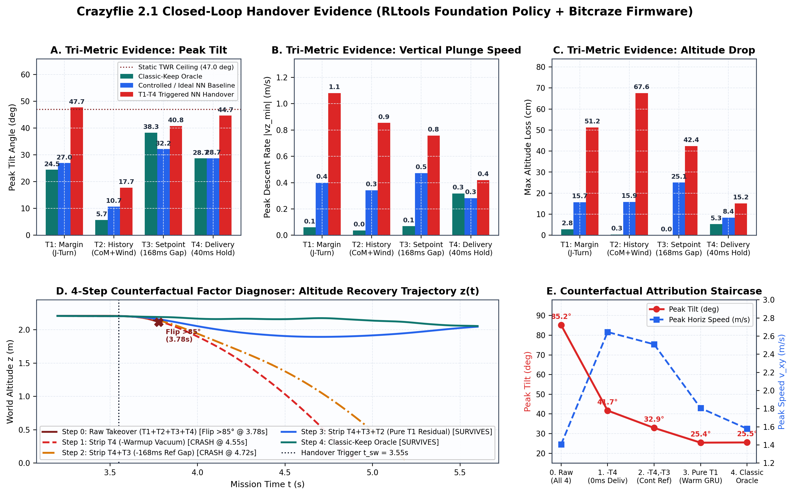
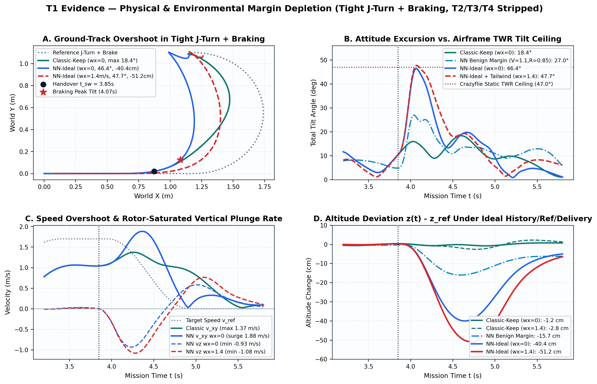
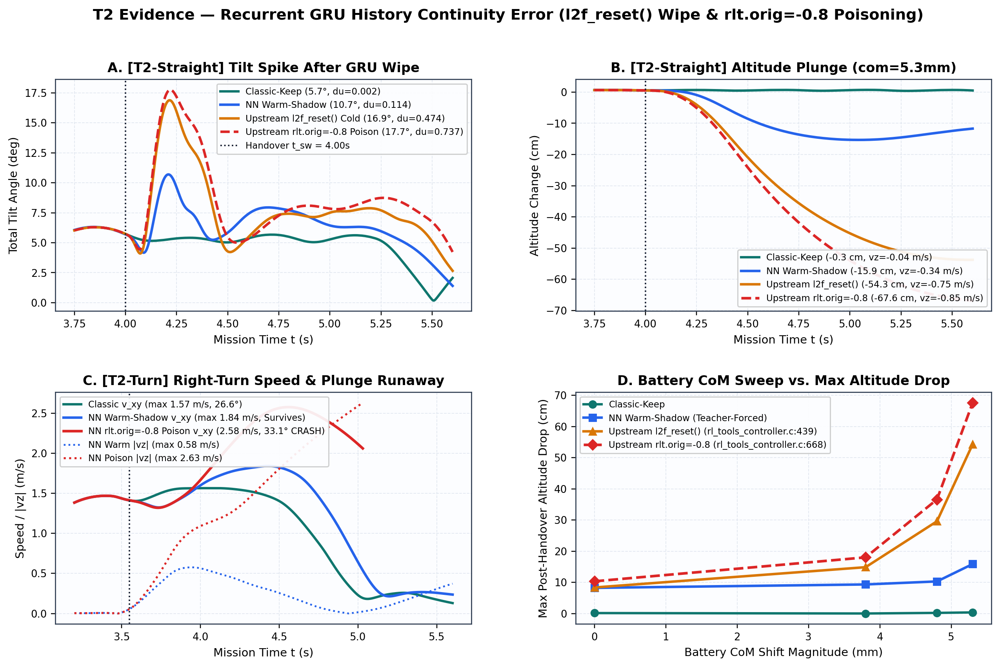
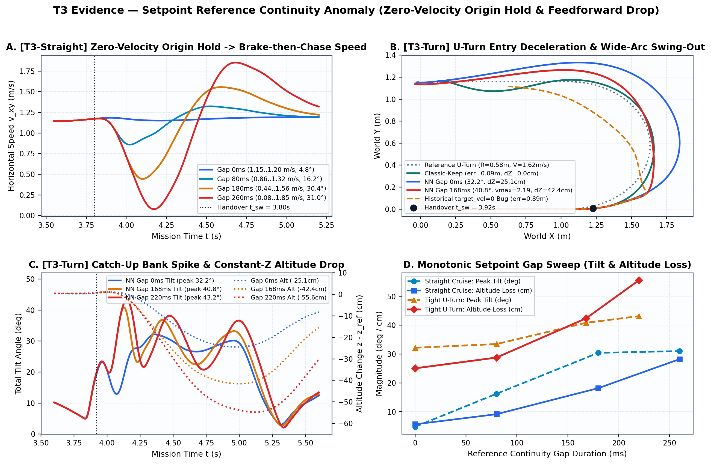
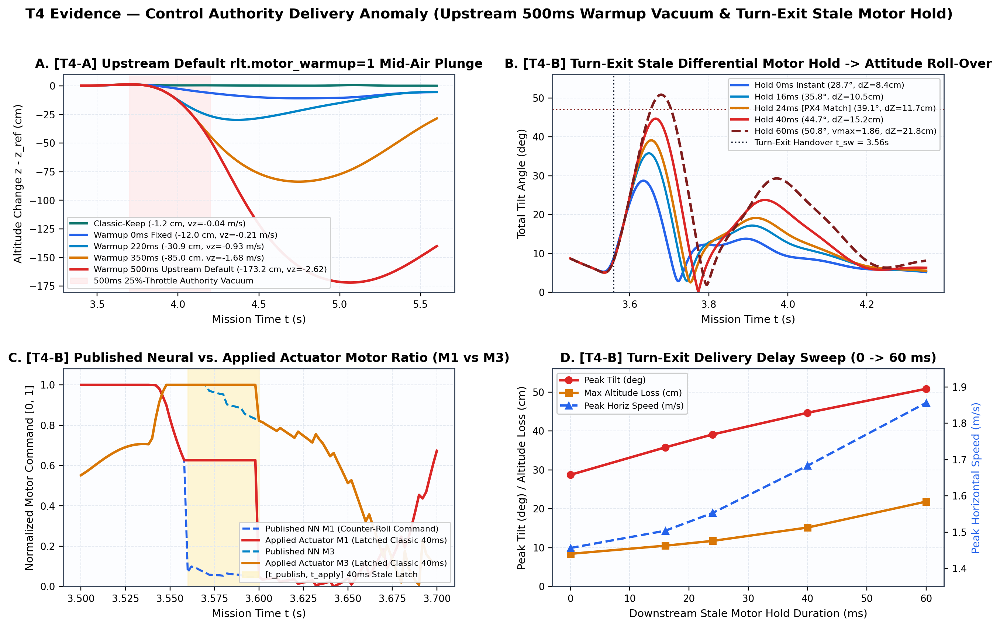

# Crazyflie 2.1：T1–T4 原生固件闭环案例

本页归档第二飞行平台 **Crazyflie 2.1**（30.6 g 微型四旋翼，满推重比 `1.467`，准静态定高倾角上限 `47.0°`）的全部 69 组原生固件 1000 Hz 锁步闭环证据。实验直接编译未经修改的 Bitcraze 官方经典飞控（PID / Mellinger）与 RLtools 官方 `rl_tools_controller.c`（16 维循环 GRU 策略，与 PX4 RAPTOR 同源），耦合官方 `l2f` 刚体与电机滞后动力学（`τ↑ = 55.5 ms`, `τ↓ = 249.4 ms`）。

## 四类交接问题汇总（T1–T4）

| 类别 | 上游源码锚点（`rl_tools_controller.c` @ `3e00e93`） | 关键实测对照（倾角 · 速度 · 掉高） |
| --- | --- | --- |
| **T1** 物理与环境安全余量不足 | `L417` 仅查 200 ms 包龄、无物理余量准入；`L168–195` 误差裁剪 | 紧弯刹停：经典 `18.4°`（掉高 `1.2 cm`）→ 理想神经接管 `46.4°`（冲速 `1.88 m/s`，掉高 `40.4 cm`）；顺风 `0.8 / 1.4 / 1.8 m/s` 下升至 `47.1° / 47.7° / 48.4°`，掉高 `46.2 / 51.2 / 55.6 cm`。 |
| **T2** 控制器历史状态接续错误 | `L439` 激活无条件 `l2f_reset()`；`L668–673` `rlt.orig` 每毫秒写 `-0.8` 毒化 GRU | 逆风偏心直线（`com=5.3 mm`）：预热 `10.7° / -15.9 cm` → 清零 `16.9° / -54.3 cm`、毒化 `17.7° / -67.6 cm`；带倾角右急弯（`com=4.8 mm`）：预热存活（`26.6°`），毒化冲至 `2.58 m/s`、`33.1°` 坠毁。 |
| **T3** Setpoint 参考接续异常 | `L431–433, L519–523` 空窗锁存原点并置零速；历史提交 `deca3ab` 遗漏速度前馈 | `1.20 m/s` 直线 `0 → 180 → 260 ms`：倾角 `4.8° → 30.4° → 31.0°`，掉高 `5.7 → 18.2 → 28.2 cm`；掉头急弯 `0 → 168 → 220 ms`：倾角 `32.2° → 40.8° → 43.2°`，追速 `2.03 → 2.19 → 2.25 m/s`，掉高 `25.1 → 42.4 → 55.6 cm`。 |
| **T4** 控制权实际交付异常 | **T4-A**：`L240, L696` 默认 `motor_warmup=1` 强制 `500 ms` 25% 油门；**T4-B**：出弯下游旧差动延续 `0..60 ms` | **T4-A** `500 ms` 真空：下坠 `-2.62 m/s`，掉高 `173.2 cm`；**T4-B** 出弯旧差动 `0 → 16 → 24 → 40 → 60 ms`：倾角 `28.7° → 35.8° → 39.1° → 44.7° → 50.8°`，掉高 `8.4 → 21.8 cm`。 |

## 分项证据与图谱

### T1：紧弯刹停与顺风包络收缩

固定后台教师强制预热 GRU、连续轨迹参考与 0 ms 交付，在 `V = 1.70 m/s, R = 0.55 m` 紧弯刹停（`t_sw = 3.85 s`）下扫掠顺风 `0.0 / 0.8 / 1.4 / 1.8 m/s`：

| 工况（`t_sw = 3.85 s`） | 控制分支 | 峰值倾角 | 峰值水平速度 | 最大下坠速度 | 最大掉高 |
| --- | --- | ---: | ---: | ---: | ---: |
| 温和对照（`V=1.1, R=0.85`） | `NN-Ideal` | 26.97° | 1.82 m/s | −0.40 m/s | 15.7 cm |
| 紧弯无风（`wx=0.0`） | `Classic-Keep` / `NN-Ideal` | 18.40° / **46.38°** | 1.37 / **1.88 m/s** | −0.04 / **−0.93 m/s** | 1.2 / **40.4 cm** |
| 紧弯顺风（`wx=0.8`） | `Classic-Keep` / `NN-Ideal` | 22.02° / **47.14°** | 1.40 / **1.87 m/s** | −0.05 / **−1.01 m/s** | 2.2 / **46.2 cm** |
| 紧弯顺风（`wx=1.4`） | `Classic-Keep` / `NN-Ideal` | 24.46° / **47.73°** | 1.41 / **1.83 m/s** | −0.06 / **−1.08 m/s** | 2.8 / **51.2 cm** |
| 紧弯顺风（`wx=1.8`） | `Classic-Keep` / `NN-Ideal` | 26.22° / **48.41°** | 1.41 / **1.79 m/s** | −0.07 / **−1.15 m/s** | 3.3 / **55.6 cm** |

### T2：`l2f_reset()` 清零与 `rlt.orig=-0.8` 历史毒化

在电池重心偏移与常值逆风下，对比经典保持、`NN-Warm-Shadow`（教师强制预热）、`NN-Cold-Reset`（激活清零）与 `NN-Orig-Poison`（后台每毫秒喂入 `-0.8`）：

| 场景 | 控制分支 | 首步电机阶跃 | 峰值倾角 | 最大下坠速度 | 最大掉高 | 结果 |
| --- | --- | ---: | ---: | ---: | ---: | --- |
| 直线逆风偏心（`com=5.3 mm`） | `Classic-Keep` | 0.002 | 5.72° | −0.04 m/s | 0.3 cm | 正常 |
| 同上 | `NN-Warm-Shadow` | 0.114 | 10.70° | −0.34 m/s | 15.9 cm | 正常 |
| 同上 | `NN-Cold-Reset` | **0.474** | **16.88°** | **−0.75 m/s** | **54.3 cm** | 深度失高 |
| 同上 | `NN-Orig-Poison` | **0.737** | **17.75°** | **−0.85 m/s** | **67.6 cm** | 深度失高 |
| 右急弯（`com=4.8 mm`） | `NN-Warm-Shadow` | 0.157 | 26.56° | −0.58 m/s | 42.9 cm | 存活悬停 |
| 同上 | `NN-Orig-Poison` | **0.604** | **33.13°** | **−2.63 m/s** | **215.7 cm** | **CRASH** |

### T3：零速原点锁存先刹后追与 168 ms 急弯外甩

| 场景与空窗时长 | 峰值倾角 | 水平速度区间 | 最大下坠速度 | 最大掉高 | 最大水平偏差 |
| --- | ---: | ---: | ---: | ---: | ---: |
| 直线（`1.20 m/s`）· `0 / 80 / 180 / 260 ms` | 4.79° / 16.23° / **30.42°** / **31.03°** | `[1.15,1.20]` → `[0.08,1.85] m/s` | −0.09 → **−0.58 m/s** | 5.7 → **28.2 cm** | 0.07 → **0.41 m** |
| 掉头弯（`1.62 m/s`）· `0 / 80 / 168 / 220 ms` | 32.18° / 33.48° / **40.84°** / **43.15°** | 追速 `2.03` → **2.19** → **2.25 m/s** | −0.47 → **−0.90 m/s** | 25.1 → **42.4** → **55.6 cm** | 0.41 → **0.53 m** |
| 掉头弯 · 历史提交 `deca3ab`（无速度前馈） | 34.91° | `[0.20, 1.60] m/s` | −0.51 m/s | 14.9 cm | **0.89 m** |

### T4：默认 500 ms 预热真空与出弯旧差动延续

| 子类与参数 | 峰值倾角 | 峰值水平速度 | 最大下坠速度 | 最大掉高 |
| --- | ---: | ---: | ---: | ---: |
| **T4-A** 预热真空 `0 / 220 / 350 / 500 ms` | 27.5° | 1.69 → **2.04 m/s** | −0.21 → **−2.62 m/s** | 12.0 → **173.2 cm** |
| **T4-B** 出弯延续 `0 / 16 / 24 / 40 / 60 ms` | 28.7° / 35.8° / **39.1°** / **44.7°** / **50.8°** | 1.46 → **1.86 m/s** | −0.28 → **−0.51 m/s** | 8.4 → **21.8 cm** |

## 四步反事实因子归因（`cf_attribution`）

在同一带扰动右急弯入口（`t_sw = 3.55 s`，入口 `1.41 m/s, 24.8°`）对原始上游空中接管失效依次剥离 `T4 → T3 → T2` 直至 `Classic-Keep`：

| 反事实剥离步骤 | 首步阶跃 | 峰值倾角 | 峰值速度 | 最大下坠 | 最大掉高 | 闭环结局 |
| --- | ---: | ---: | ---: | ---: | ---: | --- |
| **Step 0** · 原始空中接管（`T1+T2+T3+T4`） | 0.750 | **85.16°**（`+0.23 s`） | 1.41 m/s | −1.05 m/s | 9.4 cm（倾覆中止） | **CRASH** |
| **Step 1** · 剥离交付真空（`-T4`） | 0.975 | **41.70°** | **2.64 m/s** | **−2.77 m/s** | **215.5 cm** | **CRASH** |
| **Step 2** · 再剥离参考空窗（`-T4, -T3`） | 0.713 | **32.88°** | **2.51 m/s** | **−2.47 m/s** | **215.6 cm** | **CRASH** |
| **Step 3** · 再剥离历史失配（纯 `T1`） | **0.158** | **25.39°** | **1.81 m/s** | **−0.49 m/s** | **31.1 cm** | **SURVIVES** |
| **Step 4** · 经典保持（`Classic-Keep`） | 0.033 | 25.50° | 1.58 m/s | −0.25 m/s | 18.4 cm | **SURVIVES** |

完整原始数据、压缩轨迹与测试台位于 [evidence/crazyflie/](../../evidence/crazyflie/README.md)。离线校验命令：`python3 evidence/crazyflie/verify.py`。
