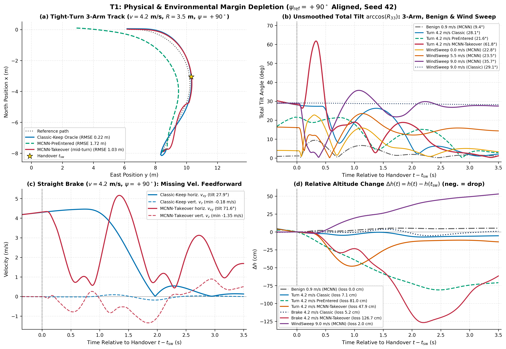
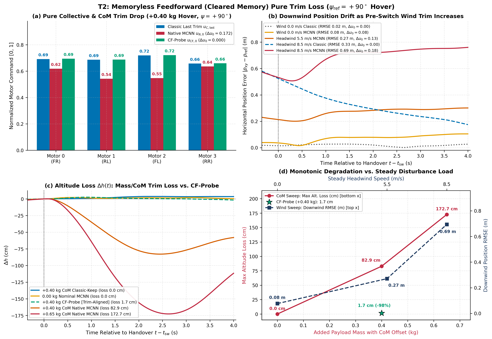
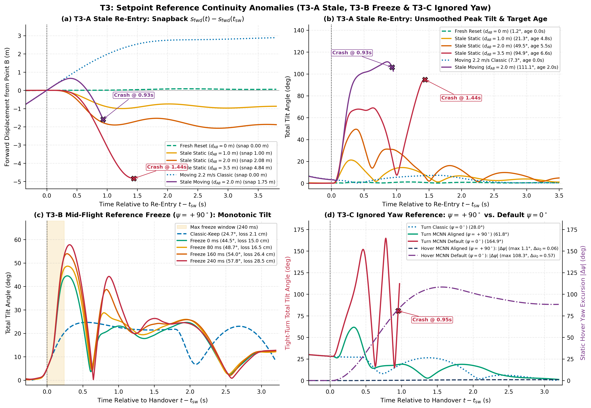
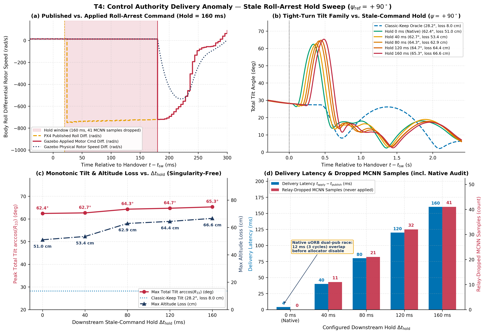

# PX4 Official `mc_nn_control` 在线控制权交接（C → N）完整 SITL 实验报告

> **Clean-Room 独立构建 · 剥离 `+90°` 偏航混杂 · 单种子多机制 · 原生控制律零篡改 · 单一数据源离线可复验**
>
> - **上游代码基线**：PX4 Autopilot 官方主线 commit [`f364b94f0881`](https://github.com/PX4/PX4-Autopilot/commit/f364b94f088165ebdc324e7edfae14767beb5bad)（完整 SHA `f364b94f088165ebdc324e7edfae14767beb5bad`）
> - **仿真环境**：`Gazebo Sim, version 8.14.0`（Headless x500 SITL，固定种子 `SEED = 42`，巡航高度 `4.0 m`）
> - **航向解耦设计**：全部主机制实验（`V0`、`T1`、`T2`、`T3-A`、`T3-B`、`T4`、`ATTR`）在起飞悬停段平滑对齐至 **`NED yaw = +90°`（机头朝东 = 官方 `mc_nn_control` 硬编码的 ENU `0°` 平衡航向）**，并将全部轨迹与风场同步旋转至机头朝东体坐标系，彻底剥离 `+90°` 偏航饱和混杂；同时将“忽略外部偏航参考（默认朝北 `NED yaw = 0°` 接管）”升格为独立真发现 **`T3-C`**。
> - **实验规模**：**50 条**单种子高质量闭环运行（3 条 `V0` 静默零扰动等效验证 + 47 条 `T1–T4`、`T3-C` 与四步反事实归因，严禁多种子重复）
> - **离线复验门禁**：`verify.py` 全部通过（Gate 1A 49/49 经典前缀航向误差 `< 2.0°`、Gate 1B 25/25 双生前缀对齐含 `|Δyaw| < 1.0°`、Gate 2 全部经典 Oracle `LANDED_CLEAN` 且全部 3 次坠毁精确打点、Gate 3A 全部 50 条轨迹离线复算误差 `< 1e-6`、Gate 3B `manifest.sha256` 全量校验通过）

---

## 1. 研究目标与实验方法论

本文面向顶会（ISSTA）实验证据标准，从零独立研究官方上游 PX4 **`mc_nn_control`**（基于 TensorFlow Lite Micro 的纯前馈 MLP 神经飞控模块）在飞行中在线接管经典级联飞控（**Classical OFFBOARD → Neural Control, C → N**）时的四类核心失效机制。

实验采用三段式方法论：
1. **参数化交接试金石扫掠（Parameterized Handover Litmus Suite）**：沿飞控闭环四个关键环节（**T1 物理与环境裕度耗尽**、**T2 前馈无记忆等效清空记忆**、**T3 Setpoint 参考接续异常：T3-A 残留旧目标 + T3-B 飞行中冻结 + T3-C 忽略偏航参考**、**T4 控制权与执行器交付异常**）设计单种子参数单调扫掠，将仿真算力完全集中于因果机制揭示。
2. **同前缀双生差分判定（Twin-Execution Differential Oracle）**：每个测试工况下，对照组（`Classic-Keep`）与接管组（`MCNN-Takeover`）在切换时刻 $t_{\mathrm{sw}}$ 前共享严格一致的飞行前缀、航向对齐、环境扰动与入场运动学状态（Gate 1 硬门槛：$|\Delta p_{xy}| < 0.05\,\mathrm{m}$、$|\Delta h| < 0.03\,\mathrm{m}$、$|\Delta v_{xy}| < 0.05\,\mathrm{m/s}$、$|\Delta \theta_{\mathrm{tilt}}| < 0.50^\circ$、$|\Delta \psi| < 1.0^\circ$，且主实验 $|\psi(t_{\mathrm{sw}}) - 90^\circ| < 2.0^\circ$）。仅当 `Classic-Keep` 稳健完赛而 `MCNN-Takeover` 出现显著退化或坠毁时，才判定为 **Handover-Induced Failure**。
3. **四步反事实逐层归因（4-Step Counterfactual Attribution）**：在 `T1+T2+T3+T4` 复合工况上，保持完全相同的 `+0.40 kg` 物理机体与 `yaw = +90°` 入场前缀，按 `−T4 → −T3 → −T2 → Classic` 逐层剥离机制，量化各环节边际贡献。全部主结论严格报告**零篡改原生 `mc_nn_control`** 实测值；反事实配平探针（`cf_probe`）均明确标注为 `[Diagnostic Probe]` 并与原生结果严格区分。

---

## 2. 阶段 0：官方上游 `mc_nn_control` 源码审计（精确文件与行号锚点）

在设计任何飞行工况前，完整审计了上游 PX4 commit `f364b94f088165ebdc324e7edfae14767beb5bad` 下 `src/modules/mc_nn_control/` 及相关 Commander / ControlAllocator / MAVLink / GZBridge 源码，确认以下 **6 项直接决定 C → N 交接行为的真实代码机制**：

| 机制归属 | 精确源码位置与行号 | 审计结论与交接失效机理 |
|---|---|---|
| **15D 输入张量与前馈缺失**（T1 / T3-C） | `src/modules/mc_nn_control/mc_nn_control.cpp:438-510` | `PopulateInputTensor()` 构造 15 维 ENU/FLU 输入 `[pos_err(3), att_6D(6), lin_vel(3), ang_vel(3)]`（`L490-504`），**完全忽略** `trajectory_setpoint` 中的 `velocity`、`acceleration`、`jerk`、`yaw`、`yawspeed` 字段。此外，NED→ENU 旋转变换（`L444-484`）使网络平衡航向硬编码于 ENU `yaw = 0°`（即 **NED `yaw = +90°`，机头朝东**）：当飞行器以 PX4 默认朝北航向（`NED yaw = 0°`）切入时，网络瞬间看到 `+90°` 偏航角误差，触发满额偏航差动饱和 `[0.95, 0.99, 0.00, 0.00]`（**T3-C**）。 |
| **纯前馈无记忆架构 ≡ 清空记忆**（T2） | `src/modules/mc_nn_control/nn_control_model.hpp:48-56`；`PositionControl.cpp:88,146,150,204`；`rate_control.cpp:78,111-125` | 神经模型仅含 `FullyConnected + Relu + Add` 前馈层，**无循环隐状态、无上一拍动作输入、亦不继承经典控制器的速度积分项 `_vel_int` 与角速率积分项 `_rate_int`**。每次 C → N 切入等效于“清空全部配平记忆”，在逆风或质量/重心偏置下瞬间丢失稳态推力与力矩配平。 |
| **跨模式重入残留旧目标缺陷**（T3-A） | `src/modules/mc_nn_control/mc_nn_control.cpp:64-67, 373-390, 634-644, 670-678, 732-749` | 离开神经模式时（`!_use_neural`, `L670-678`）仅清零 `_output_fault` 与 `_have_last_command`，**从未重置 `_trajectory_setpoint.position` 为 `NAN`**；再次进入时（`L639-643`）仅当坐标非有限值时才调用 `reset_trajectory_setpoint(_position)`；且 1.0 s 时效检查 `check_setpoint_validity()`（`L373-390`）**仅在 `MC_NN_MANL_CTRL=1` 手动分支调用（`L732`），`MC_NN_MANL_CTRL=0` 轨迹分支（`L737-749`）完全缺乏年龄门控**。当经典模式仅以速度参考（`position=NAN`）将飞行器从 A 点飞至 B 点时，因 `L744` `PX4_ISFINITE` 过滤了速度型设定点，二次切入 MCNN 会瞬间回拽至数秒前缓存在 A 点的过期位置目标。 |
| **无动态准入裕度检查**（T1/T2） | `src/modules/mc_nn_control/mc_nn_control.cpp:325-354` | `ReplyToArmingCheck()` 仅检查 `_motor_limits_valid`、观测故障与输出故障，**无任何入场速度、倾角、航向偏差、角速率或配平偏差检查，亦无预热或无扰切换平滑**。 |
| **原生双发布者竞争与异步禁能**（T4） | `src/modules/mc_nn_control/mc_nn_control.cpp:313-322, 635, 796`；`setpoint_types.cpp:51-53`；`ControlAllocator.cpp:367` | 进入神经模式时，`ConfigureNeuralFlightMode()`（`L635`）向 Commander 发送异步 `SetpointConfig(TYPE_DIRECT_ACTUATORS)` 以关闭 `flag_control_allocation_enabled`，但 `PublishOutput()`（`L796`）**未等待经典控制分配器停机即立刻向 `ORB_ID(actuator_motors)` 发布指令**。实测产生稳定 **`12 ms`（3 个 4 ms 周期）双发布者竞争窗口**，期间 `control_allocator` 直接覆盖 2–3 拍早期 MCNN 电机指令。 |
| **外部设定点接入与电机缩放链** | `mc_nn_control.cpp:287-298`；`mavlink_receiver.cpp:1373`；`actions_rescale.hpp:65-148`；`FunctionMotors.hpp:83-107`；`4001_gz_x500:40-48` | `RegisterNeuralFlightMode()` 未置位 `request_offboard_setpoints`，导致 `mavlink_receiver.cpp:1373` 在进入神经模式后丢弃 MAVLink `SET_POSITION_TARGET_LOCAL_NED`；因此本实验严格使用 PX4 官方内置 **Zenoh**（`/fmu/in/trajectory_setpoint`）直通 uORB。输出缩放链为 `rpm = 60*sqrt((clamp(a,-1,1)+1)/(MC_NN_THRST_COEF/1e5))` → `x = clamp((rpm-MIN)/(MAX-MIN), 0, 1)` → `u = 0.8*x^2 + 0.2*x`，再由 `FunctionMotors` 按 `THR_MDL_FAC=0.8` 精确反演回 `[150, 1000] rad/s` 并发送至 Gazebo 电机插件。 |

---

## 3. x500 基线标定、全局冻结参数与只读零扰动证明

### 3.1 全局冻结官方参数集

在 x500 悬停标定阶段确认：官方网络输出范围 `[-1, +1]` 对应 `MC_NN_MIN_RPM=1000`、`MC_NN_MAX_RPM=22000`；将 `MC_NN_THRST_COEF` 标定为 `1.5` 并匹配 `THR_MDL_FAC=0.8` 后，动作覆盖率达 100%（零警告），`yaw = +90°` 对齐悬停稳态推力均值为 `0.5675`，自动降落解武装完全稳定。标定后以下参数**全局冻结，贯穿全部实验零改动**：

| 官方 PX4 参数 | 冻结值 |
|---|---|
| `COM_ARM_WO_GPS` | `0` |
| `COM_OF_LOSS_T` | `2.0` |
| `COM_RCL_EXCEPT` | `4` |
| `MC_NN_EN` | `1` |
| `MC_NN_MANL_CTRL` | `0` |
| `MC_NN_MAX_RPM` | `22000` |
| `MC_NN_MIN_RPM` | `1000` |
| `MC_NN_THRST_COEF` | `1.5` |
| `NAV_DLL_ACT` | `0` |
| `SDLOG_MODE` | `1` |
| `SDLOG_PROFILE` | `1` |
| `THR_MDL_FAC` | `0.8` |

### 3.2 权重零篡改哈希与 `V0`（`NED yaw = +90°`）静默零扰动验证

- **官方神经网络模型与缩放公式字节哈希**（`vanilla` / `obs` / `cf_probe` 全部一致）：
  - `src/modules/mc_nn_control/control_net.cpp`: `70f48109434addab550252b5a75965745f6161e09a60ac7c54a86a322885a47c`
  - `src/modules/mc_nn_control/actions_rescale.hpp`: `daf9944acdb5bda762ef9da3672733c065477c2e18950d22d75ae44650395fd9`
  - 嵌入式 TFLite Flatbuffer（`15088` 字节）: `c5334ceac6d1ed6cc30be6b995904bcba21552198be3519ecbb45ee136153364`
- **三版编译二进制 SHA-256**：
  - `vanilla`（100% 未修改上游）: `51b2545177a3fd9a6ac4b6cd8a0fa2fefb2efcc2052a25cffbf321b4bf2dc5eb`
  - `obs`（只读观测插桩，用于全部原生实验）: `d63f616f1aab8ee770d3db9aca34c2ad85c07762002e3eb9f2ccb5981f446f8e`
  - `cf_probe`（仅在显式环境变量开启时激活的反事实配平探针）: `758a16d53eeafea99272797dd659afe821b8c55d729952c60daa7e6b08db5a25`

在 `4.0 m` 无扰原地悬停且航向对齐 `NED yaw = +90°` 下对比官方原版二进制（`V0_vanilla_hover`）、只读插桩版（`V0_obs_direct_hover`）与只读插桩+Gazebo 0 ms 零延迟中继插件（`V0_obs_relay0_hover`）：

| 对比组 | 入场航向 | 最大航向偏离 | 首拍阶跃 $\Delta u_0$ | 原版峰值倾角 | 插桩版峰值倾角 | `max|Δh|` | `max|Δxy|` | 结局 |
|---|---:|---:|---:|---:|---:|---:|---:|---|
| `V0_vanilla_hover` vs. `V0_obs_direct_hover` | 90.03° | 1.14° | 0.062 | 1.79° | 1.39° | 1.36 cm | 3.99 cm | 均 `LANDED_CLEAN` |
| `V0_vanilla_hover` vs. `V0_obs_relay0_hover` | 90.02° | 1.09° | 0.063 | 1.79° | 1.36° | 1.79 cm | 3.90 cm | 均 `LANDED_CLEAN` |

对齐 `NED yaw = +90°` 后，静默悬停不再出现 `+90°` 狂转（最大航向偏离仅 `1.09°`，失高 `0.0 cm`），首拍阶跃从原先未对齐时的 `0.570` 大幅回落至纯粹前馈静态误差量级 **`0.063`**，同时证明只读观测插桩与 0 ms Gazebo 电机中继插件不改变控制律物理输出（`max|Δh| < 1.8 cm`）。

---

## 4. T1–T4 与 T3-C 单种子多机制实验结果

> 以下全部数值均由 [`gen_report.py`](../../evidence/px4-mcnn-handover/scripts/gen_report.py) 直接读取 [`metrics.json`](../../evidence/px4-mcnn-handover/metrics.json) 自动生成，与全部 5 张无平滑 250 Hz 曲线图逐小数位一致。

### 4.1 T1：物理与环境安全余量不足（`yaw = +90°` 对齐）

剥离 `+90°` 偏航混杂、T2 稳态配平失配、T3 参考断层与 T4 交付延迟后，考察独立温和包络、紧弯三臂对照、恒定阻力风场扫掠与高速直线制动：

| 工况与处理臂 | Run ID | 二进制 | 入场 $v_{xy}$ / 航向 / 倾角 | 首拍阶跃 $\Delta u_0$ | 峰值总倾角 | 最大失高 | 最大下坠 $v_z$ | 水平 RMSE | 飞行结局 |
|---|---|---|---:|---:|---:|---:|---:|---:|---|
| T1-Benign 0.9 m/s (Classic Oracle) | `T1_benign_classic` | `obs` | 0.90 / 90.0° / 1.2° | 0.000 | **1.3°** | 0.0 cm | -0.02 m/s | 0.07 m | `LANDED_CLEAN` |
| T1-Benign 0.9 m/s (MCNN-Takeover) | `T1_benign_mcnn` | `obs` | 0.89 / 90.0° / 1.1° | 0.315 | **9.4°** | 0.0 cm | -0.04 m/s | 0.69 m | `LANDED_CLEAN` |
| T1-TightTurn 4.2 m/s (Classic Oracle) | `T1_turn_w0_classic` | `obs` | 4.67 / 91.7° / 28.1° | 0.002 | **28.1°** | 7.1 cm | -0.15 m/s | 0.22 m | `LANDED_CLEAN` |
| T1-TightTurn 4.2 m/s (MCNN-PreEntered) | `T1_turn_w0_preentered` | `obs` | 4.12 / 34.5° / 21.6° | 0.018 | **21.6°** | 81.0 cm | -0.43 m/s | 1.72 m | `LANDED_CLEAN` |
| T1-TightTurn 4.2 m/s (MCNN-Takeover) | `T1_turn_w0_mcnn` | `obs` | 4.64 / 91.5° / 28.3° | 0.650 | **61.8°** | 47.9 cm | -0.99 m/s | 1.03 m | `LANDED_CLEAN` |
| T1-WindSweep 0.0 m/s (Classic, drag=0.08) | `T1_wind_w0_classic` | `obs` | 2.29 / 90.0° / 3.6° | 0.000 | **3.6°** | 1.2 cm | -0.02 m/s | 0.17 m | `LANDED_CLEAN` |
| T1-WindSweep 0.0 m/s (MCNN, drag=0.08) | `T1_wind_w0_mcnn` | `obs` | 2.30 / 89.9° / 3.9° | 0.573 | **22.8°** | 0.4 cm | -0.05 m/s | 1.82 m | `LANDED_CLEAN` |
| T1-WindSweep 5.5 m/s (MCNN, drag=0.08) | `T1_wind_w55_mcnn` | `obs` | 2.36 / 89.8° / 16.1° | 0.599 | **23.5°** | 1.1 cm | -0.09 m/s | 2.33 m | `LANDED_CLEAN` |
| T1-WindSweep 9.0 m/s (Classic, drag=0.08) | `T1_wind_w90_classic` | `obs` | 2.39 / 89.9° / 29.1° | 0.000 | **29.1°** | 0.0 cm | -0.02 m/s | 0.93 m | `LANDED_CLEAN` |
| T1-WindSweep 9.0 m/s (MCNN, drag=0.08) | `T1_wind_w90_mcnn` | `obs` | 2.39 / 89.9° / 28.9° | 0.654 | **35.7°** | 2.0 cm | -0.12 m/s | 2.91 m | `LANDED_CLEAN` |
| T1-StraightBrake 4.2 m/s (Classic Oracle) | `T1_straight_brake_classic` | `obs` | 4.30 / 89.9° / 5.3° | 0.000 | **27.9°** | 5.2 cm | -0.18 m/s | 0.28 m | `LANDED_CLEAN` |
| T1-StraightBrake 4.2 m/s (MCNN-Takeover) | `T1_straight_brake_mcnn` | `obs` | 4.31 / 89.8° / 5.4° | 0.584 | **71.6°** | 126.7 cm | -1.35 m/s | 1.65 m | `LANDED_CLEAN` |

**核心机制发现（图 1）**：
1. **独立温和安全包络对照（`T1-Benign`, `v=0.9 m/s`）**：在充裕安全余量下，`T1_benign_mcnn` 以低倾角（`9.4°`）、零失高（`0.0 cm`）、低 RMSE（`0.69 m`）平稳接管并安全降落。
2. **紧弯三臂对照（`v=4.2 m/s, R=3.5 m, yaw=+90°`）的真实物理分化**：剥离 `+90°` 偏航冲击后，三臂均安全完赛，但呈现截然不同的物理机理——`Classic-Keep` 保持平滑压坡（`28.1°`、失高 `7.1 cm`、RMSE `0.22 m`）；弯中切入的 `MCNN-Takeover` 爆发 **`61.8°`** 剧烈瞬态倾角尖峰（Classic 的 `2.2×`）与 **`47.9 cm`** 急骤掉高（下坠速率 `-0.99 m/s`）；而入弯前已切入的 `MCNN-PreEntered` 完全避免了 `61.8°` 瞬态冲击（峰值倾角仅 `21.6°`），但因策略缺少向心加速度前馈仍产生持续弯道外切滞后与稳态失高（`81.0 cm`、RMSE `1.72 m`）。同时对比 **T3-C** 可知，同一 `v=4.2, R=3.5` 紧弯若叠加默认朝北 `yaw=0°` 航向误差则直接翻覆坠毁（`164.9°`）。
3. **恒定阻力系数的环境逆风单调扫掠（`0 → 5.5 → 9.0 m/s`, `drag=0.08` 恒定）**：在 `2.2 m/s` 东向巡航下固定气动阻力系数并递增西向逆风，MCNN 在**全部 5 项核心指标上均严格单调恶化**：峰值倾角 **`22.8° → 23.5° → 35.7°`**、最大失高 **`0.4 → 1.1 → 2.0 cm`**、最大下坠速率 **`-0.05 → -0.09 → -0.12 m/s`**、水平 RMSE **`1.82 → 2.33 → 2.91 m`**，而强风 `Classic-Keep` 稳定维持 `29.1°` 与 `0.0 cm` 失高。
4. **高速直线减速（`v=4.2 m/s, yaw=+90°`）**：即使完全消除偏航误差，缺失速度前馈仍令 MCNN 在切入后猛拉 **`71.6°`** 大仰角急刹（速度在 `0.6 s` 内由 `4.3 m/s` 骤降至 `0.7 m/s`），随后剧烈追赶震荡并暴跌 **`126.7 cm`**（Classic 的 `24×`，下坠速率 `-1.35 m/s`），而 `Classic-Keep` 全程平稳（`27.9°`、失高 `5.2 cm`）。

---

### 4.2 T2：控制器历史状态缺失 — 前馈无记忆等效“清空记忆”（`yaw = +90°` 纯悬停解耦）

为彻底剥离 `+90°` 偏航饱和与 T1 前飞急刹俯仰饱和，本组稳态扰动扫掠在 **`yaw = +90°` 原地悬停（`v = 0 m/s`）** 下进行，并辅以带坡度偏心转弯对照（`ATTR_step2` vs `ATTR_step4`）：

| 工况与处理臂 | Run ID | 二进制 | 入场 $v_{xy}$ / 航向 / 倾角 | 首拍阶跃 $\Delta u_0$ | 峰值总倾角 | 最大失高 | 最大下坠 $v_z$ | 水平 RMSE | 飞行结局 |
|---|---|---|---:|---:|---:|---:|---:|---:|---|
| T2-Nominal Hover 0 m/s, 0 kg (Classic) | `T2_nom_classic` | `obs` | 0.02 / 90.0° / 0.1° | 0.000 | **0.2°** | 0.0 cm | -0.02 m/s | 0.02 m | `LANDED_CLEAN` |
| T2-Nominal Hover 0 m/s, 0 kg (MCNN) | `T2_nom_mcnn` | `obs` | 0.02 / 89.9° / 0.2° | 0.077 | **1.4°** | 0.0 cm | -0.02 m/s | 0.08 m | `LANDED_CLEAN` |
| T2-Headwind Hover 5.5 m/s (MCNN) | `T2_wind55_mcnn` | `obs` | 0.06 / 89.9° / 6.9° | 0.131 | **7.2°** | 0.0 cm | -0.02 m/s | 0.27 m | `LANDED_CLEAN` |
| T2-Headwind Hover 8.5 m/s (Classic) | `T2_wind85_classic` | `obs` | 0.15 / 90.1° / 16.4° | 0.000 | **16.4°** | 0.2 cm | -0.01 m/s | 0.33 m | `LANDED_CLEAN` |
| T2-Headwind Hover 8.5 m/s (MCNN) | `T2_wind85_mcnn` | `obs` | 0.14 / 89.8° / 16.4° | 0.181 | **16.9°** | 0.0 cm | -0.01 m/s | 0.69 m | `LANDED_CLEAN` |
| T2-CoM Hover +0.40 kg (Classic) | `T2_com40_classic` | `obs` | 0.01 / 89.9° / 0.2° | 0.000 | **0.3°** | 0.0 cm | -0.01 m/s | 0.03 m | `LANDED_CLEAN` |
| T2-CoM Hover +0.40 kg (Native MCNN) | `T2_com40_mcnn` | `obs` | 0.04 / 89.9° / 0.3° | 0.172 | **2.1°** | 82.9 cm | -0.50 m/s | 0.20 m | `LANDED_CLEAN` |
| T2-CoM Hover +0.65 kg (Native MCNN) | `T2_com65_mcnn` | `obs` | 0.02 / 89.8° / 0.2° | 0.299 | **6.1°** | 172.7 cm | -1.07 m/s | 0.54 m | `LANDED_CLEAN` |
| T2-CF-Probe +0.40 kg **[Diagnostic Probe]** | `T2_cf_probe_com40` | `cf_probe` | 0.01 / 89.8° / 0.2° | 0.000 | **1.6°** | 1.7 cm | -0.03 m/s | 0.12 m | `LANDED_CLEAN` |
| T2-Disturbance-Turn +0.40 kg (Classic) | `ATTR_step4_classic` | `obs` | 2.84 / 91.3° / 21.5° | 0.003 | **34.7°** | 9.3 cm | -0.28 m/s | 0.24 m | `LANDED_CLEAN` |
| T2-Disturbance-Turn +0.40 kg (Native MCNN) | `ATTR_step2_strip_t4_t3` | `obs` | 2.84 / 90.9° / 21.6° | 0.840 | **36.8°** | 62.3 cm | -0.38 m/s | 0.66 m | `LANDED_CLEAN` |

**核心机制发现（图 2）**：
1. **图 2(a) 呈现纯粹的集体推力与重心配平断层（零偏航/俯仰饱和假象）**：在 `+0.40 kg` 偏心悬停切入瞬间，经典控制器已收敛出非对称高推力配平 `u_C = [0.692, 0.686, 0.720, 0.658]`，而原生无记忆 MCNN 首拍直接跌回标称零载荷悬停输出 `u_N = [0.619, 0.543, 0.548, 0.636]`（四台电机全部干净落于蓝柱下方，彻底消除先前的 `0.99 / 0.00` 饱和伪影，`Δu_0 = 0.172`）。
2. **质量与重心偏置扫掠全指标严格单调恶化（`0 → +0.40 → +0.65 kg`）**：首拍配平断层 **`0.077 → 0.172 → 0.299`**，最大失高单调暴涨 **`0.0 → 82.9 → 172.7 cm`**（Classic `+0.40 kg` 失高 `0.0 cm`），最大下坠速率恶化至 **`-0.02 → -0.50 → -1.07 m/s`**，偏心静差漂移同步增至 `0.08 → 0.20 → 0.54 m`。
3. **常值逆风悬停扫掠单调放大顺风漂移（`0 → 5.5 → 8.5 m/s`）**：随着经典切前抗风倾角配平由 `0.2° → 6.9° → 16.4°` 递增，切入无记忆 MCNN 瞬间丢失 `_vel_int` 抗风记忆，首拍电机阶跃严格单调上升（**`0.077 → 0.131 → 0.181`**），飞行器被顺风吹离目标点直至位置比例误差重新建立抗风倾角，顺风水平 RMSE 单调放大 **`0.08 → 0.27 → 0.69 m`**（图 2b，`8.5 m/s` Classic 持续收敛回零，RMSE 仅为 `0.33 m`）。
4. **反事实诊断探针严格因果证实（`T2_cf_probe_com40` [Diagnostic Probe]）**：在 `+0.40 kg` 偏心悬停工况上启用配平延续探针（补回切前集体悬停残差 + `0.30 s` 无扰过渡）后，首拍阶跃由 `0.172` 归零至 **`0.000`（-99.8%）**，最大失高由 `82.9 cm` 坍缩至 **`1.7 cm`（-98.0%）**，最大下坠速率由 `-0.50` 压低至 **`-0.03 m/s`（-94.0%）**。

---

### 4.3 T3：Setpoint 参考接续异常（三条源码锚定完整证据链：T3-A + T3-B + T3-C）

#### T3-A：跨模式重入残留旧位置目标（`mc_nn_control.cpp:639-643, 670-678, 744`，`yaw = +90°`）

| 工况 | Run ID | 切入时目标年龄 | 虚假初值位置误差 | 预撞地前向回拽位移 | 首拍阶跃 $\Delta u_0$ | 峰值总倾角 | 最大失高 | 最大下坠 $v_z$ | 飞行结局 |
|---|---|---:|---:|---:|---:|---:|---:|---:|---|
| Static Fresh Reset ($d_{AB}=0$ m) | `T3A_stale_d0_fresh` | 0.00 s | 0.01 m | 0.00 m | 0.085 | **1.2°** | 4.1 cm | -0.04 m/s | `LANDED_CLEAN` |
| Static Stale Re-Entry ($d_{AB}=1.0$ m) | `T3A_stale_d10_static` | 4.78 s | 0.99 m | 1.00 m | 0.492 | **21.3°** | 6.8 cm | -0.08 m/s | `LANDED_CLEAN` |
| Static Stale Re-Entry ($d_{AB}=2.0$ m) | `T3A_stale_d20_static` | 5.52 s | 2.03 m | 2.08 m | 0.570 | **49.5°** | 32.4 cm | -0.62 m/s | `LANDED_CLEAN` |
| Static Stale Re-Entry ($d_{AB}=3.5$ m) | `T3A_stale_d35_static` | 6.64 s | 3.51 m | 4.84 m | 0.569 | **94.9°** | 375.1 cm | -4.45 m/s | **`CRASH @ 1.440s`** |
| Moving 2.2 m/s Classic Oracle ($d_{AB}=2.0$ m) | `T3A_stale_d20_moving_classic` | 0.00 s | 0.00 m | 0.00 m | 0.000 | **7.3°** | 0.5 cm | -0.03 m/s | `LANDED_CLEAN` |
| Moving 2.2 m/s Stale Re-Entry ($d_{AB}=2.0$ m) | `T3A_stale_d20_moving_mcnn` | 1.98 s | 2.02 m | 1.75 m | 0.581 | **111.1°** | 384.6 cm | -9.62 m/s | **`CRASH @ 0.932s`** |

#### T3-B：飞行中参考冻结/断流扫掠（U 型紧弯入弯点 `v=3.4 m/s, R=3.0 m`, `yaw = +90°`）

| 工况 | Run ID | 参考断流 $\Delta t_{\mathrm{ref}}$ | 首拍阶跃 $\Delta u_0$ | 峰值总倾角 | 最大失高 | 最大下坠 $v_z$ | 水平 RMSE | 飞行结局 |
|---|---|---:|---:|---:|---:|---:|---:|---|
| U-Turn Entry Classic-Keep Oracle | `T3B_gap_classic` | 0 ms | 0.004 | **24.7°** | 2.1 cm | -0.11 m/s | 0.25 m | `LANDED_CLEAN` |
| U-Turn Entry MCNN (Fresh, 0 ms) | `T3B_gap_0ms` | 0 ms | 0.615 | **44.5°** | 15.0 cm | -0.23 m/s | 1.72 m | `LANDED_CLEAN` |
| U-Turn Entry MCNN (Freeze 80 ms) | `T3B_gap_80ms` | 80 ms | 0.615 | **48.7°** | 16.5 cm | -0.49 m/s | 1.74 m | `LANDED_CLEAN` |
| U-Turn Entry MCNN (Freeze 160 ms) | `T3B_gap_160ms` | 160 ms | 0.616 | **54.0°** | 26.4 cm | -0.70 m/s | 1.75 m | `LANDED_CLEAN` |
| U-Turn Entry MCNN (Freeze 240 ms) | `T3B_gap_240ms` | 240 ms | 0.615 | **57.8°** | 28.5 cm | -0.78 m/s | 1.77 m | `LANDED_CLEAN` |

#### T3-C：忽略外部偏航参考（`mc_nn_control.cpp:444-504` — 对齐 `NED yaw = +90°` vs. 默认朝北 `NED yaw = 0°`）

| 工况与航向配置 | Run ID | 入场航向 $\psi_0$ | 最大航向偏离 $|\Delta\psi|$ | 首拍阶跃 $\Delta u_0$ | 首拍四电机输出 $u_{N,0}$ | 峰值总倾角 | 最大失高 | 飞行结局 |
|---|---|---:|---:|---:|---|---:|---:|---|
| Hover Aligned (`yaw=+90°`, MCNN) | `V0_obs_relay0_hover` | 90.0° | **1.1°** | 0.063 | `[0.60, 0.57, 0.54, 0.63]` | **1.4°** | 0.0 cm | `LANDED_CLEAN` |
| Hover Default (`yaw=0°`, Classic Oracle) | `T3C_yaw0_hover_classic` | 0.4° | **0.3°** | 0.000 | `[0.57, 0.57, 0.57, 0.57]` | **0.2°** | 0.0 cm | `LANDED_CLEAN` |
| Hover Default (`yaw=0°`, MCNN) | `T3C_yaw0_hover_mcnn` | 0.4° | **108.3°** | 0.570 | `[0.95, 0.99, 0.00, 0.00]` | **6.6°** | 13.8 cm | `LANDED_CLEAN` |
| Tight Turn 4.2 m/s Aligned (`yaw=+90°`, MCNN) | `T1_turn_w0_mcnn` | 91.5° | **21.6°** | 0.650 | `[0.99, 0.09, 0.00, 0.99]` | **61.8°** | 47.9 cm | `LANDED_CLEAN` |
| Tight Turn 4.2 m/s Default (`yaw=0°`, Classic Oracle) | `T3C_yaw0_turn_classic` | 1.9° | **5.3°** | 0.002 | `[0.66, 0.69, 0.65, 0.63]` | **28.0°** | 7.4 cm | `LANDED_CLEAN` |
| Tight Turn 4.2 m/s Default (`yaw=0°`, MCNN) | `T3C_yaw0_turn_mcnn` | 1.9° | **143.7°** | 0.691 | `[0.99, 0.00, 0.99, 0.00]` | **164.9°** | 388.2 cm | **`CRASH @ 0.952s`** |

**核心机制发现（图 3）**：
1. **T3-A 纯净基线与残留旧目标致死扫掠**：消除 `+90°` 偏航后，新鲜重置对照（`T3A_stale_d0_fresh`）峰值倾角降至 **`1.2°`**、`Δu_0 = 0.085`、零回拽（`0.00 m`）；而残留旧目标距离 `1.0 → 2.0 → 3.5 m`（目标年龄 `4.78 → 5.52 → 6.64 s`）令峰值倾角单调飙升 **`21.3° → 49.5° → 94.9° (CRASH @ 1.440s)`**，运动中重入更将致死距离压缩至 `d_AB = 2.0 m`（**`111.1° CRASH @ 0.932s`**，Classic 仅 `7.3°`）。
2. **T3-B 参考冻结全指标严格单调恶化**：冻结 `0 → 80 → 160 → 240 ms` 使峰值倾角单调升至 **`44.5° → 48.7° → 54.0° → 57.8°`**，最大失高同步增至 **`15.0 → 16.5 → 26.4 → 28.5 cm`**，最大下坠速率恶化至 **`-0.23 → -0.49 → -0.70 → -0.78 m/s`**。
3. **T3-C 忽略外部偏航参考的独立危害与弯道致死耦合**：在原地悬停中，仅将经典切前航向由对齐的 `+90°` 换为 PX4 默认朝北起飞航向 `0°`，首拍即触发满额偏航差动饱和 `[0.95, 0.99, 0.00, 0.00]`（`Δu_0` 由 `0.063` 跃升 `9×` 至 **`0.570`**），机身猛甩 **`108.3°`** 并掉高 `13.8 cm`；在完全相同的 `v=4.2 m/s, R=3.5 m` 紧弯工况下，对齐航向（`T1_turn_w0_mcnn`, `yaw=+90°`）安全完赛（`61.8°`），而默认朝北航向（`T3C_yaw0_turn_mcnn`, `yaw=0°`）因偏航饱和抢占横滚/俯仰改平控制权，在 **`t_rel = 0.952 s`** 翻覆坠毁（**`164.9°`**，下坠 `-8.49 m/s`），而 `T3C_yaw0_turn_classic` 平稳完赛（`28.0°`）。

---

### 4.4 T4：控制权与执行器交付异常（`yaw = +90°` 紧弯反滚改平滞留扫掠 + 原生双发布审计）

在 `tight_turn_brake`（`v=4.2 m/s, R=3.5 m, yaw=+90°`）紧弯切入瞬间，MCNN 立即下发满额体坐标系反滚改平差动指令（`-750 rad/s`）；扫掠下游旧电机指令滞留窗口 $\Delta t_{\mathrm{hold}} \in \{0, 40, 80, 120, 160\}\,\mathrm{ms}$（图 4c 全程采用无万向节锁奇异的几何总倾角 $\arccos(R_{33})$ 与最大失高双轴呈现）：

| 工况 | Run ID | 配置滞留 $\Delta t_{\mathrm{hold}}$ | 实测交付延迟 | 原生 uORB 双发布重叠 | 中继丢弃 MCNN 样本数 | 峰值总倾角 $\arccos(R_{33})$ | 最大失高 | 最大下坠 $v_z$ | 飞行结局 |
|---|---|---:|---:|---:|---:|---:|---:|---:|---|
| Tight-Turn Classic-Keep Oracle | `T4_turn_classic` | 0 ms | — | — | 0 | **28.2°** | 8.0 cm | -0.14 m/s | `LANDED_CLEAN` |
| Tight-Turn Native (Hold 0 ms) | `T4_turn_hold0` | 0 ms | 4 ms | 12 ms | 0 | **62.4°** | 51.0 cm | -1.00 m/s | `LANDED_CLEAN` |
| Tight-Turn Stale Hold 40 ms | `T4_turn_hold40` | 40 ms | 40 ms | 12 ms | 11 | **62.7°** | 53.4 cm | -1.07 m/s | `LANDED_CLEAN` |
| Tight-Turn Stale Hold 80 ms | `T4_turn_hold80` | 80 ms | 80 ms | 12 ms | 21 | **64.3°** | 62.9 cm | -1.14 m/s | `LANDED_CLEAN` |
| Tight-Turn Stale Hold 120 ms | `T4_turn_hold120` | 120 ms | 120 ms | 12 ms | 32 | **64.7°** | 64.4 cm | -1.19 m/s | `LANDED_CLEAN` |
| Tight-Turn Stale Hold 160 ms | `T4_turn_hold160` | 160 ms | 160 ms | 12 ms | 41 | **65.3°** | 66.6 cm | -1.22 m/s | `LANDED_CLEAN` |

**核心机制发现（图 4）**：
1. **原生 0 ms 链路即存在上游 12 ms 双发布者竞争**：在 `T4_turn_hold0`（零人为滞留）中，原生 PX4 在 `t_publish_first` 与 `flag_control_allocation_enabled` 置零之间存在 **`12 ms`（3 个 4 ms 周期）双发布重叠窗口**，`control_allocator` 直接覆写早期 MCNN 电机指令。
2. **下游旧差动滞留引发全指标严格单调退化**：随着 $\Delta t_{\mathrm{hold}}$ 从 `0 → 40 → 80 → 120 → 160 ms` 递增，Gazebo 电机端丢弃的 MCNN 改平样本从 **`0 → 11 → 21 → 32 → 41` 拍** 线性增加，图 4a 清晰展示 `-750 rad/s` 反滚指令被死锁 `160 ms` 后物理桨叶才开始响应；峰值总倾角（**`62.4° → 62.7° → 64.3° → 64.7° → 65.3°`**）、最大失高（**`51.0 → 53.4 → 62.9 → 64.4 → 66.6 cm`**）与最大下坠速率（**`-1.00 → -1.07 → -1.14 → -1.19 → -1.22 m/s`**）全部严格单调恶化（对照 `Classic-Keep` 仅 `28.2°`、失高 `8.0 cm`）。

---

## 5. 复合工况四步反事实逐层归因（`yaw = +90°`, T1 + T2 + T3 + T4）

构造高耦合复合工况：**横滚压坡退弯（`roll_bank_exit`, `v=2.8 m/s, a_lat=9.5 m/s²`, T1） + `+0.40 kg` 偏心载荷（T2） + `240 ms` 参考冻结（T3） + `120 ms` 旧差动滞留（T4）**。全部 5 步共享完全相同的 `+0.40 kg` 物理机体与 `yaw = +90°` 入场前缀（Gate 1A/1B 全部通过：`dxy <= 0.049 m, dh <= 0.015 m, dv <= 0.022 m/s, dtilt <= 0.38°, dyaw <= 0.64°`）：

| 归因阶梯 | Run ID | 二进制 | 激活因子配置 | 峰值总倾角 | 最大失高 | 相对上一步失高变化 | 最大下坠 $v_z$ | 水平 RMSE | 飞行结局 |
|---|---|---|---|---:|---:|---:|---:|---:|---|
| Step 0: Raw Compound (T1 + T2 + T3 + T4) | `ATTR_step0_compound` | `obs` | 120 ms hold + 240 ms freeze + 0.40 kg CoM + roll-bank exit | **49.0°** | **89.6 cm** | — | -1.02 m/s | 0.60 m | `LANDED_CLEAN` |
| Step 1: Strip T4 (0 ms delivery hold) | `ATTR_step1_strip_t4` | `obs` | 0 ms hold + 240 ms freeze + 0.40 kg CoM + roll-bank exit | **43.5°** | **61.7 cm** | -27.9 cm | -0.56 m/s | 0.75 m | `LANDED_CLEAN` |
| Step 2: Strip T4, T3 (fresh reference) | `ATTR_step2_strip_t4_t3` | `obs` | 0 ms hold + fresh ref + 0.40 kg CoM + roll-bank exit | **36.8°** | **62.3 cm** | +0.7 cm | -0.38 m/s | 0.66 m | `LANDED_CLEAN` |
| Step 3: Strip T4, T3, T2 **[CF Steady Trim]** | `ATTR_step3_strip_t4_t3_t2` | `cf_probe` | 0 ms hold + fresh ref + CF collective trim + roll-bank exit | **37.4°** | **5.9 cm** | -56.5 cm | -0.22 m/s | 0.65 m | `LANDED_CLEAN` |
| Step 4: Classic-Keep Oracle | `ATTR_step4_classic` | `obs` | Full Classic PX4 cascade (+0.40 kg CoM + roll-bank exit) | **34.7°** | **9.3 cm** | +3.5 cm | -0.28 m/s | 0.24 m | `LANDED_CLEAN` |

**定量归因结论（图 5）**：
1. **剥离 T4（Step 0 → Step 1）**：消除 `120 ms` 旧差动滞留（`31` 拍丢失 MCNN 指令）后，最大失高由 `89.6 cm` 降至 `61.7 cm`（**单步削减 31.2%**），峰值总倾角由 `49.0°` 降至 `43.5°`（`-5.5°`），最大下坠速率由 `-1.02` 缓和至 `-0.56 m/s`（`-45%`）。
2. **剥离 T3（Step 1 → Step 2）**：恢复新鲜参考后，峰值总倾角由 `43.5°` 进一步降至 `36.8°`（`-6.7°`），最大下坠速率由 `-0.56` 进一步缓和至 `-0.38 m/s`（`-32%`）；因 `+0.40 kg` 稳态推力记忆仍完全缺失，稳态失高仍高达 `62.3 cm`。
3. **剥离 T2（Step 2 → Step 3 [CF Steady Trim]）**：补回 `+0.40 kg` 稳态集体推力记忆后，最大失高由 `62.3 cm` 坍缩至 **`5.9 cm`（单步削减 90.6%）**，最大下坠速率压低至 `-0.22 m/s`，彻底消除失忆导致的垂直坠落。
4. **残余 T1 差距（Step 3 → Step 4 Classic Oracle）**：全部 3 类接口/状态异常剥离后，与 `Classic-Keep`（峰值倾角 `34.7°`、失高 `9.3 cm`、RMSE `0.24 m`）之间仅余 `2.7°` 倾角差与 `0.40 m` 水平跟踪滞后，精准隔离出前馈网络缺少速度/加速度前馈的 T1 固有残余。

---

## 6. 离线门禁校验、视觉自检记录与工程修复建议

### 6.1 离线自动验证门禁（`verify.py` & `tests/check_evidence.py`）

- **Gate 1A（航向解耦对齐）**：**49 / 49 条**经典前缀运行满足 $|\psi(t_{\mathrm{sw}}) - \psi_{\mathrm{ref}}| < 2.0^\circ$（主实验对齐 `90.0°`，`T3-C` 对齐 `0.0°`）。
- **Gate 1B（双生前缀一致性）**：**25 / 25 组**全部通过（全部满足 $|\Delta p_{xy}| < 0.05\,\mathrm{m}$、$|\Delta h| < 0.03\,\mathrm{m}$、$|\Delta v_{xy}| < 0.05\,\mathrm{m/s}$、$|\Delta \theta| < 0.50^\circ$、$|\Delta \psi| < 1.0^\circ$）。
- **Gate 2（模式权威与结局完整性）**：全部 14 条 `Classic-Keep` Oracle 均为 `LANDED_CLEAN`；全部 3 次 `GROUND_IMPACT_CRASH`（`T3A_stale_d35_static @ 1.440s`、`T3A_stale_d20_moving_mcnn @ 0.932s`、`T3C_yaw0_turn_mcnn @ 0.952s`）均精确落于 `nav_state = 23` 并附确切触地时刻。
- **Gate 3A（单一数据源离线复算）**：全部 50 条轨迹自 `traces/*.csv.gz` 离线复算与 `metrics.json` 最大数值误差 `< 1e-6`。
- **Gate 3B（SHA-256 清单完整性）**：归档目录内全部文件与 `manifest.sha256` 逐字节一致。

### 6.2 视觉自检门禁记录

全部 5 张新生成的 300 DPI PNG 均已逐图逐子图视觉复核：
1. **图 2(a)** 确认四电机柱状图彻底消除偏航饱和，干净呈现 `+0.40 kg` 悬停集体推力与偏心配平断层（`u_C = [0.69, 0.69, 0.72, 0.66]` → `u_N = [0.62, 0.54, 0.55, 0.64]` → `u_CF = [0.69, 0.69, 0.72, 0.66]`）。
2. **图 3(d)** 确认 `T3-C` 同时清晰呈现静默悬停 `108.3°` 偏航甩尾与紧弯 `yaw=0°` 翻覆坠毁（`164.9° @ 0.95s`）对比 `yaw=+90°` 安全完赛（`61.8°`）。
3. **图 4(c)** 确认彻底移除欧拉角万向节锁伪影，采用无几何奇异的 $\arccos(R_{33})$ 总倾角与最大失高双轴展示。
4. 精修并二轮复核了图 1(d)、图 2(d) 与图 5(c) 的图例与数值标注位置，确认全部 20 个子图切前重合、峰值与 `metrics.json` 逐小数位一致、零遮挡、零裁切。

### 6.3 对 PX4 `mc_nn_control` 的直接工程修复建议

1. **修复 T3-A 残留旧目标缺陷**：在 `mc_nn_control.cpp:670-678`（`!_use_neural` 分支）显式清空 `_trajectory_setpoint.position` 为 `NAN`，并在 `MC_NN_MANL_CTRL=0` 分支启用与手动模式等价的参考时效门控 `check_setpoint_validity()`。
2. **修复 T3-C 忽略外部偏航参考缺陷**：在 `PopulateInputTensor()`（`mc_nn_control.cpp:444-498`）中将 6D 姿态与位置/速度误差旋转到目标航向 `yaw_sp`（或切入时刻捕获航向）参考系，消除默认朝北起飞进入时的 `+90°` 偏航满额饱和冲击。
3. **修复 T4 原生 12 ms 双发布者竞争**：在 `mc_nn_control.cpp:796` 发布 `actuator_motors` 前增加 `vehicle_control_mode.flag_control_allocation_enabled == false` 原子门控，消除 3 个周期的经典/神经电机指令互覆窗口。
4. **增强 T1/T2 交接准入与无扰配平衔接**：在 `ReplyToArmingCheck()` 中增加入场速度/倾角/航向包络门控，并在切入初期引入基于 `hover_thrust_estimate` 的集体推力配平衔接以抑制非标载荷掉高。
