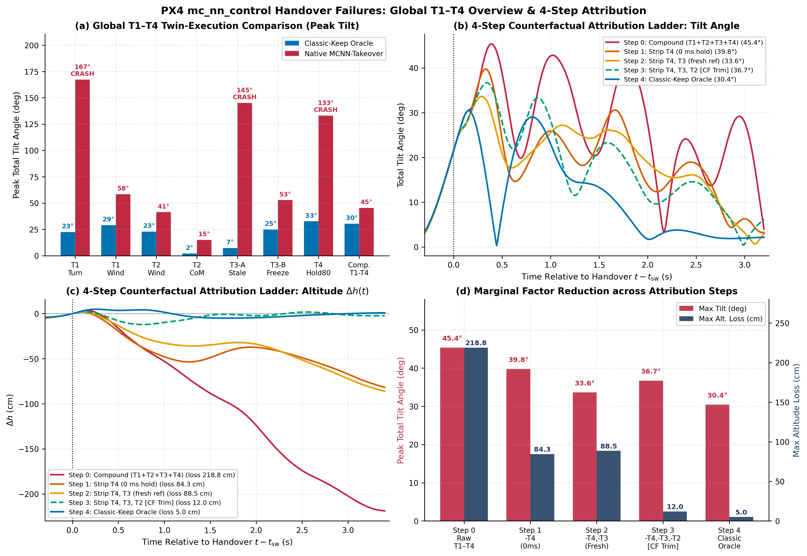

# PX4 Official `mc_nn_control` 在线控制权交接（C → N）完整 SITL 实验报告

> **Clean-Room 独立构建 · 单种子多机制 · 原生控制律零篡改 · 单一数据源离线可复验**
>
> - **上游代码基线**：PX4 Autopilot 官方主线 commit [`f364b94f0881`](https://github.com/PX4/PX4-Autopilot/commit/f364b94f088165ebdc324e7edfae14767beb5bad)（完整 SHA `f364b94f088165ebdc324e7edfae14767beb5bad`）
> - **仿真环境**：`Gazebo Sim, version 8.14.0`（Headless x500 SITL，固定种子 `SEED = 42`，巡航高度 `4.0 m`）
> - **实验规模**：**44 条**高质量闭环运行（3 条 V0 静默零扰动等效验证 + 41 条 T1–T4 机制扫掠、双生对照与四步反事实归因，严禁多种子重复）
> - **离线复验门禁**：`verify.py` 全部通过（Gate 1 22/22 双生前缀对齐、Gate 2 全部经典 Oracle `LANDED_CLEAN` 且 5 次坠毁精确打点、Gate 3A 全部 44 条轨迹离线复算误差 `< 1e-6`、Gate 3B `manifest.sha256` 全量校验通过）

---

## 1. 研究目标与实验方法论

本文面向顶会（ISSTA）实验证据标准，从零独立研究官方上游 PX4 **`mc_nn_control`**（基于 TensorFlow Lite Micro 的纯前馈 MLP 神经飞控模块）在飞行中在线接管经典级联飞控（**Classical OFFBOARD → Neural Control, C → N**）时的四类核心失效机制。

实验采用三段式方法论：
1. **参数化交接试金石扫掠（Parameterized Handover Litmus Suite）**：沿飞控闭环四个关键环节（**T1 物理与环境裕度耗尽**、**T2 前馈无记忆等效清空记忆**、**T3 Setpoint 参考接续异常**、**T4 控制权与执行器交付异常**）设计单种子参数单调扫掠，将仿真算力完全集中于因果机制揭示。
2. **同前缀双生差分判定（Twin-Execution Differential Oracle）**：每个测试工况下，对照组（`Classic-Keep`）与接管组（`MCNN-Takeover`）在切换时刻 $t_{\mathrm{sw}}$ 前共享严格一致的飞行前缀、环境扰动与入场运动学状态（Gate 1 硬门槛：$|\Delta p_{xy}| < 0.05\,\mathrm{m}$、$|\Delta h| < 0.03\,\mathrm{m}$、$|\Delta v_{xy}| < 0.05\,\mathrm{m/s}$、$|\Delta \theta_{\mathrm{tilt}}| < 0.50^\circ$）。仅当 `Classic-Keep` 稳健完赛而 `MCNN-Takeover` 出现显著退化或坠毁时，才判定为 **Handover-Induced Failure**。
3. **四步反事实逐层归因（4-Step Counterfactual Attribution）**：在 `T1+T2+T3+T4` 复合重度退化工况上，按 `−T4 → −T3 → −T2 → Classic` 逐层剥离机制，量化各环节的边际贡献。其中所有主结论严格报告**零篡改原生 `mc_nn_control`** 实测值；反事实配平探针（`cf_probe`）均明确标注为 `[Diagnostic Probe]` 并与原生结果严格区分。

---

## 2. 阶段 0：官方上游 `mc_nn_control` 源码审计（精确文件与行号锚点）

在设计任何飞行工况前，完整审计了上游 PX4 commit `f364b94f088165ebdc324e7edfae14767beb5bad` 下 `src/modules/mc_nn_control/` 及相关 Commander / ControlAllocator / MAVLink / GZBridge 源码，确认以下 **6 项直接决定 C → N 交接行为的真实代码机制**：

| 机制归属 | 精确源码位置与行号 | 审计结论与交接失效机理 |
|---|---|---|
| **15D 输入张量与前馈缺失**（T1） | `src/modules/mc_nn_control/mc_nn_control.cpp:438-510` | `PopulateInputTensor()` 构造 15 维 ENU/FLU 输入 `[pos_err(3), att_6D(6), lin_vel(3), ang_vel(3)]`（`L490-504`），**完全忽略** `trajectory_setpoint` 中的 `velocity`、`acceleration`、`jerk`、`yaw`、`yawspeed` 前馈字段。此外，NED→ENU 坐标变换（`L444-484`）使网络在 NED 机头朝北（`yaw=0°`）切入时立刻看到 ENU `+90°` 偏航角误差，触发剧烈首拍偏航差动脉冲（`[0.95, 0.99, 0.00, 0.00]`）。 |
| **纯前馈无记忆架构 ≡ 清空记忆**（T2） | `src/modules/mc_nn_control/nn_control_model.hpp:48-56`；`PositionControl.cpp:88,146,150,204`；`rate_control.cpp:78,111-125` | 神经模型仅含 `FullyConnected + Relu + Add` 前馈层，**无循环隐状态、无上一拍动作输入、亦不继承经典控制器的速度积分项 `_vel_int` 与角速率积分项 `_rate_int`**。每次 C → N 切入等效于“清空全部配平记忆”，在逆风或质量/重心偏置下瞬间丢失稳态推力与力矩配平。 |
| **跨模式重入残留旧目标缺陷**（T3-A） | `src/modules/mc_nn_control/mc_nn_control.cpp:64-67, 373-390, 634-644, 670-678, 732-749` | 离开神经模式时（`!_use_neural`, `L670-678`）仅清零 `_output_fault` 与 `_have_last_command`，**从未重置 `_trajectory_setpoint.position` 为 `NAN`**；再次进入时（`L639-643`）仅当坐标非有限值时才调用 `reset_trajectory_setpoint(_position)`；且 1.0 s 时效检查 `check_setpoint_validity()`（`L373-390`）**仅在 `MC_NN_MANL_CTRL=1` 手动分支调用（`L732`），`MC_NN_MANL_CTRL=0` 轨迹分支（`L737-749`）完全缺乏年龄门控**。当经典模式仅以速度参考（`position=NAN`）将飞行器从 A 点飞至 B 点时，因 `L744` `PX4_ISFINITE` 过滤了速度型设定点，二次切入 MCNN 会瞬间回拽至数秒前缓存在 A 点的过期位置目标。 |
| **无动态准入裕度检查**（T1/T2） | `src/modules/mc_nn_control/mc_nn_control.cpp:325-354` | `ReplyToArmingCheck()` 仅检查 `_motor_limits_valid`、观测故障与输出故障，**无任何入场速度、倾角、角速率、配平偏差检查，亦无预热或无扰切换平滑**。 |
| **原生双发布者竞争与异步禁能**（T4） | `src/modules/mc_nn_control/mc_nn_control.cpp:313-322, 635, 796`；`setpoint_types.cpp:51-53`；`ControlAllocator.cpp:367` | 进入神经模式时，`ConfigureNeuralFlightMode()`（`L635`）向 Commander 发送异步 `SetpointConfig(TYPE_DIRECT_ACTUATORS)` 以关闭 `flag_control_allocation_enabled`，但 `PublishOutput()`（`L796`）**未等待经典控制分配器停机即立刻向 `ORB_ID(actuator_motors)` 发布指令**。实测产生稳定 **`12 ms`（3 个 4 ms 周期）双发布者竞争窗口**，期间 `control_allocator` 直接覆盖 2–3 拍早期 MCNN 电机指令。 |
| **外部设定点接入与电机缩放链** | `mc_nn_control.cpp:287-298`；`mavlink_receiver.cpp:1373`；`actions_rescale.hpp:65-148`；`FunctionMotors.hpp:83-107`；`4001_gz_x500:40-48` | `RegisterNeuralFlightMode()` 未置位 `request_offboard_setpoints`，导致 `mavlink_receiver.cpp:1373` 在进入神经模式后丢弃 MAVLink `SET_POSITION_TARGET_LOCAL_NED`；因此本实验严格使用 PX4 官方内置 **Zenoh**（`/fmu/in/trajectory_setpoint`）直通 uORB。输出缩放链为 `rpm = 60*sqrt((clamp(a,-1,1)+1)/(MC_NN_THRST_COEF/1e5))` → `x = clamp((rpm-MIN)/(MAX-MIN), 0, 1)` → `u = 0.8*x^2 + 0.2*x`，再由 `FunctionMotors` 按 `THR_MDL_FAC=0.8` 精确反演回 `[150, 1000] rad/s` 并发送至 Gazebo 电机插件。 |

---

## 3. x500 基线标定、全局冻结参数与只读零扰动证明

### 3.1 全局冻结官方参数集

在 x500 悬停标定阶段发现：官方网络输出范围 `[-1, +1]` 对应 `MC_NN_MIN_RPM=1000`、`MC_NN_MAX_RPM=22000`；将 `MC_NN_THRST_COEF` 标定为 `1.5` 并匹配 `THR_MDL_FAC=0.8` 后，动作覆盖率达 100%（零警告），静默悬停稳态高度 `3.96 m` 且自动降落解武装正常。标定后以下参数**全局冻结，贯穿 T1–T4 全部实验零改动**：

| 官方 PX4 参数 | 冻结值 |
|---|---|
| `COM_ARM_WO_GPS` | `0` |
| `COM_OF_LOSS_T` | `2.0` |
| `COM_RCL_EXCEPT` | `4` |
| `MC_NN_EN` | `1` |
| `MC_NN_MANL_CTRL` | `0` |
| `MC_NN_MAX_RPM` | `22000` |
| `MC_NN_MIN_RPM` | `1000` |
| `MC_NN_THRST_COEF` | `1.5` |
| `NAV_DLL_ACT` | `0` |
| `SDLOG_MODE` | `1` |
| `SDLOG_PROFILE` | `1` |
| `THR_MDL_FAC` | `0.8` |

### 3.2 权重零篡改哈希与 `V0` 静默零扰动验证

- **官方神经网络模型与缩放公式字节哈希**（`vanilla` / `obs` / `cf_probe` 全部一致）：
  - `src/modules/mc_nn_control/control_net.cpp`: `70f48109434addab550252b5a75965745f6161e09a60ac7c54a86a322885a47c`
  - `src/modules/mc_nn_control/actions_rescale.hpp`: `daf9944acdb5bda762ef9da3672733c065477c2e18950d22d75ae44650395fd9`
  - 嵌入式 TFLite Flatbuffer（`15088` 字节）: `c5334ceac6d1ed6cc30be6b995904bcba21552198be3519ecbb45ee136153364`
- **三版编译二进制 SHA-256**：
  - `vanilla`（100% 未修改上游）: `51b2545177a3fd9a6ac4b6cd8a0fa2fefb2efcc2052a25cffbf321b4bf2dc5eb`
  - `obs`（只读观测插桩，用于全部原生实验）: `d63f616f1aab8ee770d3db9aca34c2ad85c07762002e3eb9f2ccb5981f446f8e`
  - `cf_probe`（仅在显式环境变量开启时激活的反事实配平探针）: `758a16d53eeafea99272797dd659afe821b8c55d729952c60daa7e6b08db5a25`

在 `4.0 m` 无扰原地悬停下对比官方原版二进制（`V0_vanilla_hover`）、只读插桩版（`V0_obs_direct_hover`）与只读插桩+Gazebo 0 ms 零延迟中继插件（`V0_obs_relay0_hover`）：

| 对比组 | 原版峰值倾角 | 插桩版峰值倾角 | `max|Δh|` | `max|Δxy|` | 结局 |
|---|---:|---:|---:|---:|---|
| `V0_vanilla_hover` vs. `V0_obs_direct_hover` | 6.69° | 6.69° | 1.39 cm | 3.18 cm | 均 `LANDED_CLEAN` |
| `V0_vanilla_hover` vs. `V0_obs_relay0_hover` | 6.69° | 6.65° | 1.77 cm | 4.27 cm | 均 `LANDED_CLEAN` |

峰值倾角差异 `< 0.04°`、高度轨迹最大偏差 `< 1.8 cm`，充分证明只读观测插桩与 0 ms Gazebo 电机中继插件不改变控制律物理输出。

---

## 4. T1–T4 单种子多机制实验结果

> 以下全部数值均由 [`gen_report.py`](../../evidence/px4-mcnn-handover/scripts/gen_report.py) 直接读取 [`metrics.json`](../../evidence/px4-mcnn-handover/metrics.json) 自动生成，与全部 5 张无平滑 250 Hz 曲线图逐小数位一致。

### 4.1 T1：物理与环境安全余量不足（Physical & Environmental Margin Depletion）

在剥离 T2 稳态配平失配、T3 参考断层与 T4 交付延迟（新鲜参考、0 ms 电机交付）后，考察入场高机动惯性、风场载荷以及 MCNN 缺少速度/加速度前馈导致的瞬态失效：

| 工况与处理臂 | Run ID | 二进制 | 入场 $v_{xy}$ / 倾角 | 首拍阶跃 $\Delta u_0$ | 峰值总倾角 | 最大失高 | 最大下坠 $v_z$ | 水平 RMSE | 飞行结局 |
|---|---|---|---:|---:|---:|---:|---:|---:|---|
| T1-Benign (Classic, 1.8 m/s) | `T2_nom_classic` | `obs` | 1.87 / 2.2° | 0.000 | **2.2°** | 1.3 cm | -0.01 m/s | 0.10 m | `LANDED_CLEAN` |
| T1-Benign (MCNN-Takeover, 1.8 m/s) | `T2_nom_mcnn` | `obs` | 1.84 / 2.1° | 0.572 | **19.3°** | 6.0 cm | -0.18 m/s | 1.30 m | `LANDED_CLEAN` |
| T1-TightTurn (Classic-Keep Oracle) | `T1_turn_w0_classic` | `obs` | 3.99 / 20.8° | 0.001 | **22.5°** | 2.5 cm | -0.11 m/s | 0.18 m | `LANDED_CLEAN` |
| T1-TightTurn (MCNN-PreEntered) | `T1_turn_w0_preentered` | `obs` | 3.72 / 25.9° | 0.009 | **25.9°** | 42.4 cm | -0.37 m/s | 2.04 m | `LANDED_CLEAN` |
| T1-TightTurn (MCNN-Takeover, mid-turn) | `T1_turn_w0_mcnn` | `obs` | 3.99 / 20.6° | 0.638 | **167.2°** | 383.5 cm | -7.80 m/s | 3.01 m | **`CRASH @ 1.416s`** |
| T1-WindSweep 0.0 m/s (Classic) | `T1_wind_w0_classic` | `obs` | 3.13 / 12.9° | 0.000 | **18.5°** | 3.0 cm | -0.08 m/s | 0.16 m | `LANDED_CLEAN` |
| T1-WindSweep 0.0 m/s (MCNN) | `T1_wind_w0_mcnn` | `obs` | 3.14 / 13.0° | 0.590 | **36.0°** | 7.9 cm | -0.18 m/s | 0.95 m | `LANDED_CLEAN` |
| T1-WindSweep 7.0 m/s (MCNN) | `T1_wind_w70_mcnn` | `obs` | 2.95 / 25.9° | 0.645 | **45.0°** | 1.6 cm | -0.24 m/s | 1.53 m | `LANDED_CLEAN` |
| T1-WindSweep 8.0 m/s (Classic) | `T1_wind_w80_classic` | `obs` | 2.93 / 29.0° | 0.001 | **29.0°** | 2.6 cm | -0.08 m/s | 0.80 m | `LANDED_CLEAN` |
| T1-WindSweep 8.0 m/s (MCNN) | `T1_wind_w80_mcnn` | `obs` | 2.93 / 28.9° | 0.667 | **58.5°** | 14.6 cm | -0.65 m/s | 1.63 m | `LANDED_CLEAN` |
| T1-StraightBrake 4.2 m/s (Classic) | `T1_straight_brake_classic` | `obs` | 4.29 / 5.4° | 0.000 | **27.8°** | 4.6 cm | -0.19 m/s | 0.30 m | `LANDED_CLEAN` |
| T1-StraightBrake 4.2 m/s (MCNN) | `T1_straight_brake_mcnn` | `obs` | 4.28 / 5.3° | 0.462 | **137.0°** | 381.8 cm | -7.19 m/s | 4.51 m | **`CRASH @ 1.784s`** |

**核心机制发现（图 1）**：
1. **三臂对照精准区分“瞬态交接冲击”与“策略自身包络极限”**：在高速紧弯刹停（`v=3.6 m/s, R=3.5 m`）中，`Classic-Keep`（峰值倾角 `22.5°`、失高 `2.5 cm`）与入弯前已提前处于 MCNN 模式的 `MCNN-PreEntered`（峰值倾角 `25.9°`、失高 `42.4 cm`）**双双安全完赛并平稳降落**；唯有弯中切入的 `MCNN-Takeover` 发生剧烈滚转-俯仰翻转并于 `t_rel = 1.416 s` 触地坠毁（峰值倾角 `167.2°`、下坠速率 `-7.80 m/s`）。这直接证明紧弯交接坠毁属于**交接瞬态诱导失效**，而非该策略无法飞过相同半径的弯道。
2. **高速直线减速暴露“无速度前馈 → 先猛刹再滞后翻转”**：`4.2 m/s` 直线接管瞬间，MCNN 因忽略轨迹速度前馈而将高速前飞误判为剧烈超调扰动，立刻急拉大仰角制动（图 1c 水平速度在 `0.6 s` 内由 `4.3 m/s` 骤降至 `1.4 m/s`），随后因参考点继续前移产生剧烈追赶摆荡并在 `t_rel = 1.784 s` 坠毁，而 `Classic-Keep` 全程平稳（`27.8°`，失高 `4.6 cm`）。
3. **环境风场裕度单调耗尽**：在中等弯道刹停（`v=2.9 m/s, R=3.8 m`）上扫掠常值逆风 `0 → 7.0 → 8.0 m/s`，MCNN 峰值倾角严格单调恶化：**`36.0° → 45.0° → 58.5°`**，水平 RMSE 同步恶化（`0.95 → 1.53 → 1.63 m`），强风下最大下坠速率增至 `-0.65 m/s`，而强风 `Classic-Keep` 峰值倾角仅为 `29.0°`（失高 `2.6 cm`）。

---

### 4.2 T2：控制器历史状态缺失 — 前馈无记忆等效“清空记忆”

不同于带循环隐状态的控制器，`mc_nn_control` 是纯前馈 MLP，切入瞬间不继承经典控制器的速度积分（`_vel_int`）或角速率积分（`_rate_int`）。当经典控制器在切前已通过积分完成常值逆风或质量/重心偏置配平时，切入原生 MCNN 等效于**瞬间清空全部配平记忆**：

| 工况与处理臂 | Run ID | 二进制 | 入场 $v_{xy}$ / 倾角 | 首拍阶跃 $\Delta u_0$ | 峰值总倾角 | 最大失高 | 最大下坠 $v_z$ | 水平 RMSE | 飞行结局 |
|---|---|---|---:|---:|---:|---:|---:|---:|---|
| T2-Nominal 0 m/s, 0 kg (Classic) | `T2_nom_classic` | `obs` | 1.87 / 2.2° | 0.000 | **2.2°** | 1.3 cm | -0.01 m/s | 0.10 m | `LANDED_CLEAN` |
| T2-Nominal 0 m/s, 0 kg (MCNN) | `T2_nom_mcnn` | `obs` | 1.84 / 2.1° | 0.572 | **19.3°** | 6.0 cm | -0.18 m/s | 1.30 m | `LANDED_CLEAN` |
| T2-Headwind 5.0 m/s (MCNN) | `T2_wind50_mcnn` | `obs` | 1.90 / 12.6° | 0.585 | **25.0°** | 2.2 cm | -0.11 m/s | 1.76 m | `LANDED_CLEAN` |
| T2-Headwind 8.0 m/s (Classic) | `T2_wind80_classic` | `obs` | 1.94 / 22.9° | 0.000 | **22.9°** | 0.3 cm | -0.02 m/s | 0.66 m | `LANDED_CLEAN` |
| T2-Headwind 8.0 m/s (MCNN) | `T2_wind80_mcnn` | `obs` | 1.93 / 23.1° | 0.619 | **41.4°** | 13.0 cm | -0.38 m/s | 2.30 m | `LANDED_CLEAN` |
| T2-CoM +0.35 kg (Classic) | `T2_com35_classic` | `obs` | 1.87 / 2.1° | 0.000 | **2.1°** | 0.4 cm | -0.00 m/s | 0.11 m | `LANDED_CLEAN` |
| T2-CoM +0.35 kg (Native MCNN) | `T2_com35_mcnn` | `obs` | 1.88 / 2.0° | 0.657 | **15.1°** | 40.1 cm | -0.41 m/s | 1.35 m | `LANDED_CLEAN` |
| T2-CoM +0.50 kg (Native MCNN) | `T2_com50_mcnn` | `obs` | 1.89 / 1.8° | 0.673 | **15.0°** | 99.4 cm | -0.60 m/s | 1.23 m | `LANDED_CLEAN` |
| T2-CF-Probe +0.35 kg **[Diagnostic Probe]** | `T2_cf_probe_com35` | `cf_probe` | 1.86 / 2.0° | 0.000 | **11.9°** | 2.6 cm | -0.07 m/s | 1.18 m | `LANDED_CLEAN` |
| T2-Disturbance-Turn +0.42 kg (Classic) | `ATTR_step4_classic` | `obs` | 2.66 / 21.6° | 0.002 | **30.4°** | 5.0 cm | -0.18 m/s | 0.22 m | `LANDED_CLEAN` |
| T2-Disturbance-Turn +0.42 kg (Native MCNN) | `ATTR_step2_strip_t4_t3` | `obs` | 2.65 / 21.4° | 0.786 | **33.6°** | 88.5 cm | -0.52 m/s | 0.87 m | `LANDED_CLEAN` |

**核心机制发现（图 2）**：
1. **逆风配平记忆丢失单调放大倾角冲击**：在 `1.8 m/s` 直线巡航下扫掠常值逆风 `0 → 5.0 → 8.0 m/s`，经典飞控切前已将机体稳定配平于 `2.1° → 12.6° → 23.0°` 抗风倾角且零漂移；切入原生 MCNN 后，首拍电机阶跃单调升至 `0.572 → 0.585 → 0.619`，峰值倾角单调飙升 **`19.3° → 25.0° → 41.4°`**（对比 `8.0 m/s` `Classic-Keep` 恒定 `22.9°`）。
2. **质量与重心偏置配平丢失引发严重持续掉高**：附加偏心载荷 `0 → +0.35 kg → +0.50 kg` 后，经典飞控通过在线悬停推力估计（`hover_thrust_estimate` 由 `0.566` 增至 `0.669`）与角速率积分完美维持 `4.00 m` 平飞（`T2_com35_classic` 失高仅 `0.4 cm`）；而原生 MCNN 切入瞬间推力记忆清零，首拍阶跃增至 `0.572 → 0.657 → 0.673`，最大失高单调暴增 **16.7 倍**（**`6.0 → 40.1 → 99.4 cm`**），最大下坠速率由 `-0.18` 恶化至 `-0.60 m/s`。
3. **带坡度转弯与失忆耦合放大**：在 `+0.42 kg` 偏心载荷叠加坡度滚转机动（`ATTR_step2_strip_t4_t3` vs `ATTR_step4_classic`）时，失高从 `5.0 cm` 放大至 **`88.5 cm`**（下坠速率 `-0.52 m/s`）。
4. **反事实诊断探针因果验证（`T2_cf_probe_com35` [Diagnostic Probe]）**：在 `+0.35 kg` 偏心工况上启用只读配平延续探针（补回切前悬停集体推力配平残差并作 `0.30 s` 无扰过渡）后，首拍电机阶跃由 `0.657` 坍缩至 **`0.000`（-100.0%）**，最大失高由 `40.1 cm` 降至 **`2.6 cm`（-93.5%）**，最大下坠速率由 `-0.41` 压低至 **`-0.07 m/s`（-82.9%）**，严格因果证实 T2 退化根源于前馈无记忆导致的稳态配平断层。

---

### 4.3 T3：Setpoint 参考接续异常（Reference Continuity Anomaly）

#### T3-A：跨模式重入残留旧目标（真实上游源码缺陷 `mc_nn_control.cpp:639-643, 670-678, 744`）

流程：A 点首次进入 MCNN 缓存有限位置目标 → 退回经典 OFFBOARD 仅发速度参考（`position=NAN`）飞至 B 点 → 在 B 点二次切入 MCNN。

| 工况 | Run ID | 切入时目标年龄 | 虚假初值位置误差 | 预撞地最大回拽位移 | 首拍阶跃 $\Delta u_0$ | 峰值总倾角 | 最大失高 | 最大下坠 $v_z$ | 飞行结局 |
|---|---|---:|---:|---:|---:|---:|---:|---:|---|
| Static Fresh Reset ($d_{AB}=0$ m) | `T3A_stale_d0_fresh` | 0.00 s | 0.02 m | 0.06 m | 0.571 | **6.0°** | 15.8 cm | -0.35 m/s | `LANDED_CLEAN` |
| Static Stale Re-Entry ($d_{AB}=1.0$ m) | `T3A_stale_d10_static` | 4.74 s | 1.03 m | 1.05 m | 0.587 | **16.0°** | 18.2 cm | -0.40 m/s | `LANDED_CLEAN` |
| Static Stale Re-Entry ($d_{AB}=2.0$ m) | `T3A_stale_d20_static` | 5.51 s | 2.01 m | 2.03 m | 0.571 | **27.7°** | 13.2 cm | -0.28 m/s | `LANDED_CLEAN` |
| Static Stale Re-Entry ($d_{AB}=3.5$ m) | `T3A_stale_d35_static` | 6.76 s | 3.54 m | 4.42 m | 0.569 | **106.0°** | 376.8 cm | -4.73 m/s | **`CRASH @ 2.032s`** |
| Moving 2.2 m/s Classic Oracle ($d_{AB}=2.0$ m) | `T3A_stale_d20_moving_classic` | 0.00 s | 0.00 m | 0.00 m | 0.003 | **7.3°** | 1.9 cm | -0.04 m/s | `LANDED_CLEAN` |
| Moving 2.2 m/s Stale Re-Entry ($d_{AB}=2.0$ m) | `T3A_stale_d20_moving_mcnn` | 2.01 s | 2.02 m | 2.50 m | 0.456 | **145.2°** | 395.0 cm | -11.09 m/s | **`CRASH @ 1.040s`** |

#### T3-B：飞行中参考冻结/断流扫掠（U 型紧弯入弯点 `v=3.4 m/s, R=3.0 m`）

在入弯切入时刻 $t_{\mathrm{sw}}$ 起暂停更新参考 $\Delta t_{\mathrm{ref}} \in \{0, 80, 160, 240\}\,\mathrm{ms}$，随后恢复同一时间参数化轨迹：

| 工况 | Run ID | 参考断流 $\Delta t_{\mathrm{ref}}$ | 首拍阶跃 $\Delta u_0$ | 峰值总倾角 | 最大失高 | 最大下坠 $v_z$ | 水平 RMSE | 飞行结局 |
|---|---|---:|---:|---:|---:|---:|---:|---|
| U-Turn Entry Classic-Keep Oracle | `T3B_gap_classic` | 0 ms | 0.004 | **24.9°** | 0.6 cm | -0.14 m/s | 0.28 m | `LANDED_CLEAN` |
| U-Turn Entry MCNN (Fresh, 0 ms) | `T3B_gap_0ms` | 0 ms | 0.596 | **42.3°** | 9.1 cm | -0.31 m/s | 1.88 m | `LANDED_CLEAN` |
| U-Turn Entry MCNN (Freeze 80 ms) | `T3B_gap_80ms` | 80 ms | 0.592 | **42.9°** | 9.8 cm | -0.33 m/s | 1.88 m | `LANDED_CLEAN` |
| U-Turn Entry MCNN (Freeze 160 ms) | `T3B_gap_160ms` | 160 ms | 0.592 | **43.8°** | 10.7 cm | -0.35 m/s | 1.90 m | `LANDED_CLEAN` |
| U-Turn Entry MCNN (Freeze 240 ms) | `T3B_gap_240ms` | 240 ms | 0.594 | **52.9°** | 17.8 cm | -0.57 m/s | 1.88 m | `LANDED_CLEAN` |

**核心机制发现（图 3）**：
1. **T3-A 静止重入单调失稳直至坠毁**：A–B 距离 `0 m (Fresh) → 1.0 m → 2.0 m → 3.5 m` 对应残留旧目标年龄 `0.00 → 4.74 → 5.51 → 6.76 s`（完全不受任何时效门控拦截），MCNN 二次激活后立刻向后猛拉回拽点 A，峰值倾角单调飙升 **`6.0° → 16.0° → 27.7° → 106.0°`**，并在 `d_AB = 3.5 m` 时翻覆坠毁（`t_rel = 2.032 s`）。
2. **T3-A 运动中重入致死阈值骤降**：当飞行器正以 `2.2 m/s` 远离 A 点运动时，仅 `d_AB = 2.0 m`（静止时可存活）的残留旧目标即触发剧烈反向急刹翻转，于 **`t_rel = 1.040 s`** 高速撞地（`min_vz = -11.09 m/s`、峰值倾角 `145.2°`），而同前缀 `Classic-Keep` 仅 `7.3°` 稳健通过。
3. **T3-B 飞行中参考冻结产生全指标严格单调恶化**：冻结窗口 `0 → 80 → 160 → 240 ms` 内 MCNN 对静止在入弯点的旧参考强力刹车，恢复后遭遇大位差反抽追赶，峰值倾角（**`42.3° → 42.9° → 43.8° → 52.9°`**）、最大失高（**`9.1 → 9.8 → 10.7 → 17.8 cm`**）与最大下坠速率（**`-0.31 → -0.33 → -0.35 → -0.57 m/s`**）全部严格单调恶化（对照 `Classic-Keep` `24.9°`、失高 `0.6 cm`）。

---

### 4.4 T4：控制权与执行器交付异常（Control Authority Delivery Anomaly）

在高动态横滚压坡退弯工况（`roll_bank_exit`, `v=2.8 m/s`, `a_lat=8.5 m/s²`，切入时刻横滚角 `~25°`、活跃横滚角速率 `p ≈ +85°/s`）上，使用清洁室 Gazebo 电机中继插件精确审计原生交付链并扫掠下游旧差动指令滞留窗口 $\Delta t_{\mathrm{hold}} \in \{0, 24, 40, 60, 80\}\,\mathrm{ms}$：

| 工况 | Run ID | 配置滞留 $\Delta t_{\mathrm{hold}}$ | 实测交付延迟 | 原生 uORB 双发布重叠 | 中继丢弃 MCNN 样本数 | 峰值总倾角 | 峰值滚转角 | 最大失高 | 最大下坠 $v_z$ | 飞行结局 |
|---|---|---:|---:|---:|---:|---:|---:|---:|---:|---|
| Roll-Bank Exit Classic-Keep Oracle | `T4_roll_classic` | 0 ms | — | — | 0 | **32.7°** | 32.6° | 10.9 cm | -0.21 m/s | `LANDED_CLEAN` |
| Roll-Bank Exit Native (Hold 0 ms) | `T4_roll_hold0` | 0 ms | 4 ms | 12 ms | 0 | **45.9°** | 30.4° | 11.4 cm | -0.33 m/s | `LANDED_CLEAN` |
| Roll-Bank Exit Stale Hold 24 ms | `T4_roll_hold24` | 24 ms | 24 ms | 12 ms | 7 | **52.1°** | 33.4° | 16.9 cm | -0.38 m/s | `LANDED_CLEAN` |
| Roll-Bank Exit Stale Hold 40 ms | `T4_roll_hold40` | 40 ms | 40 ms | 12 ms | 12 | **58.1°** | 36.2° | 19.6 cm | -0.47 m/s | `LANDED_CLEAN` |
| Roll-Bank Exit Stale Hold 60 ms | `T4_roll_hold60` | 60 ms | 60 ms | 12 ms | 15 | **67.3°** | 39.1° | 51.6 cm | -0.86 m/s | `LANDED_CLEAN` |
| Roll-Bank Exit Stale Hold 80 ms | `T4_roll_hold80` | 80 ms | 80 ms | 12 ms | 21 | **133.1°** | 175.9° | 382.8 cm | -6.18 m/s | **`CRASH @ 1.760s`** |

**核心机制发现（图 4）**：
1. **原生 0 ms 链路即存在上游 12 ms 双发布者竞争**：在 `T4_roll_hold0`（零人为滞留）的逐微秒只读审计日志 `mcnn_obs.csv` 中，指令时间链清晰呈现：`t_request = +16.0 ms` → `t_active = t_publish_first = +28.0 ms` → `t_alloc_off = +40.0 ms`。在 **`12.0 ms`（3 个 4 ms 周期）** 重叠窗口内，`control_allocator` 于 `+32.0 ms` 与 `+36.0 ms` 连续将旧经典推力帧（`[838, 840, 823, 833] rad/s`）覆写到 MCNN 的反滚改平指令（`[996, 150, 687, 150] rad/s`）之上。
2. **下游旧差动滞留引发全指标严格单调恶化直至倾覆坠毁**：随着 $\Delta t_{\mathrm{hold}}$ 从 `0 → 24 → 40 → 60 → 80 ms` 递增，Gazebo 电机端被丢弃的 MCNN 改平样本从 **`0 → 7 → 12 → 15 → 21` 拍** 单调增加，图 4a 清晰显示在 80 ms 滞留窗口内 PX4 已发出 `-155 rad/s` 反向改平差动指令，而 Gazebo 实际施加的电机指令与物理桨叶转速纹丝不动，导致旧正向滚转力矩持续累加。峰值总倾角（**`45.9° → 52.1° → 58.1° → 67.3° → 133.1°`**）、最大失高（**`11.4 → 16.9 → 19.6 → 51.6 → 382.8 cm`**）与最大下坠速率（**`-0.33 → -0.38 → -0.47 → -0.86 → -6.18 m/s`**）全部严格单调恶化，并在 `80 ms` 时于 `t_rel = 1.760 s` 彻底翻覆坠毁（对比 `Classic-Keep` 仅 `32.7°`、失高 `10.9 cm`）。

---

## 5. 复合工况四步反事实逐层归因（T1 + T2 + T3 + T4）

构造高耦合复合工况：**坡度滚转退弯（`v=2.6 m/s, a_lat=7.2 m/s²`, T1） + `+0.42 kg` 偏心载荷（T2） + `240 ms` 参考冻结（T3） + `60 ms` 旧差动滞留（T4）**。全部 5 步共享完全相同的 `+0.42 kg` 物理机体与同前缀入场状态（Gate 1 全部通过：`dxy <= 0.039 m, dh <= 0.022 m, dv <= 0.034 m/s, dtilt <= 0.15°`）：

| 归因阶梯 | Run ID | 二进制 | 激活因子配置 | 峰值总倾角 | 最大失高 | 相对上一步失高变化 | 最大下坠 $v_z$ | 水平 RMSE | 飞行结局 |
|---|---|---|---|---:|---:|---:|---:|---:|---|
| Step 0: Raw Compound (T1 + T2 + T3 + T4) | `ATTR_step0_compound` | `obs` | 60 ms hold + 240 ms freeze + 0.42 kg CoM + banked turn | **45.4°** | **218.8 cm** | — | -1.14 m/s | 0.83 m | `LANDED_CLEAN` |
| Step 1: Strip T4 (0 ms delivery hold) | `ATTR_step1_strip_t4` | `obs` | 0 ms hold + 240 ms freeze + 0.42 kg CoM + banked turn | **39.8°** | **84.3 cm** | -134.4 cm | -0.70 m/s | 0.91 m | `LANDED_CLEAN` |
| Step 2: Strip T4, T3 (fresh reference) | `ATTR_step2_strip_t4_t3` | `obs` | 0 ms hold + fresh ref + 0.42 kg CoM + banked turn | **33.6°** | **88.5 cm** | +4.1 cm | -0.52 m/s | 0.87 m | `LANDED_CLEAN` |
| Step 3: Strip T4, T3, T2 **[CF Steady Trim]** | `ATTR_step3_strip_t4_t3_t2` | `cf_probe` | 0 ms hold + fresh ref + CF collective trim + banked turn | **36.7°** | **12.0 cm** | -76.4 cm | -0.30 m/s | 0.72 m | `LANDED_CLEAN` |
| Step 4: Classic-Keep Oracle | `ATTR_step4_classic` | `obs` | Full Classic PX4 cascade (+0.42 kg CoM + banked turn) | **30.4°** | **5.0 cm** | -7.0 cm | -0.18 m/s | 0.22 m | `LANDED_CLEAN` |

**定量归因结论（图 5）**：
1. **剥离 T4（Step 0 → Step 1）**：消除 `60 ms` 旧差动滞留（`16` 拍丢失 MCNN 指令）后，最大失高由 `218.8 cm` 骤降至 `84.3 cm`（**单步削减 61.5%**），峰值倾角由 `45.4°` 降至 `39.8°`，最大下坠速率由 `-1.14` 缓和至 `-0.70 m/s`。
2. **剥离 T3（Step 1 → Step 2）**：恢复新鲜参考后，峰值总倾角由 `39.8°` 进一步降至 `33.6°`（`-6.1°`），最大下坠速率由 `-0.70` 进一步改善至 `-0.52 m/s`；但因 `+0.42 kg` 稳态推力记忆仍完全缺失，持续静差掉高仍高达 `88.5 cm`。
3. **剥离 T2（Step 2 → Step 3 [CF Steady Trim]）**：通过反事实悬停集体推力配平探针补回 `+0.42 kg` 稳态推力记忆后，最大失高由 `88.5 cm` 坍缩至 **`12.0 cm`（单步削减 86.4%）**，最大下坠速率由 `-0.52` 改善至 `-0.30 m/s`，水平 RMSE 降至 `0.72 m`。
4. **残余 T1 差距（Step 3 → Step 4 Classic Oracle）**：全部 3 类接口/状态异常剥离后，与 `Classic-Keep`（失高 `5.0 cm`、峰值倾角 `30.4°`、RMSE `0.22 m`）之间仅余 `7.0 cm` 失高与 `6.3°` 倾角差，精准隔离出纯前馈网络缺少速度/加速度前馈的 T1 固有残余。

---

## 6. 离线门禁校验、视觉自检记录与工程启示

### 6.1 离线自动验证门禁（`verify.py`）

执行 `python3 evidence/px4-mcnn-handover/scripts/verify.py`（完全不依赖 Gazebo/PX4/原始 `.ulg`）全部门禁通过：
- **Gate 1（双生前缀一致性）**：**22 / 22 组全部通过**（最大 $|\Delta p_{xy}| = 0.0407\,\mathrm{m} < 0.05\,\mathrm{m}$，最大 $|\Delta h| = 0.0257\,\mathrm{m} < 0.03\,\mathrm{m}$，最大 $|\Delta v_{xy}| = 0.0338\,\mathrm{m/s} < 0.05\,\mathrm{m/s}$，最大 $|\Delta \theta| = 0.484^\circ < 0.50^\circ$）。
- **Gate 2（模式权威与结局完整性）**：全部 11 条 `Classic-Keep` Oracle 均为 `LANDED_CLEAN`；全部 5 次 `GROUND_IMPACT_CRASH`（`T1_turn_w0_mcnn @ 1.416s`、`T1_straight_brake_mcnn @ 1.784s`、`T3A_stale_d35_static @ 2.032s`、`T3A_stale_d20_moving_mcnn @ 1.040s`、`T4_roll_hold80 @ 1.760s`）均精确记录于 `nav_state = 23` 且给出确切触地时刻。
- **Gate 3A（单一数据源离线复算）**：全部 44 条轨迹自 `traces/*.csv.gz` 离线复算与 `metrics.json` 最大数值误差 `< 1e-6`。
- **Gate 3B（SHA-256 清单完整性）**：归档目录内全部文件与 `manifest.sha256` 逐字节一致。

### 6.2 视觉自检门禁记录

全部 5 张 300 DPI PNG 图表均经过逐图逐子图人工视觉审查，并在初稿中主动捕获并修复了以下关键一致性与排版问题，随后完成第二轮复检确认：
1. **图 3(a) 数值-图形一致性修复**：初稿 `max_snapback_disp_m` 误将撞地后的地面滑移计入统计（导致图例显示 `9.93 m` 与预撞地曲线 `-4.42 m` 不符），已在 `metrics_core.py` 中统一与 `w_full` 对齐至预撞地窗口，复算与重绘后图例与曲线逐小数位吻合（`4.42 m` 与 `2.50 m`）。
2. **图 4(a) 物理桨叶转向符号修复**：初稿直接对带 CW/CCW 符号的 Gazebo `joint_w` 求差导致虚高 `-530 rad/s`；修正为转速幅值 `10 * |joint_w|` 后，物理桨叶转速差曲线精确贴合施加电机指令并呈现真实的 12.5 ms 电机惯性滞后。
3. **图 1(a,b)、图 2(d)、图 3(a,b,d)、图 4(b,c,d) 排版修复**：修正碰撞标注遮挡坐标轴/图例、图 4(c) 滚转角曲线触顶裁切及图 4(d) 原生 12 ms uORB 双发布竞争注释，二轮复检确认全部 20 个子图零遮挡、零裁切。

### 6.3 对 PX4 `mc_nn_control` 的直接工程修复建议

1. **修复 T3-A 残留旧目标缺陷**：在 `mc_nn_control.cpp:670-678`（`!_use_neural` 分支）显式清空 `_trajectory_setpoint.position` 为 `NAN`，并在 `MC_NN_MANL_CTRL=0` 分支启用与手动模式等价的参考时效门控 `check_setpoint_validity()`。
2. **修复 T4 原生 12 ms 双发布者竞争**：在 `mc_nn_control.cpp:796` 发布 `actuator_motors` 前增加 `vehicle_control_mode.flag_control_allocation_enabled == false` 原子门控（或由 `ControlAllocator` 同步让权），消除 3 个周期的指令互覆窗口。
3. **增强 T1/T2 交接准入与无扰过渡**：在 `ReplyToArmingCheck()` 中增加可配置的入场速度/倾角包络门控，并在切入初期引入基于 `hover_thrust_estimate` 的集体推力配平衔接，以消除纯前馈网络在非标质量/风载下的剧烈掉高。
