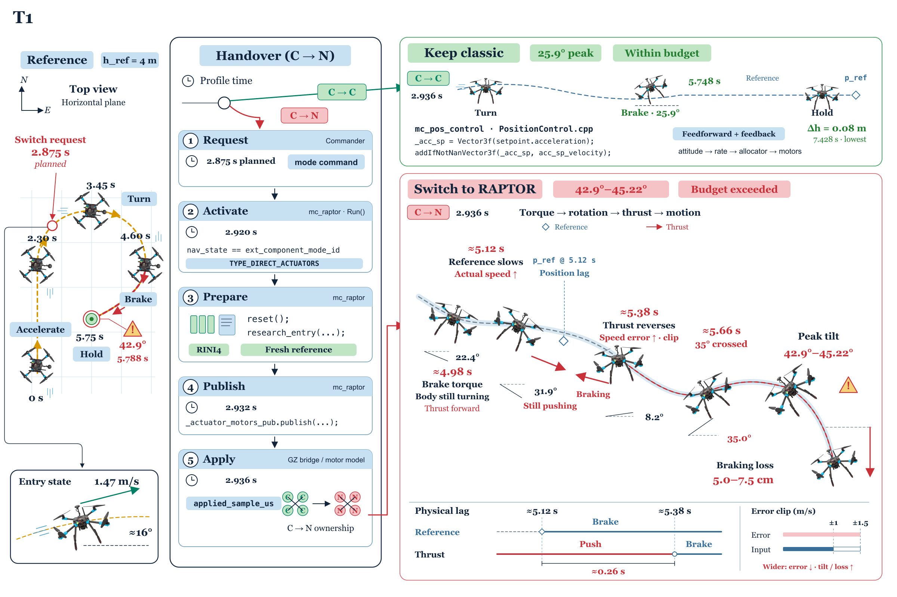

# T1 接管后安全余量不足

三次 x500 SITL 使用同一条时间放慢 1.15 倍的紧弯参考、同一构建、4 m 目标高度。C2 全程经典控制，N 在任务 2.875 s 请求 RAPTOR 接管，PRE 提前约 3 s 在悬停阶段进入 RAPTOR，再飞同一条轨迹。

1. N 在任务 2.920 s 激活，2.932 s 发布首条神经命令，2.936 s 四电机采用。入弯水平速度约 1.46 m/s，倾角约 16°。
2. 紧弯末段参考先开始减速，飞机仍以更大的速度沿弯道向前。N 在 5.384 s 进入目标坐标系第一轴速度误差裁剪，误差幅值最高达 1.326 m/s，网络输入限制为 1 m/s。
3. N 和 PRE 分别在 5.660 s 与 5.664 s 超过 35°。在各自越线前的两秒窗口，四台电机持续采用神经命令，参考持续更新。
4. N 和 PRE 在 5.788 s 与 5.792 s 达到倾角峰。提前交接组在同一刹停阶段达到近似峰值，三臂均完成落地。

| 控制臂 | 原生峰值倾角 | 轨迹起始后最大失高 |
| --- | ---: | ---: |
| C2 经典持续 | 25.895° | 5.30 cm |
| N 运动中接管 | 42.900° | 24.25 cm |
| PRE 提前进入 | 43.010° | 22.56 cm |

[三臂轨迹、时序、结果和执行脚本](../../evidence/t1/turn/)记录独立姿态话题峰值和四电机原生审计。[刹停数据及源码](../../evidence/t1/braking/)记录实际和参考速度、裁剪后的输入及四路发布命令。[构建身份与参考准备补丁](../../evidence/t1/build/)对应三臂实际使用的私有构建。
