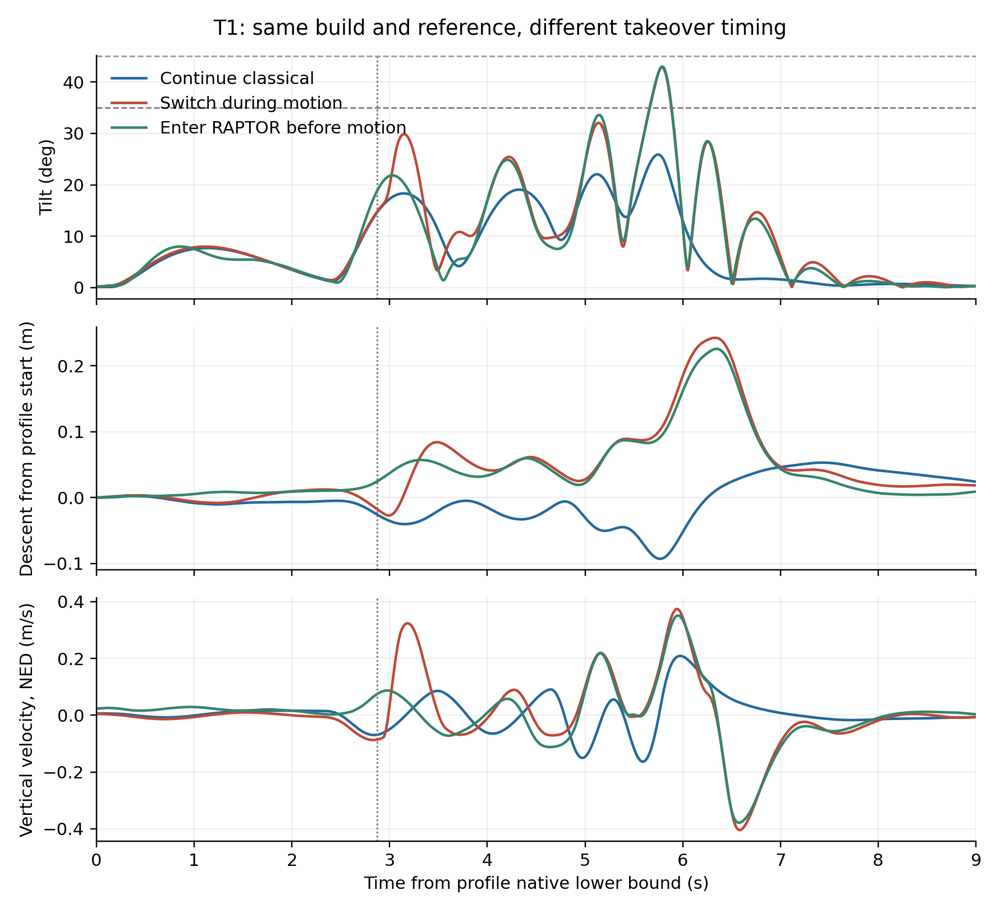

# T1：同构建三臂紧弯复核（2026-11-16）

## 结论
同一个 PX4 构建、同一条紧弯参考下，运动中切入 RAPTOR 和提前进入 RAPTOR 都在紧弯后段达到约 43°，经典控制为 25.89°。两个神经臂的峰值落在几乎相同的轨迹相位。这次补充把观察重点从“切入瞬间”推进到“接管后承担整段运动时的状态适用范围”：提前完成交接没有消除这段紧弯的倾角放大。

## 实验设计
三次独立 headless x500 SITL，seed20261110；目标高度 4 m，tight_turn_1p8 的时间乘 1.15、参考速度除以 1.15；正常准入、模式命令、清理及原保护均保留。RINI=4、RTGT=0、RREC=0、NCO=0。没有新增修复、随机种子或策略训练。

- C2：经典控制完成整条轨迹。
- N：在计划轨迹相位 2.875 s 请求经典→RAPTOR。
- PRE：在悬停阶段正常进入 RAPTOR，等待约 3 s，然后执行同一条轨迹。在 2.875 s 处只记标记，不再次切换。

三个臂使用同一已有 entry-ready 私有构建，二进制 SHA256：`185a608d2e9b4ee0cd98dd0f8fcc654f84b408d9775c331595b2e3c23f6580a4`。该构建保留最近 12 ms 内已验证参考的有效信息跨越 reset，正常参考有效性和超时检查仍在。旧档案使用的其他构建不混入本表。

## 结果
|臂|全轨迹最大倾角|峰值轨迹相位|标记后最大失高|轨迹开始后最大失高|首次超过 35° 的相位|
|---|---:|---:|---:|---:|---:|
|C2 继续经典|25.895°|5.748 s|0.0804 m|0.0530 m|无|
|N 运动中交接|42.900°|5.788 s|0.2612 m|0.2425 m|5.660 s|
|PRE 提前进入|43.010°|5.792 s|0.1994 m|0.2256 m|5.664 s|

35° 是本次沿用的实验倾角预算，45° 是沿用的运行保护阈值；两个神经臂超过前者，没有达到后者。本表不把 35° 写成 RAPTOR 固有安全边界。三臂都确认落地、disarm，PX4 和仿真退出，支持进程正常清理；没有把提前终止算成完成。三次物理启动约 259.0 s（C2 84.85、N 85.51、PRE 88.64 s），没有重跑。三份 ULog 均无 dropout，候选构建前后身份一致。

## 紧弯中的原生证据链
原生姿态显示，两神经臂在同一紧弯后段升高倾角：

|事件（轨迹相位）|N|PRE|
|---|---:|---:|
|第一轴速度误差开始进入输入裁剪|5.384 s|5.380 s|
|裁剪末次采样|5.696 s|5.708 s|
|连续裁剪样本数（125 Hz）|40|42|
|首次超过 35°|5.660 s|5.664 s|
|倾角峰值|5.788 s|5.792 s|

首末裁剪样本跨度为 0.312/0.328 s（按样本占据时长约 0.320/0.336 s）；首次裁剪时倾角仅约 8.02°/9.26°。裁剪在高倾角之前出现，是后续追踪输入表示与控制响应的具体切入点，不能把先后顺序直接写成“裁剪导致峰值”。

重建目标 yaw 坐标系速度误差，第一轴未裁剪峰值 1.326/1.348 m/s；实际网络输入在 ±1 m/s 截断。重建值与日志网络输入的最大差约 6e-8/1.2e-7。位置误差均未触及 ±0.5 m 输入裁剪，四个 executor action 没有达到 ±1 边界。输入排列及坐标变换应参照冻结源码 `src/lib/rl_tools/rl_tools/include/rl_tools/inference/applications/l2f/operations_generic.h:42–67`（位置 0–2、旋转矩阵 3–11、速度 12–14、角速度 15–17、动作历史 18–21）；这是网络输入裁剪，不是物理速度硬限制。

在完整已测轨迹的 active/native 样本中，N=1888、PRE=2252 行，stale 均为 0，最后有效读取参考的年龄最大 8 ms。这句话只覆盖所列 active/native 采样窗口，不外推为任意交接时刻绝无延迟。首次超过 35° 前两秒，两个神经臂各有 250 个原生推理步，四电机各 501 个物理应用采样，owner 均为神经、应用 sample identity 全部精确匹配，最大样本年龄 4 ms，原始电机文件无尾部残字节。因此后段倾角放大确实发生在参考持续更新、神经输出持续被四电机应用的过程中。

## 初态与时钟口径
`profile_lower_us` 是事件记录的 PX4 原生时间下界，不声称是连续时间精确轨迹起点。标记时间也是原生记录下界：C2/N/PRE 分别为 52.200/52.836/55.992 s，对应轨迹相位 2.892/2.884/2.892 s。PRE 标记不是接管时刻；其真实交接发生在轨迹开始之前。

C2 与 N 在标记处，位置差 0.145 m、速度差 0.051 m/s、姿态差 0.519°、角速度差 0.026 rad/s。位置差主要含独立启动的高度原点差（约 0.127 m），不能把绝对位置差全当作跟踪误差。N 与 PRE 标记处速度差 0.193 m/s、姿态差 4.452°、角速度差 0.187 rad/s，这是提前神经运行已改变运动状态的实际结果。本试验是相同参考任务的三种控制经历，不是同一个全状态快照的三路分叉。完整位置、速度、四元数、角速度和各字段年龄见 results.json。

PRE 继承的事件名称 `t1_continue_classic` 有文字歧义：该臂 MARK 分支只记事件，实际继续 RAPTOR。解释以执行源码和 owner/active 数据为准，不对已执行 runner 改名掩盖。

## 复核入口
- 执行与原始数据：Thor 本地保留的 `t1-triplet/` 原始目录（runner、配置、启动账本、结果、完整飞行证据）。
- 小型独立分析：[小型证据目录](../../evidence/handover-20261116/t1/)中的 `analyze.py`、`results.json`、三个 trajectory.csv、两个 native.csv、图和本报告。
- `three-arm-profile.pdf/png` 按共同轨迹相位展示；失高使用各臂同名基准，不混淆轨迹开始与交接标记。
- 原始 ULog SHA256、无丢包统计和四电机匹配统计均写入 results.json。分析在 Thor 完成，不修改原始飞行记录。

## 下一步最聚焦的问题
固定这个紧弯后段，检查速度误差裁剪前后的网络响应方向和恢复速度，拆开“状态进入了神经控制不擅长的区域”与“输入表示把不同误差压成同一值”的贡献。本轮已经获得一个可重复定位到轨迹相位的 T1 现象：经典控制保有更大倾角余量，而提前进入与运动中进入神经都在同一段消耗该余量。

### 补充：实际接管而不是粗粒度确认
`timing.py/json` 从原生 active 与四电机 sample identity 另行核实：N 首个 active/native 为 52.872 s，首个神经 actuator 为 52.884 s，四电机首个应用均为 52.888 s；PRE 分别为 49.800、49.812、49.816 s。PRE 实际 active 在轨迹开始下界之前 3.300 s，运动中 N 则在相位 2.920 s。这里的 active/native 不代替 nav_state 变化或 ACK 时刻；四电机应用是实际输出链的证据。

## 图

矢量版本：[轨迹相位图](../../evidence/handover-20261116/t1/three-arm-profile.pdf)、[交接标记图](../../evidence/handover-20261116/t1/three-arm-marker.pdf)。
