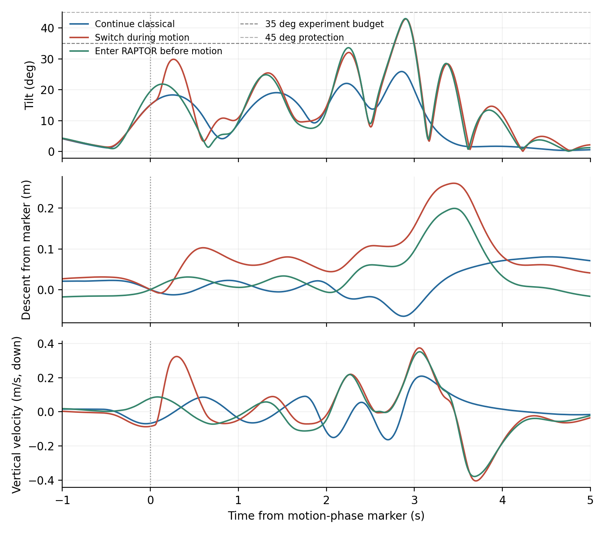
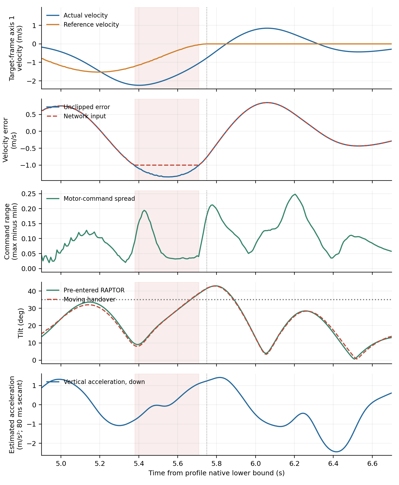
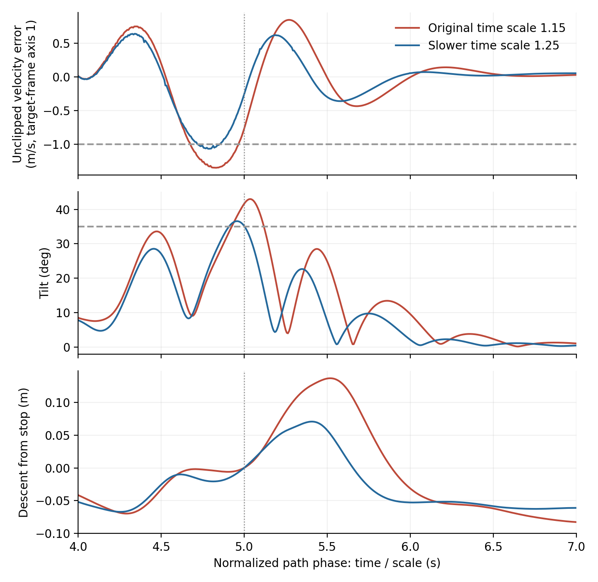
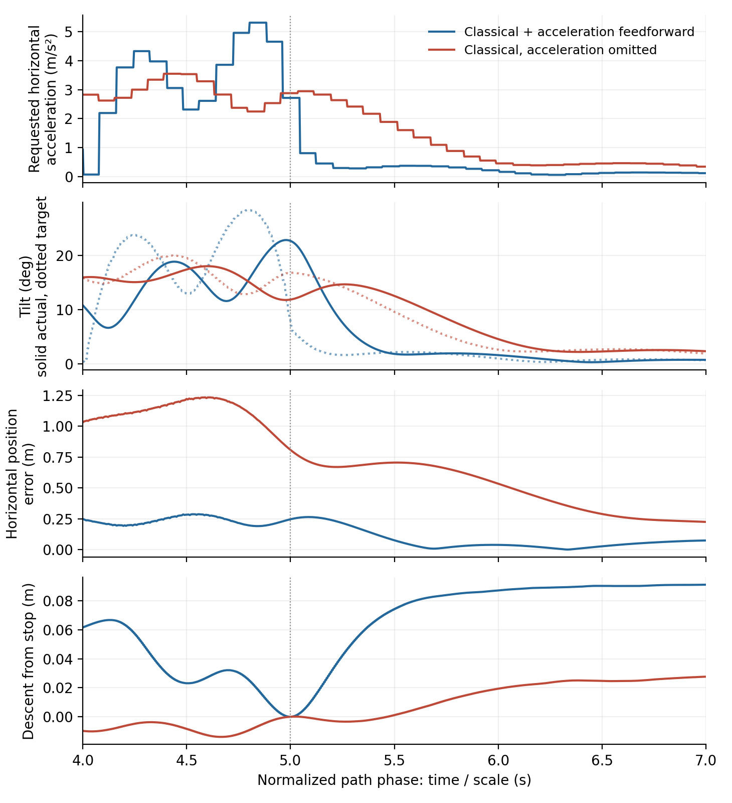

# T1：同构建三臂紧弯复核（2026-11-16）

## 结论
同一个 PX4 构建、同一条紧弯参考下，运动中切入 RAPTOR 和提前进入 RAPTOR 都在紧弯后段达到约 43°，经典控制为 25.89°。两个神经臂的峰值落在几乎相同的轨迹相位。这次补充把观察重点从“切入瞬间”推进到“接管后承担整段运动时的状态适用范围”：提前完成交接没有消除这段紧弯的倾角放大。

## 实验设计
三次独立 headless x500 SITL，seed20261110；目标高度 4 m，tight_turn_1p8 的时间乘 1.15、参考速度除以 1.15；正常准入、模式命令、清理及原保护均保留。RINI=4、RTGT=0、RREC=0、NCO=0。没有新增修复、随机种子或策略训练。

- C2：经典控制完成整条轨迹。
- N：在计划轨迹相位 2.875 s 请求经典→RAPTOR。
- PRE：在悬停阶段正常进入 RAPTOR，等待约 3 s，然后执行同一条轨迹。在 2.875 s 处只记标记，不再次切换。

三个臂使用同一已有 entry-ready 私有构建，二进制 SHA256：`185a608d2e9b4ee0cd98dd0f8fcc654f84b408d9775c331595b2e3c23f6580a4`。该构建保留最近 12 ms 内已验证参考的有效信息跨越 reset，正常参考有效性和超时检查仍在。旧档案使用的其他构建不混入本表。

## 结果
|臂|全轨迹最大倾角|峰值轨迹相位|标记后最大失高|轨迹开始后最大失高|首次超过 35° 的相位|
|---|---:|---:|---:|---:|---:|
|C2 继续经典|25.895°|5.748 s|0.0804 m|0.0530 m|无|
|N 运动中交接|42.900°|5.788 s|0.2612 m|0.2425 m|5.660 s|
|PRE 提前进入|43.010°|5.792 s|0.1994 m|0.2256 m|5.664 s|

35° 是本次沿用的实验倾角预算，45° 是沿用的运行保护阈值；两个神经臂超过前者，没有达到后者。本表不把 35° 写成 RAPTOR 固有安全边界。三臂都确认落地、disarm，PX4 和仿真退出，支持进程正常清理；没有把提前终止算成完成。三次物理启动约 259.0 s（C2 84.85、N 85.51、PRE 88.64 s），没有重跑。三份 ULog 均无 dropout，候选构建前后身份一致。

## 紧弯中的原生证据链
原生姿态显示，两神经臂在同一紧弯后段升高倾角：

|事件（轨迹相位）|N|PRE|
|---|---:|---:|
|第一轴速度误差开始进入输入裁剪|5.384 s|5.380 s|
|裁剪末次采样|5.696 s|5.708 s|
|连续裁剪样本数（125 Hz）|40|42|
|首次超过 35°|5.660 s|5.664 s|
|倾角峰值|5.788 s|5.792 s|

首末裁剪样本跨度为 0.312/0.328 s（按样本占据时长约 0.320/0.336 s）；首次裁剪时倾角仅约 8.02°/9.26°。裁剪在高倾角之前出现，是后续追踪输入表示与控制响应的具体切入点，不能把先后顺序直接写成“裁剪导致峰值”。

重建目标 yaw 坐标系速度误差，第一轴未裁剪峰值 1.326/1.348 m/s；实际网络输入在 ±1 m/s 截断。重建值与日志网络输入的最大差约 6e-8/1.2e-7。位置误差均未触及 ±0.5 m 输入裁剪，四个 executor action 没有达到 ±1 边界。输入排列及坐标变换应参照冻结源码 `src/lib/rl_tools/rl_tools/include/rl_tools/inference/applications/l2f/operations_generic.h:42–67`（位置 0–2、旋转矩阵 3–11、速度 12–14、角速度 15–17、动作历史 18–21）；这是网络输入裁剪，不是物理速度硬限制。

在完整已测轨迹的 active/native 样本中，N=1888、PRE=2252 行，stale 均为 0，最后有效读取参考的年龄最大 8 ms。这句话只覆盖所列 active/native 采样窗口，不外推为任意交接时刻绝无延迟。首次超过 35° 前两秒，两个神经臂各有 250 个原生推理步，四电机各 501 个物理应用采样，owner 均为神经、应用 sample identity 全部精确匹配，最大样本年龄 4 ms，原始电机文件无尾部残字节。因此后段倾角放大确实发生在参考持续更新、神经输出持续被四电机应用的过程中。

## 初态与时钟口径
`profile_lower_us` 是事件记录的 PX4 原生时间下界，不声称是连续时间精确轨迹起点。标记时间也是原生记录下界：C2/N/PRE 分别为 52.200/52.836/55.992 s，对应轨迹相位 2.892/2.884/2.892 s。PRE 标记不是接管时刻；其真实交接发生在轨迹开始之前。

C2 与 N 在标记处，位置差 0.145 m、速度差 0.051 m/s、姿态差 0.519°、角速度差 0.026 rad/s。位置差主要含独立启动的高度原点差（约 0.127 m），不能把绝对位置差全当作跟踪误差。N 与 PRE 标记处速度差 0.193 m/s、姿态差 4.452°、角速度差 0.187 rad/s，这是提前神经运行已改变运动状态的实际结果。本试验是相同参考任务的三种控制经历，不是同一个全状态快照的三路分叉。完整位置、速度、四元数、角速度和各字段年龄见 results.json。

PRE 继承的事件名称 `t1_continue_classic` 有文字歧义：该臂 MARK 分支只记事件，实际继续 RAPTOR。解释以执行源码和 owner/active 数据为准，不对已执行 runner 改名掩盖。

## 复核入口
- 执行与原始数据：Thor 本地保留的 `t1-triplet/` 原始目录（runner、配置、启动账本、结果、完整飞行证据）。
- 小型独立分析：[小型证据目录](../../evidence/handover-20261116/t1/)中的 `analyze.py`、`results.json`、三个 trajectory.csv、两个 native.csv、图和本报告。
- `three-arm-profile.pdf/png` 按共同轨迹相位展示；失高使用各臂同名基准，不混淆轨迹开始与交接标记。
- 原始 ULog SHA256、无丢包统计和四电机匹配统计均写入 results.json。分析在 Thor 完成，不修改原始飞行记录。

## 下一步最聚焦的问题
固定这个紧弯后段，检查速度误差裁剪前后的网络响应方向和恢复速度，拆开“状态进入了神经控制不擅长的区域”与“输入表示把不同误差压成同一值”的贡献。本轮已经获得一个可重复定位到轨迹相位的 T1 现象：经典控制保有更大倾角余量，而提前进入与运动中进入神经都在同一段消耗该余量。

### 补充：实际接管而不是粗粒度确认
`timing.py/json` 从原生 active 与四电机 sample identity 另行核实：N 首个 active/native 为 52.872 s，首个神经 actuator 为 52.884 s，四电机首个应用均为 52.888 s；PRE 分别为 49.800、49.812、49.816 s。PRE 实际 active 在轨迹开始下界之前 3.300 s，运动中 N 则在相位 2.920 s。这里的 active/native 不代替 nav_state 变化或 ACK 时刻；四电机应用是实际输出链的证据。

## 图

矢量版本：[轨迹相位图](../../evidence/handover-20261116/t1/three-arm-profile.pdf)、[交接标记图](../../evidence/handover-20261116/t1/three-arm-marker.pdf)。

---

## 2026-11-16 后续：末段运动响应与参考消费

# T1 后段动力学：从参考刹停到网络输入，再到倾角和失高

本报告只重读 2026-11-16 已完成的 N/PRE 原生记录，全部计算在 Thor，未改策略、日志、阈值或启动新仿真。本报告先做离线定位，再追加 q=1.25 单臂与经典前馈对照，完成结果见后续各节。

## 这次进一步定位了什么

后段不是目标 yaw 突变。N/PRE 的目标 yaw 全段分别恒定为 1.672740/1.674170 rad。两个神经臂都在最后一段刹停时，**参考已经减速，飞机仍保有较大同向速度**。网络收到的该方向误差达到裁剪区间；参考完全停止后，飞机倾角才到峰值，最低高度又晚约半秒出现。

这让“T1 适用状态”具体到了一个工程情形：**神经控制器接手并持续控制后，在紧弯转刹停的状态组合中，参考减速与实际运动之间产生较大误差，随后大倾角伴随高度余量消耗。** 提前进入神经也出现几乎相同的后段波形，和运动中交接特有的初始瞬态可分开讨论。

## 重建的链条

以下时间是 P11 原生记录时间相对于轨迹开始下界。姿态字段保存的是当步读取的姿态样本，因此表内峰值记录时间比独立 attitude 话题峰时约晚 4 ms；完整姿态话题的真实峰时仍以第一版报告 5.788/5.792 s 为准，不把不同消息的记录时间混为同一采样时刻。

|后段事件|N 运动中交接|PRE 提前进入|
|---|---|---|
|速度误差开始裁剪|5.384 s，倾角8.16°|5.380 s，倾角9.49°|
|当时实际/参考第一轴速度|-2.225 / -1.193 m/s|-2.230 / -1.210 m/s|
|误差幅值最大|5.544 s，-1.326 m/s|5.556 s，-1.348 m/s|
|对应网络输入|-1.000|-1.000|
|裁剪末次样本|5.696 s|5.708 s|
|参考停住|约5.750 s|约5.750 s|
|P11中峰值姿态记录|5.792 s，42.900°|5.796 s，43.010°|
|该时刻剩余第一轴速度|-0.387 m/s|-0.411 m/s|
|该时刻水平加速度估计|7.98 m/s²|8.07 m/s²|
|该时刻向下加速度估计|1.51 m/s²|1.39 m/s²|
|P11中最低高度记录|6.336 s|6.356 s|

加速度使用速度的 80 ms 中心割线，是离线派生量，不是加速度传感器或推力测量。其作用是展示“转向/刹停响应和高度响应的先后”，不是从单条曲线反推唯一力学原因。直接原生姿态和高度结果仍保留。

## 精确源码路径

冻结 `mc_raptor.cpp` 来自这次实际私有构建目录，SHA256 `bdfe28309380d3d6866f16e3086902d7ff4f2cabc06ee53ab20655c65e533289`；执行二进制 SHA256 `185a608d2e9b4ee0cd98dd0f8fcc654f84b408d9775c331595b2e3c23f6580a4`。不能将当前其他构建的行号直接套到此构建。

1. `mc_raptor.cpp:460–477`：记录本步实际状态、目标位置/速度及目标 yaw，形成 `research_p11` 的原始证据字段。
2. `:482–513`：目标 yaw 构造逆旋转，实际四元数转换到目标方向坐标系。
3. `:517–536`：实际减目标，NED 的 y/z 取反成为 FLU，再按目标 yaw 旋转；位置、速度误差分别裁剪。具体第一轴公式为 `cos(yaw)*(vx-vx_ref)+sin(yaw)*(vy-vy_ref)`。不是简单拿世界坐标 vx 作误差。
4. `mc_raptor.hpp:154–155`：位置误差范围 ±0.5 m，速度误差范围 ±1 m/s。该范围约束网络观测表示，不是飞机物理速度限制。
5. `src/lib/rl_tools/rl_tools/include/rl_tools/inference/applications/l2f/operations_generic.h:42–67,84–87`：观测展平，速度位于输入12–14，随后执行策略，将输出写回 action。
6. `mc_raptor.cpp:1254–1281`：action 用 `(action+1)/2` 映射为归一化电机指令，再按构型规则重排电机。
7. `:1284–1301`：active 与输出 gate 允许时发布 `actuator_motors`，同步发布 owner=1 与实际 control 值用于追溯。
8. `:1310–1316`：记录本步 active、native_step、executor_action 和实际 policy_input。

重建速度输入与实际日志的最大差为 N `6.72e-8`、PRE `1.09e-7`。因此这里的裁剪是由源码和逐步输入共同确认的实际计算行为，不是依据倾角推测。后段对应 actuator 数据均 owner=1，时间戳与 P11 同步（本窗口最大记录年龄0）；本轮图的 command 是发布指令，不冒充物理推力。四电机真实应用已在上一版 late-window identity 审计中单独验证。

## 图怎么读

`braking-input-response.pdf/png` 以 PRE 为主，叠加 N 的倾角：
- 第一行：实际与参考第一轴速度，看到参考先减速；
- 第二行：原始误差继续扩大，但网络输入停在 -1；
- 第三行：四个实际发布电机指令的极差，展示控制动作变化（极差不是力矩）；
- 第四行：两个神经臂的倾角，后段峰值几乎重合；
- 第五行：向下加速度估计，显示高度响应滞后。

粉色区是 PRE 原生裁剪样本区间，竖虚线是计划参考停止相位。控制输出没有到±1饱和，不能把“输入裁剪”写成“电机输出饱和”。

## 下一次只改一个量

选提前进入的 PRE，将时间尺度 q 从1.15改为1.25，保持同一路径、同样三秒准备、同样二进制及参考更新规则；时间节点乘q、速度除q。相对原例，参考速度降低8%，参考加速度需求降低15.36%。观察按 `t/q` 对齐同一轨迹相位，比较误差峰、裁剪时长、停住后的倾角与失高。

这次干预检验“同一路径的运动强度是否改变后段问题”，不修改clip，所以若改善，应归于时间尺度和它带来的运动条件变化，而不是声称已证明去掉裁剪就能解决问题。实验由统一队列执行，本报告不抢占仿真槽。

## 复算材料

本目录 `analyze.py`、`plot.py`、`summary.json`、N/PRE-dynamics.csv、source-manifest.json 和图。脚本默认读取同级 t1-triplet、t1-analysis；修改 B/R 输入路径即可在原始文件可用处复算。原始 ULog 哈希已在summary.json固定。没有丢弃原版独立姿态话题结果，新增分析是进一步追踪输入和控制数据流。

## 新定位：同一条消息，两种控制器消费的参考信息不同

这是一项预期的控制器架构差异，属于 T1 的任务/状态适用范围，不是 T3 的消息陈旧或接续失败。

发送端 `tools/handover_explore/runner.py:48–51` 同时发送位置、速度和加速度。经典 `MulticopterPositionControl.cpp:564` 将 `_setpoint` 交给位置控制；`PositionControl.cpp:102–108` 把 acceleration 保存为 `_acc_sp`，`:148–153` 将速度误差反馈叠加到该加速度前馈上，再生成姿态/推力要求。RAPTOR 的上述 observe 与22维输入没有 acceleration 分量，它接收同一个目标消息，但使用位置/速度误差等输入来响应。

这不是只查源码猜测：C2 在原生窗口 54.688–55.058 s 记录了76条实际接收到的 `trajectory_setpoint`，三轴 acceleration 全部有限，最大范数4.732 m/s²；此时位置控制开启、offboard开启、landed=0。同期3条已记录 `vehicle_local_position_setpoint` 的加速度输出全部有限，最大范数6.185 m/s²。发送日志三臂也都保存了相近的后段非零加速度（约4.732 m/s²）。具体计数、例值及时间在 `classic-acceleration-consumption.json` 和 `sent-reference-acceleration.json`。

由此可以明确说：**经典控制的这段运行有可用的加速度前馈，而神经网络不直接消费该前馈分量。相同消息接口并不意味着接手后获得相同参考信息。** 这为后段刹停响应差异给出了具体可测试的机制方向，和网络速度误差裁剪是两条需要分别处理的源码事实。当前观察不把其中任意一条单独宣称为43°峰值的唯一原因。

若后续做最小对照，应在温和时标下只把经典臂 acceleration 设成 NaN（表示未提供前馈），保持位置/速度、模式flags和路径不变；不要同时改神经策略或裁剪。该对照的后续执行结果见“最终补充”。

## 新实验已完成：只放慢相同路径

q=1.25 的 PRE 单次实验已完成，90.179 s，落地/disarm/进程退出，候选身份不变。相同的准备方式、神经策略与输出链，按归一化相位 t/q 对齐，终点均为相位5：

|量|q1.15|q1.25|
|---|---:|---:|
|末段最大倾角|43.010°|36.578°|
|峰值归一化相位|5.0365|4.9568|
|第一轴误差最大幅值|1.348 m/s|1.066 m/s|
|末段输入裁剪样本|42|20|
|裁剪首末样本跨度|0.328 s|0.152 s|
|停止相位后最大失高，相对停止时高度|0.1368 m|0.0707 m|
|停止后最低点，相对轨迹开始失高|0.2256 m|0.1338 m|

放慢轨迹后，峰值倾角降低6.43°，停点后失高约减半，误差越过网络输入边界的程度和持续时间也减小。二者仍超过35°实验预算，均未达到45°运行保护。结果支持**运动时间尺度会显著改变这段神经接管后的余量消耗**，没有把这次整体时标改变归因为单独“修复裁剪”。

原生证据核实：两例active/native profile均stale=0，最大参考年龄8ms；各自首次35°前两秒，四电机各501个物理应用样本全部owner=1、sample identity精确吻合、最大年龄4ms。两份ULog无dropout。

两例轨迹开始状态均接近悬停，但不是克隆快照：q1.15速度约[0.0125,-0.0033,0.0231]m/s，q1.25约[-0.0087,0.0132,-0.0035]m/s；位置原点分别约[-0.031,-0.037,-3.964]m和[-0.014,0.001,-3.905]m。报告比较相对各自停止点的失高，避免把高度原点差当成响应。

`retime.py`、`retime-summary.json`、两个retime.csv和`time-scale-comparison.pdf/png`保存这一补充。实际启动与配置位于`/tmp/handover3h-t1-retime-20261116/`，最终持久路径由执行总账链接。没有重跑此例。

## 最终补充：经典加速度前馈对照已完成

在同一 q=1.25、4 m、相同路径与 p/v/yaw、相同消息flags和原有保护下，运行两个全经典臂。FF 正常发送有限 acceleration；NOFF 只把 acceleration 三轴置 NaN，表示未提供前馈。没有修改 PX4，也没有给神经控制器注入此处理。两例均完整结束，FF/NOFF耗时86.712/86.625 s，落地disarm、进程退出、候选身份不变、ULog无dropout。本次T1追加共3次启动（q125 PRE加这两例），物理执行约263.52 s。

|后段量（归一化相位4–7）|经典 FF|经典 NOFF|
|---|---:|---:|
|最大倾角|22.897°|18.057°|
|控制器目标加速度最大范数|5.370 m/s²|3.560 m/s²|
|停止相位后最大失高|0.0911 m|0.0276 m|
|水平位置误差最大值|0.288 m|1.234 m|
|水平速度误差最大值|1.111 m/s|2.312 m/s|
|停止相位的水平位置误差|0.248 m|0.811 m|
|停止相位的实际水平速度|0.859 m/s|2.300 m/s|

**前馈确实改变了经典控制器的任务响应。** 去掉前馈后姿态动作更小，但实际飞行明显跟不上参考，停止点仍有较大速度和位置误差。这是有具体工程含义的响应差异：仅看最大倾角会把更弱的轨迹跟踪误读为更好的控制。神经臂的大倾角则不能简单归为“没用前馈”，应结合其实际误差编码、反馈响应与适用运动状态共同分析。

实际消息和持权核实：FF收到749条目标消息，共2247个有限加速度分量；NOFF收到745条，共2235个NaN分量。两臂classic position enabled=1、offboard=1、nav_state=14、raptor active=0、输出owner=2；后续经典控制器的目标加速度仍全部有限（FF38条/NOFF37条）。说明改动确实进入目标消费链，并且 NaN 没有被误当成异常电机输出。`feedforward-summary.json`保存这些计数。

初态分别接近静止悬停；独立启动造成原点和小速度差，FF/NOFF初速度约[0.0207,0.0176,0.0065]和[-0.0171,0.0105,-0.0002]m/s。完整初态存于摘要，不把独立启动写成状态克隆。接收/输出字段的同相位配对用最近的已记录样本；经典目标输出约10Hz记录，因此曲线用于展示时间趋势，不声称每个控制周期都直接记录到了。

`classic-feedforward-comparison.pdf/png` 同时呈现控制器目标加速度、目标/实际倾角、位置误差及失高。`feedforward.py`、`tracking.py`、`feedforward_plot.py`、两个摘要JSON与四个CSV可复核。原始数据由执行代理固定在 `extension/t1-feedforward`，不提交大体积ULog。

## 本轮得到的更具体表述

同一紧弯任务下，T1不只是“切入时状态激进”。它还表现为**接手后的控制器是否能以自己的输入表示和动态响应承担下一段运动**：提前进入神经仍在末段消耗较多姿态和高度余量；放慢同一路径明显改善；经典前馈消融则显示同一消息中被实际消费的信息会改变跟踪与动作强度。三项证据分别定位运动强度、神经输入表示和参考消费能力，已有具体源码和原生曲线支撑。

[本轮数字、源码快照和复核脚本](../../evidence/handover-20261116-extension/t1/)。

