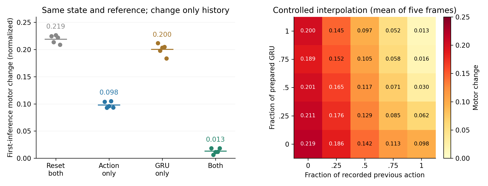
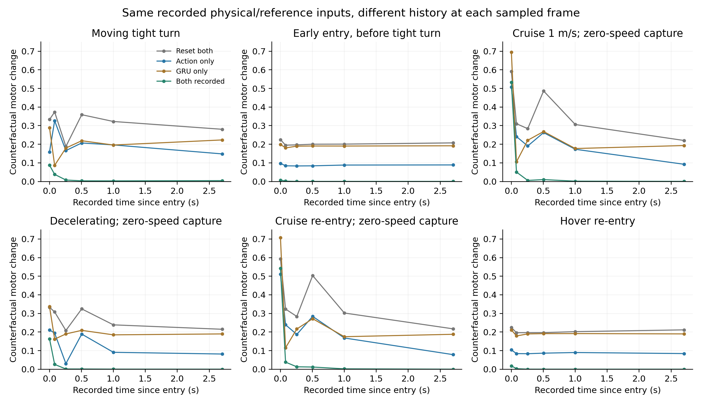

# T2：保存了 GRU，还必须接对上一动作

2026-11-16，全部新计算在 Thor（主机 `car`）进行。新做 20 次固定帧反事实推理和 125 次连续插值推理，无新增飞行；原日志、飞控、保护参数和冻结策略未改。

## 这轮直接回答的问题

将飞机状态、目标和时间固定，只改变 GRU 与上一动作，能否单独改变控制器第一轮输出？答案是能，而且两者配合很重要。

用 P4-01a 的五次 N2 悬停第二次接管帧，每帧分别计算：两项清零、只接真实上一动作、只接已准备 GRU、两项均接好。输入的其余 18 个分量逐值不变。`input-contract.json` 又从原始 ULog 核对：五帧 first-native 与 mode-entry 同时，四维策略 action-history 输入与进入时写入的 previous_action 完全相等（最大差 0）。

| 首轮历史处理 | 相对进入前动作的最大电机命令变化均值 | 五帧范围 |
|---|---:|---:|
| 两项清零 | 0.21907 | 0.20879–0.22631 |
| 只接上一动作 | 0.09816 | 0.09272–0.10511 |
| 只接准备好的 GRU | 0.20025 | 0.18348–0.21153 |
| 两项均接好 | 0.01324 | 0.00617–0.01843 |

五帧中两项均接好都最小。保持准备好的 GRU、只把上一动作变成 0，就使下一步 GRU 相对原轨迹偏移 0.637–0.643（16 维欧氏距离）。编码层输出变化约 1.09，重置门和更新门的向量变化分别约 0.213 与 0.112。也就是：**上一动作不仅直接影响本次电机输出，还会在第一轮更新中改变那份刚刚保留的历史。** 只保证 GRU 内容不被 reset，并不等于保证历史在随后的推理中延续。

## 程序链

本轮使用的 `p3_memory.py` SHA-256 为 `02b28fb626b46be3bece6db0d8a10b04b6fb49476cddea37368995299fdba578`，与 P4 冻结记录一致。网络是 Dense 22→16/ReLU、GRU 16、Dense 16→4。完整输入及中间量在 JSON 保存。

1. `research/state/MemoryInit.hpp:26–40`（当前固定读取副本）：根据处理模式，独立选择 GRU 与 previous_action；`mc_raptor.cpp:35–39` 写入正式/临时循环状态和上一动作。
2. `mc_raptor.cpp:42–64` 取经典发布命令并转换动作尺度，在非活动期间把它用于 teacher forcing；`:546` 将 previous_action 放入 observation。
3. `mc_raptor.cpp:95` 记录 executor 实际输入的全部 22 个值；`:1140` 调用网络控制；`:1189` 记录 native 推理结果。
4. 精确回放 `tools/p3_memory.py:32–37`：上一动作随输入经过 Dense/ReLU，与 GRU 共同进入 reset/update/candidate 三条计算，再得到新 GRU。输出用 `h_new @ W2.T + b2`，按动作顺序 0,2,3,1 映射四电机 `(clip(action,-1,1)+1)/2`。
5. 这轮 20 次推理没有动作裁剪。看到的变化来自输入/循环计算本身。

以上当前 mc_raptor.cpp 只用于解释仍相同的路径；为避免跨版本套行号，同时保留此次实际读取的源码副本和 SHA-256。历史飞行的输入和状态取自其原始 ULog，回放逐步核对，不假定当前源码就是当年构建。

## 连续插值补充

对每帧做 5×5 网格：GRU 和上一动作分别保留 0、25%、50%、75%、100%。五帧平均结果见 `T2-fixed-frame.pdf` 右图；上一动作越接近记录值，五个 GRU 保留水平的平均命令变化均下降。仅增加 GRU 保留比例并非处处单调：上一动作为 0 时，75% GRU 比 100% 的变化更小。这说明交接准备要看两项是否相容，不能只用“保留更多记忆”作为好坏判断。

## 与原飞行证据衔接

旧 P2 已有闭环分拆：S1a 比较 N0/N1/N2，S1b 比较 N0/N2g/N2s；S3 的一个批次具有完整 2×2。旧悬停第一条实际持权命令的 N2g 阶跃约 0.144，本次固定帧的 GRU-only 为 0.200，测量事件不同：本次是 mode-entry 的第一轮 native 推理，旧结果是发布持权变化时刻，期间可以经过更多计算。这轮用同一帧消除了入口差异，解释第一轮网络机制；原飞行仍负责说明实际电机及高度响应。

## 核对与复现

- 冻结策略 SHA-256：`5327c83dc57f094ca1977a2533ebce318645be010e16b9354c96c337cd5c278b`，五条日志 metadata 一致。
- 策略自带样例最大误差 6.915e-7；五条 armed-flight 日志共 40,738 个原生状态转移，逐步最大误差 5.912e-7，超过 1e-5 的步骤数为 0。
- 五条准备好帧的回放与原 GRU 最大误差均低于 2.7e-7。
- 指标是本次首轮推理生成的归一化命令相对记录上一动作的变化；不会把反事实命令称为物理执行过的飞行轨迹。
- 输入：`data/p4-20261016-a-D2-N2-{1,2,3,4,5}/flight.ulg`。输出均在独立 `<本轮 T2 输出>/`。
- 首次依赖探测用 miniconda Python，发现无 numpy；改用仓库已有 venv，没有安装依赖。计算约数秒级，零 SITL 启动。

## 本分支复核入口

数字与原生输入：[T2 小型证据](../../evidence/handover-20261116/t2/)。图：

PDF 版本可直接检查矢量线条与文字：[T2-fixed-frame.pdf](../../evidence/handover-20261116/t2/T2-fixed-frame.pdf)。

`source/` 保存本次读取的源码，行号均对应这些固定副本。`t2_fixed_frame.py` 接收 `--root`、`--policy`、`--output` 和五个原始运行目录；root 应指向保留历史工具与日志的实验仓库，而非本分支环境锚点。原始策略按 SHA-256 识别，不随证据发布。`t2_sensitivity.py` 和 `report.py` 是原样保存的本次运行脚本，路径仍标识当时工作目录；复算时在自己的隔离输出目录调整路径。全部运行脚本与数值原件保留，未因发布整理重新计算观测结果。

---

## 2026-11-16 后续：运动历史与闭环对照

# T2：历史接续从悬停扩展到运动状态

## 本轮做了什么
在 Thor 上使用同一个冻结策略，对六条真实飞行的六个接管入口及各入口后五个时刻做固定输入重放，共36个状态、144次单步推理。前18维物理状态与参考保持不变，只组合替换16维GRU历史和4维上一动作：全部清零、仅保留上一动作、仅保留GRU、两者都保留。后一种应复现真实原生输出。

六条飞行不是36次独立交接。偏移目标为0、80、250、500、1000、2700ms，实际采样时间写在results.json（8ms附近的原生周期）。后30个状态只是神经已持权时的历史替换，不称为新的真实交接。

## 首次接管的结果
数值是四个归一化电机命令中相对上一动作的最大绝对变化，不是L2。L2、共同推力变化、原始动作与裁剪数量均另存。

|场景|清零|仅上一动作|仅GRU|两者保留|
|---|---:|---:|---:|---:|
|运动紧弯，实际水平速度1.458m/s|.3330|.1588|.2892|.0873|
|紧弯前悬停进入|.2249|.0976|.1992|.0075|
|1m/s巡航后零速度捕获|.5913|.5079|.6948|.5337|
|减速中进入，.548m/s|.3333|.2114|.3364|.1635|
|巡航再进入，1.039m/s|.5937|.5106|.7077|.5418|
|悬停再进入|.2246|.1039|.2115|.0183|

运动紧弯中，保留实际上一动作后再恢复GRU，首步变化从.1588降至.0873；共同推力变化由-.1355降至-.0304。这里历史接续影响的不只是单个电机差，还包括四电机的共同下调。

巡航零速捕获的方向不同：仅保留上一动作的步长比完整历史小。该入口需要刹停，步长小不能自动解释为更安全。数据说明历史通过策略改变动作，但动作是否合理必须结合参考语义和随后飞行。两个巡航案例保留在表内，不按期待方向筛除。

在其余30个已进入神经的记录状态中，原样历史的步长均小于清零、仅动作、仅GRU三个替换。这表示篡改正在使用的历史会改变连续计算，而不是30次新接管的安全验证。

## 数据与代码链
`research/state/MemoryInit.hpp:10–22`定义模式及教师强制条件；26–40行执行入口写入。RINI2将GRU清零并装入实际经典上一动作；RINI4保留准备后的GRU并装入同一类实际动作。`mc_raptor.cpp`的经典动作采集、非活动期教师强制、入口写入、policy_input原生日志、网络推理和动作映射，见上一轮冻结source快照及主证据文档。

更细机制：上一动作进入策略输入的最后4维，先改变输入编码，再改变GRU的reset/update门及新历史；所以它与已有GRU不是互不影响的两项。运动紧弯入口，把上一动作置零但保留GRU，使输入编码L2变化1.1329、reset门.2164、update门.1172、新GRU .7017。仅把GRU清零则编码不变，reset门.2356、update门.4093、新GRU1.2508。完整向量与每帧门响应在results.json。

## 验证与真实成本
- 策略SHA256：5327c83dc57f094ca1977a2533ebce318645be010e16b9354c96c337cd5c278b。
- 六条轨迹43,940个armed原生GRU转移全部通过1e-5阈值，最大绝对误差5.801429e-7。
- 六个首次推理的输入上一动作与入口memory写入逐元素相同，真实模式均为4。
- 36个抽样原始推理经过实际clip后，匹配research_timing记录动作，最大绝对误差4.832586e-7。
- 首次动作核查先直接用未裁剪raw对比记录值，在巡航饱和案例报不一致；定位到记录为裁剪后值，按源码clip[-1,1]后全部吻合。保留原始与裁剪两种数据，未把差异当成控制器失配。
- 本报告仅新做Thor冻结策略重放，没有新增仿真启动。独立闭环补充对照如执行，另有t2-live账本，不与这144次推理混算。

## 阅读入口
`T2-motion-replay.pdf/png`为局部对比图；`summary.json`为精简数值；`results.json`包含每帧输入、GRU、门、原始及裁剪动作；`action-verification.json`是对原生日志动作验证；`manifest.json`记录原始日志身份；`replay.py`、`verify_actions.py`、`plot.py`为复核脚本。旧悬停125点网格见上一轮fixed-frame归档，其100/100相邻上一动作恢复步改善作为历史背景，本轮不重复计算。

结论：T2已有明确计算机制证据，并从悬停扩展到运动紧弯、减速和巡航。最值得继续看的是“历史与参考要求的相互作用”：恢复历史能减小紧弯的突降，也可能保留零速度捕获所需的较大刹停输出。

[本部分小型证据](../../evidence/handover-20261116-extension/t2/moving/)。

# T2 闭环补充：相同上一动作下，GRU准备影响运动交接

## 设计
两次实际、独立启动的x500 SITL飞行，同seed20261110、4m起飞、同0.6m/s慢直线轨迹，在轨迹第3秒正常进入RAPTOR。共享参考持续250Hz发送，采用已有entryready私有二进制，不改源码、策略或保护。唯一计划差异：N4使用RINI4（准备后的GRU＋实际经典上一动作）；N2使用RINI2（GRU清零＋实际经典上一动作）。这里N2是**本轮臂名RINI2**，不要与旧P2文献里N2表示RINI4混用。

首次神经推理两臂都已经读取本次连续轨迹，速度目标均[0.6,0,0]m/s，参考年龄0；不存在初始零速目标空窗。前2秒stale均0，最大参考年龄分别12/16ms。两臂初态差：位置8.90mm、速度向量0.01529m/s、姿态0.1570°、角速度向量0.01654rad/s。目标绝对位置随每次起飞origin略有变化，原始值完整保存在summary.json。

## 结果

|观察项|N4：准备GRU|N2：GRU清零|
|---|---:|---:|
|入口GRU L2|1.7370|0|
|首次原生推理映射命令相对经典的最大变化|0.01361|0.09911|
|首条实际发布神经电机命令的最大阶跃|0.02168|0.12972|
|首条神经命令四电机平均变化|-0.00662|-0.11375|
|前1秒最大失高|0.01332m|0.02633m|
|前1秒最大倾角|1.647°|1.452°|
|前2秒最大倾角|3.051°|2.501°|
|全主体窗最大失高|0.02426m|0.02781m|
|全主体窗最大倾角|3.051°|2.568°|

清零GRU产生约6倍的首条电机阶跃，更明显的四电机共同下调，前1秒失高约为准备历史的2倍。倾角没有随之变大，N2反而更小。这是一个**竖直推力接续瞬态**，不是这两次飞行发生姿态越界：不能把“历史有影响”简单等同于“所有指标同时恶化”。

曲线还能看到完整的“下陷再回弹”：N2平均命令从经典阶段0.72749，在入口后28ms降到0.56739，164ms回弹到0.76596；N4从0.73030仅降至0.71829（44ms），随后最高0.73088（184ms）。这说明历史清零改变了最初数个网络更新，而不仅是孤立一个采样点。

## 完整时间与作用链
源码`research/state/MemoryInit.hpp:21–22,26–40`定义非活动期教师强制和入口记忆写入。RINI2/4都从最新经典发布的四电机命令映射上一动作；RINI4另外保留准备后的16维GRU。`mc_raptor.cpp:35–39`写入GRU及临时GRU，42–53行读取owner2经典发布命令（新鲜度限50ms），55–64行非活动期教师强制，66–89行入口操作与日志。完整source依据既有冻结快照，策略哈希同前次固定帧报告。

两臂经典上一动作来源都与owner2实际发布的actuator_timestamp精确对应，年龄4ms，动作转换误差0。该来源是**发布命令**，不是物理电机回读。

- N4入口及首次原生推理52,492,000us；首条神经发布52,504,000us；四电机共同首次应用52,508,000us。
- N2入口及首次原生推理52,624,000us；首条神经发布52,636,000us；四电机共同首次应用52,640,000us。

四电机均通过Gazebo逐物理步日志核对applied_sample_us与神经发布身份，且无尾部残行。两臂应用均在入口后16ms。原生推理到发布之间还会更新输出，所以首原生动作与首发布电机命令不是同一个数值：最大差分别0.00806、0.07568。表中分开报告，未把推理输出直接当作实际电机应用。

## 验证、成本和复核
- N4：6,582个原生GRU转移全部通过，最大误差4.960e-7；首次原生动作误差2.543e-7。
- N2：6,530个原生GRU转移全部通过，最大误差4.362e-7；首次原生动作误差9.548e-8。
- 两臂原生entry_mode/result、GRU内容、上一动作、首参考有效性全部通过；无自动重跑。
- N4耗时85.0196秒，N2耗时85.0752秒。均正常完成，native final landed=true、arming_state=1（disarmed），清理无错误，冻结candidate未改变，结束后释放独占Gazebo槽。
- 主体观察窗分别为入口后14.976/14.972秒。物理结果来自原生轨迹，而非runner低频遥测。

`T2-live-pair.pdf/png`显示前2秒平均发布命令、倾角和失高。`summary.json`记录时钟、初态、参考、原生验证及四电机应用证据；`attempts.jsonl`为两次启动账本；`runner.py`和`experiment.sh`记录原样实验；`analyze.py`、`plot.py`及曲线CSV可复核。完整ULog与电机二进制保留在本地各臂flight目录，不应加入Git。

这组对照把T2从固定输入的网络输出证据推进到了实际闭环：在连续参考和正常运动入口下，仅GRU准备方式不同，已经能形成可观察的推力下降和短时失高差异。

[本部分小型证据](../../evidence/handover-20261116-extension/t2/live/)。

