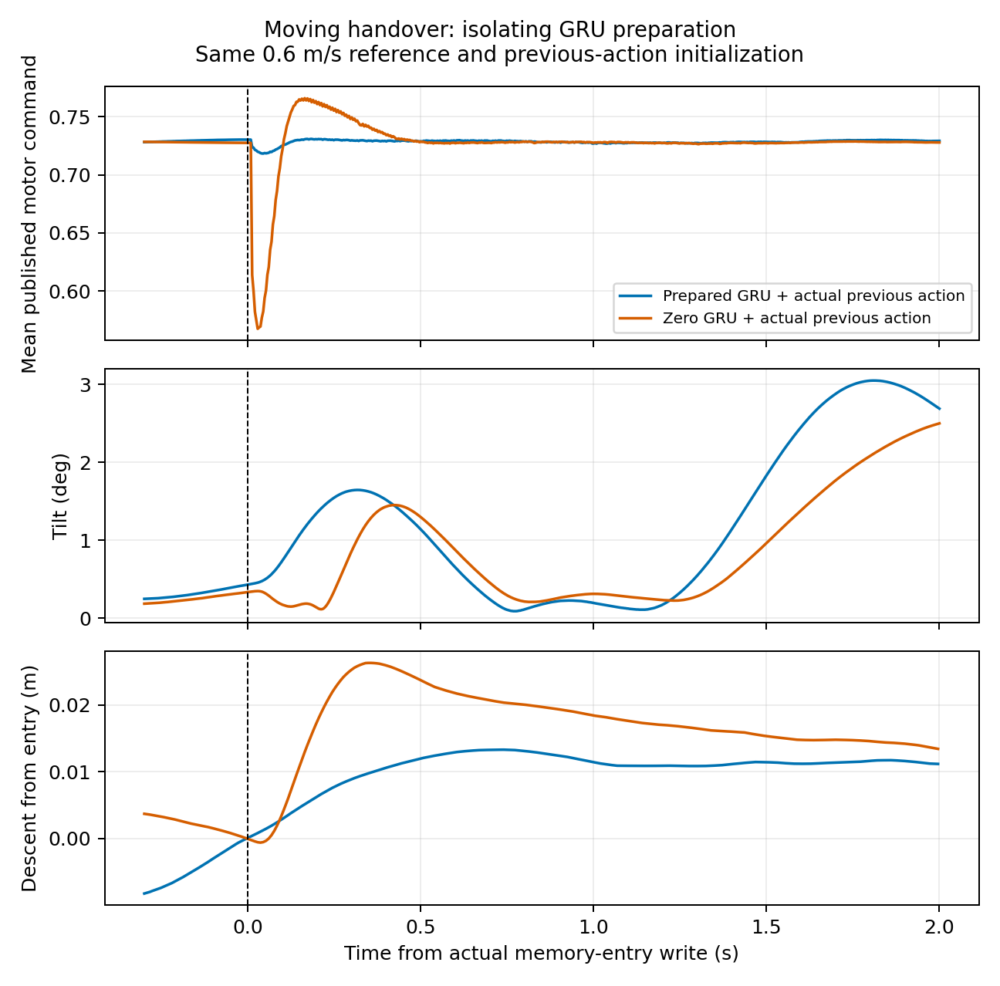

# T2 控制器历史状态接续错误

RAPTOR 的 22 维观测包含当下物理状态、参考信息以及上一拍动作。上一动作随观测进入编码层，16 维 GRU 历史参与门控和状态更新。两例比较都保留实际经典上一动作，观察入口 GRU 清零后的变化。

## 直线闭环

飞机在约 4 m 高度、以约 0.60 m/s 直线巡航，在任务 3.000 s 请求接管。准备组 N4 保留非活动阶段准备好的 GRU，N2 将它清零。两组均在激活后 12 ms 发布、16 ms 由四电机采用。N2 的四电机平均命令在激活后 28 ms 下探至 0.5674，164 ms 回升至 0.7660。

| 指标 | N4 保留 GRU | N2 清零 GRU |
| --- | ---: | ---: |
| 首条发布命令最大单电机阶跃 | 0.02168 | 0.12972 |
| 前 1 s 最大失高 | 1.33 cm | 2.63 cm |
| 前 2 s 峰值倾角 | 3.05° | 2.50° |

[配置、原生摘要、曲线及脚本](../../evidence/t2/straight/)记录两次闭环试验。

## 紧弯首帧回放

输入取自 [T1 的 N 臂](T1.md)，当时飞机以 1.46 m/s 进入紧弯。固定记录的物理状态、参考及上一动作，只切换 GRU 历史。清零组的最大单路归一化命令变化为 0.1588，保留组为 0.0873。首帧动作回放与原生日志的最大绝对误差约为 2.1×10⁻⁷。该项结果来自首帧推理；该飞行轨迹对应保留历史的一臂。

[本例的原生帧、动作和回放检查](../../evidence/t2/turn/)来自 [冻结回放](https://github.com/JacksonW1025/uav_handover/tree/141a2b31becee1a909e0d76f552b0724eb315f99/evidence/handover-20261116-extension/t2/moving)。[入口历史准备与推理参考源码](../../evidence/t2/source/)用于核对计算路径。
