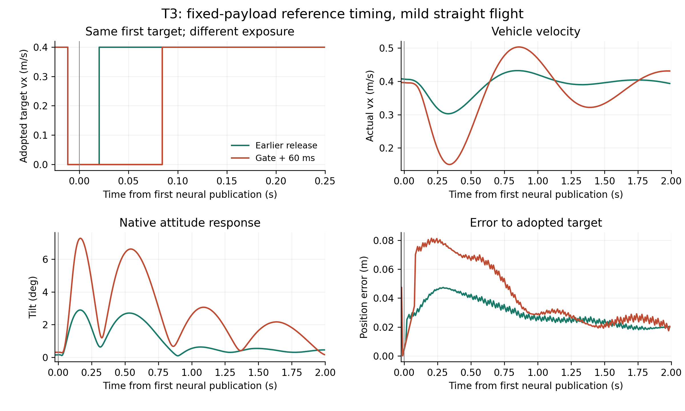

# T3：首条参考相同，接续等待如何改变飞机响应

2026-11-16，全部新飞行和原始轨迹计算在 Thor（hostname `car`）完成。本轮完成两次新 SITL，无重跑；另复算四条冻结 F1 记录。原始记录未修改。

## 结论

**同样的第一条参考，只是晚一点被神经控制器采用，飞机就会多执行一段零速度目标，随后出现更大的减速、反弹和倾斜。** 本轮轻缓直线飞行中，四电机接管到首次有效参考的间隔从 16 ms 增至 80 ms，倾角峰值从 2.89° 增至 7.28°，失高从 3.49 cm 增至 4.89 cm。两次均正常完成，未触发倾角等实验保护。这里观察到的是 T3 接续时序引起的响应放大，而不是新增越界案例。

这次最重要的补强：首条发送目标、实际接受目标和后续轨迹相位都被固定，拆开了旧 F1 中“等待时间”和“等待期间任务轨迹继续前进”两个因素。

## 两次飞行怎么做

相同 seed 20261110；经典控制先按 0.4 m/s 直线、4 m 高度飞行，在轨迹第 3 秒请求 RAPTOR。使用既有正常命令、ACK、active 确认及输出链。看到新 active 和神经输出实际发布后，等待既有安全发布门（发布样本后至少 8 ms），两臂分别再等 0 / 60 ms。

首条参考固定为位置 `[0.8,0,-4] m`、速度 `[0.4,0,0] m/s`、加速度零、yaw 96°、yawspeed 零；首发相位均为 3.0 s，之后按首发后的经过时间继续同一轨迹。第一条参考发送均晚于四个电机首次执行神经输出。原 reset 参数未改，未外推状态、未修改策略、未增加历史补偿。**本次经典前缀为 Offboard 轨迹跟踪（nav_state 14），不是 Mission 前缀。** 它是对既有 F1 参考接续机制的轻缓独立验证。

入口实际差异：位置 2.87 cm、速度 0.0173 m/s、姿态四元数角距离 0.321°、角速度差范数 0.0173 rad/s。逐轴值保留在 `flight-analysis/summary.json`。

## 结果

|项目|早接续|额外等 60 ms|
|---|---:|---:|
|四电机接管→首次有效参考|16 ms|80 ms|
|active→有效参考|32 ms|96 ms|
|首次参考前采用零速度目标的原生行数|4|12|
|这段速度误差平方积分（m²/s）|0.002648|0.007744|
|首个实际四电机阶跃 L2|0.4682|0.4756|
|接回参考时动作等价电机阶跃 L2|0.3709|0.3305|
|前 1 s 最大倾角|2.890°|7.278°|
|前 2 s 最大倾角|2.890°|7.278°|
|前 1 / 2 s 最大失高|0.03487 m|0.04888 m|
|前 200 ms 输入/动作裁剪边界计数|0 / 0|0 / 0|
|保护触发|无|无|
|落地、disarm、进程退出|全部确认|全部确认|

延迟臂的第一个电机阶跃几乎相同，接回参考时的瞬时阶跃还略小；更大的后续响应对应的是**错误目标持续更久**，而不是首次跳变更大。曲线可以直接看出：正常约 0.4 m/s 的前飞速度先被刹低，再回弹，延迟臂两种变化都更明显。该对照保持同一程序和固定 payload，用两个相近但非逐位相同的入口状态完成单次机制验证。

图横轴统一为首个神经动作发布时间。目标曲线来自原生网络实际输入，姿态来自原生 `vehicle_attitude`；不是低频遥测峰值。PDF 同名，可用于后续排版。

## 从代码到实际电机

源文件为 `uav_lab/.local/checkouts/px4-raptor/src/modules/mc_raptor/mc_raptor.cpp`（原始候选前后指纹相同）：

1. 713 行 activation 调用 reset；145–159 行 reset，包括 152 行清除有效参考时间标记。
2. 1053–1067 行在参考未就绪时捕获当前位置，并把目标速度置零；本轮原生日志确认首个神经动作和首个实际电机应用都处于该目标阶段。
3. 外部参考通过 DDS/uORB `trajectory_setpoint` 到达；829–838 行检查位置、速度、yaw、yawspeed 共八个有限值；854–857 行更新时间并完整接受目标。
4. 有效目标进入策略观测；1264–1270 行处理电机重排，1273–1278 行在 active 时发布 `actuator_motors`。审计以动作样本编号追踪到四个 Gazebo 电机 bin，而不是用模式名代替实际应用。
5. 本轮 runner 的 `fixed_phase_runner.py` 16–31 行是 owner-safe 发布时间门，35–44 行固定首发相位/后续时间，49–63 行保留正常模式命令和确认。

### 首条接受目标逐位核对

`audit_accepted_payload.py` 以 `research_p11.external_timestamp` 连接到唯一的 `trajectory_setpoint` 原始记录，再核对网络采用的目标。两臂第一条实际接受的八字段 float32 完全一致，字节 SHA-256 为 `a92a1e3f531275d19588ad6d0fddb31eb3f7a3576bf70ead4e6d1ba2d5018869`，并匹配计划及首次发送。加速度两臂发送均为零，但不属于上述八字段有限性门。

### 原生时钟时间线（微秒）

|事件|早接续|额外等 60 ms|
|---|---:|---:|
|请求前原生时间下界|52588000|52504000|
|active|52612000|52532000|
|首个神经发布|52624000|52544000|
|四电机首次应用|52628000|52548000|
|首条接受参考的源消息时间|52643226|52624157|
|首次有效读取参考|52644000|52628000|
|该有效参考样本被四电机应用|52648000|52632000|
|落地|71520000|71416000|
|disarm|73528000|73424000|

源消息时间使用 PX4 已转换的 `trajectory_setpoint.timestamp`，主结果间隔使用同一仿真微秒时钟。发送端记录另保留 host monotonic before/after；不直接拿 UTC 与仿真时间相减。ACK 原记录保留于 events；本表请求是下界，不伪装成精确收命令时刻。两臂四电机均于首神经发布后的 4 ms 应用该样本，并于有效参考读入后的 4 ms 应用对应样本。所有 motor 文件尾部完整、ULog dropout 为零。

## 旧 F1 四条轨迹复核

冻结输入来自 `data/handover-f1-sync-20261112-analysis-v1/f1-comparison.json`，SHA-256 `81f6dcb59541dc4e6667745194df25f54d2debb2888fc748194eac799e8843f8`。本轮仅重算，不算新飞行。

|旧案例|电机→有效参考 ms|零速度目标行数|速度误差平方积分|倾角峰值°|
|---|---:|---:|---:|---:|
|E2 repeat1|156|22|0.5540|55.28|
|E3 repeat1|16|4|0.1070|31.18|
|E3 repeat2|16|4|0.1054|30.29|
|E2 repeat2|168|23|0.5939|55.56|

四条记录恢复参考对应的动作均在下一物理步（+4 ms）被四电机实际应用。旧记录还显示更长错误目标暴露伴随更多输入裁剪；新轻缓对照在没有输入/动作裁剪时也出现响应放大，因而补出了更清楚的接续时间影响。

## 启动账本与成本

`data/handover-t3-fixedphase-20261116-v1/attempts.jsonl` 为原始账本。仅 `001_fixedphase_early-a1` 和 `002_fixedphase_delay60-a1` 两次启动，均 PASS，无补跑；总 wall 152.522 s，CPU 66.770 s。使用原始 binary，未用本轮 T1 的私有修改版本。两个 runner 候选前后完全相同，45° 倾角保护及既有落地/清理过程保留。先完成源代码/计划检查，再由唯一串行执行者启动；离线原始日志分析在飞行全部结束后执行。

冻结执行文件哈希：
- runner `72ba6f4ce953140fa7752eeefcc17c6e830ad47cdd1c59587e416932d8d4432d`
- plan `136a4f93facdf3b2729acddfa271e20bc2a34e5c8efc2bba2382fec8ca7f3044`
- launcher `25bb26ce3048393af51e18ae394b5fe5e65d0d0cb403cd74790c6274a0262d3a`

## 复核入口

- `flight-analysis/summary.json`：完整入口、时间线、执行成本、原始文件哈希、四电机样本链。
- `flight-analysis/accepted-payload.json`：首条接受目标逐位比较。
- `analyze_fixedphase.py`、`audit_accepted_payload.py`、`plot_fixedphase.py`：本轮原生分析与绘图脚本。
- `analysis/t3-recomputed.json`、`analysis/restore-application.json`：冻结 F1 四例复核。
- 新原始 ULog/motor/events 仍在 Thor `data/handover-t3-fixedphase-20261116-v1/`，不上传大体积日志。

下一步可用同一固定 payload 设计在已有较快入口复核，或把首条参考原子化交给接管路径，直接观察零目标阶段消失后的响应。本轮已完成轻缓、安全范围内的接续时序机制分离。

小型证据统一入口：[T3 数字、脚本与图](../../evidence/handover-20261116/t3/)。[矢量图 PDF](../../evidence/handover-20261116/t3/flight-analysis/fixedphase-mechanism.pdf)。

---

## 2026-11-16 后续实验

# T3 延伸：相近等待下，空窗期间采用什么目标很重要

2026-11-16，Thor（car），两次新轻缓 SITL。前一组固定参考、改变等待，已观察到更长空窗放大运动响应。这一组固定等待设定，改变空窗期间的 fallback 目标语义，进一步定位原因。

## 发现

**参考尚未接上时，让目标从当前运动速度平滑减速，而不是立即变成零速度，可以减轻接管的刹停、反弹和倾斜。** 相同 +60 ms 发布等待设置下，实际四电机接管到有效参考分别为 76 / 72 ms；默认零速度捕获的倾角峰值 6.27°，速度匹配捕获为 3.16°。前者沿前进方向先降到 0.209 m/s、后反弹到 0.493 m/s，后者相应为 0.271 / 0.439 m/s。两条飞行均安全完成，没有触发实验保护。

该结果与上一组形成互补：接续问题既取决于错误目标持续多久，也取决于空窗中控制器被要求做什么。

## 实验只改了什么

使用上一组同一冻结 runner（SHA-256 `72ba6f4ce953140fa7752eeefcc17c6e830ad47cdd1c59587e416932d8d4432d`），未修改 PX4、策略、模式准入、ACK 或保护。独立 batch `data/handover-t3-semantics-20261116-v1`，同 seed 20261110、4 m 高度、0.4 m/s 直线，经典 Offboard 前缀（不是 Mission）。

两臂配置唯一差异为 `MC_RAPTOR_RTGT=0/1`：

- 0：activation 时捕获当前位置，目标速度设为零。
- 1：activation 时捕获当前水平速度，按原有 `MC_RAPTOR_RTDEC=2 m/s²` 减速，目标位置按该速度积分前进；目标竖直速度为零。外部参考有效时立即结束该 fallback profile。

所以这是**整个 fallback 目标接续语义**的对照，不是仅改一个速度字段。reset/history、RREC、NCO 等参数不变。首发都等 fresh active、神经输出被观察到后至少 8 ms，再加 60 ms；第一条外部参考相位都为 3 s，之后按释放后的时间继续。

首条发送及实际接受目标逐位相同：p `[0.8,0,-4]` m，v `[0.4,0,0]` m/s，yaw 96°，yawspeed 0，加速度均发送零。八个被 RAPTOR 检查的接受字段 float32 字节 SHA-256 均为 `a92a1e3f531275d19588ad6d0fddb31eb3f7a3576bf70ead4e6d1ba2d5018869`。

## 实际结果

|量|默认零速度捕获|速度匹配减速捕获|
|---|---:|---:|
|四电机接管→首次有效参考|76 ms|72 ms|
|有效参考前原生采样行数|12|11|
|该段速度误差平方积分 m²/s|0.007793|0.000612|
|首个神经动作采用的目标 vx|0|0.3679 m/s|
|首个实际四电机阶跃 L2|0.4534|0.3767|
|外部参考接回时目标速度跳变量|0.4000|0.1769 m/s|
|接回参考动作等价电机阶跃 L2|0.2989|0.1170|
|前 1 / 2 s 最大倾角|6.271°|3.160°|
|前 1 / 2 s 最大失高|4.507 cm|4.365 cm|
|前 2 s 最低 vx|0.2092|0.2714 m/s|
|前 2 s 最高 vx|0.4934|0.4391 m/s|
|前 200 ms 输入/动作裁剪边界计数|0 / 0|0 / 0|

倾角约减半，空窗速度误差平方积分降低 92.1%；高度变化基本相近。实际等待差 4 ms 如实保留；入口差异为位置 2.58 cm、速度 0.0320 m/s、姿态角距离 0.200°、角速度差范数 0.0139 rad/s。

PDF 同名；原生目标位置/速度全量片段另见 `*-target-native.csv`，图非低频遥测。

## 源码与数据流如何对应

基于本轮候选源码 `uav_lab/.local/checkouts/px4-raptor/src/modules/mc_raptor/mc_raptor.cpp`：

1. 713 行 reset 后，1053–1067 行因目标未就绪捕获当前位置和零速度，并调用研究目标捕获钩子。
2. 1402–1420 行读取 RTGT / RTDEC 和当前位置、速度；1421–1427 行仅 RTGT1 的 activation 执行速度匹配 profile。
3. `src/lib/handover_research/TargetProfile.hpp` 17–18 行选择模式；26–34 行捕获水平速度；38–46 行使用 `v=v0−a·t`、`p=p0+v0·t−a·t²/2`（停止后保持）生成目标，不改控制器隐藏历史。
4. `mc_raptor.cpp` 1433–1442 行逐周期更新目标。当有效外部参考使 stale=false 时，1435–1438 行结束 profile，记录 `END_EXTERNAL_SETPOINT`。
5. 829–857 行接受外部 `trajectory_setpoint` 后，目标进入原有网络；1264–1278 行动作重排并发布电机。用 research_p11 原生目标、research_target capture/profile/end 和四路 motor bin 闭合数据流。

速度匹配臂原生捕获于 52520000 µs，捕获速度 `[0.3838026,0.0407579,-0.0055502] m/s`，profile 只取其水平分量。首神经动作发布于 52528000 µs，目标 vx 已按减速规则成为 0.3678920 m/s。于 52604000 µs 首次有效读取外部参考，同时出现 `KIND_END / END_EXTERNAL_SETPOINT`，目标变为固定 p/v。这个结束时刻来自真实 topic，不是推测。

|原生仿真时刻 µs|默认零速度|速度匹配|
|---|---:|---:|
|activation|52588000|52520000|
|首次神经动作发布|52600000|52528000|
|四电机首次实际应用|52604000|52532000|
|首次有效参考读取|52680000|52604000|

四电机实际应用和第一条接受参考逐条审计见 summary 与 accepted-payload。两个 ULog dropout 均零；motor bin 无尾部残缺。请求/发送 host monotonic 与原生仿真时钟分开保存，不跨时钟直接相减。

## 成本与收尾

共两次物理启动，每臂 a1 一次，无重跑。wall 76.172 + 76.105 = 152.277 s；CPU 33.246 + 33.282 = 66.529 s。两条结果 PASS、候选代码前后不变、cleanup_error=null。原生落地时刻 71408000 / 71332000 µs，disarm 73420000 / 73348000 µs，Gazebo/PX4/agent 进程均已退出，然后才释放独占槽给下一实验。

仍采用原有 45° 倾角等保护，没有保护触发，也未为了制造越界放宽限制。旧实验和旧报告保留。这是新增目标语义对照，不修改上一组固定参数结果。

## 复核入口

- `flight-plan.json`、`fixed_phase_runner.py`、`experiment.sh`：实际冻结执行文件。
- `flight-analysis/summary.json`：入口、时序、四电机样本链、成本及原始文件哈希。
- `flight-analysis/accepted-payload.json`：两臂首条真正采用目标的精确等同性。
- `flight-analysis/profile-audit.json`：capture/profile/end 及速度上下冲。
- `analyze_fixedphase.py`、`audit_accepted_payload.py`、`audit_profile.py`、`plot_fixedphase.py`：原生复算与绘图。
- 原始 ULog、motor bin、events 和启动账本保留 Thor 的上述独立 batch，不提交大体积原始日志。

本轮[小型证据、原始报告与脚本](../../evidence/handover-20261116-extension/t3/)。
