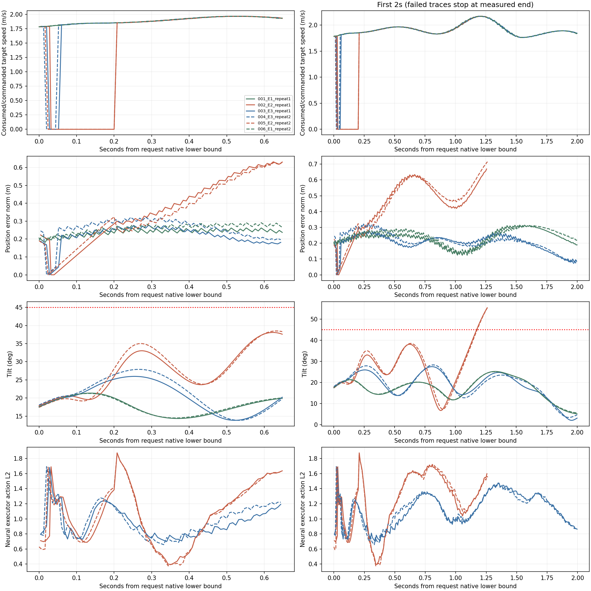

# T3 Setpoint 参考接续异常

RAPTOR 激活时会重置参考有效标记。短暂空窗里，控制器捕获当前位置和偏航、将目标速度置零。外部参考重新被读取后，控制器回到运动轨迹跟踪，飞机先制动再追赶。

## 直线固定首条参考

两次 SITL 都在 4 m 高度以约 0.40 m/s 平飞，在任务 3.000 s 请求切换。激活后 12 ms 发布首条神经命令，16 ms 四电机采用，此时目标速度为零。短、长两臂分别在激活后 32、96 ms 读到数值和相位相同的首条移动参考。

| 指标 | 短空窗 | 长空窗 |
| --- | ---: | ---: |
| 四电机接管到参考读入 | 16 ms | 80 ms |
| 实测峰值倾角 | 2.89° | 7.28° |
| 最大失高 | 3.49 cm | 4.89 cm |

长空窗组刹得更深，接回参考后的速度反弹也更大。两臂都完成落地。[直线完整数据、计划和分析脚本](../../evidence/t3/straight/)。 两臂的[原始 PX4 ULog 和校验值](../../evidence/t3/straight/RAW-ULOG.md)单独列出。

## 转弯按任务时钟恢复

固定三维紧弯同时包含高度和偏航变化。任务 2.750 s 请求交接，RAPTOR 在外部参考读入前按零速度目标控制。以原等待的第二次为例，参考在激活后 184 ms 读入，距四电机首次采用已过去 168 ms。飞机随后加速追赶并甩到弯外，最终在大倾角纠偏时触发保护。

| 对照 | 四电机接管至有效参考（两次） | 峰值倾角（两次） | 试验结果 |
| --- | --- | --- | --- |
| E1 持续经典 | — | 25.23° / 25.11° | 完成落地 |
| E2 原等待 | 156 / 168 ms | 55.28° / 55.56° | 保护中止 |
| E3 提前恢复 | 16 / 16 ms | 31.18° / 30.29° | 完成落地 |

恢复目标沿同一条绝对时间参考计算，E2/E3 首次读入参考时对应的任务相位随等待时长变化。[六次原生轨迹、完整对照和复算脚本](../../evidence/t3/turn/)同时保留这两种等待与经典对照。 第一轮三臂的[原始 PX4 ULog 和校验值](../../evidence/t3/turn/RAW-ULOG.md)单独列出。

