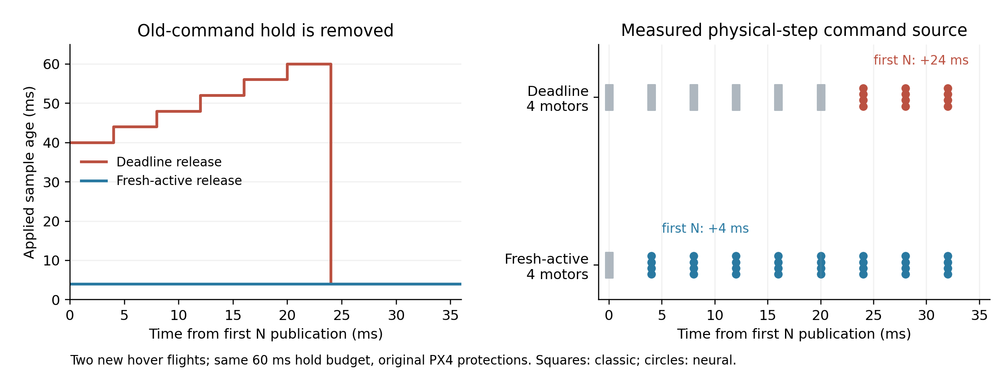

# T4 控制权实际交付异常

两次 x500 SITL 悬停使用相同的 60 ms relay 暂存预算。截止释放组等暂存窗口结束，提前释放组允许在收到新的 RAPTOR active 通知后提前解除暂存。这里的观察对象是四电机采用的样本及来源。

1. 截止释放组在 51.328 s 发布第一条神经命令。直到 51.348 s 的物理步，四电机仍使用旧经典样本。
2. 最早四条神经样本在 relay 的最新值槽被后继样本覆盖。另一条被转发后，又在电机应用前被更新的样本覆盖。
3. 51.352 s 四电机共同采用第六条神经样本。提前释放组在首条神经命令发出前恢复透传，于 51.352 s 采用首条神经样本。

| 观测 | 截止时刻释放 | 按 active 通知提前释放 |
| --- | ---: | ---: |
| 首次神经命令发布到四电机实际应用 | 24 ms | 4 ms |
| 四电机实际采用的第一条神经样本 | 第六条 | 首条 |
| 悬停段峰值倾角 | 1.29° | 1.73° |

两次均正常落地。时序使用 PX4/Gazebo 原生仿真时钟，发布动作、转发与四路物理步采用分别核对。

[悬停配对的方案、实际脚本和证据](../../evidence/t4/hover/)包含 [逐条样本去向](../../evidence/t4/hover/sample-accounting.json)与[原始数据审计](../../evidence/t4/hover/raw-audit.json)。
