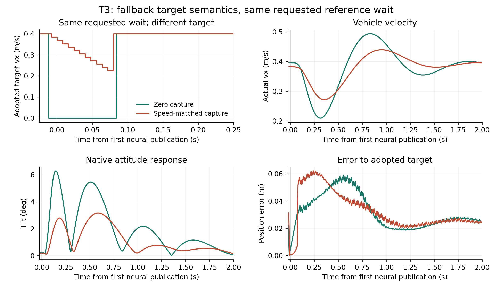

# T3 延伸：相近等待下，空窗期间采用什么目标很重要

2026-11-16，Thor（car），两次新轻缓 SITL。前一组固定参考、改变等待，已观察到更长空窗放大运动响应。这一组固定等待设定，改变空窗期间的 fallback 目标语义，进一步定位原因。

## 发现

**参考尚未接上时，让目标从当前运动速度平滑减速，而不是立即变成零速度，可以减轻接管的刹停、反弹和倾斜。** 相同 +60 ms 发布等待设置下，实际四电机接管到有效参考分别为 76 / 72 ms；默认零速度捕获的倾角峰值 6.27°，速度匹配捕获为 3.16°。前者沿前进方向先降到 0.209 m/s、后反弹到 0.493 m/s，后者相应为 0.271 / 0.439 m/s。两条飞行均安全完成，没有触发实验保护。

该结果与上一组形成互补：接续问题既取决于错误目标持续多久，也取决于空窗中控制器被要求做什么。

## 实验只改了什么

使用上一组同一冻结 runner（SHA-256 `72ba6f4ce953140fa7752eeefcc17c6e830ad47cdd1c59587e416932d8d4432d`），未修改 PX4、策略、模式准入、ACK 或保护。独立 batch `data/handover-t3-semantics-20261116-v1`，同 seed 20261110、4 m 高度、0.4 m/s 直线，经典 Offboard 前缀（不是 Mission）。

两臂配置唯一差异为 `MC_RAPTOR_RTGT=0/1`：

- 0：activation 时捕获当前位置，目标速度设为零。
- 1：activation 时捕获当前水平速度，按原有 `MC_RAPTOR_RTDEC=2 m/s²` 减速，目标位置按该速度积分前进；目标竖直速度为零。外部参考有效时立即结束该 fallback profile。

所以这是**整个 fallback 目标接续语义**的对照，不是仅改一个速度字段。reset/history、RREC、NCO 等参数不变。首发都等 fresh active、神经输出被观察到后至少 8 ms，再加 60 ms；第一条外部参考相位都为 3 s，之后按释放后的时间继续。

首条发送及实际接受目标逐位相同：p `[0.8,0,-4]` m，v `[0.4,0,0]` m/s，yaw 96°，yawspeed 0，加速度均发送零。八个被 RAPTOR 检查的接受字段 float32 字节 SHA-256 均为 `a92a1e3f531275d19588ad6d0fddb31eb3f7a3576bf70ead4e6d1ba2d5018869`。

## 实际结果

|量|默认零速度捕获|速度匹配减速捕获|
|---|---:|---:|
|四电机接管→首次有效参考|76 ms|72 ms|
|有效参考前原生采样行数|12|11|
|该段速度误差平方积分 m²/s|0.007793|0.000612|
|首个神经动作采用的目标 vx|0|0.3679 m/s|
|首个实际四电机阶跃 L2|0.4534|0.3767|
|外部参考接回时目标速度跳变量|0.4000|0.1769 m/s|
|接回参考动作等价电机阶跃 L2|0.2989|0.1170|
|前 1 / 2 s 最大倾角|6.271°|3.160°|
|前 1 / 2 s 最大失高|4.507 cm|4.365 cm|
|前 2 s 最低 vx|0.2092|0.2714 m/s|
|前 2 s 最高 vx|0.4934|0.4391 m/s|
|前 200 ms 输入/动作裁剪边界计数|0 / 0|0 / 0|

倾角约减半，空窗速度误差平方积分降低 92.1%；高度变化基本相近。实际等待差 4 ms 如实保留；入口差异为位置 2.58 cm、速度 0.0320 m/s、姿态角距离 0.200°、角速度差范数 0.0139 rad/s。

PDF 同名；原生目标位置/速度全量片段另见 `*-target-native.csv`，图非低频遥测。

## 源码与数据流如何对应

基于本轮候选源码 `uav_lab/.local/checkouts/px4-raptor/src/modules/mc_raptor/mc_raptor.cpp`：

1. 713 行 reset 后，1053–1067 行因目标未就绪捕获当前位置和零速度，并调用研究目标捕获钩子。
2. 1402–1420 行读取 RTGT / RTDEC 和当前位置、速度；1421–1427 行仅 RTGT1 的 activation 执行速度匹配 profile。
3. `src/lib/handover_research/TargetProfile.hpp` 17–18 行选择模式；26–34 行捕获水平速度；38–46 行使用 `v=v0−a·t`、`p=p0+v0·t−a·t²/2`（停止后保持）生成目标，不改控制器隐藏历史。
4. `mc_raptor.cpp` 1433–1442 行逐周期更新目标。当有效外部参考使 stale=false 时，1435–1438 行结束 profile，记录 `END_EXTERNAL_SETPOINT`。
5. 829–857 行接受外部 `trajectory_setpoint` 后，目标进入原有网络；1264–1278 行动作重排并发布电机。用 research_p11 原生目标、research_target capture/profile/end 和四路 motor bin 闭合数据流。

速度匹配臂原生捕获于 52520000 µs，捕获速度 `[0.3838026,0.0407579,-0.0055502] m/s`，profile 只取其水平分量。首神经动作发布于 52528000 µs，目标 vx 已按减速规则成为 0.3678920 m/s。于 52604000 µs 首次有效读取外部参考，同时出现 `KIND_END / END_EXTERNAL_SETPOINT`，目标变为固定 p/v。这个结束时刻来自真实 topic，不是推测。

|原生仿真时刻 µs|默认零速度|速度匹配|
|---|---:|---:|
|activation|52588000|52520000|
|首次神经动作发布|52600000|52528000|
|四电机首次实际应用|52604000|52532000|
|首次有效参考读取|52680000|52604000|

四电机实际应用和第一条接受参考逐条审计见 summary 与 accepted-payload。两个 ULog dropout 均零；motor bin 无尾部残缺。请求/发送 host monotonic 与原生仿真时钟分开保存，不跨时钟直接相减。

## 成本与收尾

共两次物理启动，每臂 a1 一次，无重跑。wall 76.172 + 76.105 = 152.277 s；CPU 33.246 + 33.282 = 66.529 s。两条结果 PASS、候选代码前后不变、cleanup_error=null。原生落地时刻 71408000 / 71332000 µs，disarm 73420000 / 73348000 µs，Gazebo/PX4/agent 进程均已退出，然后才释放独占槽给下一实验。

仍采用原有 45° 倾角等保护，没有保护触发，也未为了制造越界放宽限制。旧实验和旧报告保留。这是新增目标语义对照，不修改上一组固定参数结果。

## 复核入口

- `flight-plan.json`、`fixed_phase_runner.py`、`experiment.sh`：实际冻结执行文件。
- `flight-analysis/summary.json`：入口、时序、四电机样本链、成本及原始文件哈希。
- `flight-analysis/accepted-payload.json`：两臂首条真正采用目标的精确等同性。
- `flight-analysis/profile-audit.json`：capture/profile/end 及速度上下冲。
- `analyze_fixedphase.py`、`audit_accepted_payload.py`、`audit_profile.py`、`plot_fixedphase.py`：原生复算与绘图。
- 原始 ULog、motor bin、events 和启动账本保留 Thor 的上述独立 batch，不提交大体积原始日志。
